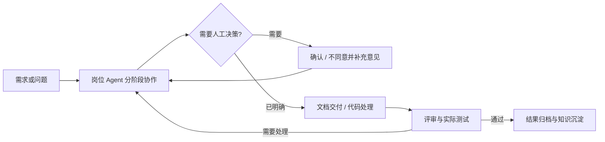

# DAP · Dev Agent Platform

**让不同岗位的 AI Agent 参与软件研发，通过人工确认、文档交付和实际测试推进工作。**

DAP 是一个面向软件研发流程的多租户协作平台，将需求管理、问题修复、AI 工作台、公共知识库、代码评审和 Docker 沙箱放在同一条流程中，使需求、设计、代码与测试结果可以相互追溯。

Agent 参考实际研发分工：产品关注业务与验收，架构关注边界与技术决策，研发关注实现与根因，测试关注覆盖与验证。各岗位使用不同提示词，共享材料与确认协议；需要人作决定时暂停，收到意见后继续执行。

当前仓库提供本地开发与验证方式，一键启动和沙箱镜像构建脚本面向 **Windows / PowerShell**。其他系统需分别启动各模块，并适配沙箱构建过程。

## 核心能力

- **需求与问题管理**：管理产品、版本、需求审批、研发任务和问题修复，记录状态流转。
- **岗位协作与流水线**：按阶段组织初审、需求设计、架构、UI、详设、用例、编码、评审与集成测试，保留人工确认和修订记录。
- **AI 工作台**：提供流式对话、材料检索、文件读写、工具执行和个人工作空间，支持配置岗位、技能与提示词。
- **Work Wiki**：沉淀租户公共文档，作为后续任务的输入；个人产物可发布到 Wiki。
- **代码与运行环境**：通过 Git worktree 隔离任务代码，在 Docker 沙箱内执行写入、构建、启动和测试命令。
- **验证与追踪**：保留交付物、代码评审结果、测试报告和 Agent 执行步骤，区分真实测试与 Mock 流程验证。

## 工作方式



平台后端负责业务状态、权限、任务调度和结果保存；Python Agent 负责模型推理与工具调用。代码的目录浏览、读取和搜索在宿主机完成，已连接沙箱的会话将写入及执行操作路由到容器。沙箱不是全部文件访问的隔离边界。

## 项目结构

| 目录 | 职责 | 主要技术 |
| --- | --- | --- |
| [`dap-front/`](dap-front/) | Web 工作台与管理界面 | Vue 3、TypeScript、Vite、Element Plus |
| [`dap-server/`](dap-server/) | 业务接口、权限、流水线、文件与沙箱调度 | Java 21、Spring Boot 4.1、MyBatis-Plus、Flyway |
| [`dap-agent/`](dap-agent/) | 模型推理与工具调用 | Python、FastAPI、LangChain |
| [`sandbox/`](sandbox/) | 沙箱管理器、客户端与容器内 code-tools | Java、Docker |
| [`dap-test/`](dap-test/) | 接口、浏览器与流程自动化测试 | Playwright、TypeScript |
| [`scripts/`](scripts/) | 开发启动与沙箱镜像构建脚本 | PowerShell、Batch |
| [`doc/`](doc/) | 需求、架构、详设、模板和规范 | Markdown |
| [`rule/`](rule/) | 代码评审规则与 UI 主题规范 | Markdown |

运行数据使用 PostgreSQL 保存业务状态、Elasticsearch 保存会话步骤与审计查询数据，文档和工作空间文件保存在磁盘。

## 本地启动

### 1. 准备依赖

| 依赖 | 要求或用途 |
| --- | --- |
| JDK | Java 21 或符合项目构建要求的版本 |
| Gradle | 一键启动后端需要 PATH 中可用的 Gradle；各 Java 模块也提供 Wrapper，当前版本为 9.7.1 |
| Node.js / npm | 可使用项目沙箱采用的 Node.js 24；安装前端与测试依赖 |
| Python / uv | Python **3.14.2+**，使用 uv 管理 Agent 环境 |
| PostgreSQL | 预先准备数据库与账号，Flyway 管理 schema 和表结构 |
| Elasticsearch | 用于会话执行步骤和审计日志，配置为可访问的实例 |
| Git / ripgrep | Git 仓库与 worktree 操作、代码检索；`git`、`rg` 可从 PATH 调用 |
| Docker | 使用编码沙箱和沙箱集成测试时需要；Windows 下使用 Linux 容器模式 |
| 模型服务 | 提供 OpenAI 兼容接口，配置地址、模型名和 API Key |

### 2. 配置模型与基础服务

下载仓库后，在仓库根目录执行以下命令。示例中的连接信息需替换为自己的环境。

```powershell
Copy-Item dap-agent/.env.example dap-agent/.env
npm --prefix dap-front ci
```

编辑 `dap-agent/.env`，填写模型服务信息：

```dotenv
LLM_BASE_URL=https://your-model-provider.example/v1
LLM_API_KEY=your-api-key
LLM_MODEL=your-model-name
```

一键启动脚本会将该文件中的 `LLM_*` 注入后端，供代码评审与 Agent 共用。待测产品的运行环境需在产品运行方案中另行配置。

在运行启动脚本的 **同一个 PowerShell 窗口**中设置数据库、ES 和检索配置：

```powershell
$env:SPRING_DATASOURCE_URL = 'jdbc:postgresql://127.0.0.1:5432/postgres?currentSchema=dap'
$env:SPRING_DATASOURCE_USERNAME = 'postgres'
$env:SPRING_DATASOURCE_PASSWORD = 'your-db-password'
$env:DAP_ES_URIS = 'http://127.0.0.1:9200'
$env:DAP_SEARCH_RIPGREP_EXECUTABLE = 'rg'
```

默认使用 `dap` schema，Flyway 启动时自动创建 schema 并执行迁移，数据库账号需要相应权限。若更换 schema，还需同步设置 `SPRING_FLYWAY_SCHEMAS` 和 `SPRING_FLYWAY_DEFAULT_SCHEMA`，与 JDBC 的 `currentSchema` 保持一致。

基础配置见 [`application.yml`](dap-server/src/main/resources/application.yml)。其中包含本地开发默认值和开发者机器的 ripgrep 路径，首次运行应通过环境变量覆盖。模型密钥保存在本地 `.env`，该文件已被 Git 忽略。

### 3. 启动服务

```powershell
.\scripts\start-dev.ps1
```

也可在同一窗口使用 Batch 入口：

```bat
scripts\start-dev.bat
```

脚本启动后端、前端、Agent、sandbox-manager 和 sandbox-client，汇总日志；按 `Ctrl+C` 停止子进程。**启动前会强制结束 8200、8201、8202、9210、9300 端口的占用进程及其子进程**，请先确认这些端口可供本项目使用。

| 服务 | 默认地址 / 端口 | 说明 |
| --- | --- | --- |
| Web 前端 | <http://localhost:8201> | 浏览器入口；`/api` 代理到后端 |
| 业务后端 | <http://localhost:8200> | 平台 API |
| Agent | `8202` | 内部推理服务，健康检查 `/health` |
| sandbox-manager | `9210` | 沙箱租约管理 |
| sandbox-client | `9300` | 本机 Docker 容器管理 |
| code-tools | 容器内 `9100` | 管理端口默认映射到宿主机 `9400–9499` |

脚本不会启动 PostgreSQL 或 Elasticsearch。当前根目录的 `docker-compose.yml` 只有说明，**不是可直接启动整个平台的 Compose 配置**。

### 4. 首次登录与初始化

打开 <http://localhost:8201>，首次数据库迁移初始化的管理员账号为 `admin` / `admin`，登录后请修改密码。

平台不预置业务租户和演示产品。首次使用通常需要：

1. 在用户中心创建租户、业务用户并分配租户成员。
2. 使用业务用户进入对应租户，配置岗位、任务类型、工作空间与提示词。
3. 创建产品与版本，绑定相应代码仓库，准备模板、规范与 Wiki 材料。
4. 提交需求或问题，按审批、计划和研发流程推进。
5. 需要 Agent 改码或执行集成测试时，再完成下面的沙箱运行方案配置。

系统级用户管理与租户内业务权限分别管理；仅登录管理员账号不等于已经具备可执行的产品研发环境。

### 分别启动模块

需要单独调试时，在各自终端执行：

```powershell
# 业务后端
cd dap-server
.\gradlew.bat bootRun
```

```powershell
# Web 前端
cd dap-front
npm ci
npm run dev
```

```powershell
# Agent
cd dap-agent
uv sync
uv run dap-agent
```

单独启动后端时也需向该进程提供数据库、ES 和 `LLM_*` 环境变量；后端不会自行读取 `dap-agent/.env`。Agent 从自身工作目录读取 `.env`。手动启动的后端默认未启用沙箱，启用时设置 `DAP_SANDBOX_ENABLED=true`，并启动 manager 与 client；各模块启动命令见[开发脚本说明](scripts/readme.md)。

## Docker 沙箱与产品运行方案

### 构建沙箱镜像

在 Docker 可用的情况下，从仓库根目录执行：

```powershell
.\scripts\build-code-tools-image.ps1
```

该脚本打包 code-tools 并构建 `dap-sandbox-webdev:dev` 镜像。也可在一键启动时传入 `-BuildSandboxImage`，让启动脚本在镜像缺失时尝试构建。

镜像准备完成后，容器在会话申请并连接租约时创建，释放或超时回收时删除。启动平台进程本身不会创建业务沙箱。

### 配置待测产品

在产品的沙箱运行方案中设置镜像、代码仓库、环境变量与构建 / 启动 / 测试命令。数据库、ES、模型和端口统一通过环境变量传入；端口变量可附带服务标识，例如 `api`、`web`，平台据此分配宿主机映射端口。

| 命令 | 用途 |
| --- | --- |
| 构建命令 | 可选的预处理或编译步骤；若启动命令已包含必要构建，可留空 |
| 启动命令 | 启动待测产品服务，并等待服务就绪 |
| 测试命令 | 对已启动的待测服务执行测试，使用退出码和报告判断结果 |

对 DAP 项目自身进行沙箱测试时，镜像内提供：

```text
启动：sh /opt/dap-scripts/sandbox-start.sh
测试：sh /opt/dap-scripts/sandbox-test.sh
构建：可留空，启动脚本会完成必要的依赖准备和启动编译
```

该启动脚本在同一个容器内启动待测后端、前端和 Agent。测试访问容器内部服务地址；从宿主机浏览器访问时使用平台分配的映射端口。平台本机的 `8200/8201` 与容器内同号端口属于不同网络空间。

数据库或 ES 在宿主机上时，Docker Desktop 容器内通常通过 `host.docker.internal` 访问，而非 `127.0.0.1`。测试应配置独立数据库 / schema，以及专用 ES 索引或别名；可用 `DAP_CHAT_STEP_INDEX_NAME` 固定索引名称，避免默认按环境与月份分索引的行为。索引权限及映射需按所用 ES 环境准备。

依赖下载缓存不代表代码已经编译；Windows 的 `node_modules`、Python 虚拟环境也不能直接充当 Linux 容器依赖。运行方案支持挂载独立 Linux 工作区缓存，详见[开发脚本说明](scripts/readme.md#dap-产品沙箱运行)与[沙箱说明](sandbox/README.md)。

## 测试与构建

Java 单元测试、Python 单元测试和前端构建可分别执行：

```powershell
# 仓库根目录
.\dap-server\gradlew.bat -p dap-server test
npm --prefix dap-front run build

cd dap-agent
uv run --with pytest python -m pytest -q
```

业务自动化测试访问一套已启动的 DAP 环境，测试脚本本身不负责启动应用或创建数据库。以下示例用于正常连接模型的开发环境：

```powershell
# 仓库根目录；替换为本次测试专用环境和管理员账号
npm --prefix dap-test ci
$env:DAP_TEST_API_URL = 'http://localhost:8200'
$env:DAP_TEST_UI_URL = 'http://localhost:8201'
$env:DAP_TEST_USERNAME = 'your-test-admin'
$env:DAP_TEST_PASSWORD = 'your-test-password'
$env:DAP_TEST_MODEL_MODE = 'real'
npm run test:api
npm run test:ui
```

Windows 默认使用已安装的 Edge；其他情况需准备 Playwright 浏览器。测试会创建带运行前缀的用户、租户等数据，并保留业务测试数据，应使用专用环境执行。

完整流程用例通过 `npm run test:workflow` 执行，仅支持 Mock 模式，且需要按测试文档将待测后端的 Agent、评审模型与沙箱接口连接到 Mock 服务。Mock 可以验证调度、人工确认、持久化和状态推进，不能证明真实模型修复质量或 Docker 环境可用性。

HTML 报告位于 `dap-test/playwright-report/`，JSON / JUnit 报告位于 `dap-test/reports/`，失败截图与 trace 位于 `dap-test/test-results/`。配置、覆盖范围和失败判断见[自动化测试说明](dap-test/README.md)及[测试矩阵](dap-test/TEST_MATRIX.md)。

## 文档导航

| 文档 | 内容 |
| --- | --- |
| [需求文档](doc/需求/需求文档V1.0.0.md) | 用户角色、业务规则、研发流程与能力边界 |
| [架构设计](doc/架构/架构设计V1.0.0.md) | 模块职责、交互关系、沙箱与上下文治理 |
| [详细设计](doc/详设/详细设计V1.0.0.md) | 数据、接口、状态与实现约束 |
| [模板](doc/模板/) / [规范](doc/规范/) | 研发交付物的结构与约束 |
| [默认岗位提示词](dap-server/src/main/resources/prompt-defaults/) | 公共协作协议及各岗位任务提示词 |
| [开发脚本](scripts/readme.md) | 启动、端口处理、环境变量与镜像构建 |
| [Agent](dap-agent/README.md) / [沙箱](sandbox/README.md) / [测试](dap-test/README.md) | 各子模块的运行说明 |

默认岗位提示词在缺失时用于初始化，不会自动覆盖租户已有的自定义内容；修改默认文件不等于更新现有租户配置。

## 参与开发

欢迎通过 Issue 描述问题或提出改进，通过 Pull Request 提交修改。反馈运行问题时，请提供复现步骤、相关版本、实际错误与必要日志，并移除其中的密钥和业务数据。

涉及行为变更时同步更新相关测试与文档；数据库结构变更通过新的 Flyway 迁移脚本演进，保留已执行迁移不变。

## 许可证

当前仓库尚未包含 `LICENSE` 文件。公开发布前需由维护者确定并补充许可证，代码使用、修改和分发的授权范围以最终许可证为准。
