# DAP 研发流程平台 · 架构设计 V1.0.0

| 项 | 内容 |
|---|---|
| 文档名称 | DAP 研发流程平台架构设计 |
| 版本 | **V1.0.0** |
| 整理日期 | 2026-11-24 |
| 状态 | 整合设计基线；已落地能力与设计预留分开说明，不作为运行验收报告 |
| 范围 | 基础业务、自动化流水线、Docker 本机沙箱、上下文治理与编码拆分；企业级演进标为规划 |
| 配套文档 | [需求 V1.0.0](../需求/需求文档V1.0.0.md)、[详设 V1.0.0](../详设/详细设计V1.0.0.md) |

本版统一口径：固定流水线主链；产物先写个人空间、人工发布 Wiki；代码只读本机、写/动作进入沙箱；System/对话两桶上下文治理。基础业务章节保留原有编号，新增专项章节按职责归并。UI 视觉稿与 Mock 不纳入交付，流水线 UI 设计任务及通用模板规范保留。文中路径未特别注明时均相对仓库根目录。

## 目录

- [1. 架构概览](#1-架构概览)
- [2. 设计原则](#2-设计原则)
- [3. 总体架构](#3-总体架构)
- [4. 部署与运行时架构](#4-部署与运行时架构)
- [5. 分层与模块划分](#5-分层与模块划分)
- [6. 关键架构决策（ADR）](#6-关键架构决策adr)
- [7. 安全架构](#7-安全架构)
- [8. 数据架构](#8-数据架构)
- [9. 文件存储架构](#9-文件存储架构)
- [10. 核心链路：AI 流式会话](#10-核心链路ai-流式会话)
- [11. 核心链路：Wiki 产物与发布](#11-核心链路wiki-产物与发布)
- [12. 事务、并发与一致性](#12-事务并发与一致性)
- [13. 技术选型](#13-技术选型)
- [14. 质量属性与风险](#14-质量属性与风险)
- [15. 版本范围与演进路线](#15-版本范围与演进路线)
- [16. 自动化流水线架构](#16-自动化流水线架构)
- [17. Docker 沙箱执行架构](#17-docker-沙箱执行架构)
- [18. 上下文治理与编码执行架构](#18-上下文治理与编码执行架构)
- [19. 企业级演进与待决策事项](#19-企业级演进与待决策事项)
- [20. 文档整合追溯与修订记录](#20-文档整合追溯与修订记录)

---

## 1. 架构概览

DAP 采用 **前后端分离 + 服务分层 + 独立推理服务** 的业务三进程架构，并扩展独立沙箱执行面：

| 进程 | 技术栈 | 职责 | 可见性 |
|---|---|---|---|
| `dap-front` | Vue 3 + TypeScript + Vite + Element Plus | 全部用户界面；权限守卫；SSE 客户端解析 | 浏览器可见（8201） |
| `dap-server` | Java 21 + Spring Boot 4.1 + MyBatis-Plus + Flyway | 鉴权、租户隔离、业务状态机、持久化、磁盘文件域、Agent 代理 | 浏览器经 `/api` 访问（8200） |
| `dap-agent` | Python 3.14 + FastAPI + LangChain | LLM 流式推理、标题生成、按 runId 取消 | **仅内网**（8202，`X-Internal-Token`） |

核心架构特征：

1. **单一写入口**：浏览器不直连 Agent，也不直接触碰磁盘；所有写操作由 Java 控制面授权；仓库写入可委派沙箱执行面。
2. **双层租户模型**：平台级（用户中心）与租户级（业务）在权限与数据上分离。
3. **数据库为准、磁盘为从**：业务元数据入库，文件内容入盘，磁盘侧以 `.dap/manifest.json` 作为可被 Agent 消费的只读索引。
4. **状态机服务端裁决**：需求/任务状态只能由服务端按白名单迁移，前端不持有状态真相。

---

## 2. 设计原则

| 原则 | 落地方式 |
|---|---|
| 一个真相源（Single Source of Truth） | 业务元数据只存 PostgreSQL；磁盘文件内容只由服务端按节点记录定位 |
| 能力不下放 | 状态流转、编号生成、权限判定、路径校验全部在服务端 |
| 内网不设防不如显式设防 | Agent 用 `X-Internal-Token` 校验调用方，浏览器无法触达 |
| 显式优于隐式 | 个人空间 → Wiki 是**显式发布**，不做后台自动同步 |
| 失败不污染主流程 | 磁盘清理/manifest 重写失败仅告警，不回滚数据库事务 |
| 幂等优先 | 投入研发产物生成、manifest 重写均可重复执行 |
| 边界清晰 | 个人域（私有）与租户公共域（Wiki）在表、磁盘、权限三处同时分离 |

---

## 3. 总体架构

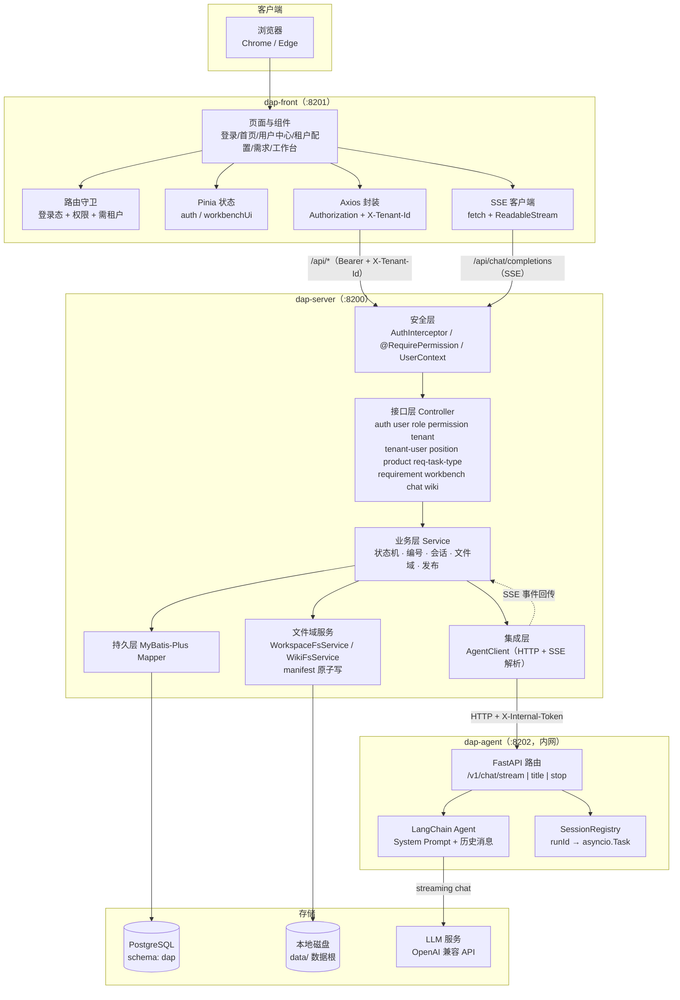

### 3.1 请求视图

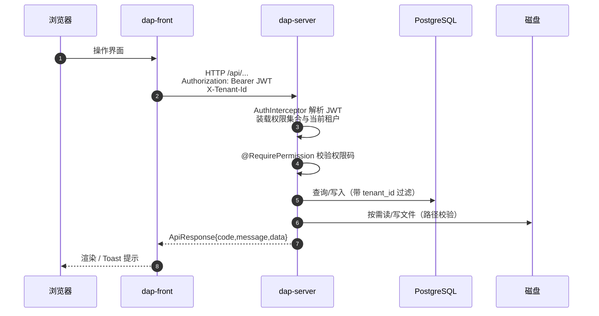

---

## 4. 部署与运行时架构

### 4.1 部署拓扑

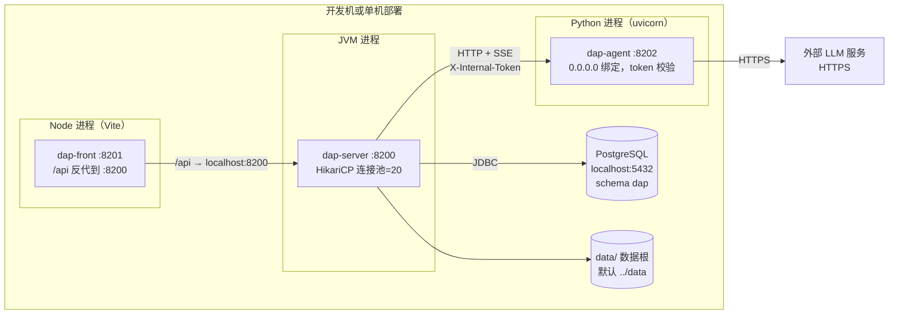

### 4.2 端口与启动

| 项 | 值 |
|---|---|
| 前端端口 | 8201（`strictPort`，`/api` 代理到 8200，SSE 关闭代理超时） |
| 后端端口 | 8200（`server.port`） |
| Agent 端口 | 8202（`settings.port`） |
| 数据库 | `jdbc:postgresql://localhost:5432/postgres?currentSchema=dap` |
| 数据根 | `dap.data.root`，默认 `../data`（相对 `dap-server` 工作目录） |
| 一键启动 | `scripts/start-dev.ps1`：清理 8200/8201/8202/9210/9300 占用 → 启动后端、前端、Agent 和两个沙箱服务 → 日志着色合并输出 → `Ctrl+C` 全停 |
| 前端构建产物 | `dap-front` 编译为静态资源；开发态由 Vite 提供服务 |

### 4.3 运行单元职责矩阵

| 能力 | dap-front | dap-server | dap-agent |
|---|---|---|---|
| 登录与路由守卫 | ✅ | ✅（JWT 签发/校验） | — |
| 权限判定 | 展示层过滤 | ✅ 强制校验 | — |
| 需求/任务状态机 | 触发动作 | ✅ 裁决与留痕 | — |
| 会话与消息持久化 | 展示 | ✅ | — |
| LLM 推理 | — | 代理转发 | ✅ 实际推理 |
| 文件读写 | — | ✅ 鉴权与路由，仓写委派沙箱 | 工具经内部 API 请求 |
| manifest 生成 | — | ✅ | 计划消费 |

---

## 5. 分层与模块划分

### 5.1 后端分层

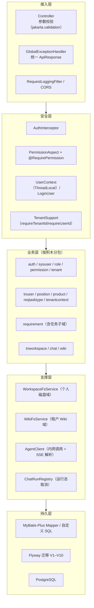

### 5.2 后端包结构（实况）

```
com.lonple.dap.server
├── common/          ApiResponse、PageResult、BizException、GlobalExceptionHandler
├── config/          WebMvcConfig、MybatisPlusConfig、DataRootProperties、PasswordConfig、RequestLoggingFilter
├── security/        AuthInterceptor、JwtService、JwtProperties、LoginUser、UserContext、
│                    PermissionAspect、RequirePermission、TenantSupport
├── integration/agent/  AgentClient、AgentProperties、ChatHistoryProperties
└── modules/
    ├── auth/            AuthController、AuthService、dto
    ├── sysuser/         用户 CRUD
    ├── role/            RoleController/Service、PlatformRole、权限关联
    ├── permission/      权限只读列表
    ├── tenant/          TenantController/Service、TenantRole、成员 Mapper
    ├── tnuser/          租户成员维护
    ├── position/        岗位 + 技能
    ├── product/         产品 + 版本（ProductVersionStatus）
    ├── reqtasktype/     需求任务类型
    ├── tenantcontext/   用户租户上下文（岗位/技能）
    ├── requirement/     需求 + 流程 + 编号 + 任务子域
    ├── tnworkspace/     个人工作空间元数据 + 文件树 + 磁盘
    ├── chat/            会话 + 消息 + SSE 补全（含 step 转发）+ 停止
    ├── agenttool/       内网 Agent FS：索引 / 检索 / 读 / 写输出
    └── wiki/            Wiki 树 + 读写 + 发布 + 研发产物
```

### 5.3 前端分层

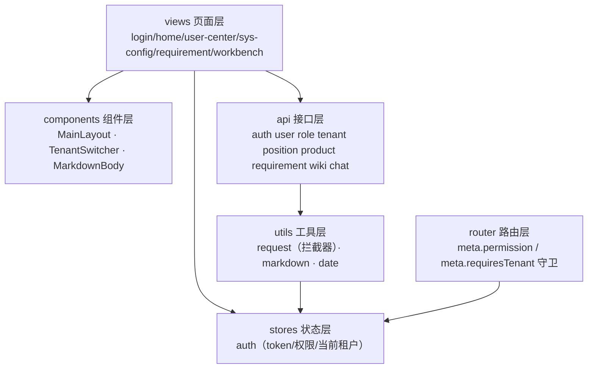

---

## 6. 关键架构决策（ADR）

| 编号 | 决策 | 背景 | 取舍与代价 |
|---|---|---|---|
| ADR-01 | **浏览器不直连 Agent**，由 Java 代理并落库 | 需要鉴权、租户隔离、消息持久化、可停止 | Java 增加一层流式转发；Agent 无法独立对外服务 |
| ADR-02 | **个人空间 → Wiki 采用显式发布**，不做自动同步 | 公共库需可治理，避免个人草稿污染 | 用户需多一步操作；不提供双向同步 |
| ADR-03 | **共享工作空间取消**，由租户 Wiki 取代 | 共享盘权限模型复杂且与 Wiki 职责重叠 | 保留 `SHARED` 枚举与磁盘分支作为兼容，代码存在历史残留 |
| ADR-04 | **显示名与磁盘存储名分离**（UUID 存储） | 中文/重名/特殊字符带来的文件系统风险 | 需 manifest 做映射；排障需查表 |
| ADR-05 | **数据库为准、磁盘为从**，manifest `afterCommit` 重写 + 加锁 + 原子替换 | 避免回滚后磁盘与库不一致、并发写坏 JSON | 磁盘故障时存在短暂不一致（仅告警） |
| ADR-06 | **权限码方法级注解**，前端同一套 code 控制菜单与路由 | 前后端权限语义一致，易审计 | 权限码需两端同步维护 |
| ADR-07 | **租户角色以代码策略映射**（`TenantRole` 常量集合），不落库为可配置权限 | V1.0.0 简化角色模型 | 调整租户角色权限需改代码 |
| ADR-08 | **需求编号用序号表行锁**（`req_requirement_no_seq`） | 需要人可读且并发安全的编号 | 每产品每年一行热点，存在串行化开销 |
| ADR-09 | **服务端裁决状态机**，前端只发动作不发状态 | 防止越权改状态、保证流程留痕 | 新增状态需后端改动 |
| ADR-10 | **上下文与输入交付件先落库引用**，V1.0.0 不注入正文 | 控制 Prompt 体积与实现复杂度 | 上下文"引而不用"，需后续增强 |
| ADR-11 | **Agent 使用 OpenAI 兼容协议 + LangChain** | 便于切换模型供应商 | 依赖 `base_url` 以 `/v1` 结尾的约定（已做自动修正与告警） |
| ADR-12 | **MyBatis-Plus + Flyway**，连接池用 HikariCP | Spring Boot 4 下 Druid Starter 不兼容 | 全部 SQL 显式可控，但需手写自定义 Mapper 方法 |

---

## 7. 安全架构

### 7.1 三层防线

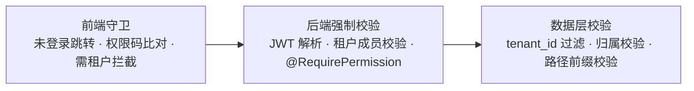

1. **前端守卫**：不做安全边界，仅优化体验（`router.beforeEach` 三层判断）。
2. **后端强制**：`AuthInterceptor` 对 `/api/**` 生效（仅 `POST /api/auth/login` 放行），`PermissionAspect` 环绕 `@RequirePermission`。
3. **数据层**：所有查询带 `tenant_id`；写操作前校验资源归属（工作空间所有者、需求创建人/当前处理人）。

### 7.2 鉴权时序

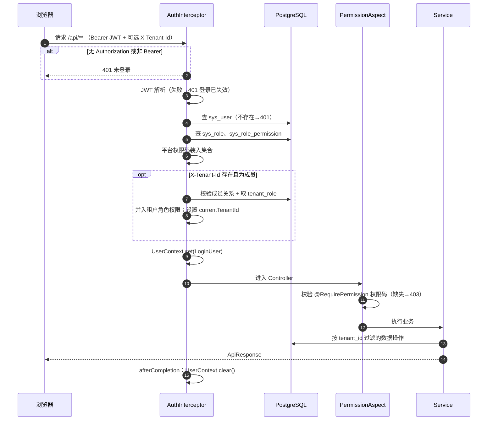

**要点**

- 无 `X-Tenant-Id` 或非法租户头时，`currentTenantId` 为空——用户中心接口仍可用，租户级接口由 `TenantSupport.requireTenantId()` 抛出"请先选择租户"。
- 租户角色权限与平台角色权限**叠加**，取并集。
- Agent 侧独立鉴权：`X-Internal-Token` 与配置 `DAP_AGENT_TOKEN` 比对，失败返回 401。

### 7.3 安全控制清单

| 面 | 控制 |
|---|---|
| 密码 | BCrypt 摘要存储；长度与复杂度校验 |
| 令牌 | JWT（HS 签名），默认 24h 过期；前端 localStorage 持有；401 自动清理并跳登录 |
| 越权 | 资源级归属校验（`requireOwnedPersonal`、`requireOwnedByCreator`、`requireCurrentHandler`） |
| 目录穿越 | 显示名禁止 `/`、`\`、`..`；路径 `normalize()` 后必须 `startsWith` 数据根/工作空间根/Wiki 根 |
| 注入 | MyBatis-Plus 参数绑定；权限码常量集合比对 |
| XSS | 助手消息 Markdown 渲染经 DOMPurify 过滤 |
| 内网防护 | Agent 仅服务端调用；`X-Internal-Token` 强校验 |

---

## 8. 数据架构

### 8.1 数据域划分

| 域 | 表 | 归属积木 |
|---|---|---|
| 平台与权限域 | `sys_user`、`sys_role`、`sys_permission`、`sys_role_permission`、`sys_tenant`、`sys_tenant_user` | 01 |
| 租户主数据域 | `sys_position`、`sys_position_skill`、`sys_product`、`sys_product_version`、`sys_req_task_type`、`sys_user_tenant_context`、`sys_user_tenant_context_skill` | 02 |
| 需求与任务域 | `req_requirement`、`req_requirement_flow`、`req_requirement_handler`、`req_requirement_no_seq`、`req_requirement_task`、`req_requirement_task_handler`、`req_requirement_task_input` | 03 |
| 工作台域 | `sys_workspace`、`sys_workspace_node`、`wb_chat_session`、`wb_session_context`、`wb_chat_message` | 04 |
| 知识域 | `sys_wiki_node`（被 `wb_session_context`、`req_requirement_task_input` 引用） | 05 |

### 8.2 关系模型（平台与租户域）

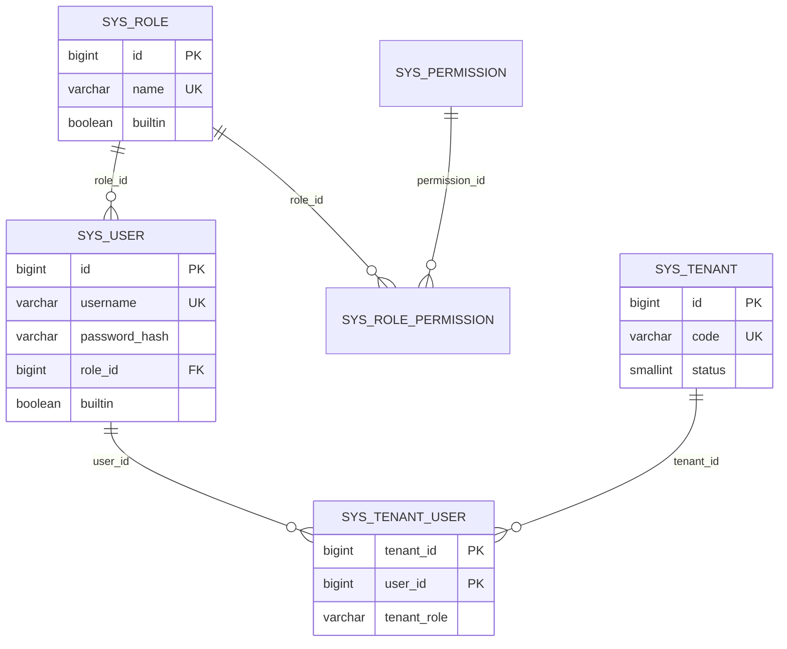

### 8.3 关系模型（业务域）

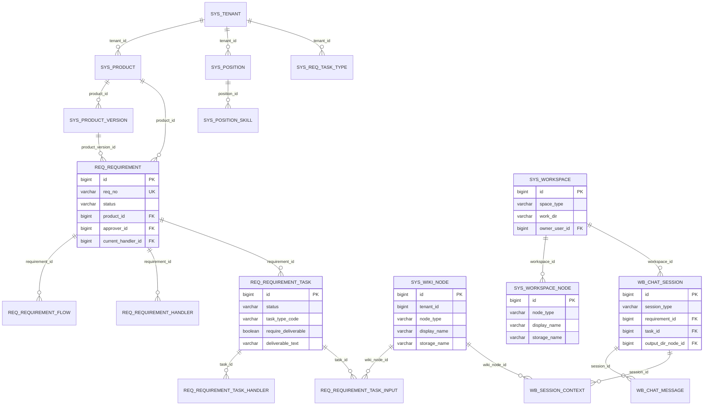

### 8.4 数据归属与清理策略

| 场景 | 处理 |
|---|---|
| 删除租户 | 按依赖顺序删除需求任务 → 任务类型 → 需求 → 编号序列 → 产品 → 工作空间节点/空间 → 会话 → 上下文 → 岗位技能/岗位 → 成员 → 租户；最后删除磁盘租户目录 |
| 删除需求 | 创建人可删；`flow`/`handler`/`task` 级联；工作空间节点 `requirement_id` 置空 |
| 删除个人空间 | 服务层递归删节点与磁盘，再删空间；会话经外键 `ON DELETE CASCADE` |
| 删除 Wiki 节点 | 递归删子树（记录 + 磁盘）；引用方 `ON DELETE CASCADE` 清理会话上下文与任务输入 |
| 删除产品/版本 | 若已关联需求则拒绝，并提示明确文案 |

---

## 9. 文件存储架构

### 9.1 磁盘布局

```
data/                              ← dap.data.root（默认 ../data）
└── {租户编码}/                     ← 例如 dev
    ├── {用户账号}/                 ← 个人域
    │   └── {workDir}/             ← 工作空间（英数下划线）
    │       ├── .dap/manifest.json ← 节点索引（Agent 可读）
    │       └── {uuid}/...          ← 目录用 UUID 名
    │       └── {uuid}.md           ← 文件用 UUID + 扩展名
    ├── wiki/                      ← 租户公共域
    │   ├── .dap/manifest.json     ← 含 tenantId 与全量节点
    │   └── {uuid}/{uuid}.md
    └── share/{workDir}/            ← 历史共享空间分支（V1.0.0 不再使用）
```

### 9.2 双名模型

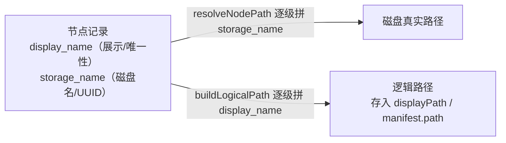

- **显示名**：用户可见，同级唯一（数据库唯一索引 + 服务层预校验）。
- **存储名**：UUID（文件带原扩展名），避免中文/重名/大小写/长度问题。
- **逻辑路径**：如 `产品A/REQ-2026-00001/原始需求.md`，写入 `wb_session_context.display_path`、`req_requirement_task_input.display_path` 与会话 VO。

### 9.3 manifest 生成与一致性

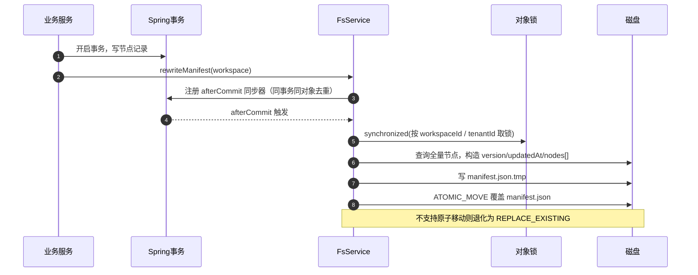

manifest 结构（字段级细节见详细设计 §6）：

```json
{
  "version": 1,
  "workspaceId": 12,
  "updatedAt": "2026-02-05T10:00:00Z",
  "nodes": [
    { "id": 31, "parentId": null, "type": "DIR", "name": "设计", "path": "设计", "storage": "ab12...", "storagePath": "ab12..." },
    { "id": 32, "parentId": 31, "type": "FILE", "name": "方案.md", "path": "设计/方案.md", "storage": "cd34....md", "storagePath": "ab12.../cd34....md" }
  ]
}
```

> Wiki 的 manifest 额外包含 `tenantId`，其余结构一致。

### 9.4 一致性保证与失效模式

| 保证 | 机制 |
|---|---|
| 事务回滚不产生"幽灵文件索引" | manifest 延迟到 `afterCommit` 重写 |
| 同事务多次变更不重复写 | 事务资源标记去重 |
| 并发写不产生半截 JSON | 按对象加锁 + 临时文件 + 原子替换 |
| 磁盘删除失败不阻塞业务 | 捕获异常记 `warn` 日志，继续数据库清理 |
| 路径不越界 | `normalize()` 后校验 `startsWith` 根路径 |
| 目录内容不进入文件树 | `.dap` 为元数据目录，不入库、不展示 |

---

## 10. 核心链路：AI 流式会话

### 10.1 端到端时序

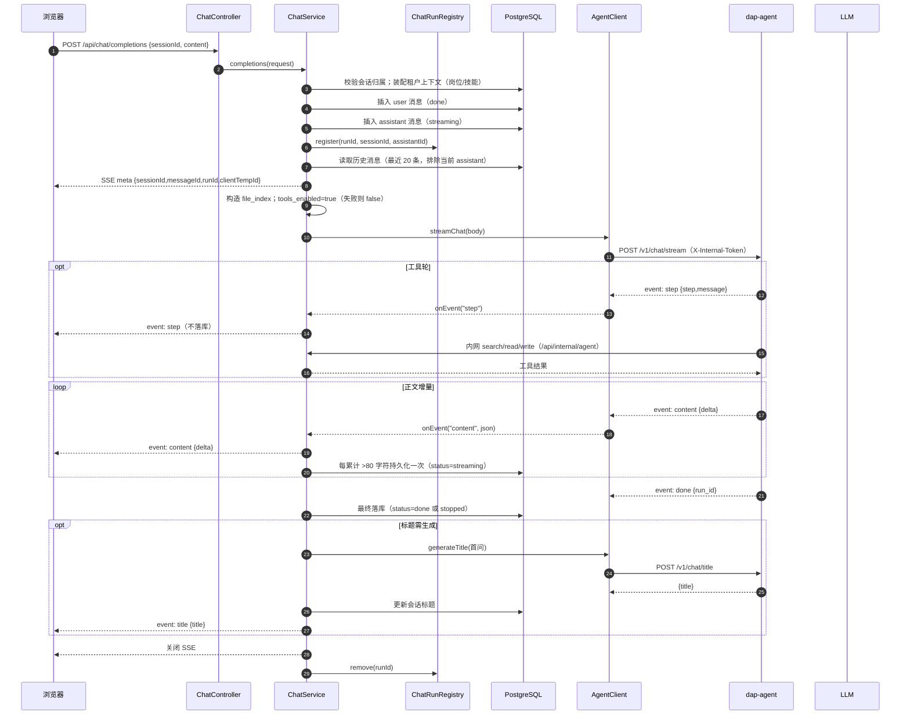

### 10.2 停止生成

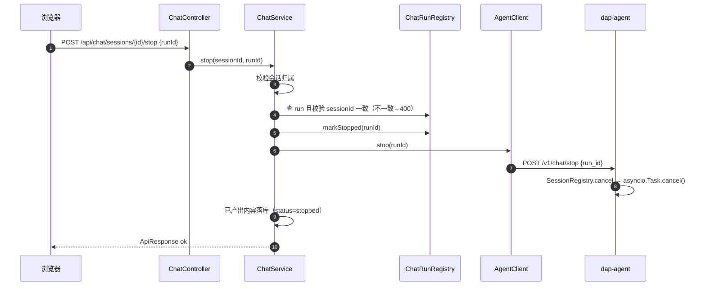

### 10.3 关键设计点

| 点 | 说明 |
|---|---|
| 双 SSE 链路 | 浏览器 ↔ Java、Java ↔ Agent 各一条 SSE；Java 逐事件解析转发，不缓冲整体响应 |
| 打字机与步骤 | `content` 增量渲染；`step` 仅前端展示（处理中/已处理耗时），不落库 |
| SSE 防缓冲 | 代理禁缓冲；日志 Filter 不得包装 SSE 响应体 |
| 逐段落库 | 每累计 >80 字符落一次库，兼顾"刷新可续看"与写库压力 |
| 运行态注册表 | `ChatRunRegistry` 存 `runId → (sessionId, messageId, stopped)`，是停止语义的唯一权威 |
| 停止竞态 | Agent 端 `Task.cancel()` + Java 端 `stopped` 标志双重保障，避免停止后继续追加内容 |
| 无会话禁止对话 | `sessionId` 必填（`@NotNull`），服务端二次校验归属 |
| 提示词组成 | System（岗位 + 技能 + 角色约束 + 可选材料索引指引）+ 历史 |
| Agent 工具 | `search_docs` / `read_docs` / `write_output` → Java `/api/internal/agent/*`；产物写入会话输出目录 |
| 上下文边界 | System Prompt 不自动拼 Wiki 全文；引用表 `wb_session_context` 仍只存路径；正文由工具按需读取 |
| 超时与异常 | 连接超时 3s、读超时 300s；Agent 返回 ≥400 → 502 明确错误；异常时消息状态置 `error` |

---

## 11. 核心链路：Wiki 产物与发布

### 11.1 投入研发写产物

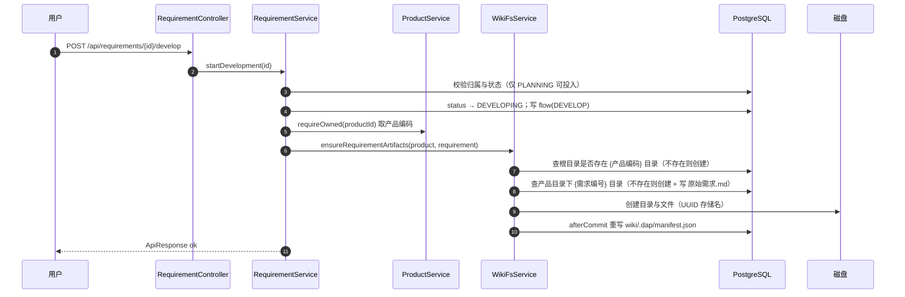

### 11.2 个人文件发布到 Wiki

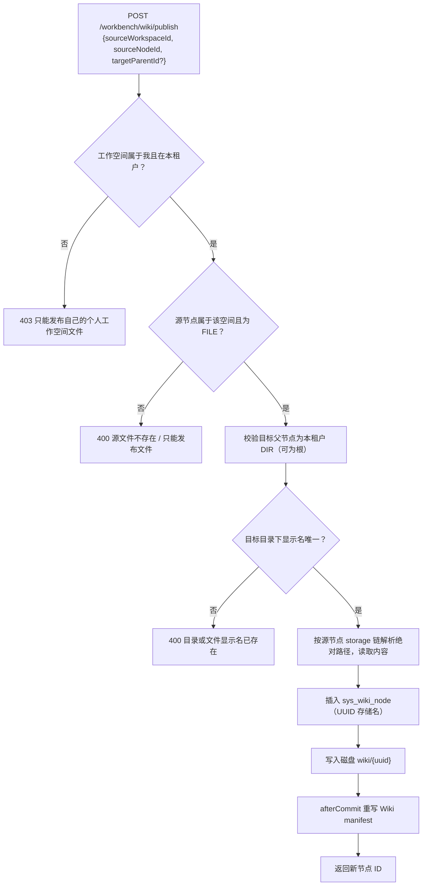

### 11.3 引用关系与级联

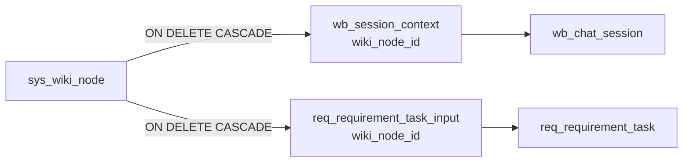

---

## 12. 事务、并发与一致性

| 关注点 | 机制 | 位置 |
|---|---|---|
| 需求编号并发 | 序号表行级 `SELECT ... FOR UPDATE`，`last_seq` 默认 -1 起始 | `RequirementService.nextReqNo` |
| 状态流转并发 | 先读后校验再更新，需以"当前处理人"作为天然串行点；建议后续加乐观锁 | `RequirementService` |
| 会话上下文替换 | 删除旧集合 + 按 `LinkedHashSet` 去重插入，单事务 | `WorkspaceSessionService.replaceContexts` |
| 磁盘与数据库一致性 | manifest 走 `afterCommit`；文件写在事务内，失败抛业务异常回滚 | `FsService` |
| manifest 并发写 | `ConcurrentHashMap` 按对象取锁 + `synchronized` + 原子替换 | `WorkspaceFsService` / `WikiFsService` |
| SSE 线程模型 | cachedThreadPool 异步执行，`SseEmitter(0L)` 不超时；`onCompletion` 清理注册表 | `ChatService` |
| 运行态存储 | 进程内 `ConcurrentHashMap`（单实例语义）——多实例部署需外置 | `ChatRunRegistry`、`AgentSessionRegistry` |
| 长事务规避 | 磁盘 IO 在事务内但为轻量文件操作；历史消息截断降低 Prompt 体积 | 全局 |

**已知一致性缺口（V1.0.0 接受）**

1. 需求/任务状态更新未使用乐观锁（`@Version`），高并发同单据操作可能后写覆盖先写（当前以"当前处理人"约束降低概率）。
2. 运行态注册表为进程内存储，`dap-server` / `dap-agent` 多实例部署会导致停止与取消失效。
3. 磁盘删除失败仅告警，可能产生孤儿文件（数据库已清理）。

---

## 13. 技术选型

| 层 | 选型 | 版本 | 理由 |
|---|---|---|---|
| 前端框架 | Vue 3 + TypeScript | 3.5 / 5.x | 组合式 API，生态成熟 |
| 构建 | Vite | 8.x | 秒级冷启动，代理配置灵活（SSE 关闭超时） |
| UI | Element Plus | 2.14 | 企业级中后台组件完备 |
| 状态 | Pinia | 4.x | 轻量、TS 友好 |
| 路由 | Vue Router | 5.x | `meta` 驱动的权限/租户守卫 |
| Markdown | marked + DOMPurify | 18 / 3.4 | 渲染与 XSS 过滤 |
| 后端框架 | Spring Boot | 4.1.2 | Java 21、Jakarta、拦截器/AOP 齐备 |
| 持久层 | MyBatis-Plus | 3.5.14 | SQL 可控 + 分页/条件构造 |
| 迁移 | Flyway | Boot 4 Starter | 版本化 schema，V1–V10 已归并 |
| 数据库 | PostgreSQL | 14+ | schema 隔离、表达式唯一索引（`COALESCE(parent_id,0)`） |
| 连接池 | HikariCP | 内置 | Spring Boot 4 下 Druid Boot3 Starter 不兼容 |
| 鉴权 | JJWT | 0.12.6 | 无状态 JWT |
| 密码 | spring-security-crypto | BCrypt | 业界标准摘要 |
| 推理服务 | FastAPI + uvicorn | 0.161 / 0.54 | 原生异步 + SSE |
| Agent 框架 | LangChain + langchain-openai | 1.4 / 1.7 | 模型可替换、流式原生支持 |
| 配置 | pydantic-settings + .env | 2.16 | 环境隔离 |

---

## 14. 质量属性与风险

### 14.1 质量属性权衡

| 属性 | 现状 | 主要手段 |
|---|---|---|
| 安全性 | 中上 | JWT + 双层权限 + 归属校验 + 路径校验 + 内网 token |
| 可扩展性 | 中 | 模块化分包；新增业务需加模块与迁移；权限码需双端同步 |
| 性能 | 中 | 索引覆盖高频查询；Prompt 有上限；SSE 无缓冲转发 |
| 可维护性 | 中上 | 一处一职责；Flyway 版本化；DSL 化的状态枚举 |
| 可观测性 | 中 | 请求日志过滤器 + 关键业务日志；无链路追踪/指标 |
| 可移植性 | 中 | 磁盘强依赖本地文件系统；多实例需共享存储 |

### 14.2 风险登记

| 风险 | 影响 | 缓解 |
|---|---|---|
| 运行态注册表进程内存储 | 多实例下停止生成失效 | 引入 Redis 等外置注册表 |
| 需求编号热点行 | 同产品高并发创建变慢 | 号段预取或 `SEQUENCE` |
| 状态更新无乐观锁 | 并发覆盖 | 增加 `version` 字段与重试 |
| 材料范围与正文预算 | AI 缺少业务上下文 | 按白名单 search/read，并在每轮调用前执行两桶预算治理 |
| 磁盘与库弱一致 | 孤儿文件/空索引 | 增加巡检任务与补偿接口 |
| 上传能力缺失 | 仅 md 可用 | 增加对象存储 + 上传接口 |
| Agent 单点 | 对话不可用 | 多副本 + 服务端重试与降级文案 |

---


## 15. 版本范围与演进路线

V1.0.0 是本次文档整合版本，不将历史设计草案自动视为已交付能力。基础业务、流水线、Docker 本机执行、上下文治理和编码阶段已有实现入口；具体测试结论需以代码及运行验证为准。

| 范围 | 基线与后续边界 |
|---|---|
| 基础业务 | 身份/租户、需求任务、工作台、Wiki 延续 §1～§14 的业务与存储约定。 |
| 流水线 | 固定主链 + 单元 TASK 会话 + Job；人工确认/发布为业务门禁；保留定义快照，不扩展通用流程引擎。 |
| 沙箱 | 本机 webdev 执行、产品资源/Profile/租约；只读本机，写/命令入容器。多机、mTLS、微 VM 另行建设。 |
| 上下文与编码 | 两桶压缩、证据卡、交付收窗、四阶段编码会话拆分；无冲突并行 wave 属后续能力。 |
| 设计预留 | 持久化异步 action、统一跨实例取消、Token 配额、SSO/审计、共享存储/对象存储、完整成本看板。 |

企业级建设优先级与待决策事项见 §19；实施细节见详设 §13～§19。

## 16. 自动化流水线架构

### 16.1 控制与执行分离

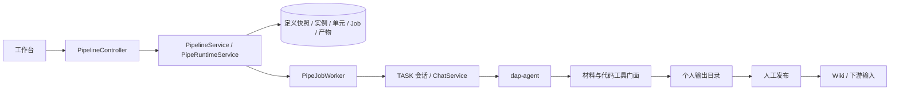

定义态包含 definition/node/unit/transition；运行态冻结定义版本，实例按需求隔离，节点管理并行汇合，单元绑定会话、确认轮与产物。主链推进由平台维护，定义存储与参数维护不等同于开放任意流程。

### 16.2 关键决策

- 一需求一活跃实例，不同需求并行；Job 条件更新抢占，重复动作需幂等。
- 各轨独立评审、归并、人工勾选、修订；在既定汇合点等待所有启用轨。
- need_human_confirm 暂停当前单元，确认后续跑；取消整条流水线是独立动作。
- 文档先到个人空间，人工发布后才进入 Wiki 输入链；逐轮草稿不自动入公共知识库。
- 业务确认轮与 LLM 工具轮分开计数，超限失败停住，不静默跳过。
- 编码/IT 才创建 Git worktree。业务/测试分仓，分支改动提交后进入代码评审，评审基线优先 master，缺失时回退默认分支。

节点材料、文件名、提示词槽位和会话映射集中于详设 §14，避免在架构中维护第二份路径表。

## 17. Docker 沙箱执行架构

### 17.1 责任边界与拓扑

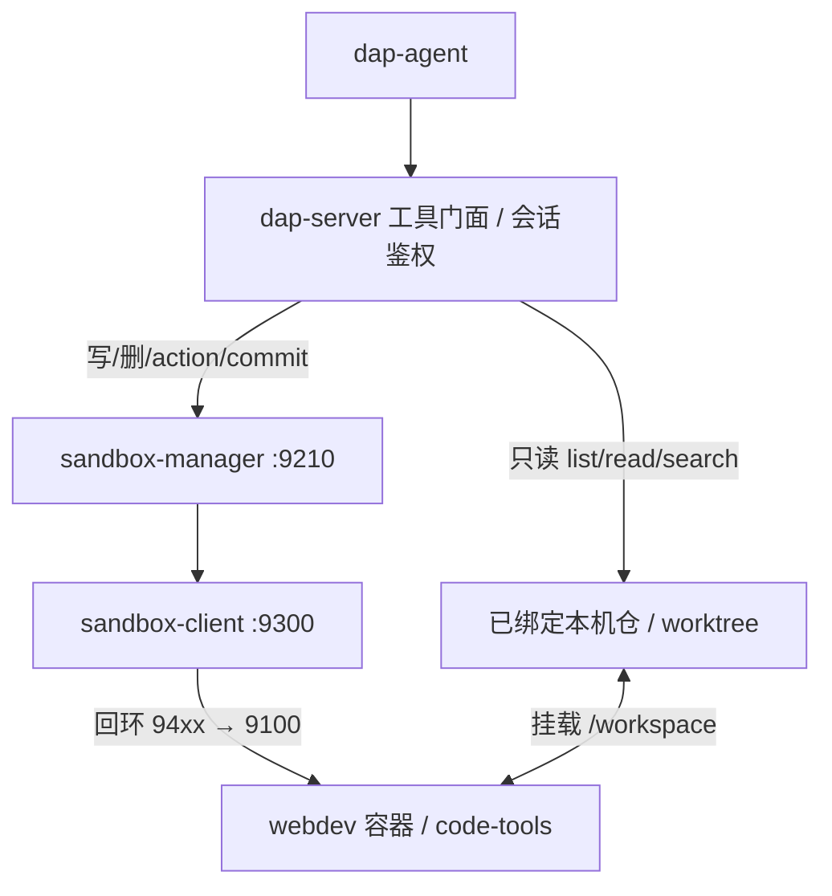

| 单元 | 责任 | 状态所有权 |
|---|---|---|
| dap-server | 材料授权、产品池/席位、Profile 实例化、会话/Job 绑定、worktree、发布与合并编排 | DAP 数据库保存业务租约真相 |
| Manager | 节点健康汇聚、lease 到 client 路由、转发控制/工具请求 | 路由缓存；不管理业务名额 |
| client | 本机 Docker、容器 attach/detach、健康探针、反代 code-tools | 本机容器映射；重启需对账 |
| code-tools | `/workspace` 内写/删、白名单动作、本地 commit，执行端再次限制路径与动作 | 无远端凭证；不裁决业务权限 |

Wiki/个人空间文件域保留在 server。跨宿主机走 Manager/client HTTP，不需要 Docker 覆盖网络，也不应让 server 直接访问各容器随机端口。本机先按这些独立服务边界验证，多机工作区可达性与亲和另行设计。

### 17.2 资源、配置与生命周期

资源桶 = 节点 + 镜像 + 席位；Profile = 产品运行参数模板；租约 = 占席与实例化快照。资源桶不是预先常驻的空容器。一租约一容器，一任务即使含前端与多个后端也只占一席；业务端口按服务列表分别分配。

`ensure worktree → 申请席位/解析 Profile → attach/env/端口映射 → 执行 → commit → detach → 归还端口和席位`。活动任务保持节点亲和；结束后可释放，再由需求分支恢复。Manager 不解析 Profile；模板只在 DAP 实例化，快照随租约固定。

### 17.3 安全与失败边界

材料白名单管可见性；动作白名单管工具形态；容器约束执行副作用。开启沙箱后远程写失败必须明确报错。只读仍由本机路径校验保护，worktree 隔离代码修改但不替代容器安全。

本机使用共享 `X-Sandbox-Token` 与回环端口。生产目标为节点内网、证书认证、出站默认拒绝并对白名单依赖放行、内网依赖缓存、非 root/最小挂载。Docker socket 留在节点管理侧，不交业务容器；Git 远端凭证不下发。共享 token 与本机验证不等于完成生产加固。

后续运行时适配器可支持 Kata/Firecracker 等；一需求一隔离实例时同步调整席位语义。表结构、Profile、协议和本机联调见详设 §15。

## 18. 上下文治理与编码执行架构

### 18.1 三个协作组件

| 组件 | 责任 | 当前边界 |
|---|---|---|
| Context Governor | 每次模型调用前检查整包预算；去重/证据卡、摘要、滑窗、模板降级、超限拒发 | 两桶：System；user+assistant+tool |
| Coding Stage Orchestrator | PLAN → ANALYZE → TASK×N → INTEGRATE，绑定独立会话和任务结果 | 固定编码节点内部增强，默认串行 |
| Async Tool Runtime | 软超时转后台、记录完成事实并续跑同一任务 | 设计预留，详设 §18；未作为已实现能力 |

### 18.2 上下文决策

System 保存岗位、任务、索引、模板和规范；工具结果归对话桶。整包上限默认 32000 tokens，50% 摘要、75% 滑窗、85% 模板降为大纲+描述，仍达上限则 CONTEXT_EXCEEDED 拒发。默认不提前削减模板，不增加极限瘦身阶梯。

「轮」按一次模型调用及其工具结果定义，不能按用户发送次数定义。精确读键含资源与行范围；搜索/阅读逐步变为证据卡，同范围重复读只给指针。交付滚动窗约束只探不写；工具轮触顶硬失败。当前未完成 tool_call 与 ToolMessage 必须保持合法配对。

会话记忆仅限本需求/单元，不做个人长期事实卡；跨会话知识进入正式 Wiki。分级拉取采用路径索引 → 搜索 → 片段读取，不自动拼接整本 Wiki。

### 18.3 编码与慢工具决策

Planner 仅拆可验证任务卡；Analyze 根据 deps/touch 生成调度；每张卡使用独立 Coding 会话；Integrate 使用另一会话验收和写报告。任务间只传摘要和产物索引。并行须无依赖/无触达冲突，P0 串行，后续再开放 wave 并行。

慢工具超时不等于 HITL。后续后台执行必须将终态写 action 存储与会话消息，再去重投递同一单元 CONTINUE；不能只靠内存通知，也不能新起主流程 Agent。需要密钥/版本决策、多次失败或总超时才转人工处理。

## 19. 企业级演进与待决策事项

企业级内容为后续规划或待评审项，不改变本版已明确的本机沙箱与两桶上下文决策。以下保留租户、配额、指标、扩容和排期依据；端口/schema/对接环境的实现设计见详设 §19。


### 19.1 租户切分策略

#### 19.1.1 结论（建议默认）

**租户按「产品线 / 产品族群」划分**，而不是按大部门或子公司一刀切。

| 切法 | 适合 | 风险 |
|---|---|---|
| **产品线 / 产品族（推荐默认）** | Wiki、代码仓、流水线、提示词、规范天然同域 | 跨产品协作需显式共享机制 |
| 大部门 / 子公司 | 组织人事、预算、强合规边界清晰 | 一部多产品时 Wiki/仓/流水线混杂，权限难精细 |
| 全公司一个租户 | 小团队快速开箱 | 隔离、配额、审计难以规模化 |

#### 19.1.2 组织与租户的关系

- **租户**：产品协作与数据隔离边界（Wiki / 仓 / 流水线 / 配额）。
- **组织（部门/子公司）**：通过 **SSO（单点登录）** 组映射解决成员来源、审批链、预算归属；**不替代**租户边界。
- **强监管子公司**：可采用「子公司 = 租户」，其下仍用「产品」做二级隔离；流水线与仓绑定继续按产品走。

#### 19.1.3 术语：SSO（单点登录）

**SSO** = **Single Sign-On（单点登录）**。

员工用公司统一账号（如企业微信 / 钉钉 / 飞书 / AD / LDAP / 统一认证中心）**登录一次**即可进入 DAP，无需再单独维护一套平台用户名密码。

企业落地时 SSO 通常一并考虑：

| 配套能力 | 说明 |
|---|---|
| OIDC / OAuth2 | 现代 Web 单点登录常用协议 |
| 离职回收 | 公司侧账号停用后，平台侧同步失效 |
| 组 / 部门映射 | 把公司组织映射到租户成员、角色 |
| MFA（可选） | 高权限操作二次校验 |

本文出现「接 SSO」即指：**对接公司统一身份，而不是只靠 DAP 本地账号。**

#### 19.1.4 跨产品复用

规范/模板跨产品线复用时，优先：

- 平台级公共库；或
- 只读共享租户 / 共享规范目录；

避免把多个产品线硬塞进同一租户。

### 19.2 执行权限与 ACL 治理

操作权限（菜单/按钮）是小权限。真正的风险面是 **LLM 工具链对文件与仓库的读写，以及仓内白名单进程的副作用**。

#### 19.2.1 材料可见性白名单

当前通过会话材料白名单约束「能看见什么」：

- 上下文（Wiki）
- 输入文档
- 模板 / 规范
- 代码仓库（业务仓 BIZ / 测试仓 TEST；部分评审节点可为 NONE）

材料白名单**不管**写盘与跑命令是否逃逸。

#### 19.2.2 本机进程与命令白名单（已落地）

DAP **不提供**任意 shell（无 `bash -c` / `cmd /c` 类通用工具）。会起本机进程的场景均为白名单，大致三类：

| 类别 | 入口 | 说明 |
|---|---|---|
| Agent `run_action` | `CodeRepoToolService` + `ProcessBuilder` | 会话绑定仓后由 Agent 调用；动作名白名单，禁止拼任意命令串 |
| 端口进程控制 | `PortProcessControl`（`stop_port`） | Windows：`netstat` + `taskkill`；非 Windows：`lsof` 等；只接受已校验端口/PID |
| 平台内部 | `GitWorktreeService`、`RipgrepSearchService` | worktree 相关 `git …`；仓内/材料检索 `rg`（失败则 Java 行扫描回退） |

`run_action` 白名单动作（完整名，勿斜杠拼接）：

| 类别 | 动作 |
|---|---|
| Git 探查 | `git_status` / `git_diff` / `git_log` |
| 构建 | `build` / `build_gradle` / `build_maven` / `build_vite` |
| 测试 | `test` / `test_gradle` / `test_maven` / `test_node` / `test_uv` |
| 启动 | `start_dev` / `start_gradle` / `start_maven` / `start_vite` / `start_uv` |
| 依赖/版本 | `mvn_validate` / `mvn_deps_tree` / `gradle_deps` / `tool_version` |
| 进程（偏登记表） | `stop_dev` / `list_processes`（停会话内登记进程，不起新 shell） |
| 端口 | `check_port` / `stop_port` |

`build` / `test` / `start_dev` 会按仓内 gradle / pom / package.json / pyproject 等**自动选型**。流水线 IT 等若跑构建/测试/启动，也走同一套白名单面，而非另开任意命令通道。

仓内文件工具（与执行并列）：`list_dir` / `read_file` / `write_file` / `delete_file` / `search_code`。路径须落在会话绑定的仓根下（`RepoPathSandbox` 等），写入另有内容/路径校验。

#### 19.2.3 风险结论（当前）

- **命令白名单**防的是「随便一条 shell」，必要且已落地。
- **当前最大越权面**仍是：
  1. **会话绑了哪些仓根、绑得有多宽** → `read` / `write` / `delete` 对该根下内容的实际能力；
  2. **白名单执行的真实副作用** → gradle/mvn/npm/uv 等插件与脚本、`start_*` 拉起的服务：可读环境、出网、写到仓外路径、占端口等——命令形态受控，**关闭沙箱或使用旧本机路径时副作用未进沙箱**，在旧本机执行模式下仍是本机进程；
  3. 次要：`stop_port` 可按端口杀进程，不限于「本仓起的」；worktree 只缩小「改哪份代码」，**不等于**执行隔离。

一句话：**白名单管命令形态与材料可见性；绑错/绑宽仓 + 仓内读写 + 白名单进程副作用，才是现阶段主风险。** 本机 Docker 执行面已补充这一层边界，生产加固继续按 §17 建设。

#### 19.2.4 分层加固

**阶段 A — 硬化 ACL（性价比高，先做）**

- 产出路径只写不读；仓按 BIZ/TEST；禁止路径穿越与 symlink 逃逸
- 按任务类型配置工具能力画像（禁用高危写 / 收紧可绑仓根 / 限制 `start_*` 与 `stop_port` 等）
- 会话级 allowlist **启动时冻结**，中途不可扩权
- 默认优先绑需求 worktree，避免直接绑本机主工作区整仓

**阶段 B — Docker / 沙箱执行面（企业级目标态）**

本机执行边界见架构 §17，生产加固另行排期。

原则：**材料白名单管可见性；命令白名单管可启动的形态；沙箱管即使工具用错也出不去；合主干与远端凭证不进沙箱。**


### 19.3 提示词治理与知识边界

提示词按岗位/任务类型维护，后续增加版本化、灰度与租户覆盖审计。材料按索引 → 搜索命中 → 分段读取，预算统一采用 §18 的 System/对话两桶模型，替代早期按材料种类多桶限额的设想。用户长期事实卡不纳入研发平台；跨会话只认显式发布的 Wiki 正式产物。

### 19.4 Token、超时与取消

#### 19.4.1 缺口

目前尚未体系化做：

- 用户 / 租户 Token 配额
- 工具调用超时
- LLM 处理超时
- 取消在多实例下的可靠传播

#### 19.4.2 规划控制面

| 控制 | 建议 |
|---|---|
| 配额 | 租户/用户日、月 Token 额度；软限告警 + 硬限拒绝 |
| 单次上限 | 单会话 / 单 Job：max input、max output、max tool rounds；与流水线 T24/T48/T96 业务轮次分别计数 |
| LLM 超时 | 连接超时、首 token 超时、整段超时；超时记失败并可策略重试 |
| 工具超时 | 单工具墙钟超时；沙箱内再套一层 |
| 取消 | 用户停止 → Job / Agent / 工具链统一取消（多实例依赖外置 run 注册表） |

无配额与超时，上量后易出现账单打爆、Agent 挂死占槽。

### 19.5 指标与可观测性

#### 19.5.1 目标：Agent / 流水线运营看板

维度：租户、产品、任务类型、流水线节点、模型。

| 类别 | 指标示例 |
|---|---|
| 量 | 请求数、Token 入/出、费用估算 |
| 稳 | LLM 失败率、超时率、工具失败率 |
| 人机 | 确认次数分布、超限失败、卡在 `WAITING_HUMAN` / `WAITING_PUBLISH` 的时长与数量 |
| 单次 run | token、轮次、耗时、模型、是否确认/发布 |

#### 19.5.2 落地路径

1. run 结束写结构化日志 + 汇总行（不必先上完整 APM）
2. 再接时序库 / Grafana
3. 与审计日志打通（谁确认、谁发布、谁停止）

### 19.6 Agent 任务水平扩容

#### 19.6.1 问题

当前偏单机：`PipeJobWorker` 线程池、`runId` 等运行态易落在进程内；多副本下停止生成、抢 Job、SSE 粘滞都会出问题。

#### 19.6.2 目标形态

```text
浏览器 → dap-server（无状态多副本）
            ├─ Job 队列（现有 pipe_job 可演进；可加 Redis/MQ）
            ├─ 运行态 runId / 租约（Redis）
            └─ dap-agent / Runner 多副本
文件与仓 → 共享存储，或「执行器本地盘 + 任务亲和」
```

#### 19.6.3 要点

1. **dap-server 无状态**：JWT + 外置锁与 run 注册表  
2. **dap-agent 水平扩**：`stop` 经 Redis 定位执行节点  
3. **编码/IT 任务**：worktree 在共享盘，或调度亲和到同一 Runner  
4. **Job 集群抢占**：多实例条件更新 `PENDING → RUNNING`（已有雏形，做成集群能力）  
5. **背压**：按租户并发槽位；槽满排队，不无限起 Agent  

控制面（server）多副本 + 执行面（agent/runner）弹性池。

### 19.7 与现有流水线能力的对齐

| 已有 | 规划补齐 |
|---|---|
| 一需求一活跃流水线实例 | 本机沙箱租约已纳入，补生产运行时生命周期治理 |
| worktree + 本机 Profile 实例 | 生产端口持久化对账 / schema 治理 / 中间件前缀约束 |
| 材料白名单 + 本机 Docker 执行 | 工具画像、生产隔离和网络策略 |
| Job 并行调度雏形 | 集群抢占 + Redis 运行态 |
| 确认轮次档位 T24/T48/T96 | Token 配额与超时挂钩 |
| 显式发布 Wiki | 审计 + 指标 |

### 19.8 优先序建议（企业版 MVP → 完整）

#### P0 — 能安全小范围上线

1. SSO（单点登录）/ 审计 / 本岗硬权限（流水线触发·确认·发布）  
2. 密钥库（LLM / Git / Internal Token）  
3. 材料 ACL 硬化 + 任务工具画像  
4. 基础：LLM/工具超时、租户 Token 软硬配额  
5. run 级基础指标（失败、超时、token、确认次数）  

#### P1 — 能多人并行开发与 IT

1. 资源租约（端口 + schema）+ 配额 + 自动回收  
2. 产品对接环境配置 + 合并注入运行配置  
3. IT：禁止共用开发库 migrate；独立 schema 或短命库  
4. Redis 外置 run 注册表；Job 多实例抢占  
5. 卡住实例运维（WAITING_HUMAN / 待发布）  

#### P2 — 能规模化与强隔离

1. Docker Runner 多节点调度与生产加固  
2. IT Compose/Testcontainers 一栈一任务  
3. 对象存储替代单机 data 盘；多机共享 worktree 策略  
4. LLM 轨合并质量治理；集成测试对接正式 CI  
5. 完整运营看板与成本分摊  

#### P3 — 平台化经营

1. Git 合主干 / PR 门禁 / worktree 生命周期自动化  
2. 推进规则完全配置化、定义版本兼容  
3. 外系统（IM/工单）与度量驾驶舱

### 19.9 待评审拍板清单

- [ ] 租户默认按产品线；子公司强隔离是否作为可选模式写入产品说明  
- [ ] 生产沙箱加固与 ACL 硬化的排期（本机沙箱已纳入整合基线；待确认生产加固排期）  
- [ ] 资源租约默认「一需求一套」还是「一需求×一用户」  
- [ ] 对接环境最少几套（dev/qa/pre）及密钥归属  
- [ ] 集成测试默认联调模式还是契约模式  
- [ ] Token 配额按租户还是按用户（或两者都有）  
- [ ] Agent 扩容一期是否上 Redis（强烈建议与多实例绑定）

## 20. 文档整合追溯与修订记录

| 合并前材料 | 合并后位置与处理 |
|---|---|
| 需求文档 V1.0 | 需求 §1～§12；保留需求编号与基础业务，新增流水线/沙箱/上下文需求。 |
| 架构设计 V1.0 | 架构 §1～§14；扩展控制面/执行面与治理架构，原演进计划统一为 §15/§19。 |
| 详细设计 V1.0 | 详设 §1～§12、附录；保留数据/接口/流程/配置，补充专项详设。 |
| 流水线需求规格 | 需求 §13：将讨论整理为业务规则、发布门禁、范围与验收。 |
| 流水线详细设计 | 架构 §16、详设 §13；通用流程引擎与逐轮自动发布的旧设想已修正。 |
| 流水线节点与 Agent 配置 | 详设 §14：完整保留节点/材料/文件名/提示词槽位。 |
| Docker 沙箱本机落地设计 | 架构 §17；详设 §15 的部署、最小配置和验收；重复概要/API 以较新详设为准。 |
| Docker 沙箱详细设计 | 架构 §17 的责任边界；详设 §15 的模型/Profile/配置/API/时序/错误/测试。 |
| 上下文压缩与编码任务拆分设计 | 需求 §15、架构 §18、详设 §16～§18；整合截至原 V0.15 的决策，并核对当前预算默认值。 |
| 企业级设计规划 | 架构 §19：租户、配额、指标、扩容、优先级与待决策；详设 §19：并行 IT、资源与对接环境。 |
| 平台 UI 设计目录与交互 Mock | 移除；流程中的 UI 生成/评审业务能力、模板与规范保留。 |

旧专题与旧版本主文档在内容归入后三份主文档后移除，后续在各自职责层维护，不再另存同版本副本。模板与编码规范继续独立保留。

| 版本 | 日期 | 修订 |
|---|---|---|
| V1.0.0 | 2026-11-24 | 统一需求/架构/详设目录；合并流水线、Docker、上下文与企业规划；统一发布规则、只读执行边界和端口；移除 UI 设计稿与 Mock。 |
