# DAP 研发流程平台 · 架构设计 V1.0

| 项 | 内容 |
|---|---|
| 文档名称 | DAP 研发流程平台 架构设计说明书 |
| 版本 | **V1.0** |
| 状态 | 已实现基线（与代码一致） |
| 适用范围 | 平台 V1.0 全部业务积木与三个运行进程 |
| 配套文档 | [需求文档 V1.0](./需求文档V1.0.md)、[详细设计 V1.0](./详细设计V1.0.md) |

---

## 目录

1. [架构概览](#1-架构概览)
2. [设计原则](#2-设计原则)
3. [总体架构](#3-总体架构)
4. [部署与运行时架构](#4-部署与运行时架构)
5. [分层与模块划分](#5-分层与模块划分)
6. [关键架构决策（ADR）](#6-关键架构决策adr)
7. [安全架构](#7-安全架构)
8. [数据架构](#8-数据架构)
9. [文件存储架构](#9-文件存储架构)
10. [核心链路：AI 流式会话](#10-核心链路ai-流式会话)
11. [核心链路：Wiki 产物与发布](#11-核心链路wiki-产物与发布)
12. [事务、并发与一致性](#12-事务并发与一致性)
13. [技术选型](#13-技术选型)
14. [质量属性与风险](#14-质量属性与风险)
15. [演进路线](#15-演进路线)

---

## 1. 架构概览

DAP 采用 **前后端分离 + 服务分层 + 独立推理服务** 的三进程架构：

| 进程 | 技术栈 | 职责 | 可见性 |
|---|---|---|---|
| `dap-front` | Vue 3 + TypeScript + Vite + Element Plus | 全部用户界面；权限守卫；SSE 客户端解析 | 浏览器可见（8201） |
| `dap-server` | Java 21 + Spring Boot 4.1 + MyBatis-Plus + Flyway | 鉴权、租户隔离、业务状态机、持久化、磁盘文件域、Agent 代理 | 浏览器经 `/api` 访问（8200） |
| `dap-agent` | Python 3.14 + FastAPI + LangChain | LLM 流式推理、标题生成、按 runId 取消 | **仅内网**（8202，`X-Internal-Token`） |

核心架构特征：

1. **单一写入口**：浏览器不直连 Agent，也不直接触碰磁盘；所有写操作集中经 Java 服务。
2. **双层租户模型**：平台级（用户中心）与租户级（业务）在权限与数据上分离。
3. **数据库为准、磁盘为从**：业务元数据入库，文件内容入盘，磁盘侧以 `.dap/manifest.json` 作为可被 Agent 消费的只读索引。
4. **状态机服务端裁决**：需求/任务状态只能由服务端按白名单迁移，前端不持有状态真相。

---

## 2. 设计原则

| 原则 | 落地方式 |
|---|---|
| 一个真相源（Single Source of Truth） | 业务元数据只存 PostgreSQL；磁盘文件内容只由服务端按节点记录定位 |
| 能力不下放 | 状态流转、编号生成、权限判定、路径校验全部在服务端 |
| 内网不设防不如显式设防 | Agent 用 `X-Internal-Token` 校验调用方，浏览器无法触达 |
| 显式优于隐式 | 个人空间 → Wiki 是**显式发布**，不做后台自动同步 |
| 失败不污染主流程 | 磁盘清理/manifest 重写失败仅告警，不回滚数据库事务 |
| 幂等优先 | 投入研发产物生成、manifest 重写均可重复执行 |
| 边界清晰 | 个人域（私有）与租户公共域（Wiki）在表、磁盘、权限三处同时分离 |

---

## 3. 总体架构

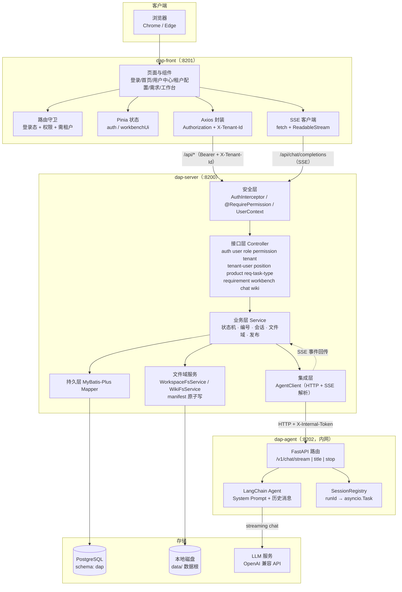

### 3.1 请求视图

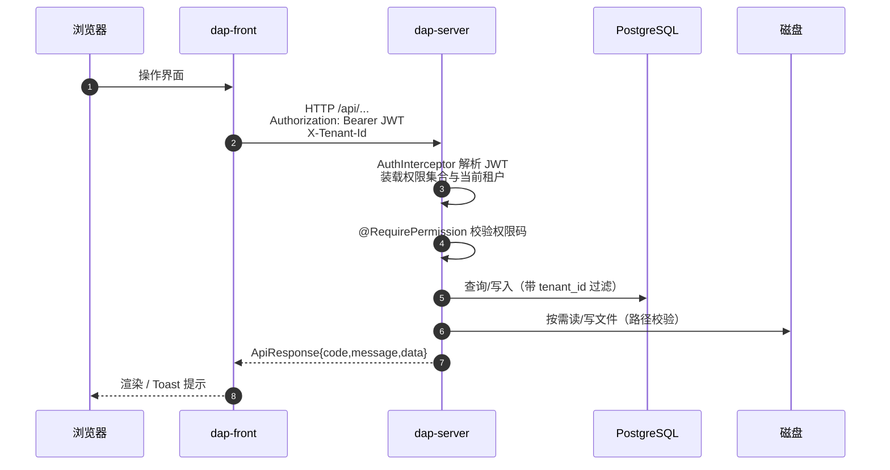

---

## 4. 部署与运行时架构

### 4.1 部署拓扑

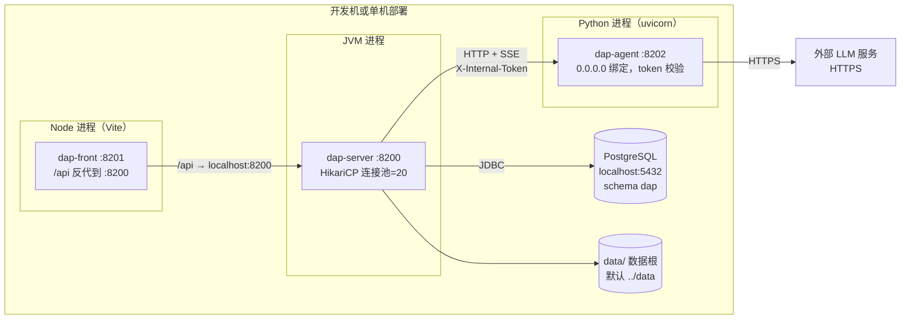

### 4.2 端口与启动

| 项 | 值 |
|---|---|
| 前端端口 | 8201（`strictPort`，`/api` 代理到 8200，SSE 关闭代理超时） |
| 后端端口 | 8200（`server.port`） |
| Agent 端口 | 8202（`settings.port`） |
| 数据库 | `jdbc:postgresql://localhost:5432/postgres?currentSchema=dap` |
| 数据根 | `dap.data.root`，默认 `../data`（相对 `dap-server` 工作目录） |
| 一键启动 | `start-dev.ps1`：清理 8200/8201/8202 占用 → 并发启动三者 → 日志着色合并输出 → `Ctrl+C` 全停 |
| 前端构建产物 | `dap-front` 编译为静态资源；开发态由 Vite 提供服务 |

### 4.3 运行单元职责矩阵

| 能力 | dap-front | dap-server | dap-agent |
|---|---|---|---|
| 登录与路由守卫 | ✅ | ✅（JWT 签发/校验） | — |
| 权限判定 | 展示层过滤 | ✅ 强制校验 | — |
| 需求/任务状态机 | 触发动作 | ✅ 裁决与留痕 | — |
| 会话与消息持久化 | 展示 | ✅ | — |
| LLM 推理 | — | 代理转发 | ✅ 实际推理 |
| 文件读写 | — | ✅ 唯一写入口 | V1.0 不读写 |
| manifest 生成 | — | ✅ | 计划消费 |

---

## 5. 分层与模块划分

### 5.1 后端分层

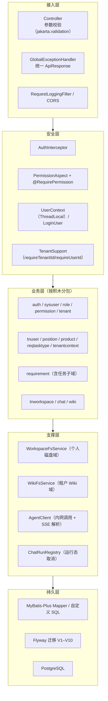

### 5.2 后端包结构（实况）

```
com.lonple.dap.server
├── common/          ApiResponse、PageResult、BizException、GlobalExceptionHandler
├── config/          WebMvcConfig、MybatisPlusConfig、DataRootProperties、PasswordConfig、RequestLoggingFilter
├── security/        AuthInterceptor、JwtService、JwtProperties、LoginUser、UserContext、
│                    PermissionAspect、RequirePermission、TenantSupport
├── integration/agent/  AgentClient、AgentProperties、ChatHistoryProperties
└── modules/
    ├── auth/            AuthController、AuthService、dto
    ├── sysuser/         用户 CRUD
    ├── role/            RoleController/Service、PlatformRole、权限关联
    ├── permission/      权限只读列表
    ├── tenant/          TenantController/Service、TenantRole、成员 Mapper
    ├── tnuser/          租户成员维护
    ├── position/        岗位 + 技能
    ├── product/         产品 + 版本（ProductVersionStatus）
    ├── reqtasktype/     需求任务类型
    ├── tenantcontext/   用户租户上下文（岗位/技能）
    ├── requirement/     需求 + 流程 + 编号 + 任务子域
    ├── tnworkspace/     个人工作空间元数据 + 文件树 + 磁盘
    ├── chat/            会话 + 消息 + SSE 补全（含 step 转发）+ 停止
    ├── agenttool/       内网 Agent FS：索引 / 检索 / 读 / 写输出
    └── wiki/            Wiki 树 + 读写 + 发布 + 研发产物
```

### 5.3 前端分层

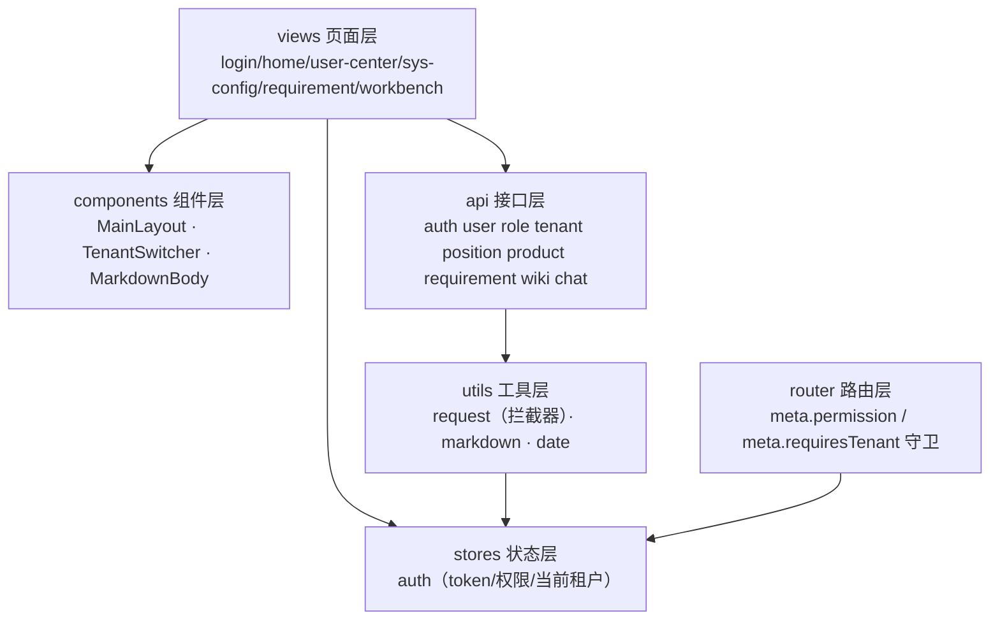

---

## 6. 关键架构决策（ADR）

| 编号 | 决策 | 背景 | 取舍与代价 |
|---|---|---|---|
| ADR-01 | **浏览器不直连 Agent**，由 Java 代理并落库 | 需要鉴权、租户隔离、消息持久化、可停止 | Java 增加一层流式转发；Agent 无法独立对外服务 |
| ADR-02 | **个人空间 → Wiki 采用显式发布**，不做自动同步 | 公共库需可治理，避免个人草稿污染 | 用户需多一步操作；不提供双向同步 |
| ADR-03 | **共享工作空间取消**，由租户 Wiki 取代 | 共享盘权限模型复杂且与 Wiki 职责重叠 | 保留 `SHARED` 枚举与磁盘分支作为兼容，代码存在历史残留 |
| ADR-04 | **显示名与磁盘存储名分离**（UUID 存储） | 中文/重名/特殊字符带来的文件系统风险 | 需 manifest 做映射；排障需查表 |
| ADR-05 | **数据库为准、磁盘为从**，manifest `afterCommit` 重写 + 加锁 + 原子替换 | 避免回滚后磁盘与库不一致、并发写坏 JSON | 磁盘故障时存在短暂不一致（仅告警） |
| ADR-06 | **权限码方法级注解**，前端同一套 code 控制菜单与路由 | 前后端权限语义一致，易审计 | 权限码需两端同步维护 |
| ADR-07 | **租户角色以代码策略映射**（`TenantRole` 常量集合），不落库为可配置权限 | V1.0 简化角色模型 | 调整租户角色权限需改代码 |
| ADR-08 | **需求编号用序号表行锁**（`req_requirement_no_seq`） | 需要人可读且并发安全的编号 | 每产品每年一行热点，存在串行化开销 |
| ADR-09 | **服务端裁决状态机**，前端只发动作不发状态 | 防止越权改状态、保证流程留痕 | 新增状态需后端改动 |
| ADR-10 | **上下文与输入交付件先落库引用**，V1.0 不注入正文 | 控制 Prompt 体积与实现复杂度 | 上下文"引而不用"，需后续增强 |
| ADR-11 | **Agent 使用 OpenAI 兼容协议 + LangChain** | 便于切换模型供应商 | 依赖 `base_url` 以 `/v1` 结尾的约定（已做自动修正与告警） |
| ADR-12 | **MyBatis-Plus + Flyway**，连接池用 HikariCP | Spring Boot 4 下 Druid Starter 不兼容 | 全部 SQL 显式可控，但需手写自定义 Mapper 方法 |

---

## 7. 安全架构

### 7.1 三层防线

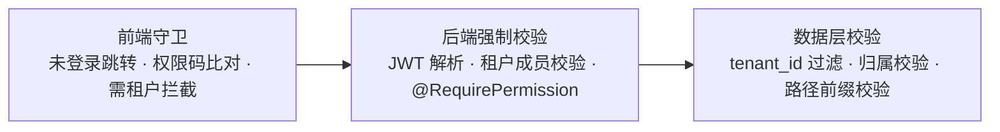

1. **前端守卫**：不做安全边界，仅优化体验（`router.beforeEach` 三层判断）。
2. **后端强制**：`AuthInterceptor` 对 `/api/**` 生效（仅 `POST /api/auth/login` 放行），`PermissionAspect` 环绕 `@RequirePermission`。
3. **数据层**：所有查询带 `tenant_id`；写操作前校验资源归属（工作空间所有者、需求创建人/当前处理人）。

### 7.2 鉴权时序

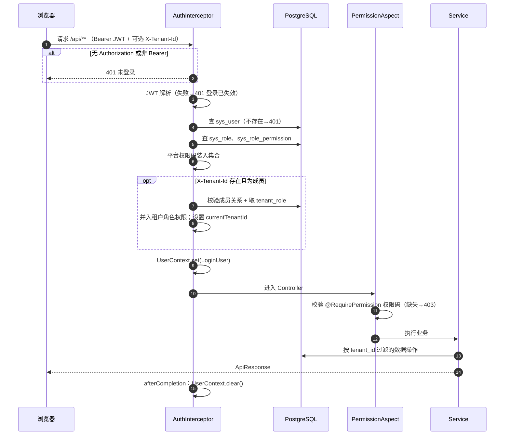

**要点**

- 无 `X-Tenant-Id` 或非法租户头时，`currentTenantId` 为空——用户中心接口仍可用，租户级接口由 `TenantSupport.requireTenantId()` 抛出"请先选择租户"。
- 租户角色权限与平台角色权限**叠加**，取并集。
- Agent 侧独立鉴权：`X-Internal-Token` 与配置 `DAP_AGENT_TOKEN` 比对，失败返回 401。

### 7.3 安全控制清单

| 面 | 控制 |
|---|---|
| 密码 | BCrypt 摘要存储；长度与复杂度校验 |
| 令牌 | JWT（HS 签名），默认 24h 过期；前端 localStorage 持有；401 自动清理并跳登录 |
| 越权 | 资源级归属校验（`requireOwnedPersonal`、`requireOwnedByCreator`、`requireCurrentHandler`） |
| 目录穿越 | 显示名禁止 `/`、`\`、`..`；路径 `normalize()` 后必须 `startsWith` 数据根/工作空间根/Wiki 根 |
| 注入 | MyBatis-Plus 参数绑定；权限码常量集合比对 |
| XSS | 助手消息 Markdown 渲染经 DOMPurify 过滤 |
| 内网防护 | Agent 仅服务端调用；`X-Internal-Token` 强校验 |

---

## 8. 数据架构

### 8.1 数据域划分

| 域 | 表 | 归属积木 |
|---|---|---|
| 平台与权限域 | `sys_user`、`sys_role`、`sys_permission`、`sys_role_permission`、`sys_tenant`、`sys_tenant_user` | 01 |
| 租户主数据域 | `sys_position`、`sys_position_skill`、`sys_product`、`sys_product_version`、`sys_req_task_type`、`sys_user_tenant_context`、`sys_user_tenant_context_skill` | 02 |
| 需求与任务域 | `req_requirement`、`req_requirement_flow`、`req_requirement_handler`、`req_requirement_no_seq`、`req_requirement_task`、`req_requirement_task_handler`、`req_requirement_task_input` | 03 |
| 工作台域 | `sys_workspace`、`sys_workspace_node`、`wb_chat_session`、`wb_session_context`、`wb_chat_message` | 04 |
| 知识域 | `sys_wiki_node`（被 `wb_session_context`、`req_requirement_task_input` 引用） | 05 |

### 8.2 关系模型（平台与租户域）

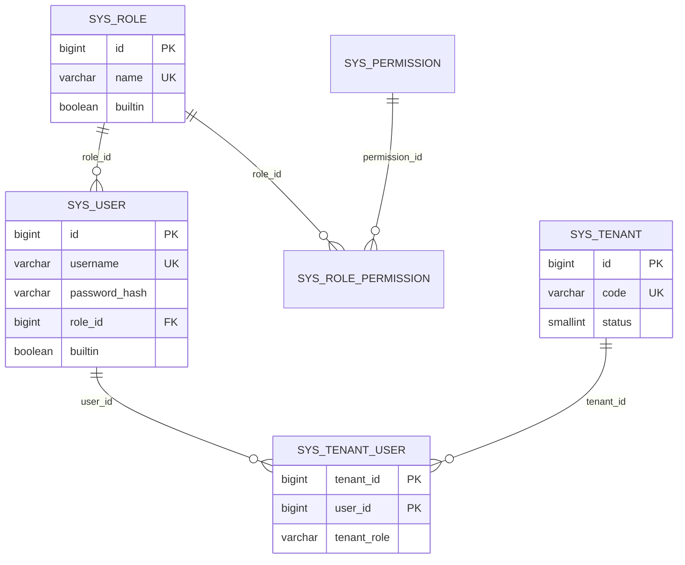

### 8.3 关系模型（业务域）

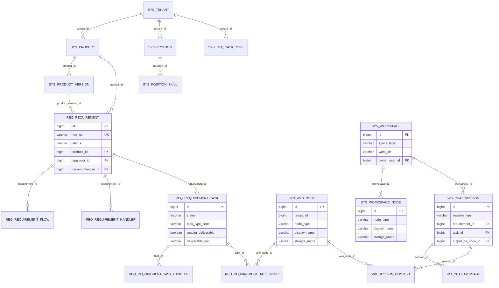

### 8.4 数据归属与清理策略

| 场景 | 处理 |
|---|---|
| 删除租户 | 按依赖顺序删除需求任务 → 任务类型 → 需求 → 编号序列 → 产品 → 工作空间节点/空间 → 会话 → 上下文 → 岗位技能/岗位 → 成员 → 租户；最后删除磁盘租户目录 |
| 删除需求 | 创建人可删；`flow`/`handler`/`task` 级联；工作空间节点 `requirement_id` 置空 |
| 删除个人空间 | 服务层递归删节点与磁盘，再删空间；会话经外键 `ON DELETE CASCADE` |
| 删除 Wiki 节点 | 递归删子树（记录 + 磁盘）；引用方 `ON DELETE CASCADE` 清理会话上下文与任务输入 |
| 删除产品/版本 | 若已关联需求则拒绝，并提示明确文案 |

---

## 9. 文件存储架构

### 9.1 磁盘布局

```
data/                              ← dap.data.root（默认 ../data）
└── {租户编码}/                     ← 例如 dev
    ├── {用户账号}/                 ← 个人域
    │   └── {workDir}/             ← 工作空间（英数下划线）
    │       ├── .dap/manifest.json ← 节点索引（Agent 可读）
    │       └── {uuid}/...          ← 目录用 UUID 名
    │       └── {uuid}.md           ← 文件用 UUID + 扩展名
    ├── wiki/                      ← 租户公共域
    │   ├── .dap/manifest.json     ← 含 tenantId 与全量节点
    │   └── {uuid}/{uuid}.md
    └── share/{workDir}/            ← 历史共享空间分支（V1.0 不再使用）
```

### 9.2 双名模型

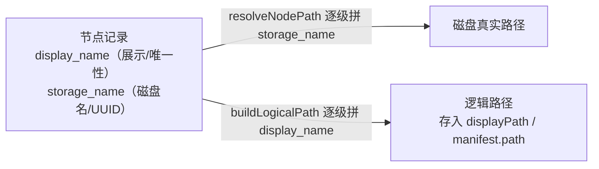

- **显示名**：用户可见，同级唯一（数据库唯一索引 + 服务层预校验）。
- **存储名**：UUID（文件带原扩展名），避免中文/重名/大小写/长度问题。
- **逻辑路径**：如 `产品A/REQ-2026-00001/原始需求.md`，写入 `wb_session_context.display_path`、`req_requirement_task_input.display_path` 与会话 VO。

### 9.3 manifest 生成与一致性

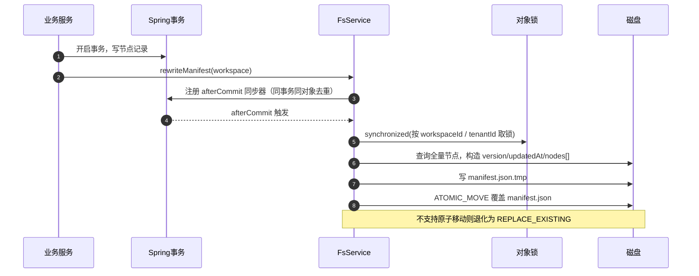

manifest 结构（字段级细节见详细设计 §6）：

```json
{
  "version": 1,
  "workspaceId": 12,
  "updatedAt": "2026-02-05T10:00:00Z",
  "nodes": [
    { "id": 31, "parentId": null, "type": "DIR", "name": "设计", "path": "设计", "storage": "ab12...", "storagePath": "ab12..." },
    { "id": 32, "parentId": 31, "type": "FILE", "name": "方案.md", "path": "设计/方案.md", "storage": "cd34....md", "storagePath": "ab12.../cd34....md" }
  ]
}
```

> Wiki 的 manifest 额外包含 `tenantId`，其余结构一致。

### 9.4 一致性保证与失效模式

| 保证 | 机制 |
|---|---|
| 事务回滚不产生"幽灵文件索引" | manifest 延迟到 `afterCommit` 重写 |
| 同事务多次变更不重复写 | 事务资源标记去重 |
| 并发写不产生半截 JSON | 按对象加锁 + 临时文件 + 原子替换 |
| 磁盘删除失败不阻塞业务 | 捕获异常记 `warn` 日志，继续数据库清理 |
| 路径不越界 | `normalize()` 后校验 `startsWith` 根路径 |
| 目录内容不进入文件树 | `.dap` 为元数据目录，不入库、不展示 |

---

## 10. 核心链路：AI 流式会话

### 10.1 端到端时序

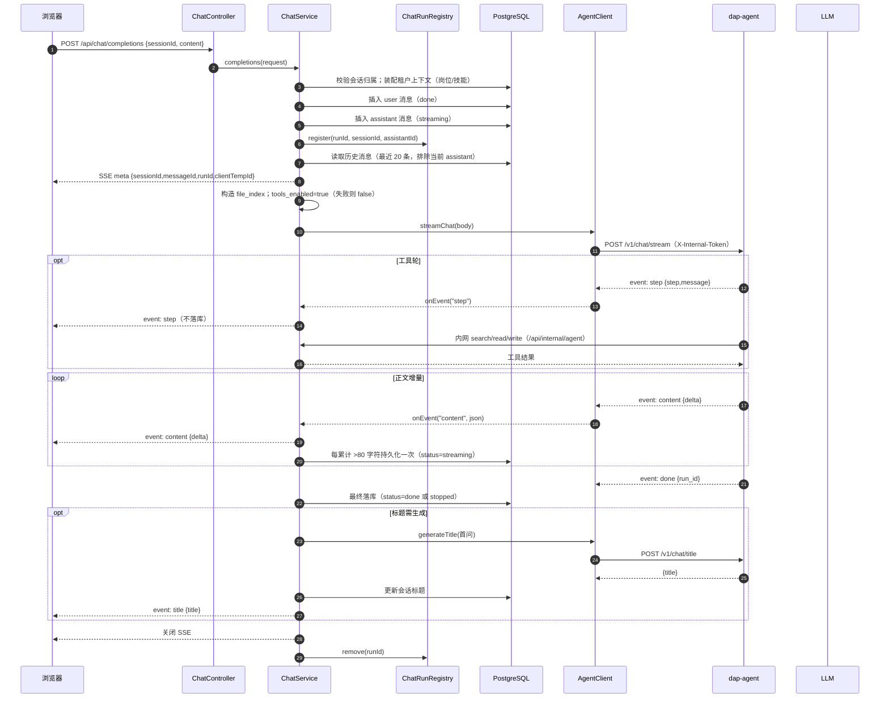

### 10.2 停止生成

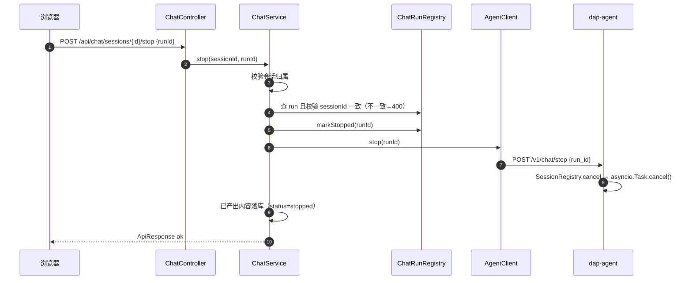

### 10.3 关键设计点

| 点 | 说明 |
|---|---|
| 双 SSE 链路 | 浏览器 ↔ Java、Java ↔ Agent 各一条 SSE；Java 逐事件解析转发，不缓冲整体响应 |
| 打字机与步骤 | `content` 增量渲染；`step` 仅前端展示（处理中/已处理耗时），不落库 |
| SSE 防缓冲 | 代理禁缓冲；日志 Filter 不得包装 SSE 响应体 |
| 逐段落库 | 每累计 >80 字符落一次库，兼顾"刷新可续看"与写库压力 |
| 运行态注册表 | `ChatRunRegistry` 存 `runId → (sessionId, messageId, stopped)`，是停止语义的唯一权威 |
| 停止竞态 | Agent 端 `Task.cancel()` + Java 端 `stopped` 标志双重保障，避免停止后继续追加内容 |
| 无会话禁止对话 | `sessionId` 必填（`@NotNull`），服务端二次校验归属 |
| 提示词组成 | System（岗位 + 技能 + 角色约束 + 可选材料索引指引）+ 历史 |
| Agent 工具 | `search_docs` / `read_docs` / `write_output` → Java `/api/internal/agent/*`；产物写入会话输出目录 |
| 上下文边界 | System Prompt 不自动拼 Wiki 全文；引用表 `wb_session_context` 仍只存路径；正文由工具按需读取 |
| 超时与异常 | 连接超时 3s、读超时 300s；Agent 返回 ≥400 → 502 明确错误；异常时消息状态置 `error` |

---

## 11. 核心链路：Wiki 产物与发布

### 11.1 投入研发写产物

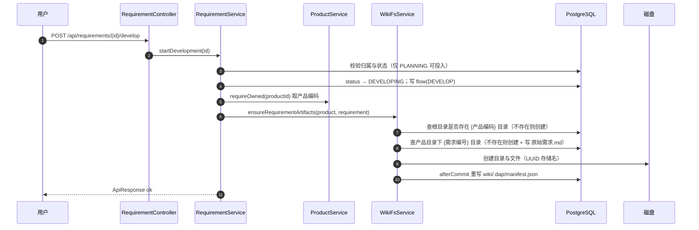

### 11.2 个人文件发布到 Wiki

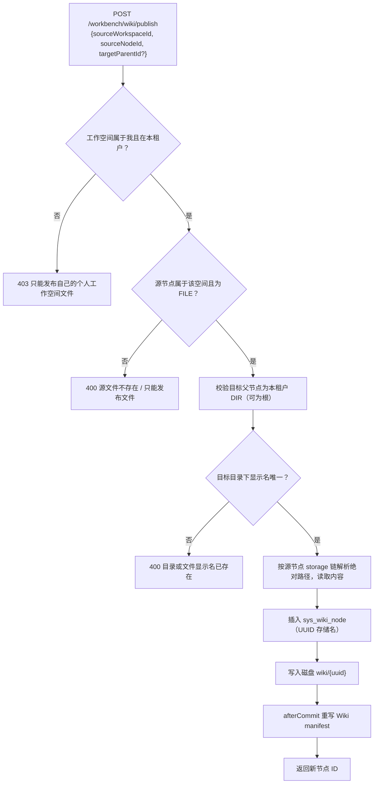

### 11.3 引用关系与级联

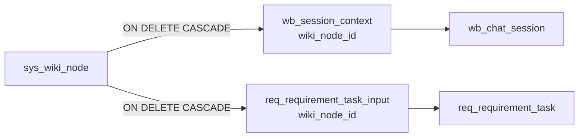

---

## 12. 事务、并发与一致性

| 关注点 | 机制 | 位置 |
|---|---|---|
| 需求编号并发 | 序号表行级 `SELECT ... FOR UPDATE`，`last_seq` 默认 -1 起始 | `RequirementService.nextReqNo` |
| 状态流转并发 | 先读后校验再更新，需以"当前处理人"作为天然串行点；建议后续加乐观锁 | `RequirementService` |
| 会话上下文替换 | 删除旧集合 + 按 `LinkedHashSet` 去重插入，单事务 | `WorkspaceSessionService.replaceContexts` |
| 磁盘与数据库一致性 | manifest 走 `afterCommit`；文件写在事务内，失败抛业务异常回滚 | `FsService` |
| manifest 并发写 | `ConcurrentHashMap` 按对象取锁 + `synchronized` + 原子替换 | `WorkspaceFsService` / `WikiFsService` |
| SSE 线程模型 | cachedThreadPool 异步执行，`SseEmitter(0L)` 不超时；`onCompletion` 清理注册表 | `ChatService` |
| 运行态存储 | 进程内 `ConcurrentHashMap`（单实例语义）——多实例部署需外置 | `ChatRunRegistry`、`AgentSessionRegistry` |
| 长事务规避 | 磁盘 IO 在事务内但为轻量文件操作；历史消息截断降低 Prompt 体积 | 全局 |

**已知一致性缺口（V1.0 接受）**

1. 需求/任务状态更新未使用乐观锁（`@Version`），高并发同单据操作可能后写覆盖先写（当前以"当前处理人"约束降低概率）。
2. 运行态注册表为进程内存储，`dap-server` / `dap-agent` 多实例部署会导致停止与取消失效。
3. 磁盘删除失败仅告警，可能产生孤儿文件（数据库已清理）。

---

## 13. 技术选型

| 层 | 选型 | 版本 | 理由 |
|---|---|---|---|
| 前端框架 | Vue 3 + TypeScript | 3.5 / 5.x | 组合式 API，生态成熟 |
| 构建 | Vite | 8.x | 秒级冷启动，代理配置灵活（SSE 关闭超时） |
| UI | Element Plus | 2.14 | 企业级中后台组件完备 |
| 状态 | Pinia | 4.x | 轻量、TS 友好 |
| 路由 | Vue Router | 5.x | `meta` 驱动的权限/租户守卫 |
| Markdown | marked + DOMPurify | 18 / 3.4 | 渲染与 XSS 过滤 |
| 后端框架 | Spring Boot | 4.1.2 | Java 21、Jakarta、拦截器/AOP 齐备 |
| 持久层 | MyBatis-Plus | 3.5.14 | SQL 可控 + 分页/条件构造 |
| 迁移 | Flyway | Boot 4 Starter | 版本化 schema，V1–V10 已归并 |
| 数据库 | PostgreSQL | 14+ | schema 隔离、表达式唯一索引（`COALESCE(parent_id,0)`） |
| 连接池 | HikariCP | 内置 | Spring Boot 4 下 Druid Boot3 Starter 不兼容 |
| 鉴权 | JJWT | 0.12.6 | 无状态 JWT |
| 密码 | spring-security-crypto | BCrypt | 业界标准摘要 |
| 推理服务 | FastAPI + uvicorn | 0.161 / 0.54 | 原生异步 + SSE |
| Agent 框架 | LangChain + langchain-openai | 1.4 / 1.7 | 模型可替换、流式原生支持 |
| 配置 | pydantic-settings + .env | 2.16 | 环境隔离 |

---

## 14. 质量属性与风险

### 14.1 质量属性权衡

| 属性 | 现状 | 主要手段 |
|---|---|---|
| 安全性 | 中上 | JWT + 双层权限 + 归属校验 + 路径校验 + 内网 token |
| 可扩展性 | 中 | 模块化分包；新增业务需加模块与迁移；权限码需双端同步 |
| 性能 | 中 | 索引覆盖高频查询；Prompt 有上限；SSE 无缓冲转发 |
| 可维护性 | 中上 | 一处一职责；Flyway 版本化；DSL 化的状态枚举 |
| 可观测性 | 中 | 请求日志过滤器 + 关键业务日志；无链路追踪/指标 |
| 可移植性 | 中 | 磁盘强依赖本地文件系统；多实例需共享存储 |

### 14.2 风险登记

| 风险 | 影响 | 缓解 |
|---|---|---|
| 运行态注册表进程内存储 | 多实例下停止生成失效 | 引入 Redis 等外置注册表 |
| 需求编号热点行 | 同产品高并发创建变慢 | 号段预取或 `SEQUENCE` |
| 状态更新无乐观锁 | 并发覆盖 | 增加 `version` 字段与重试 |
| Prompt 无 Wiki 正文 | AI 缺少业务上下文 | 会话构造阶段读取引用正文并做预算控制 |
| 磁盘与库弱一致 | 孤儿文件/空索引 | 增加巡检任务与补偿接口 |
| 上传能力缺失 | 仅 md 可用 | 增加对象存储 + 上传接口 |
| Agent 单点 | 对话不可用 | 多副本 + 服务端重试与降级文案 |

---

## 15. 演进路线

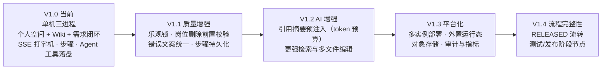

| 阶段 | 关键交付 |
|---|---|
| V1.1 | 需求/任务乐观锁；岗位技能删除前置校验；统一错误码；工作步骤落库可回看 |
| V1.2 | 可选：会话构造预读 Wiki 引用摘要（token 预算）；增强检索与批量编辑策略 |
| V1.3 | 运行态与锁外置（Redis）；文件存储抽象为对象存储；结构化日志 + 指标 + 链路追踪；审计表 |
| V1.4 | `RELEASED` 流转与版本闭环；详设/测试/发布阶段节点；评审工单与异议门禁 |

---

## 附录：架构与需求/详设的对应关系

| 架构章节 | 对应需求 | 对应详细设计 |
|---|---|---|
| §3 总体架构 | 全部 | §2 全局约定 |
| §5 分层与模块 | §2.1 业务积木 | §3 模块与类设计 |
| §7 安全架构 | §3 角色与权限 | §3.1 安全层、§5.1 登录流程 |
| §8 数据架构 | §8 状态与枚举 | §2 数据库详细设计 |
| §9 文件存储架构 | FR-04-07、FR-05-05 | §6 磁盘与清单 |
| §10 AI 流式会话 | FR-04-13～FR-04-17（含步骤/工具/复制） | 详设 §4.2 SSE、§8 Agent 工具 |
| §11 Wiki 产物与发布 | FR-03-05、FR-05-06、FR-05-08 | §5.5 发布与产物流程 |
