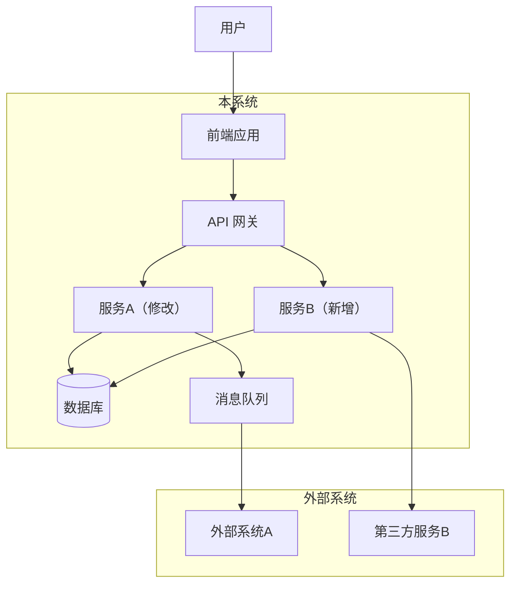
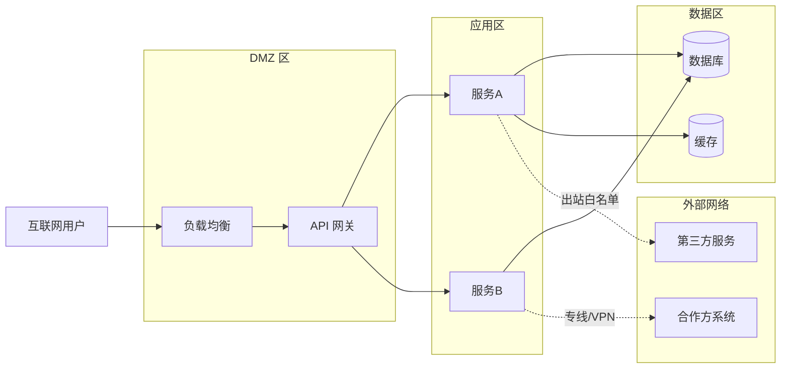
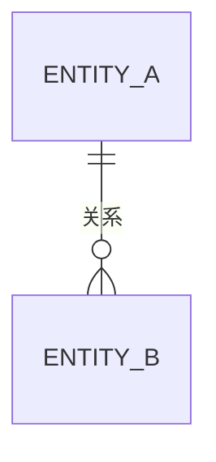

架构设计文档 · {产品名称} · {需求编号}
0. 文档元数据
项	内容
文档类型	ARCH
归属需求	{需求编号} {需求名称}
产品 / 模块	{产品名称} / {模块名}
版本	V0.0.1
状态	草稿 / 评审中 / 已冻结 / 已归档
作者（AI）	AI架构师
评审人	{架构师} / {研发} / {测试}
变更来源	{发布后合并时填写：合并自版本号，涉及需求列表}
1. 设计目标与约束
1.1 要解决的问题
用 3–5 句话说明本需求在架构层面要解决什么问题，不重复 PRD 的业务描述。

1.2 架构目标
目标	说明	衡量方式
{如：不引入新中间件}	{为什么}	{如何验证}
{如：保持现有模块边界}	{为什么}	{如何验证}
{如：支持水平扩展}	{为什么}	{如何验证}
1.3 硬约束
约束	来源	是否可变更
{如：必须复用现有鉴权体系}	组织规范 / 历史决策	不可变更 / 需架构委员会评审
{如：数据库版本不可升级}	运维约束	不可变更
{如：不能引入新的编程语言}	团队约束	需架构委员会评审
1.4 明确不做的事
不做的事	原因
{如：本次不改造消息队列}	{与需求无关 / 风险过高 / 后续独立立项}
{如：不做多租户隔离改造}	{不在本次需求范围}
2. 架构图（当前系统与外部系统交互）
必须展示：本需求涉及的系统、外部依赖系统、用户/客户端、数据流向。标注新增、修改、复用的部分。

图例约定：

实线框 = 本需求涉及

虚线框 = 不涉及但需展示的上下文

标注“新增 / 修改 / 复用”区分变更类型

2.1 与外部系统的交互说明
外部系统	交互方式	协议	数据流向	本次是否变更
{外部系统A}	同步调用 / 异步消息 / 文件交换	HTTP / MQ / FTP	我方→对方 / 对方→我方 / 双向	新增 / 修改 / 不变
{第三方服务B}	同步调用	HTTPS	我方→对方	新增
2.2 与现有系统的关系
关系类型	涉及系统/模块	说明
新增	{模块名}	{新增原因}
修改	{模块名}	{修改点}
复用	{模块名}	{复用方式}
废弃	{模块名}	{废弃原因与迁移策略}
3. 网络拓扑图（内部通信与网络边界）
必须展示：部署单元、网络区域划分、跨区域通信方式、网络边界（防火墙/网关/代理）、与外部系统的网络连接。

3.1 网络区域与部署单元
区域	部署单元	说明
DMZ	{负载均衡 / 网关}	{对外暴露的入口}
应用区	{服务A / 服务B}	{内网服务，不直接对外}
数据区	{数据库 / 缓存}	{仅应用区可访问}
3.2 通信方式
调用方	被调用方	协议	端口	同步/异步	是否跨网络区域
{服务A}	{服务B}	HTTP / gRPC / MQ	{端口}	同步 / 异步	是 / 否
{服务A}	{第三方服务}	HTTPS	443	同步	是（出站）
3.3 网络边界与安全策略
边界	策略	说明
互联网 → DMZ	仅开放 {端口}，WAF 防护	{入口控制}
DMZ → 应用区	仅允许网关访问指定服务	{内部横向控制}
应用区 → 数据区	仅允许指定服务访问指定库	{数据访问控制}
应用区 → 外部网络	出站白名单	{第三方调用控制}
3.4 与外部系统的网络连接
外部系统	连接方式	网络路径	带宽/延迟要求	安全措施
{第三方服务}	公网 HTTPS	应用区 → NAT → 互联网	{要求}	{TLS / IP 白名单}
{合作方系统}	专线 / VPN	应用区 → 专线 → 合作方	{要求}	{专线加密 / 双向认证}
4. 模块划分（粗粒度）
只到模块级，不展开类/函数。详设阶段再细化到符号级。

4.1 模块清单
模块名	职责	边界（做什么 / 不做什么）	变更类型
{module-a}	{一句话职责}	做：{…}；不做：{…}	新增 / 修改 / 复用
{module-b}	{一句话职责}	做：{…}；不做：{…}	新增 / 修改 / 复用
规则：每个模块的“不做”必须显式写出，这是防止后续需求越界的关键。

4.2 模块间关系
调用方	被调用方	通信方式	说明
{module-a}	{module-b}	同步接口 / 异步消息 / 共享数据	{调用目的}
5. 技术选型
架构师在这一节决定“用什么技术、为什么不用别的”，不写具体实现，不写接口字段和错误码。

5.1 选型决策
决策点	选型	备选方案	选择理由	放弃备选的理由
{如：消息队列}	{Kafka}	{RocketMQ / RabbitMQ}	{理由}	{为什么不选}
{如：缓存方案}	{Redis Cluster}	{本地缓存 / 其他}	{理由}	{为什么不选}
{如：通信协议}	{gRPC}	{REST / MQ}	{理由}	{为什么不选}
{如：接口风格}	{RESTful}	{GraphQL / RPC}	{理由}	{为什么不选}
5.2 技术约束
约束	来源	是否可变更
{如：必须使用现有 ORM 框架}	团队规范	不可变更
{如：不能引入新的编程语言}	运维约束	需架构委员会评审
5.3 技术债
技术债	位置	影响	本次是否处理
{描述}	{模块/文件}	{影响}	是 / 否（计划何时处理）
6. 大致实现思路
用 3–8 条说明“这个需求在架构上大概怎么落地”，不写代码、不写接口字段、不写类图。目的是让人判断“方向对不对”。

编号	实现要点	涉及模块	说明
IMP-01	{如：新增一个独立服务承接订单拆单逻辑}	{服务B}	{为什么独立、不独立的后果}
IMP-02	{如：通过消息队列解耦订单与库存}	{服务A、MQ}	{同步改异步的原因}
IMP-03	{如：复用现有鉴权，不新建权限体系}	{服务A}	{复用方式}
7. 数据模型（实体级）
只列核心实体和关系，字段级细节、DDL、索引放详设。

7.1 核心实体
实体	说明	存储位置	变更类型
{Entity}	{业务含义}	{库/表/缓存}	新增 / 修改 / 复用
7.2 实体关系

7.3 数据变更类型
变更项	变更类型	说明
{表/实体}	新增表 / 新增字段 / 修改字段 / 删除	{影响范围}
数据删除或类型变更必须在此标注，并在 §9 风险中登记。

8. 非功能设计
只写架构层面的非功能决策与目标，不写具体参数配置。具体参数在详设或运维配置中定义。

8.1 性能
维度	架构级决策/目标	说明
响应时间	{如：核心接口 P95 ≤ 200ms}	{目标依据、测量方式}
吞吐量	{如：峰值 1000 QPS}	{峰值场景、压测方式}
并发能力	{如：支持 500 并发用户}	{并发模型、连接池策略}
数据量增长	{如：日增 10 万条，3 年 1 亿条}	{容量规划、分表分库策略}
缓存策略	{如：热点数据本地缓存 + Redis 二级缓存}	{缓存粒度、失效策略}
异步化	{如：非核心链路走消息队列}	{哪些环节异步、为什么}
8.2 安全
安全面	架构级决策	验证方式
身份认证	{如：复用现有 JWT，不新建认证体系}	{接口测试}
权限控制	{如：接口级权限码 + 数据级归属校验}	{越权测试}
数据隔离	{如：tenant_id 行级隔离 / 独立 schema}	{跨租户测试}
敏感数据	{如：手机号加密存储、日志脱敏}	{代码审查 + 扫描}
输入校验	{如：统一参数校验框架，防注入}	{安全测试}
传输安全	{如：内部服务间 mTLS / 外部 HTTPS}	{配置审查}
审计	{如：关键操作写审计日志}	{日志验证}
8.3 可用性与容错
场景	架构级决策	降级策略
依赖服务不可用	{如：超时 3s、重试 2 次、熔断阈值 50%}	{降级返回缓存 / 默认值 / 友好提示}
数据库故障	{如：主从切换、读写分离}	{只读模式 / 排队重试}
消息队列积压	{如：监控阈值告警、消费者水平扩容}	{限流 / 丢弃非核心消息}
流量突增	{如：网关限流、队列削峰}	{拒绝策略 / 排队}
部署升级	{如：滚动发布、蓝绿部署}	{快速回滚策略}
单点故障	{如：多副本部署、无状态服务}	{自动摘除 / 流量切换}
8.4 数据一致性
场景	一致性要求	架构级决策	补偿机制
{如：订单与库存}	强一致 / 最终一致	{如：本地事务 / 分布式事务 / 消息最终一致}	{如：对账任务 / 补偿消息}
{如：跨服务写操作}	最终一致	{如：Saga / TCC / 本地消息表}	{失败重试 / 人工介入}
{如：缓存与数据库}	最终一致	{如：先更新库再删缓存 / 延迟双删}	{缓存过期兜底}
8.5 可扩展性
维度	架构级决策	说明
水平扩展	{如：服务无状态，支持多副本}	{扩展方式、上限}
垂直扩展	{如：数据库读写分离}	{瓶颈点}
功能扩展	{如：插件化 / 策略模式}	{新增业务如何接入}
数据扩展	{如：分库分表预留}	{分片键、迁移策略}
8.6 可观测性
维度	架构级决策	说明
日志	{如：结构化日志、traceId 贯穿、敏感字段脱敏}	{日志级别、保留周期}
指标	{如：采集 QPS、延迟、错误率、队列深度、连接池使用率}	{监控大盘}
链路追踪	{如：接入 OpenTelemetry，跨服务传递 traceId}	{采样率}
告警	{如：错误率 > 1% 告警、P99 > 1s 告警}	{告警渠道、升级策略}
健康检查	{如：/health 端点、依赖服务探活}	{探活频率、摘除策略}
8.7 兼容性
维度	架构级决策	说明
接口兼容	{如：新增字段不破坏旧调用方、版本化路径}	{废弃策略}
数据兼容	{如：新增字段允许 null、不删旧字段}	{迁移窗口}
客户端兼容	{如：支持旧版 App 至少 N 个版本}	{灰度策略}
浏览器兼容	{如：Chrome/Edge 最新两个版本}	{降级方案}
8.8 可维护性
维度	架构级决策	说明
模块边界	{如：按业务域分包，禁止跨层调用}	{依赖规则}
配置管理	{如：配置外置、环境隔离}	{配置变更流程}
文档同步	{如：架构变更必须更新架构文档}	{同步机制}
9. 风险与取舍
9.1 风险登记
风险	类型	影响	概率	缓解措施
{风险描述}	技术 / 业务 / 进度	高/中/低	高/中/低	{缓解措施}
9.2 关键取舍
取舍点	选择了	放弃了	原因	代价
{如：一致性 vs 可用性}	{选择}	{放弃}	{原因}	{代价与接受理由}
{如：开发效率 vs 性能}	{选择}	{放弃}	{原因}	{代价与接受理由}
10. 架构变更记录（ArchitectureChangeRecord）
记录本需求对租户级架构文档的待合并变更。发布后由平台批量合并到架构文档主版本。

编号	变更类型	目标模块/系统	变更前摘要	变更后摘要	状态
ACR-01	新增模块 / 修改模块 / 新增外部依赖 / 网络拓扑变更 / 技术选型变更	{模块名/系统名}	{before}	{after}	待合并
11. 待确认事项
编号	事项	需要谁确认	截止时间	状态
Q-01	{待确认问题}	{角色}	{日期}	待确认 / 已确认
