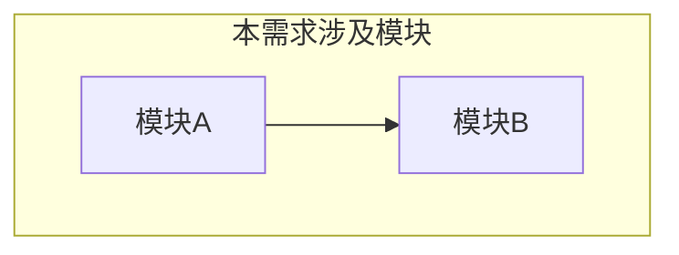
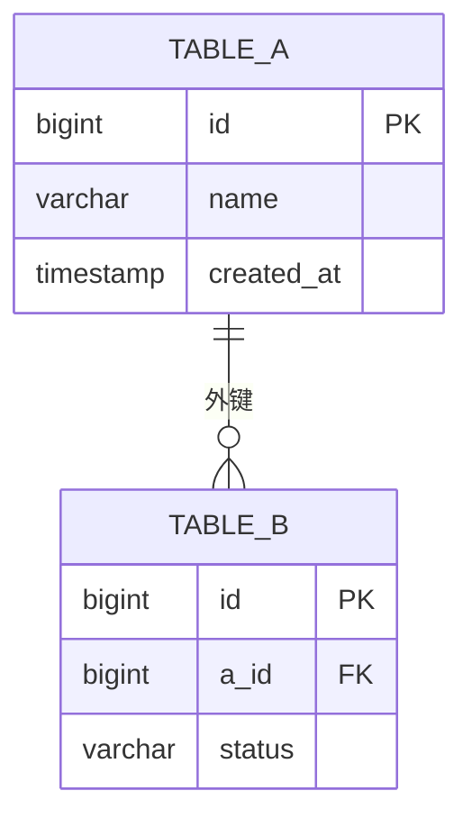
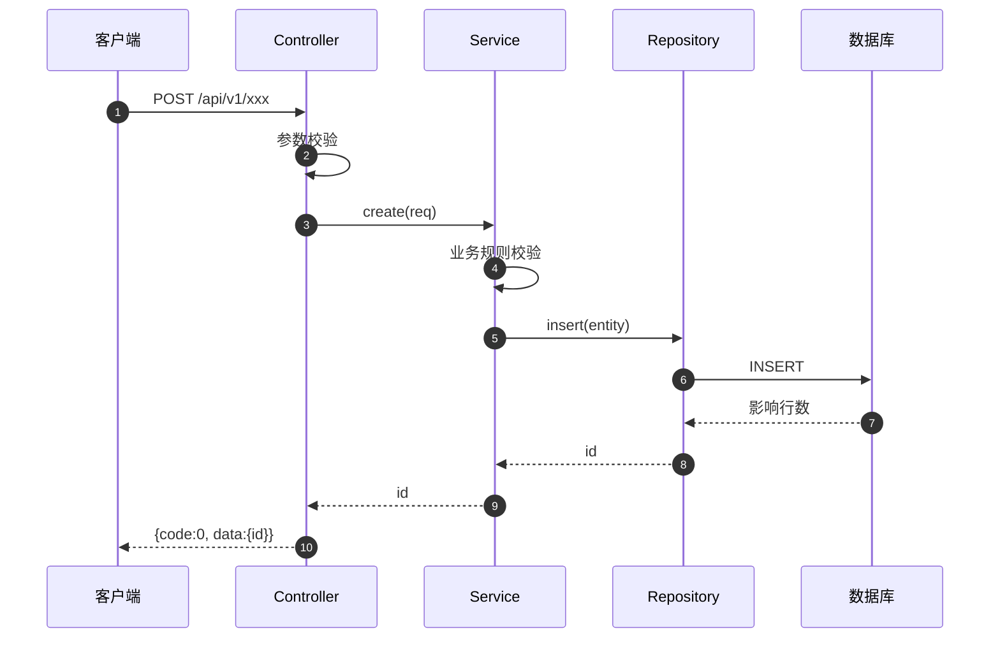

# 详细设计文档 · {产品名称} · {需求编号}

## 0. 文档信息

| 项 | 内容 |
|---|---|
| 需求编号 | {REQ-YYYY-XXXXX} |
| 文档名称 | {产品/需求名称} 详细设计说明书 |
| 文档类型 | DETAIL |
| 版本 | V0.0.1 |
| 状态 | 草稿 / 评审中 / 已冻结 / 已归档 |
| 归属产品 / 模块 | {产品名称} / {模块名} |
| 作者 | {研发/角色} |
| 评审人 | {架构} / {研发} / {测试} |
| 创建日期 | {YYYY-MM-DD} |
| 最后更新 | {YYYY-MM-DD} |
| 关联文档 | PRD：{链接}；架构设计：{链接}；接口契约：{openapi.json 链接} |

### 修订记录

| 版本 | 日期 | 修改内容 | 修改人 |
|---|---|---|---|
| V0.0.1 | {日期} | 初稿 | {姓名} |
| V1.1 | {日期} | {修改说明} | {姓名} |

---

## 1. 概述

### 1.1 设计范围

说明本文档覆盖的需求范围、涉及的模块，以及与架构设计文档的对应关系。

| 项 | 内容 |
|---|---|
| 覆盖需求 | {FR-001、FR-002…} |
| 涉及模块 | {模块列表} |
| 上游架构文档 | {架构文档版本与链接} |
| 不在本文档范围 | {明确排除的内容，如：部署运维细节、前端视觉稿} |

### 1.2 设计目标与约束

| 类型 | 内容 |
|---|---|
| 设计目标 | {如：可测试、可扩展、与现有代码风格一致} |
| 技术约束 | {语言版本、框架版本、禁止引入的依赖} |
| 兼容性约束 | {需兼容的旧接口、旧数据、旧客户端版本} |
| 性能约束 | {来自 PRD/架构的非功能指标} |

### 1.3 术语与缩写

| 术语 | 定义 |
|---|---|
| {术语} | {定义} |

---

## 2. 总体设计

### 2.1 模块结构



### 2.2 模块职责与边界

| 模块 | 职责 | 边界（做什么 / 不做什么） | 依赖模块 |
|---|---|---|---|
| {模块A} | {职责} | 做：{…}；不做：{…} | {依赖列表} |
| {模块B} | {职责} | 做：{…}；不做：{…} | {依赖列表} |

### 2.3 分层与包结构

```
com.{company}.{product}
├── controller/       接口层
├── service/          业务层
├── repository/       持久层
├── domain/           领域模型
├── dto/              数据传输对象
├── config/           配置
└── common/           公共组件
```

> 按实际项目结构调整；说明新增/修改的包及其职责。

### 2.4 类设计（整体）

> 本节展示本需求涉及的全部类及其关系，不分模块拆散。评审时从整体视角判断类职责是否清晰、依赖是否合理、有无循环依赖。

| 类名 | 所属模块 | 类型 | 职责 | 依赖 |
|---|---|---|---|---|
| {XxxController} | {模块A} | Controller | {职责} | {XxxService} |
| {XxxService} | {模块A} | Service | {职责} | {XxxRepository} |
| {XxxRepository} | {模块A} | Repository | {职责} | {DB} |
| {YyyService} | {模块B} | Service | {职责} | {XxxService、ZzzClient} |
| {ZzzClient} | {模块B} | Client | {职责} | {外部服务} |
| {XxxDTO} | {模块A} | DTO | {职责} | — |

**类设计检查项**：

| 检查项 | 结论 | 说明 |
|---|---|---|
| 是否存在循环依赖 | 是 / 否 | {如有，说明打破方式} |
| 类职责是否单一 | 是 / 否 | {如有职责过载的类，说明拆分计划} |
| 跨模块依赖是否通过接口 | 是 / 否 | {如有直接依赖实现类，说明原因} |
| 是否有可复用的现有类 | 有 / 无 | {复用类列表，避免重复造轮子} |

### 2.5 关键设计决策

| 编号 | 决策 | 备选方案 | 选择理由 | 影响范围 |
|---|---|---|---|---|
| DD-01 | {如：采用策略模式处理多类型订单} | {if-else / 工厂} | {理由} | {涉及类} |
| DD-02 | {如：使用本地缓存减少DB查询} | {Redis / 不缓存} | {理由} | {涉及类} |

---

## 3. 模块详细设计

> 类设计已在 §2.4 整体给出，本节只说明每个模块的状态与并发、事务边界等运行时行为，不重复类定义。

### 3.1 {模块A}

#### 3.1.1 职责说明

{一段话说明该模块做什么、不做什么。}

#### 3.1.2 状态与并发

| 项 | 说明 |
|---|---|
| 状态机 | {如涉及，引用 PRD §6，说明实现方式} |
| 并发控制 | {乐观锁 / 悲观锁 / 分布式锁，说明锁粒度和超时} |
| 幂等设计 | {幂等键、去重表、Token 机制} |
| 事务边界 | {哪些操作在同一事务内，传播行为} |

### 3.2 {模块B}

#### 3.2.1 职责说明

{一段话说明该模块做什么、不做什么。}

#### 3.2.2 状态与并发

| 项 | 说明 |
|---|---|
| 状态机 | {说明} |
| 并发控制 | {说明} |
| 幂等设计 | {说明} |
| 事务边界 | {说明} |

---

## 4. 接口设计

> 本节说明接口的设计意图、字段定义、调用约定、错误码和幂等性。**字段级定义以此节为准**，`openapi.json` 由本节内容生成，二者必须一致。
>
> **变更标记说明**：字段表最后一列“变更标记”取值 `新增` / `修改` / `删除` / `—`（无变更）。接口清单中，新增接口整表标注为新增；变更接口只列出有变更的字段，并标注变更类型。

### 4.1 接口清单

| 接口名 | 方法 | 路径 | 权限码 | 幂等 | 变更类型 | 说明 |
|---|---|---|---|---|---|---|
| {createXxx} | POST | `/api/v1/xxx` | `xxx:operate` | 否 | 新增 | {用途} |
| {queryXxx} | GET | `/api/v1/xxx/{id}` | `xxx:view` | 是 | 新增 | {用途} |
| {updateXxx} | PUT | `/api/v1/xxx/{id}` | `xxx:operate` | 是 | 变更 | {用途} |
| {deleteXxx} | DELETE | `/api/v1/xxx/{id}` | `xxx:operate` | 是 | 不变 | {用途} |

### 4.2 接口详情

> 每个新增或变更的接口一小节。新增接口列出完整字段；变更接口列出完整字段，并在“变更标记”列标注每个字段的变更类型。不变的接口只列接口名和一句话说明，不展开字段。

#### 4.2.1 {createXxx}（新增）

| 项 | 内容 |
|---|---|
| 接口路径 | `POST /api/v1/xxx` |
| 接口说明 | {这个接口做什么、什么时候调用} |
| 权限码 | `xxx:operate` |
| 幂等 | 否 / 是（幂等键：{key}） |
| 限流 | {如：单用户 10 QPS} |
| 事务 | {是否开启事务、传播行为} |

**请求头**

| 头 | 必填 | 说明 |
|---|---|---|
| `Authorization` | 是 | `Bearer {jwt}` |
| `X-Tenant-Id` | 是 | 租户ID |

**请求字段**

| 字段 | 类型 | 必填 | 约束 | 默认值 | 说明 | 变更标记 |
|---|---|---|---|---|---|---|
| {field1} | String | 是 | 长度 1-64，非空 | — | {业务含义} | 新增 |
| {field2} | Integer | 否 | ≥0，≤9999 | 0 | {业务含义} | 新增 |
| {field3} | String | 否 | 枚举：A/B/C | A | {业务含义} | 新增 |
| {nested.field} | Object | 否 | — | — | {嵌套对象说明} | 新增 |
| {nested.field.subField} | Long | 是 | >0 | — | {子字段说明} | 新增 |
| {list[]} | Array | 否 | 最多 100 项 | [] | {数组说明} | 新增 |
| {list[].itemId} | Long | 是 | >0 | — | {数组元素字段} | 新增 |

**响应字段**

| 字段 | 类型 | 必返 | 说明 | 变更标记 |
|---|---|---|---|---|
| {code} | Integer | 是 | 0 成功，非 0 失败 | 新增 |
| {message} | String | 是 | 提示信息 | 新增 |
| {data.id} | Long | 是 | 新建记录ID | 新增 |
| {data.xxx} | String | 是 | {业务含义} | 新增 |

**请求示例**

```json
POST /api/v1/xxx
{
  "field1": "value1",
  "field2": 123,
  "field3": "A",
  "nested": { "subField": 1 },
  "list": [{ "itemId": 1 }]
}
```

**响应示例**

```json
{
  "code": 0,
  "message": "ok",
  "data": {
    "id": 1,
    "xxx": "value"
  }
}
```

**错误码**

| 错误码 | 含义 | 触发条件 |
|---|---|---|
| 400 | 参数错误 | {具体条件，如：field1 为空} |
| {自定义码} | {业务错误} | {如：同名记录已存在} |

#### 4.2.2 {updateXxx}（变更）

| 项 | 内容 |
|---|---|
| 接口路径 | `PUT /api/v1/xxx/{id}` |
| 接口说明 | {这个接口做什么} |
| 权限码 | `xxx:operate` |
| 幂等 | 是（幂等键：{id + version}） |
| 变更摘要 | {如：新增 `remark` 字段；`status` 枚举新增 `ARCHIVED`；删除 `oldField`} |

**请求字段**

| 字段 | 类型 | 必填 | 约束 | 默认值 | 说明 | 变更标记 |
|---|---|---|---|---|---|---|
| {id} | Long | 是 | 路径参数，>0 | — | 记录ID | — |
| {field1} | String | 是 | 长度 1-64 | — | {业务含义} | 修改（原：长度 1-32） |
| {field2} | Integer | 否 | ≥0 | 0 | {业务含义} | — |
| {remark} | String | 否 | 长度 ≤500 | — | {新增字段：备注} | **新增** |
| {status} | String | 是 | 枚举：A/B/C/ARCHIVED | A | {枚举新增 ARCHIVED} | 修改（枚举值新增） |
| {oldField} | String | — | — | — | {原字段，已废弃} | **删除** |

**响应字段**

| 字段 | 类型 | 必返 | 说明 | 变更标记 |
|---|---|---|---|---|
| {code} | Integer | 是 | 0 成功 | — |
| {data.updated} | Boolean | 是 | 是否更新成功 | — |

**变更兼容性说明**

| 变更项 | 兼容性 | 对调用方影响 | 迁移要求 |
|---|---|---|---|
| 新增 `remark` 字段 | 向后兼容 | 无影响（调用方可不传） | 无 |
| `status` 枚举新增 `ARCHIVED` | 向后兼容 | 调用方需能处理新枚举值 | 调用方升级前需兼容未知枚举 |
| 删除 `oldField` | **不兼容** | 调用方若仍传 `oldField` 将被忽略或报错 | 调用方需在 {日期} 前移除该字段 |

**请求示例**

```json
PUT /api/v1/xxx/1
{
  "field1": "value1",
  "field2": 123,
  "remark": "备注内容",
  "status": "ARCHIVED"
}
```

**错误码**

| 错误码 | 含义 | 触发条件 |
|---|---|---|
| 404 | 资源不存在 | id 对应记录不存在 |
| {自定义码} | 版本冲突 | 乐观锁 version 不匹配 |

#### 4.2.3 {queryXxx}（不变）

`GET /api/v1/xxx/{id}`，查询单条记录。字段定义见现有 `openapi.json`，本次无变更，不展开。

#### 4.2.4 {deleteXxx}（不变）

`DELETE /api/v1/xxx/{id}`，删除记录。本次无变更，不展开。

### 4.3 请求/响应通用约定

| 项 | 约定 |
|---|---|
| 统一响应体 | `{code, message, data}`，`code=0` 表示成功 |
| 分页参数 | `page`（从1开始）、`size`（默认20，最大100） |
| 分页响应 | `{total, records[]}` |
| 时间格式 | ISO-8601（`yyyy-MM-dd'T'HH:mm:ss`） |
| 鉴权头 | `Authorization: Bearer {jwt}` |
| 租户头 | `X-Tenant-Id`（租户级接口必填） |
| 空值约定 | 字段无值时，字符串传 `null` 或省略，不传空字符串 |

### 4.4 错误码定义（全局）

| 错误码 | HTTP 状态 | 含义 | 触发条件 | 前端处理建议 |
|---|---|---|---|---|
| 0 | 200 | 成功 | — | — |
| 400 | 200 | 参数错误 | {具体条件} | Toast 提示 message |
| 401 | 401 | 未登录/令牌失效 | {条件} | 跳转登录页 |
| 403 | 403 | 无权限 | {条件} | 提示无权限 |
| 404 | 200 | 资源不存在 | {条件} | 提示不存在 |
| {自定义码} | 200 | {业务错误} | {条件} | {处理建议} |
| 500 | 200 | 服务器内部错误 | 未捕获异常 | 提示稍后重试 |

### 4.5 幂等与重试

| 接口 | 幂等实现 | 重试策略 | 说明 |
|---|---|---|---|
| {接口名} | {幂等键 / 去重表 / Token} | {客户端重试次数与间隔} | {说明} |

### 4.6 接口变更汇总

> 汇总本次涉及的所有接口变更，供代码评审和调用方迁移参考。

| 接口 | 变更类型 | 变更内容 | 兼容性 | 影响调用方 |
|---|---|---|---|---|
| {createXxx} | 新增 | 新接口 | — | 无 |
| {updateXxx} | 变更 | 新增 `remark`；`status` 枚举新增 `ARCHIVED`；删除 `oldField` | 部分不兼容 | {调用方列表} |
| {queryXxx} | 不变 | — | — | 无 |
| {deleteXxx} | 不变 | — | — | 无 |

---

## 5. 数据设计

### 5.1 数据模型



### 5.2 表结构定义

#### {table_name}

| 字段 | 类型 | 约束 | 默认值 | 说明 |
|---|---|---|---|---|
| id | BIGSERIAL | PK | — | 主键 |
| tenant_id | BIGINT | NOT NULL, FK | — | 租户ID |
| name | VARCHAR(128) | NOT NULL | — | 名称 |
| status | VARCHAR(32) | NOT NULL | 'ACTIVE' | 状态：ACTIVE/INACTIVE |
| created_at | TIMESTAMP | NOT NULL | now() | 创建时间 |
| updated_at | TIMESTAMP | NOT NULL | now() | 更新时间 |

索引：

| 索引名 | 字段 | 类型 | 用途 |
|---|---|---|---|
| idx_xxx_tenant | (tenant_id) | 普通 | 租户过滤 |
| uk_xxx_name | (tenant_id, name) | 唯一 | 名称唯一 |

### 5.3 DDL 变更

```sql
-- 新增表
CREATE TABLE {table_name} (
    id BIGSERIAL PRIMARY KEY,
    tenant_id BIGINT NOT NULL,
    name VARCHAR(128) NOT NULL,
    status VARCHAR(32) NOT NULL DEFAULT 'ACTIVE',
    created_at TIMESTAMP NOT NULL DEFAULT now(),
    updated_at TIMESTAMP NOT NULL DEFAULT now()
);
CREATE INDEX idx_xxx_tenant ON {table_name}(tenant_id);
CREATE UNIQUE INDEX uk_xxx_name ON {table_name}(tenant_id, name);

-- 修改表
ALTER TABLE {table_name} ADD COLUMN {column} {type};

-- 新增索引
CREATE INDEX {idx_name} ON {table_name}({columns});
```

### 5.4 数据迁移与回滚

| 变更项 | 变更前 | 变更后 | 迁移脚本 | 回滚方案 |
|---|---|---|---|---|
| {表/字段} | {旧结构} | {新结构} | {脚本名} | {如何回滚} |

**规则**：涉及数据删除或类型变更的，必须有回滚方案；无回滚方案的变更不允许上线。

### 5.5 数据字典

| 字段 | 枚举值 | 含义 |
|---|---|---|
| status | ACTIVE | 启用 |
| status | INACTIVE | 停用 |

---

## 6. 关键流程设计

### 6.1 {流程名称}（如：创建流程）



**步骤说明**

| 步骤 | 操作 | 校验/规则 | 异常处理 |
|---|---|---|---|
| 1 | 参数校验 | {规则} | 400 参数错误 |
| 2 | 业务规则校验 | {规则} | 400 业务错误 |
| 3 | 写入数据库 | {约束} | 500 或回滚 |
| 4 | 返回结果 | — | — |

### 6.2 {流程名称}（如：状态流转流程）

（同上结构）

---

## 7. 异常处理设计

### 7.1 异常分类

| 异常类型 | 示例 | 处理方式 | 返回码 |
|---|---|---|---|
| 参数异常 | 必填字段为空、格式错误 | 统一参数校验，返回具体字段错误 | 400 |
| 业务异常 | 状态不允许、资源不存在 | 抛 BizException，携带错误码和消息 | 自定义码 |
| 权限异常 | 无权限、越权访问 | 拦截器/AOP 拦截 | 403 |
| 系统异常 | DB 超时、下游服务不可用 | 捕获后转 500，记录日志，告警 | 500 |

### 7.2 异常处理策略

| 场景 | 策略 | 说明 |
|---|---|---|
| 数据库操作失败 | 事务回滚 + 抛业务异常 | {说明} |
| 下游服务调用失败 | 超时 + 重试 + 降级 | {重试次数、降级行为} |
| 消息发送失败 | 本地消息表 + 定时补偿 | {补偿策略} |
| 并发冲突 | 乐观锁重试 / 返回冲突提示 | {重试次数} |

---

## 8. 非功能实现

### 8.1 性能实现

| 措施 | 实现方式 | 预期效果 |
|---|---|---|
| 索引优化 | {为哪些查询加索引} | {减少全表扫描} |
| 缓存 | {本地缓存/Redis，缓存什么、失效策略} | {降低 DB 压力} |
| 异步化 | {哪些操作异步、用什么队列} | {降低响应时间} |
| 批量处理 | {批量查询/批量写入} | {减少交互次数} |
| 分页 | {分页参数限制、深分页处理} | {避免大结果集} |

### 8.2 安全实现

| 安全面 | 实现方式 | 验证方式 |
|---|---|---|
| 鉴权 | {拦截器/JWT 校验} | 接口测试 |
| 权限 | {@RequirePermission 注解 + 权限码} | 越权测试 |
| 数据隔离 | {tenant_id 过滤 / 归属校验} | 跨租户测试 |
| 敏感数据 | {加密算法、脱敏规则} | 代码审查 |
| 输入校验 | {参数校验框架、SQL 参数绑定} | 安全测试 |
| XSS | {输出转义/过滤} | 安全测试 |
| 路径穿越 | {路径 normalize + 前缀校验} | 安全测试 |

### 8.3 并发与一致性

| 场景 | 并发问题 | 解决方案 | 说明 |
|---|---|---|---|
| {如：同一记录并发修改} | 丢失更新 | 乐观锁（version 字段） | {重试策略} |
| {如：编号生成} | 重复编号 | 序列表行锁 / 分布式ID | {说明} |
| {跨服务写} | 数据不一致 | 本地消息表 / Saga | {补偿机制} |

### 8.4 可观测性实现

| 维度 | 实现方式 |
|---|---|
| 日志 | {结构化日志、关键日志点、日志级别、敏感字段脱敏} |
| 指标 | {采集哪些指标、上报方式} |
| 链路追踪 | {traceId 注入与传递} |
| 健康检查 | {端点、检查项} |

---

## 9. 配置与依赖

### 9.1 配置项

| 配置键 | 默认值 | 说明 | 是否敏感 |
|---|---|---|---|
| {config.key} | {默认值} | {用途} | 是/否 |

### 9.2 外部依赖

| 依赖 | 版本 | 用途 | 引入方式 |
|---|---|---|---|
| {依赖名} | {版本} | {用途} | {maven/npm} |

### 9.3 环境差异

| 配置项 | 开发环境 | 测试环境 | 生产环境 |
|---|---|---|---|
| {配置} | {值} | {值} | {值} |

---

## 10. 测试要点

> 供测试角色设计测试用例参考，不替代测试用例文档。

| 测试类型 | 测试点 | 预期结果 |
|---|---|---|
| 功能测试 | {正常路径} | {结果} |
| 边界测试 | {边界条件} | {结果} |
| 异常测试 | {异常输入/异常状态} | {错误码与提示} |
| 并发测试 | {并发场景} | {无数据错乱、无死锁} |
| 权限测试 | {越权场景} | {403} |
| 性能测试 | {压测场景} | {满足指标} |
| 兼容性测试 | {旧接口/旧数据} | {兼容} |

---

## 11. 部署与发布

### 11.1 部署单元

| 单元 | 变更类型 | 说明 |
|---|---|---|
| {服务/应用} | 新增 / 修改 / 不变 | {说明} |

### 11.2 发布顺序

| 步骤 | 操作 | 依赖 | 回滚方式 |
|---|---|---|---|
| 1 | {DDL 变更} | — | {回滚脚本} |
| 2 | {服务发布} | DDL 完成 | {回滚到上一版本} |
| 3 | {配置更新} | 服务发布完成 | {恢复旧配置} |

### 11.3 回滚方案

| 场景 | 回滚操作 | 数据影响 | 验证方式 |
|---|---|---|---|
| {发布失败} | {回滚步骤} | {数据是否需回滚} | {验证方法} |

---

## 12. 风险与待确认事项

### 12.1 风险

| 风险 | 类型 | 影响 | 缓解措施 |
|---|---|---|---|
| {风险描述} | 技术/依赖/性能 | 高/中/低 | {措施} |

### 12.2 待确认事项

| 编号 | 事项 | 需要谁确认 | 截止时间 | 状态 |
|---|---|---|---|---|
| Q-01 | {问题} | {角色} | {日期} | 待确认 / 已确认 |

---

## 13. 附录

### 13.1 参考文档

| 文档 | 版本 | 链接 |
|---|---|---|
| PRD | {版本} | {链接} |
| 架构设计 | {版本} | {链接} |
| 接口契约 | {版本} | {openapi.json 链接} |

### 13.2 代码位置索引

| 模块 | 代码路径 | 说明 |
|---|---|---|
| {模块A} | {路径} | {说明} |

### 13.3 设计图附件

| 图名 | 类型 | 链接 |
|---|---|---|
| {图名} | 架构图/时序图/ER图 | {链接} |