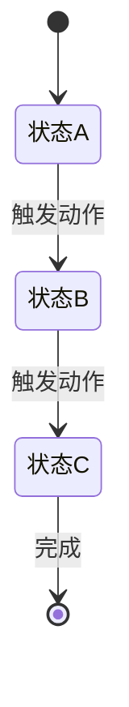

# 产品需求文档（PRD） · {产品/需求名称}

## 0. 文档信息

| 项 | 内容 |
|---|---|
| 需求编号 | {REQ-YYYY-XXXXX} |
| 文档名称 | {产品/需求名称} 产品需求说明书 |
| 版本 | V0.0.1 |
| 状态 | 草稿 / 评审中 / 已冻结 / 已归档 |
| 归属产品 / 模块 | {产品名称} / {模块名} |
| 作者 | {姓名/角色} |
| 评审人 | {产品} / {架构} / {研发} / {测试} |
| 创建日期 | {YYYY-MM-DD} |
| 最后更新 | {YYYY-MM-DD} |
| 关联文档 | {需求工单、上游规划文档、设计文档链接} |

### 修订记录

| 版本 | 日期 | 修改内容 | 修改人 |
|---|---|---|---|
| V0.0.1 | {日期} | 初稿 | {姓名} |
| V1.1 | {日期} | {修改说明} | {姓名} |

---

## 1. 背景与目标

### 1.1 背景

说明需求产生的业务背景、当前现状和存在的问题。

| 项 | 内容 |
|---|---|
| 业务背景 | {所属业务方向、当前阶段} |
| 现状问题 | {当前存在什么问题，尽量带数据或可观察现象} |
| 受影响对象 | {哪些用户/角色/业务受影响} |
| 不解决的后果 | {业务损失 / 效率损失 / 合规风险} |

### 1.2 需求目标

| 目标层级 | 目标描述 | 衡量指标 | 目标值 |
|---|---|---|---|
| 业务目标 | {业务结果} | {指标名} | {目标值} |
| 产品目标 | {用户使用后应达到的状态} | {指标名} | {目标值} |

### 1.3 成功标准

用可验证的方式描述“这个需求做完且做对了”的判断依据。

- {成功标准 1，如：用户可在 3 步内完成 XX 操作}
- {成功标准 2，如：XX 接口 P95 延迟 ≤ 500ms}
- {成功标准 3}

---

## 2. 范围

### 2.1 本期范围

| 模块 / 能力 | 说明 | 优先级 |
|---|---|---|
| {模块/能力} | {做什么} | P0 / P1 / P2 |

### 2.2 不在本期范围

| 不做的内容 | 原因 |
|---|---|
| {功能/能力} | {不在本期规划 / 依赖未就绪 / 后续独立立项} |

---

## 3. 用户与场景

### 3.1 目标用户

| 角色 | 说明 | 核心诉求 |
|---|---|---|
| {角色A} | {角色描述} | {在本需求中的诉求} |
| {角色B} | {角色描述} | {在本需求中的诉求} |

### 3.2 使用场景

| 场景编号 | 场景名称 | 触发条件 | 涉及角色 | 期望结果 |
|---|---|---|---|---|
| SC-01 | {场景名} | {什么情况下发生} | {角色} | {用户获得什么} |
| SC-02 | {场景名} | {触发条件} | {角色} | {期望结果} |

### 3.3 业务流程

> 用流程图描述本需求涉及的主流程；有分支、异常流程的，补充说明。

---

## 4. 功能需求

### 4.1 功能清单

| 需求编号 | 功能名称 | 关联场景 | 功能描述 | 优先级 |
|---|---|---|---|---|
| FR-001 | {功能名} | SC-01 | {一句话描述功能} | P0 |
| FR-002 | {功能名} | SC-01 | {一句话描述功能} | P1 |

### 4.2 功能详细说明

#### FR-001 {功能名称}

| 项 | 内容 |
|---|---|
| 需求描述 | {用户做什么、系统做什么、得到什么结果} |
| 触发条件 | {什么情况下触发该功能} |
| 前置条件 | {使用该功能的前提} |
| 操作流程 | {步骤化描述用户操作} |
| 预期结果 | {可观察的结果} |
| 异常处理 | {异常情况下的系统行为} |
| 关联规则 | {引用 §5 业务规则编号} |

#### FR-002 {功能名称}

| 项 | 内容 |
|---|---|
| 需求描述 | {用户做什么、系统做什么、得到什么结果} |
| 触发条件 | {什么情况下触发该功能} |
| 前置条件 | {使用该功能的前提} |
| 操作流程 | {步骤化描述用户操作} |
| 预期结果 | {可观察的结果} |
| 异常处理 | {异常情况下的系统行为} |
| 关联规则 | {引用 §5 业务规则编号} |

### 4.3 页面 / 交互说明（如涉及）

| 页面/模块 | 说明 | 交互要点 |
|---|---|---|
| {页面名} | {页面用途} | {关键交互、状态变化} |

> 如有原型图、设计稿，在此引用链接。文字描述只写关键交互和状态，不重复设计稿内容。

---

## 5. 业务规则

| 规则编号 | 规则描述 | 来源 | 是否可变更 |
|---|---|---|---|
| BR-001 | {如：同一用户对同一对象只能有一条进行中的记录} | 业务约束 | 不可变更 |
| BR-002 | {如：金额保留两位小数，四舍五入} | 财务规范 | 需业务确认 |
| BR-003 | {如：删除操作需二次确认并记录操作日志} | 安全规范 | 不可变更 |

---

## 6. 状态与流转（如涉及）

### 6.1 状态定义

| 状态 | 含义 | 进入条件 | 允许的操作 |
|---|---|---|---|
| {状态A} | {含义} | {条件} | {操作列表} |
| {状态B} | {含义} | {条件} | {操作列表} |

### 6.2 状态流转

| 当前状态 | 触发动作 | 操作角色 | 目标状态 | 附加条件 |
|---|---|---|---|---|
| 状态A | {动作} | {角色} | 状态B | {条件} |

---

## 7. 非功能需求

| 维度 | 要求 | 衡量方式 | 优先级 |
|---|---|---|---|
| 性能 | {如：核心接口 P95 ≤ 500ms} | {压测 / 监控} | P0 |
| 并发 | {如：支持 200 并发用户} | {压测} | P1 |
| 可用性 | {如：核心功能可用性 ≥ 99.5%} | {监控} | P1 |
| 安全 | {如：接口鉴权、敏感字段加密、日志脱敏} | {安全测试} | P0 |
| 数据隔离 | {如：按租户隔离数据} | {越权测试} | P0 |
| 兼容性 | {如：Chrome/Edge 最新两个版本} | {兼容性测试} | P2 |
| 可观测性 | {如：关键操作日志、链路追踪} | {日志验证} | P1 |
| 易用性 | {如：核心操作不超过 3 步} | {可用性测试} | P2 |

---

## 8. 数据与接口（概要）

> 本节只描述“需要什么数据、和谁交互”，字段级定义、DDL、接口 schema 由详细设计文档承载。

### 8.1 核心数据对象

| 数据对象 | 说明 | 变更类型 |
|---|---|---|
| {对象名} | {业务含义} | 新增 / 修改 / 复用 |

### 8.2 外部依赖

| 依赖方 | 交互内容 | 方式 | 是否变更 |
|---|---|---|---|
| {系统/服务} | {交互什么} | {接口/消息/文件} | 新增 / 修改 / 不变 |

---

## 9. 验收标准

### 9.1 验收用例

| 验收编号 | 关联需求 | 验收场景 | 前置条件 | 操作步骤 | 预期结果 | 判定方式 | 优先级 |
|---|---|---|---|---|---|---|---|
| AC-001 | FR-001 | {正常路径} | {条件} | {步骤} | {可观察结果} | 自动化 / 人工 | P0 |
| AC-002 | FR-001 | {边界/异常} | {条件} | {步骤} | {可观察结果} | 自动化 / 人工 | P0 |
| AC-003 | FR-002 | {正常路径} | {条件} | {步骤} | {可观察结果} | 自动化 / 人工 | P1 |

**判定方式**：
- **自动化**：可通过脚本/CI 自动验证。
- **人工**：需要人观察、操作、判断。

### 9.2 验收覆盖

| 需求编号 | 是否已被验收覆盖 | 未覆盖原因 / 替代方式 |
|---|---|---|
| FR-001 | 是 | — |
| FR-002 | 是 | — |
| FR-003 | 否 | {如：纯视觉调整，由人工验收覆盖} |

---

## 10. 风险与开放问题

### 10.1 风险

| 风险 | 类型 | 影响 | 概率 | 缓解措施 |
|---|---|---|---|---|
| {风险描述} | 业务 / 技术 / 依赖 | 高/中/低 | 高/中/低 | {措施} |

### 10.2 开放问题

| 编号 | 问题 | 需要谁确认 | 截止时间 | 状态 |
|---|---|---|---|---|
| Q-01 | {问题} | {角色} | {日期} | 待确认 / 已确认 |

---

## 11. 附录

### 11.1 术语表

| 术语 | 定义 |
|---|---|
| {术语} | {定义} |

### 11.2 参考文档

| 文档 | 版本 | 链接 |
|---|---|---|
| {文档名} | {版本} | {链接} |

### 11.3 原型与设计稿

| 页面 | 类型 | 链接 |
|---|---|---|
| {页面名} | 原型 / 设计稿 | {链接} |