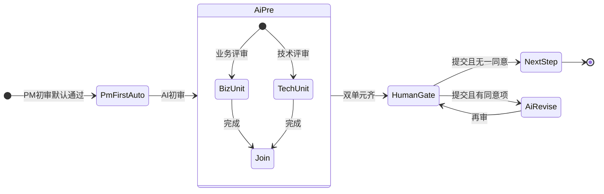

# 流程梳理 · 自动化研发流水线（草稿）

| 项 | 内容 |
|---|---|
| 状态 | **草稿 · 可改 · 不锁实现** |
| 日期 | 2026-10-30 |
| UI | [UI设计-自动化研发流水线.md](./UI设计-自动化研发流水线.md) / [Mock](../ui-mock/pipeline-workbench.html) |
| 说明 | 只梳理「有哪些节点、怎么串」；**不写 API / 表结构 / 执行器实现**。谈清后再删旧代码、按节点重建。 |

---

## 1. 节点类型（五种）

| 类型 | 谁做 | 暂停？ | 典型产出 |
|---|---|---|---|
| **人闸审批** | 人 | 是（**例外见 §1.2 默认通过**） | 同意项、不同意意见、疑似解答 |
| **AI 生成 / 评审 / 整改** | AI | 人工按**岗位**触发；可含多个**任务单元** | Wiki 文档 / 评审书 |
| **系统结束** | 系统 | 否 | 仅结束实例，**不改**需求粗状态 |

### 1.1 人闸两类项（对齐模板）

| 类型 | 模板对应 | 人类动作 |
|---|---|---|
| **一类 · 确认项** | 问题清单；业务风险 / 技术风险 | 同意·采纳推荐 / 不同意+意见 |
| **二类 · 疑似项** | 疑似问题 | 人类必答 |

### 1.2 产品经理初审：默认直接通过

在**自动化流水线**内，「产品经理初审」**不停留等人确认**，启动后（或进入该步时）**默认直接通过**，时间线仍保留节点便于追溯。

> 若业务上仍需「真挡人」的 PM 关卡，用后续「二审」或独立人闸，而不是这道初审。

### 1.3 任务单元与岗位触发权

- 一个流程**节点**可挂 **1..N 个任务单元**（每个单元 = 一次 Agent 任务：角色包 + 模板 + 会话）。  
- **仅本岗**可点「执行 Agent」；其他岗位**可看**节点/单元/产物/提示词/执行过程，**不可触发**。  
- 若一人兼多岗（如产品=架构）：该节点基本信息仍展示**多个任务单元**，兼岗者可分别触发。

| 规则 | 说明 |
|---|---|
| 触发 | `当前用户岗位 ∩ 单元.ownerRole` 非空才可执行 |
| 只读 | 否则按钮禁用，文案「可看 · 不可触发」 |
| 节点完成 | 该节点下**全部任务单元 SUCCEEDED** 才推进 |

---

## 2. AI 初审（双 Agent）

进入自动化且 PM 初审默认通过后 → **AI 初审**节点，内含两个任务单元：

| 任务单元 | 岗位（触发人） | Agent | 模板 |
|---|---|---|---|
| **业务评审** | 产品经理 | AI 产品经理 | [原始需求评估模板-业务](../模板/原始需求评估模板-业务.md) |
| **技术评审** | 架构师 | AI 架构师 | [原始需求评估模板-技术](../模板/原始需求评估模板-技术.md) |

两路都完成后 → 进入「初审有效确认」人闸（对两份评估里的确认项/疑似项做两类确认；细节可再拍板是合并确认还是分册确认）。

```text
启动自动化
  → 产品经理初审（默认直接通过）
  → AI 初审
       ├─ 任务单元：业务评审（仅 PM 可触发）
       └─ 任务单元：技术评审（仅 ARCH 可触发）
       （兼岗同一人：两单元都展示，均可触发）
  → 两单元齐 → 初审有效确认（人闸）→ …
```

---

## 3. 通用环（可审文档）

```text
AI 产出（或已有文档）
    → （可选）AI 评审 → 确认项 + 疑似项
    → 人闸：项级表态/解答 → 提交确认
         ├─ 有「同意」确认项 ──→ AI 整改 → 同一人闸再审
         └─ 无一同意 → 下一业务步
```



---

## 4. 候选主链（阶段块 · 可删可并）

| 阶段 | 建议步骤（候选） | 备注 |
|---|---|---|
| **进入** | 启动自动化实例 | 与需求粗状态无关 |
| **受理** | PM 初审（**默认通过**）→ **AI 初审（业务+技术双单元）** → 初审有效确认 → PM 二审 | 已拍板：初审自动过、AI 初审双 Agent |
| **分析** | AI 生成 PRD →（AI 评 PRD）→ 人确认 ↔ 整改 | |
| **设计** | AI 架构 + AI UI → 评审确认 ↔ 整改 | 并行与否待拍板 |
| **详设 / 构建 / 结束** | … | 范围待拍板 |

---

## 5. 待你拍板

### 5.1 已拍板（本稿）

- [x] PM 初审在自动化内默认直接通过  
- [x] AI 初审 = 业务评审 + 技术评审两个 Agent 任务单元  
- [x] 按岗位触发；兼岗展示两个任务单元  

### 5.2 仍待确认

- [ ] 初审有效确认：一份合并人闸还是业务/技术两道确认？  
- [ ] 两单元是否必须都跑完才能确认？（现默认：是）  
- [ ] 设计及以后阶段是否也用「多任务单元」模型？  
- [ ] 主链裁到哪一步？  
- [ ] max_round、取消与手动轨关系  

---

## 6. 建议的沟通顺序

1. 确认「初审有效确认」合并还是拆分。  
2. 定首期主链最短路径。  
3. 再按节点重建实现（先删旧自动化代码）。  

---

## 修订记录

| 版本 | 日期 | 说明 |
|---|---|---|
| 草稿 0.1 | 2026-10-30 | 首版：五类节点、通用环、候选阶段 |
| 草稿 0.2 | 2026-10-30 | 人闸两类项 |
| 草稿 0.3 | 2026-10-30 | PM 初审默认通过；AI 初审双 Agent；岗位触发 + 任务单元 |
