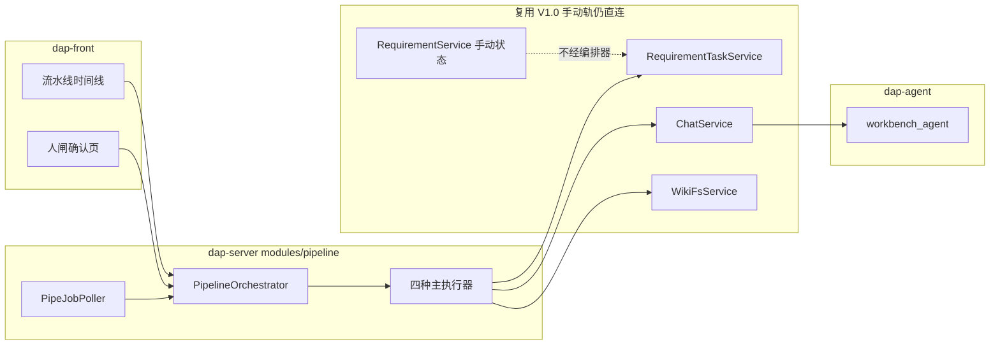
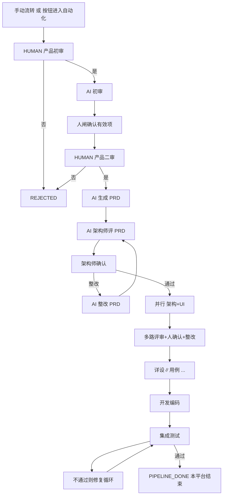
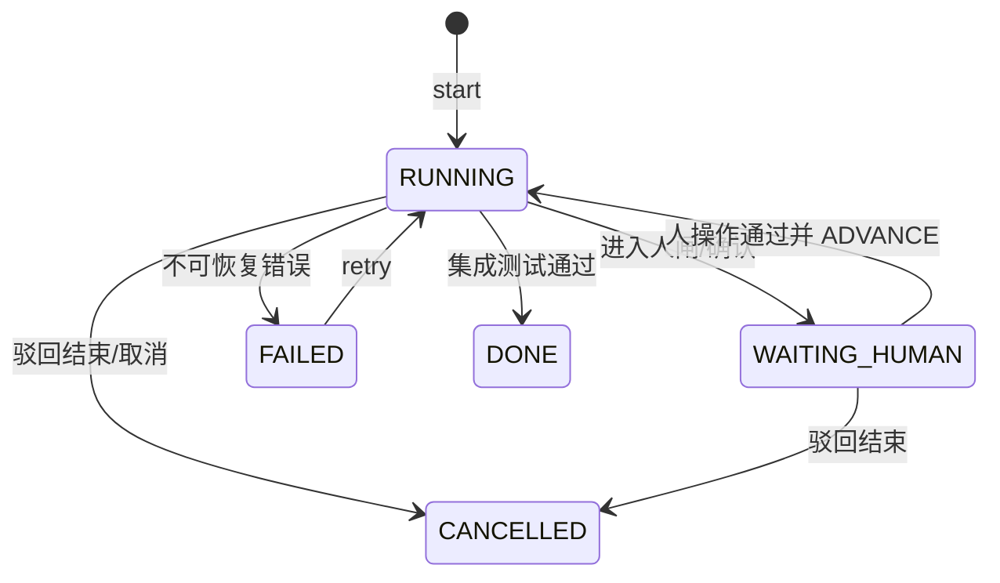
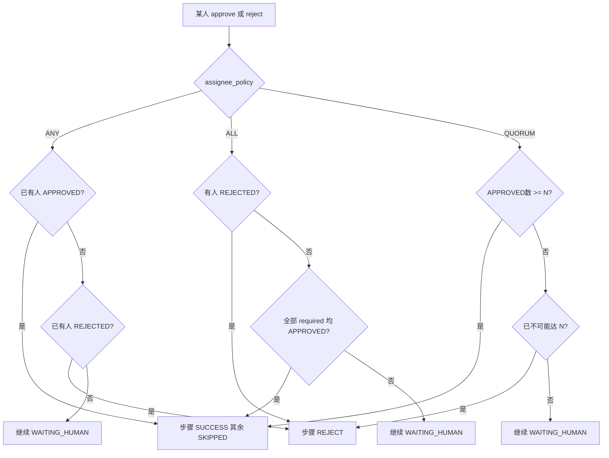
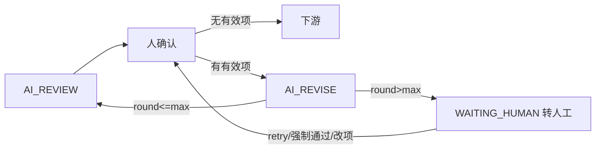
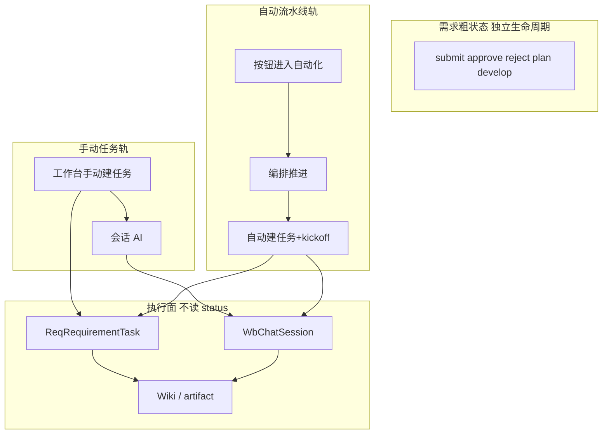
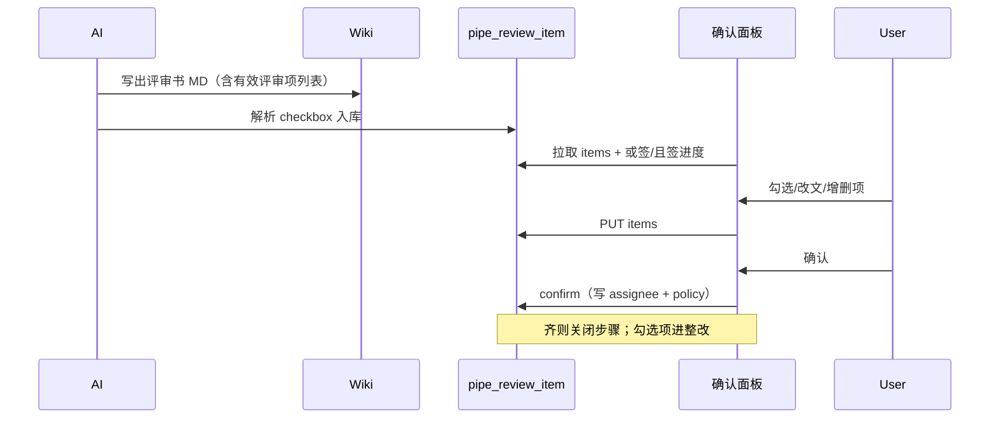

# DAP 自动化研发流水线 · 详细设计

| 项 | 内容 |
|---|---|
| 文档名称 | DAP 自动化研发流水线详细设计说明书 |
| 版本 | **V0.8（设计稿）** |
| 状态 | 待实现（本文件为设计基线，不以当前代码为准） |
| 适用范围 | Pipeline 轻量编排、评审闭环、与 V1.0 需求/任务/Wiki/Agent 的接线；**仅覆盖本平台研发侧，至集成测试通过为止** |
| 配套文档 | [自动化开发流程.md](../自动化开发流程.md)、[详细设计 V1.0](../详细设计V1.0.md)、[模板索引](../模板/README.md)、[流水线精简模板](../模板/流水线/)、[UI设计-自动化研发流水线.md](./UI设计-自动化研发流水线.md) |

---

## 目录

1. [目标与边界](#1-目标与边界)
2. [已锁定决策](#2-已锁定决策)
3. [总体架构](#3-总体架构)
4. [领域模型与表结构](#4-领域模型与表结构)
5. [步骤种子清单](#5-步骤种子清单)
6. [编排状态机与执行器](#6-编排状态机与执行器)
7. [有效评审与整改循环](#7-有效评审与整改循环)
8. [双轨：手动流程与流水线](#8-双轨手动流程与流水线)
9. [与需求状态解耦及 V1.0 关系](#9-与需求状态解耦及-v10-关系)
10. [接口详细设计](#10-接口详细设计)
11. [Agent / 角色包约定](#11-agent--角色包约定)
12. [前端与交互（有效项 / 菜单 / 呈现）](#12-前端与交互有效项--菜单--呈现)
13. [分期实现](#13-分期实现)
14. [错误码与测试要点](#14-错误码与测试要点)
15. [风险与后续扩展](#15-风险与后续扩展)

---

## 1. 目标与边界

### 1.1 产品定位与目标

本产品是**研发智能平台**：管需求澄清、设计、详设/用例、编码与**开发侧集成测试**，服务产品经理与研发协同；**不管**外平台上的发布版本登记，也**不管**验收环境上的测试验收（碰不到源码；自动化脚本对接属自动化测试平台建设）。

在 V1.0「人工需求状态机 + 工作台任务 + AI 会话」之上，增加**可选的轻量流水线编排**，使研发主链可自动推进：

- 需求默认走**手动轨**；是否进入自动化由用户在需求上点 **「进入自动化流程」** 按钮显式触发（调用 `POST .../pipeline/start`），**不**在 submit 时静默启动；
- 进入自动轨后：AI 生成 / 评审 / 整改无人值守；**仅人确认节点暂停**；
- **终点**：集成测试通过 → 流水线 `DONE`；CIDI / 验收出界；
- 产物落 Wiki；`pipe_artifact` 做索引；
- 手动改状态、手动建任务永久保留；亦可 `run-one` 单节点（见 §8）；
- **流水线运行、手动任务运行与需求粗状态无关**（不依赖、不回写 `APPROVING`/`DEVELOPING` 等）。

### 1.2 非目标（本设计明确不做）

| 项 | 说明 |
|---|---|
| 重型 BPM 套件（Camunda/Flowable 全量产品化） | 首期用**可配置的轻量编排定义**（§3.4）；流程可变 ≠ 必须上 BPMN 引擎 |
| 发布版本规划 / 登记 | 属其他产品平台；本平台不设「绑定发布版本」步骤 |
| CIDI 打包发布、验收环境测试、JIRA 验收闭环 | 出界；用例文档可在本平台产出并交外系统 |
| 独立多进程多 Agent | 仍用单一 `workbench_agent` + 角色包 |
| Redis / MQ（首期） | DB `pipe_job` + 进程内调度 |
| Figma | UI 步产出 Markdown UI 说明 |
| 替换 Wiki 正文 | Markdown 为唯一正文 |

### 1.3 与 V1.0 边界

| V1.0 **完整保留**（手动轨） | 本设计新增（自动轨，可选） |
|---|---|
| 需求手工 submit / approve / reject / plan / develop 与粗状态 | `pipe_*` + `modules/pipeline` 轻量编排 |
| 工作台**手动**创建/开始/完成任务 | 编排器可自动建任务（`source=PIPELINE`） |
| `WbChatSession` + Agent | kickoff、角色包；也可仅对手动任务会话使用 |
| Wiki | 产物登记与版本索引 |
| 发布版本字段（若库中仍有） | 流水线**不读写**；人手 plan 仍可按 V1.0 使用，与编排无关 |

---

## 2. 已锁定决策

| 决策点 | 结论 |
|---|---|
| 停顿策略 | **开发阶段：AI 步亦停**，须人工点「执行」才 kickoff；人闸照常停。AI 跑完后：生成类→进下一步待触发；评审类→进确认人闸 |
| AI 结束条件 | 会话 `done` **且** 约定产物已写入产品 Wiki（`{产品Wiki}/{需求编码}/`）才 `SUCCEEDED`；禁止 stream 未完/产物未落盘就 ADVANCE；禁止与「跳过」抢跑 |
| 启动校验 | `pipeline/start` 前校验产品已绑 **Wiki 根节点** 与 **≥1 代码仓**，缺一则 **400 拒绝** |
| 产品配置 | 产品可绑 Wiki 上下文根（可选父节点+新建）；可配多个本地仓库路径 |
| 会话形态 | 流水线 AI = **TASK 会话**；标题=`{需求编码}-{步骤名}`；**输出目录=Wiki**（产品 Wiki/`{需求编码}`）；**输出模板=Wiki「流水线模板」**下对应文件；手动任务输出目录**仅个人空间** |
| 自动化 UI | 需求详情顶栏「进入自动化」→ 自动化页：左流水线 / 右当前任务会话窗（流式+步骤日志）；点节点展示输入/上下文/模板/输出/仓路径 |
| 手动 / 自动切换 | **默认手动**；按钮「进入自动化流程」才 `start`；不挂接 submit |
| 与需求状态 | **完全解耦**：建任务 / 跑流水线 / `run-one` **不校验、不修改** `req_requirement.status` |
| 流水线起点 | 按钮触发；可选 `fromStepCode` |
| 流水线终点 | **集成测试通过** → `PIPELINE_DONE` |
| 发布版本 / 验收 / CIDI | **不进入**本流水线 |
| 编排形态 | **数据驱动的轻量编排**（定义表可配置/可版本化）；不上 Camunda 类重型 BPM，见 §3.4 |
| 手动轨 | 状态机与工作台任务**永久保留**，且任务不绑状态 |
| 评审真相 | `pipe_review_item.checked`；Wiki 评审书不同步作唯一真相 |
| 评审确认 UX | 人闸可**预览**本轮 AI 评审书（Wiki MD 只读）、**编辑**合并后的有效项（增删改/勾选）后确认；多角色共用模板时确认步合并紧邻多路 `AI_REVIEW` 有效项 |
| 多角色评审 | 同场景共用一份评审模板；kickoff 指定本路 `role_pack`；两路（或一路）跑完再进人闸合并 |
| 多人评审逻辑 | 步骤级 `assignee_policy`：**ANY=或多个或签**，**ALL=且多个会签**（另可选 QUORUM）；见 §6.7 |
| 整改 / 轮次 | 仅有效项；默认 `max_round=3` |
| 并行 | 架构∥UI、详设∥用例；P1 启用 |
| 异步 | `pipe_job` + `@Scheduled`；不上 MQ |
| AI 角色 | 统一「AI 研发」=`AI_DEV` |

---

## 3. 总体架构

### 3.1 分层



| 层 | 职责 | 包 / 服务 |
|---|---|---|
| 编排层（可选） | 步骤图、人闸、循环、并行汇合、job；**不读写**需求粗状态 | `modules.pipeline` |
| 执行层 | Task、Session、模板、Wiki（手动与自动共用；**不校验**需求 status） | requirement / chat / wiki |
| 需求状态层 | V1.0 审批/计划/投入研发 **独立保留**，只表示业务生命周期，不门禁任务/流水线 | `RequirementService` |
| 推理层 | 单次 SSE + 工具轮 | dap-agent |

### 3.2 主路径示意（节选）



### 3.3 后端组件清单（拟新增）

| 组件 | 职责 |
|---|---|
| `PipelineController` | 对外 REST（含单步执行） |
| `PipelineService` | 启动/查询/取消/单步 run |
| `PipelineOrchestrator` | 进入步骤、推进、汇合；**禁止**改需求 status |
| `HumanApproveExecutor` / `AiGenerateExecutor` / `AiReviewExecutor` / `AiReviseExecutor` | 四种执行器（无 EXTERNAL 主路径） |
| `PipeJobService` + `PipeJobPoller` | 入队、认领、重试 |
| `PipeReviewService` | 解析 checkbox、确认有效项 |
| `PipeArtifactService` | 登记/查当前版本/升版 |
| `RolePackRegistry` | 角色包种子 |

### 3.4 「流程引擎」与可配置：澄清

常见误解：**不用 Camunda = 流程写死在代码里、以后改不动。**  
本设计要的是：**轻量、可配置的流程运行时**，不是「零配置硬编码 if-else」。

#### 3.4.1 我们实际上在做什么

| 层次 | 内容 | 是否可配置 |
|---|---|---|
| **流程定义**（数据） | `pipe_definition` + `pipe_step_def` + `pipe_transition` + 角色包 | **是**：改表/管理端/导入 JSON 即改流程，**不必发版改 Java** |
| **执行器**（代码） | HUMAN / AI_GENERATE / AI_REVIEW / AI_REVISE | 否：稳定能力插件；新类型才加代码 |
| **运行时**（代码） | Orchestrator + `pipe_job` | 否：通用推进/并行/循环，与具体业务步骤无关 |

也就是说：业务步骤增减、顺序调整、人闸增减、并行组、max_round、模板路径、跳转条件 → **改定义数据**；只有出现「第五种执行语义」才改代码。

这本身就是领域内的**轻量流程引擎**（定义驱动 + 实例推进），只是没有 BPMN 标准和可视化设计器。

#### 3.4.2 流程变动时怎么做

| 变动类型 | 做法 |
|---|---|
| 加/删/改步骤、改边 | 新发 `pipe_definition.version++`（或租户覆盖定义）；**在跑实例仍绑旧 definition_id**，新 `start` 用新版 |
| 租户裁剪（不要 UI 步） | `tenant_id` 非空的定义覆盖平台默认；或同 code 禁用部分 step |
| 改模板/角色提示词 | 改 `template_wiki_path` / `pipe_role_pack`，即时生效于新进入的步骤 |
| 管理方式 | P1 起提供「流水线定义」管理 API/简单 UI（步骤列表 + 转移边编辑）；亦可 YAML/JSON 导入导出 |

**禁止**：在 `PipelineOrchestrator` 里按 `step_code` 写死业务分支（除执行器分发）。

#### 3.4.3 为何首期不上 Camunda / Flowable 全量引擎

| 维度 | 重型 BPM | 本方案（定义表 + 编排器） |
|---|---|---|
| 流程可变 | BPMN 部署 | **定义版本 + 配置 UI/导入**，同样可变 |
| 与 AI 任务/Wiki/`run-one`/双轨 | 要大量 Delegate/适配 | 原生对接现有 Task/Chat |
| 人闸=有效评审 checkbox | 要自定义表单与变量 | 一等公民 `pipe_review` |
| 成本 | 引擎库表、历史、权限、运维、学习曲线 | 十余张业务表 + 一个 Poller |
| 可视化拖拽 | 强 | 首期列表/边编辑；需要时再加画布 |

重型引擎解决的是「任意组织画任意审批流」；我们解决的是「研发智能步骤图 + AI 执行器 + 可版本配置」。后者用定义驱动即可，上 BPM 投入产出比差。

#### 3.4.4 何时再引入「现成引擎」

出现以下**产品需求**再评估嵌入（可迁定义，运行中实例策略另定）：

1. 租户要 **BPMN/画布拖拽** 且步骤语义超出四种执行器；  
2. 要与公司统一的 Camunda/Flowable 中台对齐；  
3. 需要引擎自带的复杂定时器、消息相关、多实例会签标准模型且自研成本明显高于接入。

备选若真要上「轻量现成件」：优先评估 **Temporal / Conductor 类编排**（偏 job 图）或 **仅引入 Flowable 嵌入式做定义存储**——仍须自建 AI/评审适配；**不作为 P0–P2 前置**。

#### 3.4.5 配置面交付（写入分期）

| 期 | 可配置能力 |
|---|---|
| P0 | 平台种子定义（SQL/JSON）；改种子即改流程（开发态） |
| P1 | 定义 **版本发布** API；租户只读当前图；支持导出 JSON |
| P2 | 管理端编辑步骤/转移边/启用禁用；租户覆盖定义 |
| 更后 | 可视化编辑器（可选）；或对接外部引擎 |

---


## 4. 领域模型与表结构

> 表前缀 `pipe_`；迁移脚本建议 `V14__pipeline.sql`（以仓库实际下一序号为准）。  
> 主键 `BIGSERIAL`；时间 `TIMESTAMP`；枚举存 `VARCHAR` 大写名；租户通过 `requirement_id → req_requirement.tenant_id` 间接隔离（定义表可带 `tenant_id`，`NULL` 表示平台默认定义）。

### 4.1 表清单

| 表 | 说明 |
|---|---|
| `pipe_definition` | 流水线定义版本 |
| `pipe_step_def` | 步骤定义 |
| `pipe_transition` | 转移边（含条件） |
| `pipe_role_pack` | AI 角色包 |
| `pipe_instance` | 需求上的运行实例 |
| `pipe_step_instance` | 步骤运行实例 |
| `pipe_step_assignee_def` | 步骤定义上的多处理人/评审人配置 |
| `pipe_step_assignee` | 步骤实例上的运行时处理人（含每人确认状态） |
| `pipe_artifact` | 产物索引 |
| `pipe_review` | 评审单 |
| `pipe_review_item` | 评审项（有效勾选） |
| `pipe_job` | 异步任务 |

### 4.2 pipe_definition

| 字段 | 类型 | 约束 | 说明 |
|---|---|---|---|
| `id` | BIGINT | PK | |
| `code` | VARCHAR(64) | NOT NULL | 如 `RD_AUTO` |
| `version` | INT | NOT NULL | 定义版本号 |
| `name` | VARCHAR(128) | NOT NULL | |
| `tenant_id` | BIGINT | NULL | NULL=平台默认 |
| `enabled` | BOOLEAN | NOT NULL DEFAULT TRUE | |
| `created_at` / `updated_at` | TIMESTAMP | | |

唯一：`(tenant_id, code, version)`（平台默认用 `tenant_id IS NULL` 时需部分唯一索引或 `COALESCE` 策略，实现时按 PG 习惯处理）。

### 4.3 pipe_step_def

| 字段 | 类型 | 约束 | 说明 |
|---|---|---|---|
| `id` | BIGINT | PK | |
| `definition_id` | BIGINT | FK → pipe_definition | |
| `code` | VARCHAR(64) | NOT NULL | 步骤码，见 §5 |
| `name` | VARCHAR(128) | NOT NULL | |
| `stage` | VARCHAR(32) | NOT NULL | `INTAKE` / `ANALYSIS` / `DESIGN` / `DETAIL` / `BUILD` / `RELEASE` / `ACCEPTANCE` |
| `executor` | VARCHAR(32) | NOT NULL | `HUMAN_APPROVE` / `AI_GENERATE` / `AI_REVIEW` / `AI_REVISE`（见 §6.2） |
| `role_pack_code` | VARCHAR(64) | NULL | AI 步必填 |
| `task_type_code` | VARCHAR(64) | NULL | 映射 `sys_req_task_type.code`（可种子） |
| `template_wiki_path` | VARCHAR(512) | NULL | 相对租户 Wiki 的模板路径或平台种子路径约定 |
| `input_artifact_kinds` | TEXT | NULL | JSON 数组，如 `["RAW_REQ","PRD"]` |
| `output_artifact_kind` | VARCHAR(64) | NULL | 单主产物；多产物见 `output_extra_json` |
| `output_extra_json` | TEXT | NULL | 如用例步输出两种 kind |
| `parallel_group` | VARCHAR(64) | NULL | 同组并行；NULL=串行 |
| `join_group` | VARCHAR(64) | NULL | 汇合点标识；进入前须同组上游完成 |
| `max_round` | INT | NOT NULL DEFAULT 3 | 整改/修复循环 |
| `auto_advance` | BOOLEAN | NOT NULL DEFAULT TRUE | 非人闸默认 TRUE；人闸 FALSE |
| `human_role` | VARCHAR(32) | NULL | 单角色快捷配置（与 assignee 二选一或作默认解析源） |
| `assignee_policy` | VARCHAR(32) | NOT NULL DEFAULT `ANY` | **`ANY`=或多个（或签）**；**`ALL`=且多个（会签）**；`QUORUM`=满 N 人通过 |
| `assignee_quorum` | INT | NULL | 仅 `QUORUM` |
| `reject_policy` | VARCHAR(32) | NOT NULL DEFAULT `ANY_REJECT` | 与多人配合：`ANY_REJECT`（一人驳即驳）/ `ALL_REJECT`（需全部驳才驳，少见） |
| `on_reject` | VARCHAR(32) | NULL | 驳回后实例策略：`CANCEL` / `STAY` 等 |
| `sort_order` | INT | NOT NULL | 展示序 |
| `coarse_status_on_enter` | — | **删除** | 与需求状态解耦后不再投影 |

唯一：`(definition_id, code)`。

**多人配置（推荐表，优于只塞 JSON）**：`pipe_step_assignee_def`

| 字段 | 类型 | 说明 |
|---|---|---|
| `id` | PK | |
| `step_def_id` | FK → pipe_step_def | |
| `assignee_type` | `USER` / `ROLE` / `POSITION` / `REQ_HANDLER` | 解析策略 |
| `assignee_ref` | VARCHAR(128) | userId / 角色码 / 岗位名 / `CREATOR` 等 |
| `sort_order` | INT | |
| `required` | BOOLEAN DEFAULT TRUE | `ALL` 时是否必须；`ANY` 时作候选人 |

进入步骤时解析为具体用户列表，写入运行时 `pipe_step_assignee`（见 §4.7）。  
**能覆盖**：同一确认节点配置张三+李四+王五都可评；或「所有架构师岗位」；或「需求相关人里岗位=测试的全部」。

### 4.4 pipe_transition

| 字段 | 类型 | 约束 | 说明 |
|---|---|---|---|
| `id` | BIGINT | PK | |
| `definition_id` | BIGINT | FK | |
| `from_step_code` | VARCHAR(64) | NOT NULL | |
| `to_step_code` | VARCHAR(64) | NOT NULL | |
| `event` | VARCHAR(32) | NOT NULL | `APPROVE` / `REJECT` / `SUCCESS` / `NEED_REVISE` / `REVISE_DONE` / `MAX_ROUND` |
| `priority` | INT | NOT NULL DEFAULT 0 | 多边时排序 |

### 4.5 pipe_role_pack

| 字段 | 类型 | 约束 | 说明 |
|---|---|---|---|
| `id` | BIGINT | PK | |
| `code` | VARCHAR(64) | UK | `AI_PM` / `AI_ARCH` / `AI_UI` / `AI_DEV` / `AI_QA` / `AI_CODE_REVIEW` |
| `display_name` | VARCHAR(128) | | |
| `system_prompt_extra` | TEXT | | 注入 Agent system 的角色片段 |
| `default_task_type_code` | VARCHAR(64) | | |
| `enabled` | BOOLEAN | DEFAULT TRUE | |

### 4.6 pipe_instance

| 字段 | 类型 | 约束 | 说明 |
|---|---|---|---|
| `id` | BIGINT | PK | |
| `requirement_id` | BIGINT | UK, FK → req_requirement CASCADE | 一需求一活跃实例（取消后可再开则放宽 UK） |
| `definition_id` | BIGINT | FK | |
| `status` | VARCHAR(32) | NOT NULL | `RUNNING` / `WAITING_HUMAN` / `FAILED` / `DONE` / `CANCELLED` |
| `waiting_reason` | VARCHAR(256) | NULL | 如 `REVIEW_CONFIRM` / `APPROVE` / `EXTERNAL` / `MAX_ROUND` |
| `current_step_codes` | TEXT | NULL | JSON 数组，支持并行多当前步 |
| `started_at` / `finished_at` | TIMESTAMP | | |
| `created_at` / `updated_at` | TIMESTAMP | | |

### 4.7 pipe_step_instance

| 字段 | 类型 | 约束 | 说明 |
|---|---|---|---|
| `id` | BIGINT | PK | |
| `instance_id` | BIGINT | FK CASCADE | |
| `step_code` | VARCHAR(64) | NOT NULL | |
| `status` | VARCHAR(32) | NOT NULL | `PENDING` / `RUNNING` / `WAITING_HUMAN` / `SUCCEEDED` / `FAILED` / `SKIPPED` / `CANCELLED` |
| `round` | INT | NOT NULL DEFAULT 1 | |
| `executor` | VARCHAR(32) | NOT NULL | 冗余自定义，便于查询 |
| `handler_user_id` | BIGINT | NULL | **兼容字段**：单人时=唯一处理人；多人时可为「主联系人」或 NULL，以 `pipe_step_assignee` 为准 |
| `task_id` | BIGINT | NULL | → req_requirement_task |
| `session_id` | BIGINT | NULL | → wb_chat_session |
| `output_artifact_id` | BIGINT | NULL | 主产物 |
| `review_id` | BIGINT | NULL | AI_REVIEW 关联 |
| `error_message` | VARCHAR(2000) | NULL | |
| `started_at` / `finished_at` | TIMESTAMP | | |
| `created_at` / `updated_at` | TIMESTAMP | | |

索引：`(instance_id, step_code, round)`。

**pipe_step_assignee（运行时多人）**

| 字段 | 类型 | 说明 |
|---|---|---|
| `id` | PK | |
| `step_instance_id` | FK CASCADE | |
| `user_id` | BIGINT | 解析后的具体用户 |
| `status` | `PENDING` / `APPROVED` / `REJECTED` / `SKIPPED` | |
| `acted_at` | TIMESTAMP | |
| `comment` | VARCHAR(2000) | |

唯一：`(step_instance_id, user_id)`。  
待办查询：`status=PENDING AND user_id=当前用户`。

### 4.8 pipe_artifact

| 字段 | 类型 | 约束 | 说明 |
|---|---|---|---|
| `id` | BIGINT | PK | |
| `requirement_id` | BIGINT | FK CASCADE | |
| `kind` | VARCHAR(64) | NOT NULL | 见 §4.11 |
| `version` | INT | NOT NULL | 同 kind 递增 |
| `wiki_node_id` | BIGINT | NOT NULL | → sys_wiki_node |
| `step_instance_id` | BIGINT | NULL | 产出步骤 |
| `title` | VARCHAR(256) | NULL | |
| `is_current` | BOOLEAN | NOT NULL DEFAULT TRUE | 同 requirement+kind 仅一条 current |
| `created_at` | TIMESTAMP | | |

唯一建议：`(requirement_id, kind, version)`；业务保证 current 唯一。

### 4.9 pipe_review / pipe_review_item

**pipe_review**

| 字段 | 类型 | 说明 |
|---|---|---|
| `id` | PK | |
| `step_instance_id` | FK | |
| `requirement_id` | FK | |
| `status` | `DRAFT` / `CONFIRMED` | |
| `summary_wiki_node_id` | 可选，汇总评审书 | |
| `confirmed_by` / `confirmed_at` | | |

**pipe_review_item**

| 字段 | 类型 | 说明 |
|---|---|---|
| `id` | PK | |
| `review_id` | FK CASCADE | |
| `ordinal` | INT | |
| `content` | TEXT | 评审项正文 |
| `checked` | BOOLEAN | **true=有效项** |
| `source` | `AI` / `HUMAN` | |
| `severity_user_id` | NULL | 最后改勾选人 |
| `fix_action` | NULL / `REVISE` / `IGNORE` | 确认时可细分 |

### 4.10 pipe_job

| 字段 | 类型 | 说明 |
|---|---|---|
| `id` | PK | |
| `instance_id` | FK | |
| `step_instance_id` | NULL | |
| `job_type` | `ENTER_STEP` / `KICKOFF_AI` / `POLL_AI_DONE` / `PARSE_REVIEW` / `ADVANCE` / `RUN_ONE` | |
| `payload_json` | TEXT | |
| `status` | `PENDING` / `RUNNING` / `DONE` / `FAILED` / `DEAD` | |
| `attempts` | INT | |
| `max_attempts` | INT DEFAULT 5 | |
| `next_run_at` | TIMESTAMP | |
| `last_error` | TEXT | |
| `created_at` / `updated_at` | | |

Poller：每 N 秒认领 `PENDING AND next_run_at <= now()`，单机 `FOR UPDATE SKIP LOCKED`。

### 4.11 产物 kind 枚举

| kind | 说明 |
|---|---|
| `RAW_REQ` | 原始需求说明 |
| `PRE_REVIEW` | 原始需求评审报告 |
| `PRD` | 需求分析 PRD |
| `PRD_REVIEW` | 需求分析评审书（可多份按角色，用 title/扩展区分） |
| `ARCH` | 架构设计 |
| `ARCH_REVIEW` | 架构设计评审书 |
| `UI_SPEC` | UI 设计文档 |
| `UI_REVIEW` | UI 评审书 |
| `DETAIL` | 详细设计说明书 |
| `DETAIL_REVIEW` | 详细设计评审书 |
| `CASE_AUTO` | 自动化测试用例 |
| `CASE_MANUAL` | 人工测试用例 |
| `CASE_REVIEW` | 测试用例评审书 |
| `DEV_REPORT` | 开发完成报告 |
| `TEST_REPORT` | 自动化测试完成报告 |
| `CODE_REVIEW` | 代码评审报告 |
| `FIX_REPORT` | 修复报告 |
同 kind 多角色评审书采用**细分 kind**（如 `PRD_REVIEW_DEV` / `PRD_REVIEW_QA`，见 §5）。  
出界产物（发布记录、验收手工报告等）**不建 kind**。

### 4.12 任务来源扩展与状态解耦（V1.0 行为变更）

`req_requirement_task` 增加：

| 字段 | 类型 | 说明 |
|---|---|---|
| `source` | VARCHAR(32) NOT NULL DEFAULT `MANUAL` | `MANUAL` / `PIPELINE` |
| `pipe_step_instance_id` | BIGINT NULL | 反向关联 |

**实现约束（重要）**：

- **删除**「仅 `DEVELOPING` 可建任务」校验（手动 `POST .../tasks` 与编排器建任务均适用）；
- 允许在 `DRAFT` / `APPROVING` / `PENDING_PLAN` / `PLANNING` / `DEVELOPING` / `REJECTED` 等状态下创建与执行任务（产品可另加软提示，但非硬门禁）；
- `pipeline/start`、`run-one`、job 推进**不读取需求 status 做门禁**，也**不写回** status；
- 需求 status 仅由现有手动 API（submit/approve/reject/plan/develop）变更。

---

## 5. 步骤种子清单

定义码：`RD_AUTO` / version=`1`。  
范围对齐业务：**提交 → … → 集成测试通过**；与 [自动化开发流程.md](./自动化开发流程.md) 中本平台相关行对应。  
**明确删除（相对 V0.1 / 流程原文后半段）**：绑定发布版本、代码评审链、全量编译验收测、CIDI、增量/全量验收自动化、手工验收。

### 5.1 图例

- **人闸**：进入后 `WAITING_HUMAN`  
- **\***：AI_REVIEW 完成后进入独立确认步  
- **PG** / **JG**：并行组 / 汇合点  

### 5.2 本平台步骤表

| # | step_code | 流程原名 | stage | executor | 角色包/人 | 人闸 | PG / JG | 主输入 | 输出 | 备注 |
|---|---|---|---|---|---|---|---|---|---|---|
| 0 | （平台外） | 提交原始需求 | — | 手动 `submit` | CREATOR | — | — | — | Wiki `RAW_REQ` | 手动状态机事务；**不**启动流水线 |
| 1 | `START_AUTO` | 进入自动化流程 | INTAKE | 按钮 `pipeline/start` | 有权限用户 | 触发 | — | 建议有 `RAW_REQ` | — | **与需求 status 无关**；创建实例后进下一步 |
| 2 | `PM_FIRST_APPROVE` | 产品经理初审 | INTAKE | HUMAN_APPROVE | PM | **是** | — | `RAW_REQ` | — | 流水线内人闸；否→实例结束（**不强制**改需求 REJECTED，可由人闸 API 可选同步） |
| 3 | `AI_PRE_REVIEW` | AI初审 | INTAKE | AI_REVIEW | AI_PM | 否* | — | `RAW_REQ` | `PRE_REVIEW` | |
| 4 | `PM_PRE_REVIEW_CONFIRM` | 初审有效确认 | INTAKE | HUMAN_APPROVE | PM | **是** | — | `PRE_REVIEW` | — | |
| 5 | `PM_SECOND_APPROVE` | 产品经理二审 | INTAKE | HUMAN_APPROVE | PM | **是** | — | `PRE_REVIEW` | — | 通过后进分析；不绑发布版本 |
| 6 | `GEN_PRD_V1` | 需求分析 | ANALYSIS | AI_GENERATE | AI_PM | 否 | — | `RAW_REQ` | `PRD` | |
| 7 | `REVIEW_PRD_ARCH` | 需求分析初审 | ANALYSIS | AI_REVIEW | AI_ARCH | 否* | — | `PRD` | `PRD_REVIEW_ARCH` | |
| 8 | `CONFIRM_PRD_ARCH` | 架构师确认初审 | ANALYSIS | HUMAN_APPROVE | ARCH | **是** | — | — | — | |
| 9 | `CONFIRM_PRD_REVISE_PM` | PM 确认是否整改 | ANALYSIS | HUMAN_APPROVE | PM | **是** | — | — | — | 有有效项时 |
| 10 | `REVISE_PRD_AFTER_ARCH` | 需求分析整改（初审后） | ANALYSIS | AI_REVISE | AI_PM | 否 | — | `PRD`+有效项 | `PRD`↑ | |
| 11 | `GEN_ARCH_V1` | 架构设计 | DESIGN | AI_GENERATE | AI_ARCH | 否 | `PG_DESIGN` | `PRD` | `ARCH` | |
| 12 | `GEN_UI_V1` | UI设计 | DESIGN | AI_GENERATE | AI_UI | 否 | `PG_DESIGN` | `PRD` | `UI_SPEC` | Markdown |
| 13–19 | `REVIEW_*` | 需求/架构/UI 多角色评审 | DESIGN | AI_REVIEW | DEV/QA/PM | 否* | `PG_REQ_REV` / JG=`JG_DESIGN` | 设计产物 | 细分 REVIEW | |
| 20 | `CONFIRM_REQ_REV_BUNDLE` | 需求评审有效确认 | DESIGN | HUMAN_APPROVE | 多角色 | **是** | JG=`JG_REQ_REV` | — | — | |
| 21–23 | `REVISE_PRD/ARCH/UI` | 评审后整改 | DESIGN | AI_REVISE | 对应角色 | 否 | — | 原文+有效项 | 升版 | |
| 24 | `GEN_DETAIL_V1` | 研发详细设计 | DETAIL | AI_GENERATE | AI_DEV | 否 | `PG_DETAIL` | `PRD`,`ARCH`+仓 | `DETAIL` | |
| 25 | `GEN_CASES_V1` | 测试用例 | DETAIL | AI_GENERATE | AI_QA | 否 | `PG_DETAIL` | `PRD`,`ARCH` | `CASE_AUTO`,`CASE_MANUAL` | 交外平台用；本平台不跑验收 |
| 26–28 | 详设/用例评审与确认、整改 | DETAIL | 见定义 | 多 | 见定义 | `PG_DET_REV` | — | — | |
| 29 | `DEV_CODING` | 开发编码 | BUILD | AI_GENERATE | AI_DEV | 否 | JG=`JG_DETAIL_OK` | `DETAIL`,`PRD`,`ARCH` | `DEV_REPORT` | |
| 30 | `INT_TEST` | 集成测试 | BUILD | AI_GENERATE | AI_DEV | 否 | — | `DEV_REPORT`,`CASE_AUTO` | `TEST_REPORT` | 开发侧 |
| 31 | `CONFIRM_INT_TEST` | 集成测试结果确认 | BUILD | HUMAN_APPROVE | DEV | **是** | — | `TEST_REPORT` | — | 通过→DONE |
| 32 | `FIX_INT_TEST` | 集成测试问题修复 | BUILD | AI_REVISE | AI_DEV | 否 | — | 报告+仓 | `TEST_REPORT`↑ | max_round=3 |
| 33 | `PIPELINE_DONE` | 本平台研发流水线结束 | BUILD | 系统 | — | 否 | — | — | — | 只结束实例；**不改**需求 status |

> PM 二审通过后自动进入架构师评审链；架构师只做有效确认（步骤 8），无需再点「开始任务」。  
> `CASE_MANUAL` 仍可生成，作为交付给验收/自动化平台的文档，**不在本平台执行手工测**。

### 5.3 关键 transition（示意）

| from | event | to |
|---|---|---|
| `PM_FIRST_APPROVE` | `APPROVE` | `AI_PRE_REVIEW` |
| `PM_FIRST_APPROVE` | `REJECT` | 实例 CANCELLED；需求 status **默认不动**（可选 body `syncRejectRequirement=true` 才调手动驳回） |
| `PM_SECOND_APPROVE` | `APPROVE` | `GEN_PRD_V1`（**不再**经绑版本） |
| `CONFIRM_PRD_ARCH` | `SUCCESS` / `NEED_REVISE` | 设计并行 或 PM 整改确认 |
| `CONFIRM_INT_TEST` | `APPROVE`（通过） | `PIPELINE_DONE` |
| `CONFIRM_INT_TEST` | `NEED_REVISE` | `FIX_INT_TEST` |
| `FIX_INT_TEST` | `REVISE_DONE` | `INT_TEST` 或再确认 |
| `FIX_INT_TEST` | `MAX_ROUND` | WAITING_HUMAN |

完整边表以种子数据为准。

### 5.4 模板映射（精简版优先）

索引见 [doc/模板/README.md](../模板/README.md)。编排默认绑定 **流水线精简模板**：

| 输出 kind | 精简模板 | AI 角色 |
|---|---|---|
| `RAW_REQ` | [流水线/模板-原始需求.md](../模板/流水线/模板-原始需求.md) | — |
| `PRD` | [流水线/模板-需求分析PRD.md](../模板/流水线/模板-需求分析PRD.md) | AI_PM |
| `ARCH` | [流水线/模板-架构设计.md](../模板/流水线/模板-架构设计.md) | AI_ARCH |
| `UI_SPEC` | [流水线/模板-UI设计规范.md](../模板/流水线/模板-UI设计规范.md) | AI_UI |
| `DETAIL` | [流水线/模板-详细设计.md](../模板/流水线/模板-详细设计.md) | AI_DEV |
| `CASE_*` | [流水线/模板-测试用例.md](../模板/流水线/模板-测试用例.md) | AI_QA |
| `DEV_REPORT` | [流水线/模板-开发交付摘要.md](../模板/流水线/模板-开发交付摘要.md) | AI_DEV |
| `TEST_REPORT` | [流水线/模板-集成测试执行摘要.md](../模板/流水线/模板-集成测试执行摘要.md) | AI_DEV |
| `PRE_REVIEW` | [流水线/模板-评审-原始需求初审.md](../模板/流水线/模板-评审-原始需求初审.md) | **AI_PM** |
| `PRD_REVIEW_ARCH` | [流水线/模板-评审-PRD架构师初审.md](../模板/流水线/模板-评审-PRD架构师初审.md) | **AI_ARCH** |
| `PRD_REVIEW_DEV` / `PRD_REVIEW_QA` | [流水线/模板-评审-需求分析.md](../模板/流水线/模板-评审-需求分析.md) | **AI_DEV + AI_QA** 共用→合并 |
| `ARCH_REVIEW_DEV` / `ARCH_REVIEW_QA` | [流水线/模板-评审-架构设计.md](../模板/流水线/模板-评审-架构设计.md) | **AI_DEV + AI_QA** 共用→合并 |
| `UI_REVIEW` | [流水线/模板-评审-UI设计.md](../模板/流水线/模板-评审-UI设计.md) | **AI_PM** |
| `DETAIL_REVIEW_QA` / `DETAIL_REVIEW_ARCH` | [流水线/模板-评审-详细设计.md](../模板/流水线/模板-评审-详细设计.md) | **AI_QA + AI_ARCH** 共用→合并 |
| `CASE_REVIEW_DEV` / `CASE_REVIEW_ARCH` | [流水线/模板-评审-测试用例.md](../模板/流水线/模板-评审-测试用例.md) | **AI_DEV + AI_ARCH** 共用→合并 |
| （集成测试确认辅助） | [流水线/模板-评审-集成测试.md](../模板/流水线/模板-评审-集成测试.md) | AI_DEV 辅助 / 人闸 |

完整参考版仍留在 `doc/模板/模板-*.md`，仅人工细写时选用。

---

## 6. 编排状态机与执行器

### 6.1 实例状态



步骤实例：`PENDING → RUNNING → (WAITING_HUMAN) → SUCCEEDED | FAILED`。

### 6.2 执行器枚举

| executor | 自动推进 | 暂停点 |
|---|---|---|
| `HUMAN_APPROVE` | 否 | 进入即等 |
| `AI_GENERATE` | 是 | 仅失败/缺产物 |
| `AI_REVIEW` | 至确认步 | 确认步人闸 |
| `AI_REVISE` | 是 | 超 max_round |

### 6.3 AI_GENERATE 伪流程

1. 解析 `input_artifact_kinds` → 取各 kind `is_current=true` 的 wiki 节点。  
2. `RequirementTaskService.createPipelineTask(...)`：处理人=步骤 handler（或产品经理/架构师等解析规则）、输入节点、任务类型、`source=PIPELINE`。  
3. 创建/复用处理人个人空间下 `WbChatSession(TASK)`，绑定 output 目录、模板、代码仓（若任务类型要求）。  
4. 入队 `KICKOFF_AI`：以编排身份调用 Chat 通路发送 kickoff 消息。  
5. 入队 `POLL_AI_DONE`：会话 `done` 且输出目录出现约定文件（或后续 `artifact_ready` 事件）。  
6. 发布到需求 Wiki 目录（若尚在个人空间）→ `PipeArtifactService.register` 升版 → 步骤 `SUCCEEDED` → `ADVANCE`。

### 6.4 AI_REVIEW 伪流程

1. 同生成：产出评审 Markdown（含 `- [ ]` / `- [x]`）。  
2. `PARSE_REVIEW`：解析列表项写入 `pipe_review_item`（初始 checked 按 AI 勾选；产品约定「人可改，最终以确认时勾选为准」）。  
3. 步骤成功后 transition 到对应 `CONFIRM_*` 人闸；**不**因有无勾选自动改文，只在确认 API 时分支 `NEED_REVISE` / `SUCCESS`。

### 6.5 AI_REVISE 伪流程

1. Prompt 必含：当前正文 wiki + **仅** `checked=true` 的项。  
2. 输出升版；`round++`。  
3. `round > max_round` → 步骤 `WAITING_HUMAN`，`waiting_reason=MAX_ROUND`，不自动 ADVANCE。  
4. 否则按 transition 回到评审或确认步。

### 6.6 并行与汇合

- 同一 `parallel_group`：父步 SUCCESS 时同时 `ENTER` 组内所有步。  
- 带 `join_group` 的步：仅当该 join 所需上游（配置在 transition 或 `pipe_step_def` 扩展 `join_requires` JSON）全部 `SUCCEEDED` 才可 ENTER。  
- `pipe_instance.current_step_codes` 为当前未完成集合。

### 6.7 多人评审逻辑：或多个（或签）/ 且多个（会签）

单节点挂多人时，用 `assignee_policy` 表达业务上的 **「或」** 与 **「且」**（另可选满票数）。

#### 6.7.1 决策表（核心）

设步骤候选人集合 \(U=\{u_1..u_n\}\)，每人状态 ∈ `{PENDING, APPROVED, REJECTED, SKIPPED}`。

| 策略码 | 业务名 | 何时步骤 **通过**（SUCCESS / 可 confirm 关闭） | 何时步骤 **驳回**（REJECT 边） | 典型场景 |
|---|---|---|---|---|
| **`ANY`** | **或多个 / 或签** | **任意 1 人** `APPROVED` 即通过；其余未表态改为 `SKIPPED` | 默认 `reject_policy=ANY_REJECT`：**任意 1 人** `REJECTED` 即驳回（其余 SKIPPED） | 「架构组里谁有空谁确认有效项」 |
| **`ALL`** | **且多个 / 会签** | **每一个** `required=true` 的人均为 `APPROVED` | 默认：**任意 1 人** `REJECTED` 即整步驳回（不必等其他人）；可选等全部表态后再裁（少用） | 「产品且研发且测试都点头才过」 |
| **`QUORUM`** | 满 N 人 | `APPROVED` 人数 ≥ `assignee_quorum` | `REJECTED` 已使「即使剩余全过也不可能达 quorum」时提前驳；或等全部表态 | 「5 人里至少 3 人同意」 |



#### 6.7.2 与「有效评审项」的叠加

人闸关闭（policy 满足通过）时再看共享勾选：

- 存在 `checked=true` → transition `NEED_REVISE`（进整改）；  
- 全无勾选 → `SUCCESS`（进下游）。  

**会签未齐时**：每人仍可改勾选、可先点「我已确认」；步骤不关闭、不 ADVANCE。

**或签注意**：先点通过的人锁定关闭瞬间的勾选清单；若业务要求「人人改完再或签」，应改用 `ALL` 或先共享编辑、最后由指定人点或签通过。

#### 6.7.3 两种配置形态（可组合）

| 形态 | 含义 | 配置 |
|---|---|---|
| A. 一步多人 | 一个确认节点上挂多人，用 ANY/ALL | `assignee_def` + `assignee_policy` |
| B. 多步并行再汇合 | 每人/每角色各跑 AI 评审步，汇合点等价「且」 | `parallel_group` + `join_group`（汇合=且） |

例：研发、测试、产品**且**都要评文档 → B（三路 AI_REVIEW）+ 确认步 A 且签（`ALL`）；  
例：三个架构师**或**一人确认即可 → A 且 `ANY`。

#### 6.7.4 解析与运行时

1. `ENTER`：解析 `assignee_def` → `pipe_step_assignee(PENDING)`。  
2. 候选人调用 approve / reject / confirm → 更新本人行。  
3. 按 §6.7.1 决策表推进或继续等待。  
4. 本实例可 API 增删 assignee（补人/转办），只影响当前实例。

`human_role` 仅作快捷解析；显式 `assignee_def` 优先。  
待办：`pipe_step_assignee.user_id=我 AND PENDING`。

种子默认建议：多数确认步 `ANY`；「需求评审有效确认」等关键闸 `ALL`。

---

## 7. 有效评审与整改循环

### 7.1 Checkbox 协议（AI 输出 → 何为「有效」）

按场景拆分模板：见 [流水线/模板-评审书.md](../模板/流水线/模板-评审书.md) 索引；步骤 `template_wiki_path` 指向对应单场景文件。

**有效的唯一定义**：落在标题为「有效评审项」的小节下、且为 Markdown 任务列表的条目；**勾选（`[x]`）= 有效 = 进入整改 Prompt**；未勾选 = 备忘，默认不进整改。

```markdown
#### 有效评审项

- [ ] 必改点……
- [x] AI 预标有效项……
```

解析规则：

- 只解析「有效评审项」标题下的 `- [ ]` / `- [x]`（大小写 x 均可）；  
- 入库为 `pipe_review_item`；**业务真相在表，不在 Wiki 勾选状态**（确认后可回写 Wiki 对齐）；  
- 场景差异（初审 / 评 PRD / 评架构…）只影响检查清单章节，**不改变**有效项协议。  
- **多角色共用模板**：同一 `template_wiki_path`，各路 `role_pack` 不同；确认步向前回溯紧邻连续 `AI_REVIEW`，合并其 `pipe_review_item` 与评审书列表供预览。

### 7.1.1 确认页（查看 + 编辑）

人闸 `HUMAN_APPROVE`（评审确认）时：

1. **预览**：展示本轮关联 Wiki 评审书（可切换多路 `reviewDocs`）；MD 只读。  
2. **编辑**：合并后的有效项可勾选、改文案、增删；`PUT .../review-items` 落库。  
3. **确认并继续**：先保存有效项，再 `approve` ADVANCE。

### 7.2 确认 API 语义（含或/且）

`POST .../reviews/{id}/confirm`（须为该步 assignee）：

1. 更新共享 `items` 勾选；当前用户 → `APPROVED`。  
2. 按 §6.7.1 决策：  
   - **或签未中 / 且签未齐** → `waitingOthers=true`，步骤仍 `WAITING_HUMAN`，review=`DRAFT`。  
   - **已满足通过** → 有勾选则 `NEED_REVISE`，否则 `SUCCESS`；review=`CONFIRMED`。  
3. `reject`：当前用户 → `REJECTED`，再按 `reject_policy`（默认一人驳即整步驳）。

响应带：`policy`（ANY/ALL）、`approvedCount`、`pendingUserIds`、`stepClosed`。  
最终有效项以**步骤关闭瞬间**共享清单为准。

### 7.3 整改循环与人工介入



集成测试修复、代码评审修复同构，复用 `AI_REVISE` + `max_round`。

---

## 8. 双轨：手动流程与流水线

本平台**同时**支持两条路径，互不取代。



> 三条线并行：**状态机 ∥ 手动任务 ∥ 流水线**。后两者只挂 `requirement_id` 做归属，**不以 status 为门禁或副作用**。

### 8.1 手动轨（默认，V1.0 不删）

| 能力 | 说明 |
|---|---|
| 需求状态 | submit/approve/reject/plan/develop **保留**；只表达业务生命周期 |
| 手动任务 | **任意需求 status 下**可建、可跑（去掉 DEVELOPING 限制） |
| 默认模式 | 未点「进入自动化流程」= 无 pipeline 实例 |

### 8.2 进入自动轨（按钮触发，唯一入口）

| 项 | 约定 |
|---|---|
| UI | 需求详情主按钮：**「进入自动化流程」**（无活跃实例且 `pipeline.enabled` 时显示） |
| API | 仅 `POST /api/requirements/{id}/pipeline/start` |
| 禁止 | submit / approve / develop **均不得**隐式 `start` |
| 前置 | 至少已有原始需求材料（Wiki `RAW_REQ` 或需求说明）；建议已过或愿意从流水线内再走人闸 |
| 后置 | 创建 `pipe_instance`，按 `fromStepCode`（可选）或默认从 `PM_FIRST_APPROVE` 进入；按钮变为「流水线进行中 / 取消自动化」 |
| 退出 | `POST .../cancel`：实例 CANCELLED，需求回到纯手动（状态不强制回滚） |

`start` 请求体示例：

```json
{
  "fromStepCode": null
}
```

- `fromStepCode`：可从例如 `GEN_PRD_V1` 切入，跳过流水线内已不需要的人闸；  
- 校验输入产物是否齐全，**不校验**需求 status；否则 400。

### 8.3 自动轨能力

| 能力 | 说明 |
|---|---|
| 全图推进 | `start` 后按 transition 至集成测试通过 |
| 单步 `run-one` | 不启全图也可补跑单节点；与手动建任务互补 |
| 并存 | 全图运行中仍允许手动建**其他**任务；同 `step_code` RUNNING 则 409 |

### 8.4 单节点执行语义（`run-one`）

请求：`{ "stepCode": "GEN_PRD_V1", "round": 1, "inputArtifactIds": [], "handlerUserId": null }`

- 按定义取执行器/模板；输入优先请求指定，否则当前 artifact；  
- 默认 `advance=false`（不推进全图）；仅当已有实例且该步为当前步时可 `advance=true`；  
- 产物登记 `pipe_artifact`；人闸类则 WAITING 至 approve/confirm。

---

## 9. 与需求状态解耦及 V1.0 关系

### 9.1 解耦原则（硬约束）

| 规则 | 说明 |
|---|---|
| 不门禁 | `POST .../tasks`、`pipeline/start`、`run-one`、job 执行器 **不检查** `RequirementStatus` |
| 不回写 | Orchestrator / 任务完成 **不修改** `req_requirement.status` |
| 进度看哪 | 需求生命周期 → 左侧状态；自动化进度 → **流水线时间线**；干活进度 → **任务列表** |
| 可选同步 | 流水线人闸 reject 若需同步驳回需求，须请求显式 `syncRejectRequirement=true`，默认 false |

### 9.2 现有 API 策略

| API | 策略 |
|---|---|
| submit/approve/reject/plan/develop | **保留**；只改状态；**不** start 流水线 |
| `POST .../tasks` | **保留**；**去掉**「必须 DEVELOPING」；任意 status 可建 |
| `POST .../pipeline/start` | 进入自动化**唯一**入口（按钮） |
| 编排器建任务 | `source=PIPELINE`；同样不校验 status |

流水线人闸 API 与手动 approve **分离**；UI 按「是否有活跃实例」展示对应操作。

### 9.3 Wiki

- `develop` 或 `pipeline/start` 均可幂等 `ensureRequirementArtifacts` + 登记 `RAW_REQ`。  

### 9.4 功能开关

| 配置 | 默认 | 说明 |
|---|---|---|
| `dap.pipeline.enabled` | `true` | false：隐藏「进入自动化流程」 |
| `dap.pipeline.definition-code` | `RD_AUTO` | |
| `dap.pipeline.job-poll-ms` | `3000` | |
| `dap.pipeline.max-round-default` | `3` | |
| ~~auto-start / project-coarse-status~~ | — | **删除**：不自动启动、不投影状态 |

---

## 10. 接口详细设计

前缀：`/api/requirements/{requirementId}/pipeline`  
权限：`work:access`；人闸校验「当前用户 ∈ 该步 `pipe_step_assignee`」（或管理员）。

| 方法 | 路径 | 说明 |
|---|---|---|
| POST | `/start` | **进入自动化流程**（UI 按钮唯一入口）；body 可选 `fromStepCode` |
| GET | `/` | 实例摘要 |
| GET | `/steps` | 步骤实例列表 |
| GET | `/artifacts` | 产物索引 |
| POST | `/cancel` | 取消实例 |
| POST | `/run-one` | **单节点执行**（§8.4） |
| POST | `/steps/{stepInstanceId}/approve` | 本人通过；按 policy 决定是否推进 |
| POST | `/steps/{stepInstanceId}/reject` | 本人驳回 |
| POST | `/steps/{stepInstanceId}/assignees` | 本实例增补/移除评审人（多样性运行时调整） |
| GET | `/steps/{stepInstanceId}/assignees` | 查看多人确认进度 |
| POST | `/steps/{stepInstanceId}/retry` | 失败/超轮次重试 |
| GET | `/reviews/{reviewId}` | 评审项 + 各人确认进度 |
| PUT | `/reviews/{reviewId}/items` | 保存共享勾选（未最终关闭前） |
| POST | `/reviews/{reviewId}/confirm` | 本人确认；齐则推进 |

需求手动 API 仍在 `/api/requirements/{id}/submit|approve|...`，**不删除**。

### 10.1 响应 VO 要点

```json
{
  "instanceId": 1,
  "status": "WAITING_HUMAN",
  "waitingReason": "APPROVE",
  "requirementStatus": "APPROVING",
  "currentSteps": [
    {
      "stepInstanceId": 10,
      "stepCode": "PM_FIRST_APPROVE",
      "name": "产品经理初审",
      "status": "WAITING_HUMAN",
      "handlerUserId": 3,
      "round": 1
    }
  ]
}
```

> `requirementStatus` 仅为只读展示（当前需求字段快照），流水线**不会**因推进而更新它。

---

## 11. Agent / 角色包约定

### 11.1 角色包种子

| code | display | 用途 |
|---|---|---|
| `AI_PM` | AI 产品经理 | 初审、PRD、相关评审/整改 |
| `AI_ARCH` | AI 架构师 | 架构、PRD 初审、架构整改 |
| `AI_UI` | AI UI 设计师 | UI 说明与整改 |
| `AI_DEV` | AI 研发 | 详设、编码、集成测试、修复 |
| `AI_QA` | AI 测试 | 用例编写与设计期评审（非验收执行） |

### 11.2 Kickoff 消息结构（编排器组装）

1. 步骤目标  
2. 输入 Wiki 路径  
3. 输出文件名与目录  
4. 模板路径  
5. 整改时：有效评审项  
6. 评审时：§7.1 checkbox 协议  

### 11.3 System 片段

现有 `workbench_agent` 增加可选 `role_pack` / `pipeline_step`；无人值守步要求必须 `write_output`；编码类复用 CodingTaskSupport。

### 11.4 完成检测（P1）

会话 `done` + 约定输出文件存在；后续可加 `artifact_ready`。超时靠 `pipe_job` 重试，超限步骤 FAILED。

---

## 12. 前端与交互（有效项 / 菜单 / 呈现）

> **界面线框、组件清单、文案与验收**见专文：[UI设计-自动化研发流水线.md](./UI设计-自动化研发流水线.md)。本节保留产品决策摘要。

### 12.1 要不要单独菜单？

**结论：P0～P2 不新增顶级菜单「自动化流水线」。**  
流水线挂在**现有工作台 · 需求详情**内，与状态、任务同屏；另用「我的待办」聚合人闸。

| 入口 | 位置 | 作用 |
|---|---|---|
| 进入自动化 | 需求详情操作区按钮 | `pipeline/start` |
| 流水线进度 | 需求详情 Tab「流水线」 | 时间线、产物、当前等待 |
| 人闸办理 | 工作台待办（扩展）+ 详情内打开确认抽屉 | 审批 / 有效项确认 |
| 单步补跑 | 流水线 Tab →「执行单步」 | `run-one` |
| 模板只读（可选 P2） | 租户 Wiki 或设置里「流水线模板」 | 非日常入口 |

仅当出现「跨需求编排监控大盘、定义管理」再考虑设置态菜单或独立「流水线定义」页（P2+）。

### 12.2 需求详情信息架构

```text
工作台
 └─ 需求详情
     ├─ 概要（标题、产品、粗状态只读展示）
     ├─ Tab「状态与审批」   ← 手动 submit/approve/plan/develop
     ├─ Tab「任务」         ← 手动建任务 / 会话
     ├─ Tab「流水线」       ← 自动化（本设计）
     └─ Tab「Wiki 产物」    ← 或复用右侧 Wiki，链到 artifact
```

**流水线 Tab 布局（建议）**

| 区域 | 内容 |
|---|---|
| 顶栏 | 状态徽章（未启动 / 运行中 / 等人 / 完成）；按钮：进入自动化 / 取消；「执行单步」 |
| 左：时间线 | 步骤列表；并行步并排；当前步高亮；失败红点 |
| 右：步骤详情 | 运行中：会话链接、产物预览；等人：打开确认面板 |

### 12.3 「有效项」交互（核心）

目标：用户**不靠手改 Markdown 勾选当真相**，在结构化 UI 上确认；MD 只是 AI 产物与归档。



**确认面板 UI**

1. 顶：场景名、被评文档链接、策略徽章（或签 ANY / 且签 ALL）、多人进度（已确认 a/b）。  
2. 中：表格/列表渲染 `pipe_review_item`——每行 checkbox + 可编辑正文 + 删除；「新增一项」。  
3. 旁：只读 MD 预览（Wiki），避免直接当编辑主表面。  
4. 底：二次说明「勾选项将进入整改」；按钮：保存草稿 / 我确认 / 驳回。  
5. 会签未齐：确认成功 Toast「已记录，等待：张三、李四」；齐则「已进入下一步/整改」。

**如何判定有效（产品话术）**

- 列表里**打勾**的 = 有效；  
- 确认关闭步骤后冻结快照；整改 Agent 只吃快照中勾选项；  
- 未打勾的保留在文档备忘，不进 Prompt。

### 12.4 纯人闸（无评审书）

如产品初审/二审：简单通过/驳回 + 意见，无 checkbox 面板。

### 12.5 待办呈现

工作台「我的待办」增加类型：`PIPELINE_GATE`（人闸）、`PIPELINE_REVIEW`（有效项确认）；点击深链到「需求 → 流水线 Tab → 该步确认面板」。

### 12.6 小结表

| 界面 | 行为 |
|---|---|
| 无独立顶级菜单 | 嵌在需求详情 |
| 流水线 Tab | 时间线 + 步骤详情 + 进入/取消/单步 |
| 有效项 | 结构化勾选面板；MD 只读预览；DB 为真相 |
| 或签/且签 | 面板展示策略与进度 |
| 手动状态/任务 | 原 Tab 保留，互不门禁 |

---


## 13. 分期实现

| 期 | 范围 | 完成定义 |
|---|---|---|
| **P0** | 表 + Orchestrator + HUMAN_APPROVE + 按钮 start/cancel + 时间线；种子定义可改；手动零破坏 | 点按钮才建实例；改种子可调人闸顺序 |
| **P1** | AI 三执行器 + job + 评审 + 并行 + run-one + 定义版本；**多人 assignee ANY/ALL** | 单节点多人都可评；可演示闭环 |
| **P2** | 编码+集成测试；管理端编辑步骤/边/**assignee 配置**；QUORUM；租户覆盖 | 主路径 DONE；运营可配多人策略 |
| **P3** | 外平台同步；可选可视化或外部引擎评估 | 另立项 |

---

## 14. 错误码与测试要点

### 14.1 业务错误（示例）

| code | 场景 |
|---|---|
| 400 | 步骤非 WAITING_HUMAN / 非 handler / 缺输入产物 |
| 409 | 已有 RUNNING 全图实例；或同 step 正在跑 |
| 409 | 评审已 CONFIRMED |

### 14.2 测试要点

- submit/approve/develop **不**创建 pipeline；也**不**被 pipeline 改写。  
- `DRAFT`/`APPROVING` 下可手动建任务、可 `start` 流水线。  
- 仅按钮 / `POST start` 建实例；推进后需求 status 不变。  
- 集成测试通过 → 实例 DONE；status 仍由人手改。  
- `run-one` 与手动任务均可单节点执行。  
- 评审有效项与 max_round 同前。

---

## 15. 风险与后续扩展

| 风险 | 缓解 |
|---|---|
| AI 产物质量 | 关键人闸；模板约束；retry |
| 用户混淆三套进度 | UI 分区：状态 / 任务 / 流水线时间线；文案标明互不驱动 |
| 单机 job | SKIP LOCKED；日后可迁 MQ |
| 解析后 assignee 为空 | ENTER 失败并提示配置；允许 start 时手工传入用户列表 |

### 15.1 开放扩展点

- 租户覆盖 / 版本化 `pipe_definition`（流程变更主路径，见 §3.4）  
- 评审模板/解析插件化  
- `artifact_ready` 事件  
- 与自动化测试/发布平台出站集成  
- 可视化设计器或嵌入 Flowable/Temporal（仅当 §3.4.4 条件满足）  

---

## 修订记录

| 版本 | 日期 | 说明 |
|---|---|---|
| V0.1 | 2026-10-27 | 初稿：人闸暂停 + 提交起编排 |
| V0.2 | 2026-10-27 | 收口本平台边界（无发布版本/无验收段）；明确不上 BPM 引擎；双轨保留手动状态与手动任务；增 run-one；终点=集成测试通过 |
| V0.3 | 2026-10-27 | 默认手动；「进入自动化流程」按钮为唯一 start 入口；删除 submit 自动启动 |
| V0.4 | 2026-10-27 | 流水线/手动任务与需求 status 完全解耦；去掉 DEVELOPING 建任务门禁与粗状态投影 |
| V0.5 | 2026-10-27 | 澄清：轻量=定义驱动可配置/可版本化；不上重型 BPM；补充流程变更与配置分期 |
| V0.6 | 2026-10-27 | 单节点多人评审：assignee_def/运行时表 + ANY/ALL/QUORUM；与并行多步模式并列 |
| V0.7 | 2026-10-27 | 明确或多个（ANY 或签）/ 且多个（ALL 会签）决策表与驳回策略；叠加有效项关闭规则 |
| V0.8 | 2026-10-27 | 流水线精简模板目录；统一评审书分场景；有效项交互与需求内嵌呈现（不设独立顶级菜单） |
| V0.8.1 | 2026-10-27 | 链出独立 UI 设计说明书（工作台嵌套、确认抽屉、组件表） |
| V0.9 | 2026-10-28 | 评审模板按 AI 角色重写指标；多角色共用模板+确认合并；确认页可预览评审书并编辑有效项 |
