# DAP 研发流程平台 · 详细设计 V1.0

| 项 | 内容 |
|---|---|
| 文档名称 | DAP 研发流程平台 详细设计说明书 |
| 版本 | **V1.0** |
| 状态 | 已实现基线（字段、接口、流程与代码一致） |
| 适用范围 | 数据库、后端、前端、Agent 的落地级设计 |
| 配套文档 | [需求文档 V1.0](./需求文档V1.0.md)、[架构设计 V1.0](./架构设计V1.0.md) |

---

## 目录

1. [通用约定](#1-通用约定)
2. [数据库详细设计](#2-数据库详细设计)
3. [后端组件详细设计](#3-后端组件详细设计)
4. [接口详细设计](#4-接口详细设计)
5. [关键流程详细设计](#5-关键流程详细设计)
6. [磁盘与清单规范](#6-磁盘与清单规范)
7. [前端详细设计](#7-前端详细设计)
8. [Agent 详细设计](#8-agent-详细设计)
9. [配置项清单](#9-配置项清单)
10. [错误码与提示文案](#10-错误码与提示文案)
11. [测试要点](#11-测试要点)
12. [已知差异与待办](#12-已知差异与待办)

---

## 1. 通用约定

### 1.1 技术基线

| 项 | 后端 | 前端 | Agent |
|---|---|---|---|
| 语言 | Java 21 | TypeScript / Vue 3 | Python 3.14 |
| 框架 | Spring Boot 4.1.2 | Vite 8 + Element Plus 2.14 | FastAPI 0.161 |
| 数据访问 | MyBatis-Plus 3.5.14 | Axios 1.20 | LangChain 1.4 |
| 迁移 | Flyway（`classpath:db/migration`） | — | — |
| 端口 | 8200 | 8201 | 8202 |

### 1.2 统一响应与异常

所有 REST 接口返回 `ApiResponse<T>`：

```json
{ "code": 0, "message": "ok", "data": {} }
```

| 处理 | HTTP 状态 | body.code | 说明 |
|---|---|---|---|
| 正常 | 200 | 0 | `data` 为业务数据，可为 null |
| 未登录 / 令牌失效 | **401** | 401 | 前端拦截器清空 token 并跳登录 |
| 无权限 | **403** | 403 | `@RequirePermission` 或资源归属校验失败 |
| 业务错误 | 200 | 400/404/自定义 | `BizException(code, message)` |
| 参数校验失败 | 200 | 400 | 取首个字段错误消息 |
| 未捕获异常 | 200 | 500 | 统一"服务器内部错误"，堆栈进日志 |

> 约定：业务错误默认 HTTP 200 + `code != 0`，**只有 401/403 使用对应 HTTP 状态码**，便于前端统一处理登录失效。

### 1.3 请求头

| 头 | 必填 | 说明 |
|---|---|---|
| `Authorization: Bearer {jwt}` | 是（除登录） | 由 Axios 拦截器注入 |
| `X-Tenant-Id` | 租户级接口必填 | 前端从 Pinia/localStorage 注入；非法值被静默忽略（视为未选租户） |
| `X-Internal-Token` | Agent 接口 | 仅 `dap-server` 携带 |
| `Content-Type: application/json` | 写操作 | SSE 请求带 `Accept: text/event-stream` |

### 1.4 命名与编码约定

| 项 | 约定 |
|---|---|
| 表名 | 领域前缀：`sys_`（平台/主数据）、`req_`（需求）、`wb_`（工作台） |
| 字段 | `snake_case`，实体 `camelCase` 自动映射（`map-underscore-to-camel-case`） |
| 主键 | `BIGSERIAL`，全局自增 |
| 时间 | `TIMESTAMP`，应用侧 `LocalDateTime.now()` |
| 字符集 | 数据库 UTF-8；JDBC `client_encoding=UTF8`；Java 进程强制 UTF-8 |
| DTO | 请求 `*SaveRequest` / `*CreateRequest`，响应 `*VO` |
| 枚举 | 以 `VARCHAR` 存枚举名（大写），中文标签由 Java 枚举 `label` 提供 |

---

## 2. 数据库详细设计

### 2.1 迁移脚本

| 脚本 | 内容 |
|---|---|
| `V1__init.sql` | 平台域 + 租户主数据 + 需求主体 + 权限/角色/`admin` 种子（原 V1–V12 合并） |
| `V2__workspace_assoc.sql` | 个人空间关联共享空间（后被 V7 删除） |
| `V3__workspace_fs_node.sql` | 工作空间文件节点表与双唯一索引 |
| `V4__req_task.sql` | 任务类型表 + 首个任务表 + 任务类型权限码 |
| `V5__req_task_handlers_inputs.sql` | 任务重建：多处理人 + 输入交付件（共享空间版） |
| `V6__workspace_session.sql` | 会话/上下文/消息重建，会话挂到个人空间 |
| `V7__drop_workspace_assoc.sql` | 删除关联表 |
| `V8__task_input_node_cascade.sql` | 任务输入外键级联 |
| `V9__workspace_path_and_drop_desc.sql` | 清理工作空间数据；去除描述；个人/共享 workDir 部分唯一索引 |
| `V10__work_wiki.sql` | **新建 Wiki 节点表**；会话上下文与任务输入改为引用 Wiki 节点；清理共享空间 |

### 2.2 表清单总览

| 表 | 域 | 主要唯一约束 | 删除策略 |
|---|---|---|---|
| `sys_role` | 平台 | `name` | 被用户引用（FK 阻止） |
| `sys_permission` | 平台 | `code` | 被角色引用（FK 阻止） |
| `sys_role_permission` | 平台 | `(role_id, permission_id)` | 关联表 |
| `sys_user` | 平台 | `username` | 删除时先清成员关系 |
| `sys_tenant` | 平台 | `code` | 服务层按序清理全部租户数据 |
| `sys_tenant_user` | 平台 | `(tenant_id, user_id)` | 随租户/用户删除 |
| `sys_position` | 租户 | `(tenant_id, name)` | 服务层先删技能 |
| `sys_position_skill` | 租户 | `(position_id, name)` | 随岗位/技能删除 |
| `sys_user_tenant_context` | 租户 | `(tenant_id, user_id)` | 随租户删除 |
| `sys_user_tenant_context_skill` | 租户 | `(context_id, skill_id)` | `ON DELETE CASCADE`（随上下文） |
| `sys_product` | 租户 | `(tenant_id, name)`、`(tenant_id, code)` | 已关联需求时拒绝 |
| `sys_product_version` | 租户 | `(product_id, version)` | 随产品 `CASCADE`；已关联需求时拒绝 |
| `sys_req_task_type` | 租户 | `(tenant_id, code)` | 随租户删除 |
| `req_requirement` | 需求 | `req_no` | 创建人可删，级联子表 |
| `req_requirement_flow` | 需求 | — | `ON DELETE CASCADE`（随需求） |
| `req_requirement_handler` | 需求 | `(requirement_id, user_id)` | `ON DELETE CASCADE` |
| `req_requirement_no_seq` | 需求 | `(tenant_id, product_id, year_no)` | 随租户删除 |
| `req_requirement_task` | 需求 | — | `ON DELETE CASCADE`（随需求） |
| `req_requirement_task_handler` | 需求 | `(task_id, user_id)` | `ON DELETE CASCADE` |
| `req_requirement_task_input` | 需求 | `(task_id, wiki_node_id)` | `CASCADE`（随任务/随 Wiki 节点） |
| `sys_workspace` | 工作台 | `(tenant_id, space_type, name)` | 服务层清理节点与磁盘 |
| `sys_workspace_node` | 工作台 | `(workspace_id, COALESCE(parent_id,0), display_name)` 等 | `CASCADE`（随空间/父节点） |
| `wb_chat_session` | 工作台 | — | `CASCADE`（随空间） |
| `wb_session_context` | 工作台 | `(session_id, wiki_node_id)` | `CASCADE`（随会话/Wiki 节点） |
| `wb_chat_message` | 工作台 | — | `CASCADE`（随会话） |
| `sys_wiki_node` | 知识 | `(tenant_id, COALESCE(parent_id,0), display_name)` | 服务层递归删除 |

### 2.3 平台域表

#### sys_role（角色）

| 字段 | 类型 | 约束 | 说明 |
|---|---|---|---|
| `id` | BIGSERIAL | PK | |
| `name` | VARCHAR(64) | NOT NULL, UK | 角色名 |
| `description` | VARCHAR(200) | | 描述 |
| `builtin` | BOOLEAN | NOT NULL DEFAULT FALSE | 内置角色标记 |
| `created_at` / `updated_at` | TIMESTAMP | NOT NULL DEFAULT now() | |

种子：`(1, 系统管理员, TRUE)`、`(2, 系统操作人员, TRUE)`；`setval('sys_role_id_seq', 2)`。

#### sys_permission（权限）

| 字段 | 类型 | 约束 | 说明 |
|---|---|---|---|
| `id` | BIGSERIAL | PK | |
| `code` | VARCHAR(64) | NOT NULL, UK | 权限码（如 `work:access`） |
| `name` | VARCHAR(64) | NOT NULL | 中文名 |
| `module` | VARCHAR(64) | NOT NULL | 模块分组 |
| `description` | VARCHAR(200) | | 说明 |

种子 21 条（`V1__init.sql` 19 条 + `V4__req_task.sql` 新增 `req-task-type:view/operate` 2 条，含需求文档 §3.2 全部权限码）；`permission:operate` 存在但不授予任何角色。

#### sys_role_permission（角色-权限）

| 字段 | 类型 | 约束 |
|---|---|---|
| `role_id` | BIGINT | PK, FK → `sys_role.id` |
| `permission_id` | BIGINT | PK, FK → `sys_permission.id` |

系统管理员（role_id=1）授予 7 条用户中心权限；系统操作人员无额外权限。

#### sys_user（用户）

| 字段 | 类型 | 约束 | 说明 |
|---|---|---|---|
| `id` | BIGSERIAL | PK | |
| `username` | VARCHAR(32) | NOT NULL, UK | 3–32 位，字母数字下划线 |
| `password_hash` | VARCHAR(100) | NOT NULL | BCrypt（`$2b$10$...`） |
| `description` | VARCHAR(200) | | ≤200 |
| `role_id` | BIGINT | NOT NULL, FK → `sys_role.id` | 一人一平台角色 |
| `builtin` | BOOLEAN | NOT NULL DEFAULT FALSE | `admin` 为 TRUE |
| `created_at` / `updated_at` | TIMESTAMP | NOT NULL | |

索引：`idx_sys_user_role_id`。种子：`admin`（密码 `admin`，BCrypt 摘要）。

#### sys_tenant（租户）

| 字段 | 类型 | 约束 | 说明 |
|---|---|---|---|
| `id` | BIGSERIAL | PK | |
| `code` | VARCHAR(64) | NOT NULL, UK | **磁盘目录名**，创建后不可改 |
| `name` | VARCHAR(64) | NOT NULL | 展示名 |
| `description` | VARCHAR(200) | | |
| `status` | SMALLINT | NOT NULL DEFAULT 1 | 1 启用 / 0 停用 |
| `created_at` / `updated_at` | TIMESTAMP | NOT NULL | |

#### sys_tenant_user（租户成员）

| 字段 | 类型 | 约束 | 说明 |
|---|---|---|---|
| `tenant_id` | BIGINT | PK, FK → `sys_tenant.id` | |
| `user_id` | BIGINT | PK, FK → `sys_user.id` | |
| `tenant_role` | VARCHAR(32) | NOT NULL DEFAULT `OPERATOR` | `ADMIN` / `OPERATOR` |

索引：`idx_sys_tenant_user_user (user_id)`。

### 2.4 租户主数据表

#### sys_position（岗位）

| 字段 | 类型 | 约束 | 说明 |
|---|---|---|---|
| `id` | BIGSERIAL | PK | |
| `tenant_id` | BIGINT | NOT NULL, FK | |
| `name` | VARCHAR(64) | NOT NULL | 与 `tenant_id` 联合唯一 |
| `description` | VARCHAR(200) | | |
| `created_at` / `updated_at` | TIMESTAMP | NOT NULL | |

#### sys_position_skill（技能）

| 字段 | 类型 | 约束 | 说明 |
|---|---|---|---|
| `id` | BIGSERIAL | PK | |
| `position_id` | BIGINT | NOT NULL, FK → `sys_position.id` | |
| `name` | VARCHAR(64) | NOT NULL | 岗位内唯一 |
| `description` | VARCHAR(200) | | |
| `sort_order` | INT | NOT NULL DEFAULT 0 | 升序展示 |
| `created_at` / `updated_at` | TIMESTAMP | NOT NULL | |

#### sys_user_tenant_context（用户租户上下文）

| 字段 | 类型 | 约束 | 说明 |
|---|---|---|---|
| `id` | BIGSERIAL | PK | |
| `tenant_id` | BIGINT | NOT NULL, FK | |
| `user_id` | BIGINT | NOT NULL, FK | |
| `position_id` | BIGINT | FK → `sys_position.id` | 当前岗位 |
| `custom_skill_text` | VARCHAR(128) | | 自定义技能文案 |
| `updated_at` | TIMESTAMP | NOT NULL | |

唯一：`uk_user_tenant_ctx (tenant_id, user_id)`——一租户一用户一行。

#### sys_user_tenant_context_skill（上下文技能）

| 字段 | 类型 | 约束 |
|---|---|---|
| `context_id` | BIGINT | PK, FK → 上下文 `ON DELETE CASCADE` |
| `skill_id` | BIGINT | PK, FK → `sys_position_skill.id` |

#### sys_product（产品）

| 字段 | 类型 | 约束 | 说明 |
|---|---|---|---|
| `id` | BIGSERIAL | PK | |
| `tenant_id` | BIGINT | NOT NULL, FK | |
| `code` | VARCHAR(64) | NOT NULL | 租户内唯一；用于需求编号与 Wiki 目录 |
| `name` | VARCHAR(128) | NOT NULL | 租户内唯一 |
| `description` | VARCHAR(500) | | |
| `manager_user_id` | BIGINT | FK → `sys_user.id` | 产品经理，默认审批人 |
| `created_at` / `updated_at` | TIMESTAMP | NOT NULL | |

索引：`idx_sys_product_tenant`。

#### sys_product_version（产品版本）

| 字段 | 类型 | 约束 | 说明 |
|---|---|---|---|
| `id` | BIGSERIAL | PK | |
| `tenant_id` | BIGINT | NOT NULL, FK | |
| `product_id` | BIGINT | NOT NULL, FK → `sys_product.id` `CASCADE` | |
| `version` | VARCHAR(64) | NOT NULL | 产品内唯一 |
| `status` | VARCHAR(32) | NOT NULL DEFAULT `PLANNING` | `PLANNING`/`RELEASED`/`INVALID` |
| `plan_release_at` | TIMESTAMP | | `PLANNING` 状态必填 |
| `description` | VARCHAR(500) | | |
| `created_at` / `updated_at` | TIMESTAMP | NOT NULL | |

#### sys_req_task_type（需求任务类型）

| 字段 | 类型 | 约束 | 说明 |
|---|---|---|---|
| `id` | BIGSERIAL | PK | |
| `tenant_id` | BIGINT | NOT NULL, FK | |
| `code` | VARCHAR(64) | NOT NULL | 租户内唯一 |
| `name` | VARCHAR(128) | NOT NULL | |
| `description` | VARCHAR(500) | | |
| `require_deliverable` | BOOLEAN | NOT NULL DEFAULT FALSE | 完成时是否强制交付说明 |
| `deliverable_template` | TEXT | | 交付件模板文案 |
| `status` | SMALLINT | NOT NULL DEFAULT 1 | 1 启用 / 0 停用 |
| `created_at` / `updated_at` | TIMESTAMP | NOT NULL | |

### 2.5 需求与任务表

#### req_requirement（需求）

| 字段 | 类型 | 约束 | 说明 |
|---|---|---|---|
| `id` | BIGSERIAL | PK | |
| `tenant_id` | BIGINT | NOT NULL, FK | |
| `req_no` | VARCHAR(64) | NOT NULL, UK | `{产品编码}-{年}-{5位}` |
| `name` | VARCHAR(128) | NOT NULL | 需求名称 |
| `product_id` | BIGINT | NOT NULL, FK | |
| `product_version_id` | BIGINT | FK | 申请时绑定版本 |
| `product_version` | VARCHAR(64) | NOT NULL | 版本号快照 |
| `description` | TEXT | NOT NULL | 需求描述 |
| `status` | VARCHAR(32) | NOT NULL DEFAULT `DRAFT` | 见枚举 |
| `approver_id` | BIGINT | FK → 用户 | 审批人 |
| `current_handler_id` | BIGINT | FK → 用户 | 当前处理人（待办归属） |
| `reject_reason` | VARCHAR(1000) | | 驳回原因 |
| `plan_date` | DATE | | 计划日期（V1.0 提交计划时置空） |
| `release_version` | VARCHAR(64) | | 计划绑定的发布版本号 |
| `created_by` | BIGINT | NOT NULL, FK → 用户 | 创建人 |
| `created_at` / `updated_at` | TIMESTAMP | NOT NULL | |

索引：`(tenant_id, created_at DESC)`、`(product_id)`、`(tenant_id, status)`、`(tenant_id, current_handler_id, status)`、`(product_version_id)`、`(tenant_id, req_no)`。

#### req_requirement_flow（流程留痕）

| 字段 | 类型 | 约束 | 说明 |
|---|---|---|---|
| `id` | BIGSERIAL | PK | |
| `tenant_id` | BIGINT | NOT NULL, FK | |
| `requirement_id` | BIGINT | NOT NULL, FK `CASCADE` | |
| `node_type` | VARCHAR(32) | NOT NULL | `SUBMIT`/`APPROVE`/`REJECT`/`PLAN`/`DEVELOP` |
| `from_status` / `to_status` | VARCHAR(32) | | 迁移前后状态 |
| `operator_id` | BIGINT | NOT NULL, FK → 用户 | 操作人 |
| `comment_text` | VARCHAR(2000) | | 备注（如"审批人：xxx"、驳回原因） |
| `extra_json` | TEXT | | 扩展（计划节点存 `releaseVersionId`/`releaseVersion`） |
| `created_at` | TIMESTAMP | NOT NULL | |

#### req_requirement_handler（需求相关人）

| 字段 | 类型 | 约束 |
|---|---|---|
| `id` | BIGSERIAL | PK |
| `tenant_id` | BIGINT | NOT NULL, FK |
| `requirement_id` | BIGINT | NOT NULL, FK `CASCADE` |
| `user_id` | BIGINT | NOT NULL, FK → 用户 |
| `created_at` | TIMESTAMP | NOT NULL |

唯一：`uk_req_handler (requirement_id, user_id)`；插入使用 `INSERT ... ON CONFLICT DO NOTHING` 语义（`insertIgnore`）。

#### req_requirement_no_seq（需求编号序列）

| 字段 | 类型 | 约束 | 说明 |
|---|---|---|---|
| `tenant_id` | BIGINT | PK, FK | |
| `product_id` | BIGINT | PK, FK `CASCADE` | |
| `year_no` | INT | PK | 年份 |
| `last_seq` | INT | NOT NULL DEFAULT **-1** | 当前最大序号；首次 +1 = 0 |

#### req_requirement_task（研发任务）

| 字段 | 类型 | 约束 | 说明 |
|---|---|---|---|
| `id` | BIGSERIAL | PK | |
| `tenant_id` | BIGINT | NOT NULL, FK | |
| `requirement_id` | BIGINT | NOT NULL, FK `CASCADE` | |
| `task_type_id` | BIGINT | NOT NULL, FK | |
| `task_type_code` | VARCHAR(64) | NOT NULL | **类型快照** |
| `task_type_name` | VARCHAR(128) | NOT NULL | **类型快照** |
| `require_deliverable` | BOOLEAN | NOT NULL DEFAULT FALSE | **快照** |
| `status` | VARCHAR(32) | NOT NULL DEFAULT `PENDING` | `PENDING`/`IN_PROGRESS`/`DONE`/`CANCELLED` |
| `remark` | VARCHAR(1000) | | 任务备注 |
| `deliverable_text` | VARCHAR(2000) | | 交付件说明 |
| `created_by` | BIGINT | NOT NULL, FK → 用户 | |
| `created_at` / `updated_at` | TIMESTAMP | NOT NULL | |
| `completed_at` | TIMESTAMP | | 完成时间 |

#### req_requirement_task_handler（任务处理人）

| 字段 | 类型 | 约束 |
|---|---|---|
| `id` | BIGSERIAL | PK |
| `tenant_id` | BIGINT | NOT NULL, FK |
| `task_id` | BIGINT | NOT NULL, FK `CASCADE` |
| `user_id` | BIGINT | NOT NULL, FK → 用户 |
| `created_at` | TIMESTAMP | NOT NULL |

唯一：`uk_rrth_task_user (task_id, user_id)`。

#### req_requirement_task_input（任务输入交付件）

| 字段 | 类型 | 约束 | 说明 |
|---|---|---|---|
| `id` | BIGSERIAL | PK | |
| `tenant_id` | BIGINT | NOT NULL, FK | |
| `task_id` | BIGINT | NOT NULL, FK `CASCADE` | |
| `wiki_node_id` | BIGINT | NOT NULL, FK → `sys_wiki_node.id` `CASCADE` | **只引用 Wiki 文件** |
| `display_path` | VARCHAR(1000) | NOT NULL | 逻辑路径快照 |
| `created_at` | TIMESTAMP | NOT NULL | |

唯一：`uk_rrti_task_wiki_node (task_id, wiki_node_id)`。

### 2.6 工作台表

#### sys_workspace（工作空间）

| 字段 | 类型 | 约束 | 说明 |
|---|---|---|---|
| `id` | BIGSERIAL | PK | |
| `tenant_id` | BIGINT | NOT NULL, FK | |
| `space_type` | VARCHAR(32) | NOT NULL DEFAULT `SHARED` | V1.0 仅写 `PERSONAL` |
| `name` | VARCHAR(128) | NOT NULL | 与 `(tenant_id, space_type)` 联合唯一 |
| `owner_user_id` | BIGINT | NOT NULL, FK → 用户 | 所有者 |
| `work_dir` | VARCHAR(256) | NOT NULL | 磁盘目录名（英数下划线） |
| `status` | SMALLINT | NOT NULL DEFAULT 1 | 1 启用 |
| `created_at` / `updated_at` | TIMESTAMP | NOT NULL | |

索引：`idx_sys_workspace_tenant`、`idx_sys_workspace_type`；
部分唯一索引（V9）：

```sql
CREATE UNIQUE INDEX uk_sys_workspace_shared_dir
  ON sys_workspace (tenant_id, work_dir) WHERE space_type = 'SHARED';
CREATE UNIQUE INDEX uk_sys_workspace_personal_dir
  ON sys_workspace (tenant_id, owner_user_id, work_dir) WHERE space_type = 'PERSONAL';
```

> V9 已 `DROP COLUMN description`，前端 `description` 字段为历史残留。

#### sys_workspace_node（工作空间节点）

| 字段 | 类型 | 约束 | 说明 |
|---|---|---|---|
| `id` | BIGSERIAL | PK | |
| `tenant_id` | BIGINT | NOT NULL, FK | |
| `workspace_id` | BIGINT | NOT NULL, FK `CASCADE` | |
| `parent_id` | BIGINT | FK → 自身 `CASCADE` | NULL 表示根 |
| `node_type` | VARCHAR(16) | NOT NULL, CHECK `DIR`/`FILE` | |
| `display_name` | VARCHAR(256) | NOT NULL | 展示名 |
| `storage_name` | VARCHAR(128) | NOT NULL | UUID 磁盘名 |
| `requirement_id` | BIGINT | FK → `req_requirement.id` `SET NULL` | 历史关联（V1.0 无写入入口） |
| `created_at` / `updated_at` | TIMESTAMP | NOT NULL | |

唯一索引：

```sql
uk_wsn_ws_parent_display (workspace_id, COALESCE(parent_id,0), display_name)
uk_wsn_ws_parent_storage (workspace_id, COALESCE(parent_id,0), storage_name)
```

#### wb_chat_session（工作会话）

| 字段 | 类型 | 约束 | 说明 |
|---|---|---|---|
| `id` | BIGSERIAL | PK | |
| `tenant_id` | BIGINT | NOT NULL, FK | |
| `user_id` | BIGINT | NOT NULL, FK | 会话归属人 |
| `workspace_id` | BIGINT | NOT NULL, FK `CASCADE` | 必须为个人空间 |
| `session_type` | VARCHAR(16) | NOT NULL, CHECK `NORMAL`/`TASK` | |
| `title` | VARCHAR(128) | NOT NULL | 初始"新对话"，首轮后自动生成 |
| `requirement_id` | BIGINT | FK `SET NULL` | TASK 会话绑定 |
| `task_id` | BIGINT | FK `SET NULL` | TASK 会话绑定 |
| `output_dir_node_id` | BIGINT | FK `SET NULL` | 输出目录（必须为 DIR） |
| `position_id` | BIGINT | FK → `sys_position` | 首轮对话时快照当前岗位 |
| `created_at` / `updated_at` | TIMESTAMP | NOT NULL | |

索引：`idx_wcs_workspace (workspace_id, updated_at DESC)`、`idx_wcs_user (tenant_id, user_id, updated_at DESC)`。

#### wb_session_context（会话上下文，引用 Wiki）

| 字段 | 类型 | 约束 | 说明 |
|---|---|---|---|
| `id` | BIGSERIAL | PK | |
| `session_id` | BIGINT | NOT NULL, FK `CASCADE` | |
| `wiki_node_id` | BIGINT | NOT NULL, FK → `sys_wiki_node.id` `CASCADE` | 引用对象 |
| `node_type` | VARCHAR(16) | NOT NULL, CHECK `DIR`/`FILE` | 快照 |
| `display_path` | VARCHAR(1000) | NOT NULL | 逻辑路径快照 |
| `created_at` | TIMESTAMP | NOT NULL | |

唯一：`uk_wsc_session_wiki_node (session_id, wiki_node_id)`。

#### wb_chat_message（消息）

| 字段 | 类型 | 约束 | 说明 |
|---|---|---|---|
| `id` | BIGSERIAL | PK | |
| `session_id` | BIGINT | NOT NULL, FK `CASCADE` | |
| `role` | VARCHAR(16) | NOT NULL | `user`/`assistant`/`system` |
| `thinking` | TEXT | | 思考内容（预留给推理模型） |
| `content` | TEXT | | 正文 |
| `status` | VARCHAR(16) | NOT NULL DEFAULT `done` | `streaming`/`done`/`stopped`/`error` |
| `created_at` / `updated_at` | TIMESTAMP | NOT NULL | |

索引：`idx_wb_chat_message_session (session_id, id)`。

### 2.7 知识域表

#### sys_wiki_node（Wiki 节点）

| 字段 | 类型 | 约束 | 说明 |
|---|---|---|---|
| `id` | BIGSERIAL | PK | |
| `tenant_id` | BIGINT | NOT NULL, FK | 一租户一棵树 |
| `parent_id` | BIGINT | FK → 自身 `CASCADE` | NULL 为根 |
| `node_type` | VARCHAR(16) | NOT NULL, CHECK `DIR`/`FILE` | |
| `display_name` | VARCHAR(200) | NOT NULL | 同级唯一 |
| `storage_name` | VARCHAR(64) | NOT NULL | UUID（文件带扩展名） |
| `created_by` | BIGINT | FK → 用户 | |
| `created_at` / `updated_at` | TIMESTAMP | NOT NULL | |

唯一表达式索引：`uk_wiki_node_sibling_name (tenant_id, COALESCE(parent_id,0), display_name)`；普通索引 `idx_wiki_node_tenant (tenant_id, parent_id)`。

### 2.8 引用完整性一览

```mermaid
graph LR
  subgraph 强级联（删除父即删子）
    R1["req_requirement"] -->|CASCADE| R2["req_requirement_flow / handler / task"]
    R3["req_requirement_task"] -->|CASCADE| R4["task_handler / task_input"]
    W1["sys_workspace"] -->|CASCADE| W2["sys_workspace_node / wb_chat_session"]
    W3["sys_workspace_node"] -->|CASCADE| W4["子节点"]
    S1["wb_chat_session"] -->|CASCADE| S2["wb_chat_message / wb_session_context"]
    K1["sys_wiki_node"] -->|CASCADE| K2["子节点 / wb_session_context / task_input"]
  end
  subgraph 置空（SET NULL）
    Q1["req_requirement"] -.->|SET NULL| Q2["wb_chat_session.requirement_id"]
    Q3["req_requirement_task"] -.->|SET NULL| Q4["wb_chat_session.task_id"]
    Q5["sys_workspace_node"] -.->|SET NULL| Q6["wb_chat_session.output_dir_node_id"]
    Q7["req_requirement"] -.->|SET NULL| Q8["sys_workspace_node.requirement_id"]
  end
```

### 2.9 种子数据

| 对象 | 内容 |
|---|---|
| 权限 | 21 条（V1 19 条 + V4 新增 `req-task-type:view/operate`；含 `permission:operate`、`workspace:*` 保留码） |
| 角色 | 系统管理员（全部用户中心权限）、系统操作人员（无额外权限） |
| 用户 | `admin` / `admin`，`builtin=TRUE` |
| 租户 | **无预置租户**（首次使用需在用户中心创建） |

---

## 3. 后端组件详细设计

### 3.1 安全层

| 组件 | 类型 | 关键行为 |
|---|---|---|
| `AuthInterceptor` | `HandlerInterceptor` | 放行 OPTIONS 与 `/api/auth/login`；解析 Bearer JWT → 查用户/角色/权限；解析 `X-Tenant-Id` 并校验成员关系后并入租户权限；写入 `UserContext`；`afterCompletion` 清理 |
| `JwtService` | `@Component` | `createToken(userId, username)`、`parse(token)`（HS 签名，过期 24h 可配） |
| `LoginUser` | POJO | `userId/username/builtin/roleId/roleName/currentTenantId/permissions` |
| `UserContext` | `ThreadLocal` 持有者 | `set/get/require/clear`；`require` 缺失抛 401 |
| `PermissionAspect` | `@Aspect` | `@Before("@annotation(requirePermission)")`，权限集合不含 code 抛 403 |
| `RequirePermission` | 注解 | `value()` 为权限码 |
| `TenantSupport` | 静态工具 | `requireTenantId()`（缺失抛 400"请先选择租户"）、`requireUserId()` |
| `WebMvcConfig` | `@Configuration` | 注册拦截器 `/api/**`、CORS 全放开（开发态） |

**权限装配伪代码**

```
permissions = rolePermissionMapper.selectCodesByRoleId(user.roleId)   // 平台角色
if X-Tenant-Id 存在且 tenantUserMapper.existsMembership(tenantId, userId):
    currentTenantId = tenantId
    tenantRoleCode  = selectTenantRole(tenantId, userId)
    permissions += TenantRole.fromCode(tenantRoleCode).permissions()   // 租户角色
```

### 3.2 模块与类清单

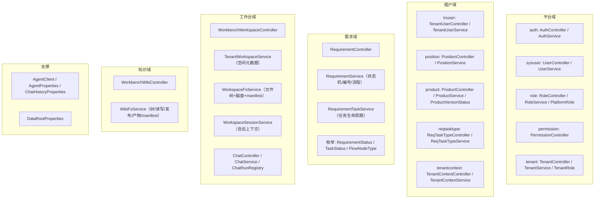

### 3.3 关键校验顺序

| 场景 | 校验顺序 |
|---|---|
| 任意租户级写操作 | 1) 登录态 → 2) 权限码 → 3) 租户存在（`requireTenantId`）→ 4) 资源归属/存在性 → 5) 业务规则 |
| 个人空间操作 | 1) 工作在当前租户 → 2) `space_type == PERSONAL` → 3) `owner_user_id == 当前用户` → 4) 节点属于该空间 |
| 会话操作 | 1) 空间合法（同上）→ 2) 会话属于该空间且 `user_id == 当前用户` → 3) 输出目录为空间内 DIR → 4) 上下文节点为本租户 Wiki 节点 |
| 需求动作 | 1) 权限码 → 2) 需求在本租户 → 3) 身份（创建人/当前处理人）→ 4) 状态机允许 → 5) 关联实体（产品/版本/审批人）合法 |
| 任务动作 | 1) 权限码 → 2) 需求/任务在本租户且互相匹配 → 3) 操作权（处理人/创建人/需求处理人/需求创建人）→ 4) 状态机允许 |
| Wiki 写操作 | 1) 权限码 `work:access` → 2) 父节点为本租户 DIR → 3) 名称合法且同级唯一 → 4) 磁盘写入 |

---

## 4. 接口详细设计

### 4.1 全量接口清单

#### 认证（`/api/auth`）

| 方法 | 路径 | 权限 | 请求 | 响应 `data` |
|---|---|---|---|---|
| POST | `/login` | 公开 | `{username, password}` | `{token, user:{id,username,roleId,roleName,builtin}, permissions[], currentTenantId, currentTenantName}` |
| POST | `/logout` | 登录 | — | `null`（前端负责清态） |
| GET | `/me` | 登录 | — | 同 login（无 token），含当前租户解析 |
| GET | `/my-tenants` | 登录 | — | 已加入且启用的租户列表 |

#### 用户 / 角色 / 权限 / 租户

| 方法 | 路径 | 权限 | 说明 |
|---|---|---|---|
| GET | `/api/users?page&size&username` | `user:view` | 分页 + 模糊搜索，返回 `{total, records[]}` |
| GET | `/api/users/all` | `tenant:view` | 全量用户（租户管理员候选） |
| POST/PUT/DELETE | `/api/users`、`/api/users/{id}` | `user:operate` | `{username,password,description,roleId}`；内置用户仅可改密码 |
| GET | `/api/roles` | `role:view` | 角色列表 |
| POST/PUT/DELETE | `/api/roles`、`/api/roles/{id}` | `role:operate` | 名称唯一 |
| GET/PUT | `/api/roles/{id}/permissions` | `role:view` / `role:operate` | 权限码集合读写 |
| GET | `/api/permissions` | `permission:view` | 只读 |
| GET | `/api/tenants`、`/api/tenants/{id}` | `tenant:view` | 含管理员列表 |
| POST/PUT/DELETE | `/api/tenants`、`/api/tenants/{id}` | `tenant:operate` | `{code,name,description,status,adminUserIds[]}`；编码不可改；至少一名管理员 |

#### 租户配置

| 方法 | 路径 | 权限 | 说明 |
|---|---|---|---|
| GET | `/api/tenant-users` | `tenant-user:view` | 当前租户成员（含平台/租户角色） |
| GET | `/api/tenant-users/candidates` | `tenant-user:view` | 可添加的系统用户 |
| GET | `/api/tenant-users/roles` | `tenant-user:view` | 租户角色字典 |
| POST/PUT/DELETE | `/api/tenant-users`、`/{id}` | `tenant-user:operate` | 成员与租户角色维护 |
| GET | `/api/positions?withSkills` | `position:view` 或 `work:access` | 岗位（可带技能） |
| GET | `/api/positions/{id}` | 同上 | 岗位详情 |
| POST/PUT/DELETE | `/api/positions`、`/{id}` | `position:operate` | 名称租户内唯一 |
| GET | `/api/positions/{id}/skills` | 同上 | 技能列表（按 `sort_order`） |
| POST/PUT/DELETE | `/api/positions/{id}/skills[/{skillId}]` | `position:operate` | 技能维护 |
| GET | `/api/products`、`/{id}` | `product:view` 或 `requirement:view` | 产品 |
| GET | `/api/products/managers` | `product:view` | 产品经理候选 |
| POST/PUT/DELETE | `/api/products`、`/{id}` | `product:operate` | 已关联需求拒绝删除 |
| GET | `/api/products/{id}/versions` | `product:view` 或 `requirement:view` | 版本列表 |
| POST/PUT/DELETE | `/api/products/{id}/versions[/{versionId}]` | `product:operate` | 版本号产品内唯一；`PLANNING` 必填 `planReleaseAt` |
| GET | `/api/req-task-types`、`/{id}` | `req-task-type:view` | 任务类型 |
| GET | `/api/req-task-types/enabled` | `work:access` | 启用类型（建任务用） |
| POST/PUT/DELETE | `/api/req-task-types`、`/{id}` | `req-task-type:operate` | 编码租户内唯一 |
| GET/PUT | `/api/tenant/context` | `work:access` | 我的岗位/技能上下文（PUT：`{positionId, skillIds[], customSkillText}`） |

#### 需求与任务（`/api/requirements`）

| 方法 | 路径 | 权限 | 说明 |
|---|---|---|---|
| GET | `/` | `requirement:view` | 我创建的需求 |
| GET | `/inbox` | `work:access` | 兼容接口，等价 `scope=todo` |
| GET | `/workbench?scope=todo\|all` | `work:access` | 当前处理人为我的需求 |
| GET | `/approver-candidates?productId` | `requirement:view` | 审批人候选 + 产品经理默认值 |
| GET | `/{id}` | 登录 + 可见性校验 | 详情（含 `flows` 流程列表） |
| POST | `/` | `requirement:operate` | `{name, description, productId, productVersionId}` |
| PUT | `/{id}` | `requirement:operate` | 仅 `DRAFT`/`REJECTED` 且为创建人 |
| POST | `/{id}/submit` | `requirement:operate` | `{approverId?}` |
| POST | `/{id}/approve` | `work:access` | 当前处理人 |
| POST | `/{id}/reject` | `work:access` | `{reason}` 必填 |
| POST | `/{id}/plan` | `work:access` | `{releaseVersionId, comment?}` |
| POST | `/{id}/develop` | `work:access` | 生成 Wiki 产物 |
| DELETE | `/{id}` | `requirement:operate` | 仅创建人 |
| GET | `/{id}/tasks` | `work:access` | 任务列表（含处理人/输入交付件） |
| POST | `/{id}/tasks` | `work:access` | `{taskTypeId, handlerUserIds[], inputDeliverables:[{wikiNodeId}], remark?}` |
| POST | `/{id}/tasks/{taskId}/start` | `work:access` | 开始 |
| POST | `/{id}/tasks/{taskId}/complete` | `work:access` | `{deliverableText?}` |
| POST | `/{id}/tasks/{taskId}/cancel` | `work:access` | 取消 |

#### 工作台工作空间（`/api/workbench/workspaces`）

| 方法 | 路径 | 说明 |
|---|---|---|
| GET | `/personal` | 我的个人空间列表 |
| POST | `/` | `{name, workDir?}` → `{id}`（服务端分配 workDir） |
| DELETE | `/{id}` | 删除空间（级联节点/会话/磁盘） |
| GET | `/{id}/tree` | 文件树（返回嵌套 `children`） |
| POST | `/{id}/dirs` | `{parentId?, displayName}` |
| POST | `/{id}/files` | `{parentId?, displayName, content?}`（自动补 `.md`） |
| GET | `/{id}/nodes/{nodeId}/content` | 读取文件 `{id,displayName,content,requirementId}` |
| PUT | `/{id}/nodes/{nodeId}/content` | `{content}` |
| DELETE | `/{id}/nodes/{nodeId}` | 删除节点（目录递归） |
| GET | `/{id}/sessions` | 会话列表（含上下文、输入交付件与输出目录标签） |
| POST | `/{id}/sessions` | `{sessionType,title,requirementId?,taskId?,outputDirNodeId?,contexts:[{wikiNodeId}]}` |
| GET/PUT/DELETE | `/{id}/sessions/{sessionId}` | 会话详情 / 更新 / 删除 |
| PUT | `/{id}/sessions/{sessionId}` | `{title, outputDirNodeId?, contexts[]}`（上下文整体替换） |
| GET | `/{id}/nodes/{nodeId}/revisions` | 文件修订列表（覆盖保存产生的快照） |
| GET | `/{id}/nodes/{nodeId}/diff` | 与上一版或指定修订并排 diff |

#### 聊天（`/api/chat`）

| 方法 | 路径 | 说明 |
|---|---|---|
| POST | `/completions` | SSE；`{sessionId, clientTempId?, content}`；转发 Agent 的 `meta`/`step`/`content`/`error`/`done`/`title` |
| POST | `/sessions/{id}/stop` | `{runId}` |
| GET | `/sessions` | 我的会话列表（跨空间） |
| GET | `/sessions/{id}/messages` | 消息列表（按 id 升序；不含步骤日志） |
| DELETE | `/sessions/{id}` | 删除会话（消息级联） |

#### Agent 内部文件工具（`/api/internal/agent`，`X-Internal-Token`，不对浏览器开放）

| 方法 | 路径 | 说明 |
|---|---|---|
| GET | `/sessions/{sessionId}/file-index` | 构造会话可用材料索引（Wiki 上下文 / 任务输入 / 输出目录等） |
| POST | `/sessions/{sessionId}/search` | `{query}` → 命中列表（优先 ripgrep，失败回退行扫描） |
| POST | `/sessions/{sessionId}/read` | `{source, nodeId}` → 文件正文（`source`：`wiki` / `workspace`） |
| POST | `/sessions/{sessionId}/write` | `{displayName, content}` → 写入会话输出目录；同名覆盖并保留旧版快照 |

#### Wiki（`/api/workbench/wiki`，均需 `work:access`）

| 方法 | 路径 | 说明 |
|---|---|---|
| GET | `/tree` | 租户 Wiki 树 |
| POST | `/dirs` | `{parentId?, displayName}` |
| POST | `/files` | `{parentId?, displayName, content?}` |
| GET | `/nodes/{nodeId}/content` | 读取文件 |
| PUT | `/nodes/{nodeId}/content` | `{content}` |
| DELETE | `/nodes/{nodeId}` | 删除节点（递归） |
| POST | `/publish` | `{sourceWorkspaceId, sourceNodeId, targetParentId?}` → `{id}` |

### 4.2 SSE 事件协议

**Java → 浏览器**（`POST /api/chat/completions`，`Content-Type: text/event-stream`）

| 事件 | data | 说明 |
|---|---|---|
| `meta` | `{sessionId, messageId, runId, clientTempId}` | 流开始，前端据此绑定消息与停止按钮 |
| `step` | `{step, message}` | 工作步骤摘要（如 `llm` / `search_docs` / `read_docs` / `write_output`）；**只转发不落库** |
| `content` | `{delta}` | 增量正文（打字机） |
| `error` | `{message}` | 运行期错误 |
| `done` | `{run_id}` 或 `{run_id, cancelled}` | 上游结束 |
| `title` | `{sessionId, title}` | 首轮后自动标题 |

**Agent → Java**（`POST /v1/chat/stream`）

| 事件 | data |
|---|---|
| `step` | `{step, message}` |
| `content` | `{delta}` |
| `done` | `{run_id}` / `{run_id, cancelled:true}` |
| `error` | `{message}` |

响应头要求：`Cache-Control: no-cache, no-transform`、`X-Accel-Buffering: no`、`Connection: keep-alive`。

**流式防缓冲要点**

- Vite 开发代理：对 `text/event-stream` / `/chat/completions` 去压缩、清 `content-length`，避免攒包。
- `RequestLoggingFilter`：**不得**对 SSE 响应使用 `ContentCachingResponseWrapper`，否则整段缓冲导致前端无打字机/无步骤。

### 4.3 Agent 内部接口

| 方法 | 路径 | 请求 | 响应 |
|---|---|---|---|
| POST | `/v1/chat/stream` | `{run_id, tenant_id, user_id, session_id, workspace_id, position, skills, messages, session_type?, output_dir_node_id?, file_index?, tools_enabled?}` | SSE（见上） |
| POST | `/v1/chat/title` | `{question}` | `{title}` |
| POST | `/v1/chat/stop` | `{run_id}` | `{ok, cancelled}` |
| GET | `/health` | — | 存活探测 |

所有 `/v1/chat/*` 均需 `X-Internal-Token`，缺失或不匹配返回 401。

---

## 5. 关键流程详细设计

### 5.1 登录与租户上下文

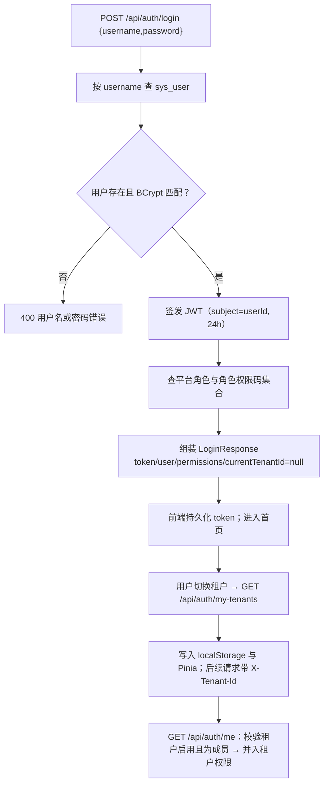

**要点**

- 登录不自动选租户（`currentTenantId` 恒为 null），与需求 FR-01-02 一致。
- `/me` 每次进入应用调用一次（前端 `meLoaded` 只取一次），用于恢复权限与租户。
- 若租户被停用或成员被移除，`/me` 返回的 `currentTenantId` 为空 → 前端提示重新选择。

### 5.2 需求创建与编号生成

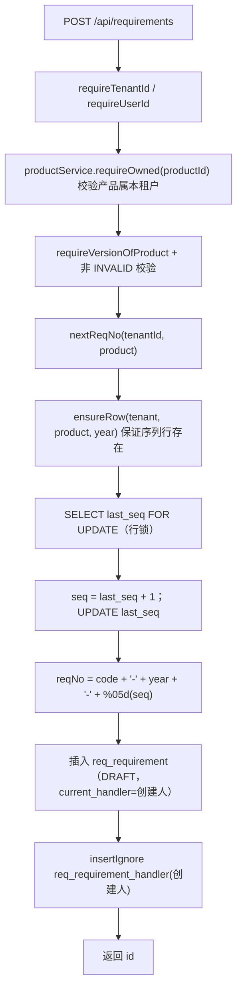

编号示例：产品 `DAP` 于 2026 年第 1 次创建 → `DAP-2026-00001`。

### 5.3 需求状态流转

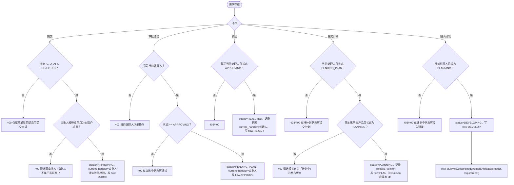

### 5.4 研发任务生命周期

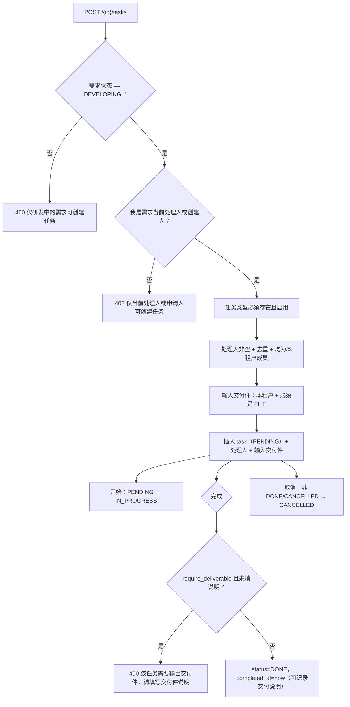

### 5.5 个人空间文件树

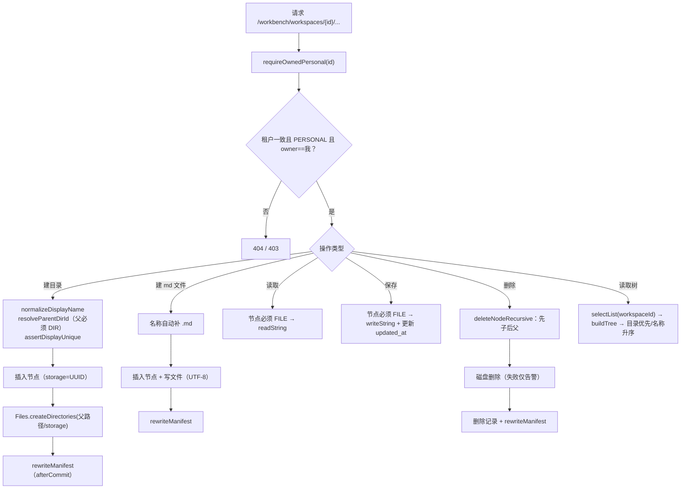

**路径解析**

```
resolveNodePath(ws, node):
  chain = 从 node 沿 parentId 上溯（上限 64 层）
  path  = resolveWorkspacePath(ws)
  for n in chain: path = path.resolve(n.storageName)
  assert path.normalize().startsWith(resolveWorkspacePath(ws))
```

### 5.6 会话创建与上下文落库

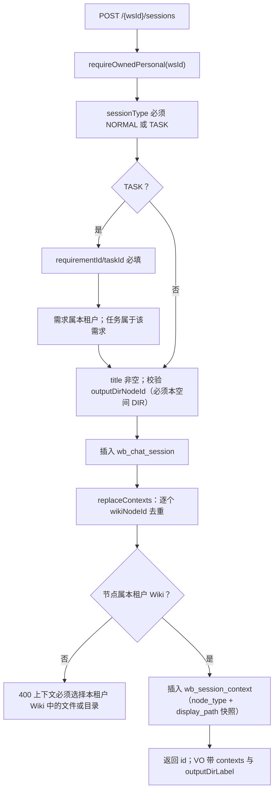

### 5.7 对话补全（代码级）

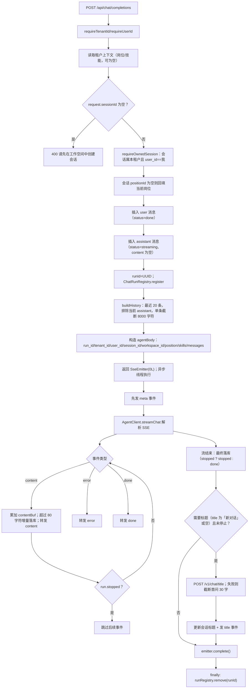

**异常路径**：`catch` 中把助手消息置 `error`，向浏览器发 `error` 事件并 `completeWithError`；`onTimeout` 触发 `markStopped + agentClient.stop`。

### 5.8 Wiki 发布

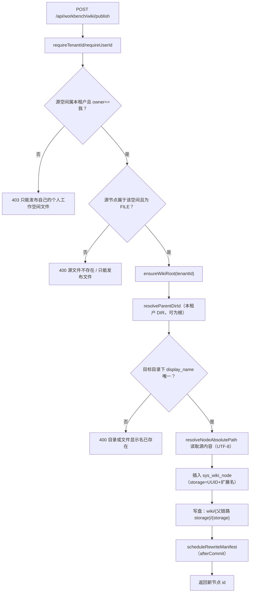

### 5.9 投入研发产物生成

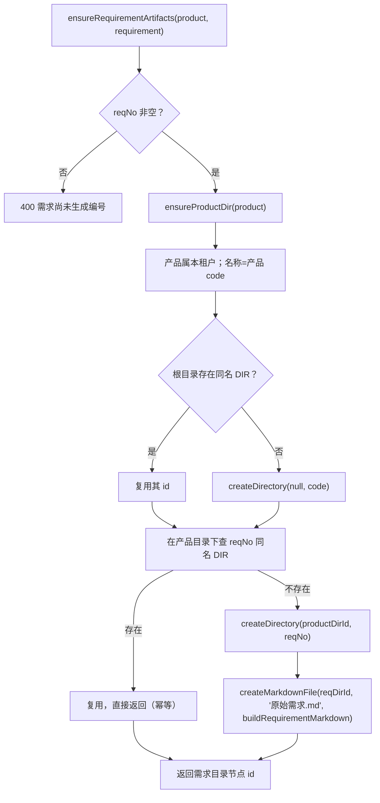

生成内容模板：

```markdown
# 原始需求

- 需求编号：{reqNo}
- 需求名称：{name}
- 产品版本：{productVersion}

---

{description}
```

### 5.10 manifest 原子重写

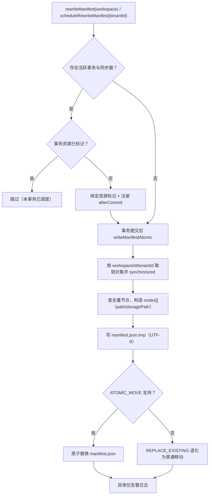

---

## 6. 磁盘与清单规范

### 6.1 目录契约

| 域 | 路径模板 | 说明 |
|---|---|---|
| 个人空间 | `{data.root}/{tenantCode}/{username}/{workDir}/` | `workDir` 由服务端分配，仅英数下划线，长度 ≤64 |
| 个人空间元数据 | `{空间根}/.dap/manifest.json` | 不参与文件树、不入库 |
| 个人空间目录 | `{空间根}/{uuid}/` | UUID 无扩展名 |
| 个人空间文件 | `{空间根}/.../{uuid}.md` | 保留原扩展名 |
| Wiki 根 | `{data.root}/{tenantCode}/wiki/` | 一租户一棵树 |
| Wiki 元数据 | `{wiki 根}/.dap/manifest.json` | 含 `tenantId` |
| Wiki 节点 | `{wiki 根}/.../{uuid}[.ext]` | |

### 6.2 manifest 结构

**个人空间**

| 字段 | 说明 |
|---|---|
| `version` | 结构版本，当前 `1` |
| `workspaceId` | 工作空间 id |
| `updatedAt` | ISO-8601 时间戳 |
| `nodes[].id` | 节点 id |
| `nodes[].parentId` | 父节点 id / null |
| `nodes[].type` | `DIR` / `FILE` |
| `nodes[].name` | 显示名 |
| `nodes[].path` | 展示逻辑路径（`a/b/c.md`） |
| `nodes[].storage` | 磁盘存储名 |
| `nodes[].storagePath` | 磁盘相对路径（`uuid/uuid.md`） |
| `nodes[].requirementId` | 可选，历史关联 |

**Wiki**：同上，`workspaceId` 替换为 `tenantId`。

### 6.3 命名与校验规则

| 对象 | 规则 | 违反提示 |
|---|---|---|
| 工作空间名称 | 必填；`^[a-zA-Z0-9_]+$`；长度 ≤128 | 「请输入名称」/「仅支持英文、数字、下划线」 |
| workDir | 单层；仅英数下划线；≤64 | 「工作目录只能是单层文件夹名」/「工作目录仅支持英文、数字、下划线」 |
| 节点显示名（空间/Wiki） | 非空；不含 `/`、`\`、`..`；同级唯一 | 「名称非法」/「目录或文件显示名已存在: xxx」 |
| Markdown 文件名 | 未以 `.md` 结尾自动补全（大小写不敏感） | — |
| 文件内容 | UTF-8，无大小上限（V1.0） | — |

---

## 7. 前端详细设计

### 7.1 目录结构

```
dap-front/src
├── main.ts              应用装配（Pinia / Router / Element Plus 中文包）
├── App.vue
├── router/index.ts      路由表 + 全局守卫
├── stores/
│   ├── auth.ts          token / user / permissions / currentTenant
│   └── workbenchUi.ts   工作台 UI 状态（当前未被引用）
├── api/                 auth user role permission tenant tenantUser tenantContext
│                        position product reqTaskType requirement wiki chat tenantWorkspace
├── utils/               request（Axios 实例与拦截器）· markdown · date
├── layouts/MainLayout.vue  顶栏 + 侧栏 + 内容区
├── components/          TenantSwitcher · MarkdownBody · FloatingAssistant（未挂载）
└── views/
    ├── login/LoginView.vue
    ├── home/HomeView.vue
    ├── user-center/     UsersView · RolesView · PermissionsView · TenantsView
    ├── sys-config/      TenantUsersView · PositionsView · ProductsView · ReqTaskTypesView
    ├── requirement/RequirementApplyView.vue
    └── workbench/       WorkbenchView · WorkbenchSpacesPane · WorkbenchWikiPane
```

### 7.2 路由与守卫

| 路由 | 组件 | `meta.permission` | `meta.requiresTenant` |
|---|---|---|---|
| `/login` | LoginView | —（`public: true`） | — |
| `/home` | HomeView | — | — |
| `/user-center/users` | UsersView | `user:view` | — |
| `/user-center/roles` | RolesView | `role:view` | — |
| `/user-center/permissions` | PermissionsView | `permission:view` | — |
| `/user-center/tenants` | TenantsView | `tenant:view` | — |
| `/tenant-config/users` | TenantUsersView | `tenant-user:view` | ✅ |
| `/tenant-config/positions` | PositionsView | `position:view` | ✅ |
| `/tenant-config/products` | ProductsView | `product:view` | ✅ |
| `/tenant-config/req-task-types` | ReqTaskTypesView | `req-task-type:view` | ✅ |
| `/requirement/apply` | RequirementApplyView | `requirement:view` | ✅ |
| `/workbench` | WorkbenchView | `work:access` | ✅ |
| `/sys-config/*` | 重定向到 `/tenant-config/*` | — | — |
| `/requirement/submit` | 重定向到 `/requirement/apply` | — | — |

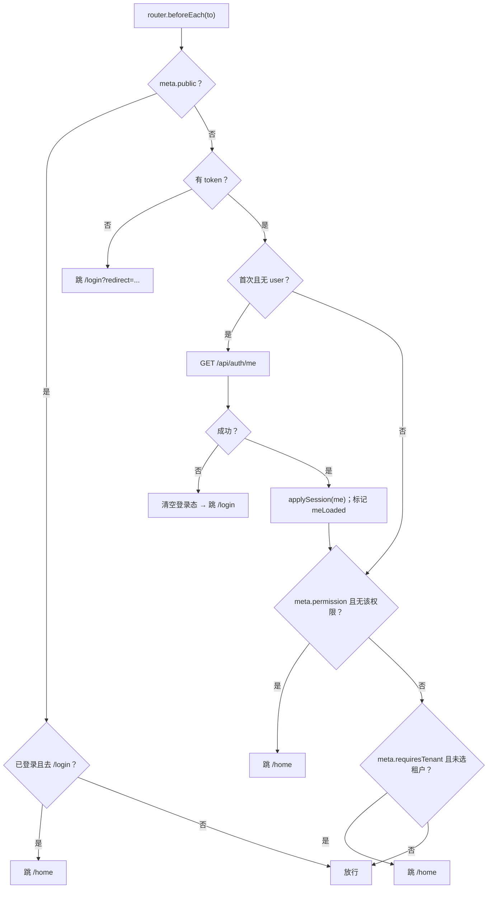

### 7.3 请求与 SSE 封装

**Axios 拦截器**

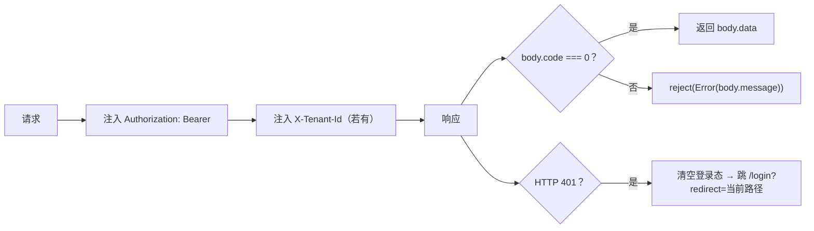

超时统一 30s；SSE 不走 Axios，使用原生 `fetch` 以支持 `ReadableStream`。

**SSE 客户端（`api/chat.ts#streamCompletion`）**

1. `fetch('/api/chat/completions', { method:'POST', headers, body, signal })`，头含 Bearer 与 `X-Tenant-Id`。
2. 逐行切分 `\r?\n`；空行触发 flush；`event:` 记录事件名，`data:` 累积数据行。
3. `flush` 中最多两次 `JSON.parse` 解包（兼容被二次转义的字符串）。
4. 非 2xx 时尝试读取 `{message}` 并抛错。

### 7.4 页面与组件要点

| 页面/组件 | 关键设计 |
|---|---|
| `MainLayout` | 顶栏 5 个主菜单（首页 / 需求管理 / 工作台 / 租户配置 / 用户中心），按权限与"是否已选租户"过滤；租户级菜单无权限时提示"暂无 xx 访问权限"；侧栏由路径前缀决定（用户中心 / 租户配置 / 需求） |
| `TenantSwitcher` | 读取 `my-tenants`，切换写入 Pinia + localStorage，触发页面重载数据 |
| `LoginView` | 表单校验；成功写 token 并跳 `redirect` 或 `/home` |
| `UsersView` / `RolesView` / `TenantsView` | 列表 + 抽屉/对话框表单；内置用户与当前用户删除按钮禁用；角色可勾选权限码 |
| `PermissionsView` | 纯只读表格 |
| `PositionsView` | 岗位列表 + 技能子表（行内增删改、排序号） |
| `ProductsView` | 产品列表 + 版本子表（状态、计划发布时间、关联需求保护） |
| `ReqTaskTypesView` | 类型列表 + 交付件要求/模板/启停 |
| `RequirementApplyView` | 本人需求列表 + 新建/编辑表单（产品→版本联动）+ 提交选审批人 |
| `WorkbenchView` | 三面板壳：需求列表 / 工作空间 / Wiki；左侧宽度可拖拽（默认 300）；需求面板为"产品→版本→需求"三级树 + 详情 + 流程时间线 + 任务对话框（Wiki 树勾选输入交付件） |
| `WorkbenchSpacesPane` | 左：空间+会话；中：会话/文档同级 Tab；聊天支持 Enter 发送、打字机增量、可折叠「工作步骤」、气泡 max-width；右：文件树；左右栏可拖宽；文件菜单「发布到 Wiki」/版本对比 |
| `DiffSideBySide` | md 修订并排 diff，行级高亮 |
| `WorkbenchWikiPane` | 左：Wiki 树；右：默认预览、点「编辑」切文本域、保存回预览；内容区 `flex:1` 撑满 |
| `MarkdownBody` | `marked` + `DOMPurify`；`user-select: text`；代码块「复制」按钮；与全局「非输入框清选区」策略兼容（`.md-body` / `.chat-body .bubble` 豁免） |
| `FloatingAssistant` / `HelloWorld` / `workbenchUi` | **未被任何路由或组件引用**，属历史残留，不影响运行 |

### 7.5 状态管理

| Store | 状态 | 说明 |
|---|---|---|
| `auth` | `token`、`user`、`permissions[]`、`currentTenantId`、`currentTenantName` | token 与租户持久化到 localStorage（`dap_token`、`dap_tenant_id`、`dap_tenant_name`）；`hasPermission/hasAnyPermission` 供菜单与守卫使用 |
| `workbenchUi` | `showAssistant` | 仅为残留组件准备，未使用 |

---

## 8. Agent 详细设计

### 8.1 服务结构

```
dap_agent/
├── main.py                 FastAPI 应用装配 + uvicorn 启动
├── config.py               Settings（.env）
├── api/
│   ├── deps.py             verify_internal_token
│   ├── logging_middleware.py
│   └── routes/
│       ├── health.py       GET /health
│       └── chat.py         /v1/chat/stream | title | stop（含 step/content SSE）
├── agents/
│   ├── workbench_agent.py  系统提示词 + 工具轮 astream + step/content 事件
│   └── title_agent.py      会话标题生成
├── tools/
│   ├── workspace_tools.py  search_docs / read_docs / write_output
│   └── dap_server_client.py  调用 Java /api/internal/agent/*（trust_env=False 防代理）
├── llm/factory.py          ChatOpenAI 工厂（base_url 归一化）
├── runtime/session_registry.py  runId → asyncio.Task
└── schemas/chat.py         Pydantic 请求/响应（含 file_index、tools_enabled）
```

### 8.2 流式接口实现

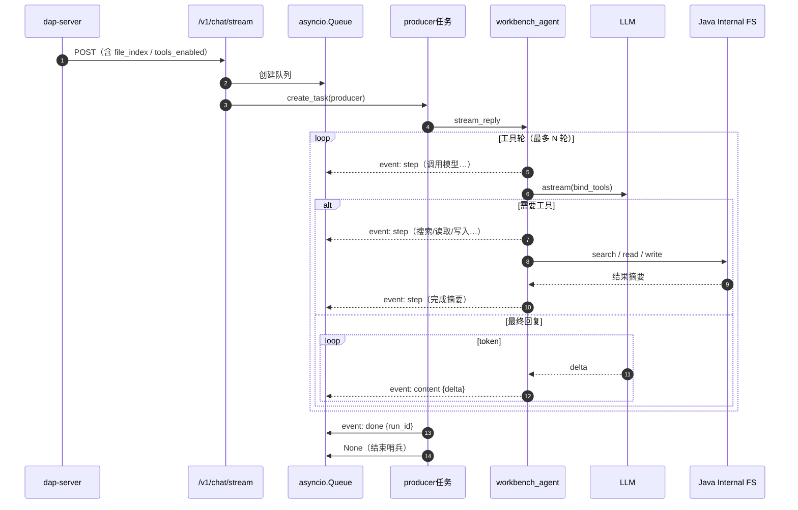

**取消语义**

- `/v1/chat/stop` → `session_registry.cancel(run_id)` → `Task.cancel()`；被取消分支会先投递 `done{cancelled:true}` 再抛出，确保客户端收到明确的结束事件。
- 未注册的 runId 返回 `{ok:true, cancelled:false}`，不报错（幂等）。

### 8.3 提示词与工具

```
你是 DAP 开发智能体工作台助手。
当前岗位：{position.name 或 "未指定"}
当前技能：{skills 名称、自定义文案，以「、」连接；无则 "未指定"}
（可附带会话材料索引摘要，指导工具选用）
请用简洁、专业的中文回答，聚焦软件研发生命周期相关问题。
直接输出对用户有用的正文，不要输出内部思考过程标签。
```

消息序列 = `System(上述)` + 历史消息。**不自动拼接 Wiki 全文**；需要时通过工具按需读取。

| 工具 | 作用 | 对应 Java |
|---|---|---|
| `search_docs` | 按关键词检索会话可访问材料 | `POST .../search` |
| `read_docs` | 读取 Wiki 或工作空间文件 | `POST .../read` |
| `write_output` | 写入本会话输出目录（同名覆盖+快照） | `POST .../write` |

`tools_enabled=false` 或缺少 `session_id` 时退化为纯 `astream` 文本流，仍发 `step`/`content`。

### 8.4 模型与流式细节

| 项 | 值 |
|---|---|
| 客户端 | `langchain_openai.ChatOpenAI` |
| 参数 | `temperature=0.3`（正文）/ `0`（标题）、`streaming=True` |
| `base_url` 归一化 | 去尾斜杠；以 `/v1` 结尾则原样；`/compatible-mode` 结尾自动补 `/v1` 并告警；其余仅告警 |
| 密钥缺失 | 正文：抛 `RuntimeError("未配置 LLM_API_KEY…")`；标题：退化为截断首问 |
| 内容解析 | `chunk.content` 为字符串直接输出；为列表时取 `type == "text"` 或字符串片段 |
| 工具轮 | `bind_tools` + `astream` 累积；有 `tool_calls` 则执行并继续；无则推送正文 delta |
| 步骤事件 | 每轮开始/工具前后 yield `step`，仅短摘要 |
| 标题 | 首问截断 500 字符送模型，返回再截断 30 字；异常回落为截断首问 |

---

## 9. 配置项清单

### 9.1 后端（`application.yml`）

| 配置 | 默认 | 说明 |
|---|---|---|
| `server.port` | 8200 | 服务端口 |
| `spring.datasource.url` | `jdbc:postgresql://localhost:5432/postgres?currentSchema=dap` | 数据库 |
| `spring.datasource.hikari.maximum-pool-size` | 20 | 连接池上限 |
| `spring.datasource.hikari.connection-init-sql` | `SET client_encoding TO 'UTF8'` | 编码 |
| `spring.flyway.schemas` / `default-schema` | `dap` | 迁移 schema |
| `dap.data.root` | `../data` | 数据根目录 |
| `dap.jwt.secret` | `dap-dev-secret-change-me-please-32bytes!!` | **生产必须替换** |
| `dap.jwt.expire-hours` | 24 | 令牌有效期 |
| `dap.agent.base-url` | `http://127.0.0.1:8202` | Agent 地址 |
| `dap.agent.internal-token` | `${DAP_AGENT_TOKEN:dev-internal-token}` | 内网令牌 |
| `dap.agent.connect-timeout-ms` | 3000 | 连接超时 |
| `dap.agent.read-timeout-ms` | 300000 | 读超时（5 分钟） |
| `dap.chat.history-max-messages` | 20 | 历史条数上限 |
| `dap.chat.history-max-chars` | 8000 | 单条历史截断 |

### 9.2 Agent（`.env`）

| 配置 | 默认 | 说明 |
|---|---|---|
| `DAP_INTERNAL_TOKEN` | `dev-internal-token` | 必须与后端一致 |
| `LLM_BASE_URL` | `https://api.openai.com/v1` | 需以 `/v1` 结尾 |
| `LLM_API_KEY` | 空 | 空则拒绝正文推理 |
| `LLM_MODEL` | `gpt-4o-mini` | 模型名 |
| `HOST` / `PORT` | `0.0.0.0` / 8202 | 监听 |

### 9.3 前端

| 配置 | 值 |
|---|---|
| 开发端口 | 8201（`strictPort`） |
| API 代理 | `/api → http://localhost:8200`，`timeout: 0`、`proxyTimeout: 0`；SSE 去压缩/`content-length`、设 `X-Accel-Buffering: no` |
| 请求超时 | 30s |

---

## 10. 错误码与提示文案

| HTTP | code | 触发 | 文案示例 |
|---|---|---|---|
| 401 | 401 | 无/非法 Bearer；JWT 过期；用户不存在；`UserContext` 为空 | 未登录 / 登录已失效 / 用户不存在 |
| 403 | 403 | 权限码缺失 | 无权限：`{code}` / 无权限查看产品 / 无权限查看岗位 |
| 200 | 403 | 资源归属校验 | 只能操作自己的个人工作空间 / 当前处理人才能操作 / 只能发布自己的个人工作空间文件 / 无权查看该需求 |
| 200 | 400 | 参数与业务规则 | 请先选择租户 / 请输入名称 / 名称非法 / 目录或文件显示名已存在 / 请选择岗位 / 请至少选择一个技能，或填写自定义技能 |
| 200 | 404 | 资源不存在或跨租户 | 工作空间不存在 / 会话不存在 / 节点不存在 / 需求不存在 / 任务不存在 / 产品不存在 |
| 200 | 200 | 需求状态机 | 仅草稿或驳回状态可提交申请 / 仅审批中状态可通过 / 仅待计划状态可提交计划 / 仅计划中状态可投入研发 |
| 200 | 200 | 任务规则 | 仅研发中的需求可创建任务 / 请至少选择一名处理人 / 处理人不属于当前租户 / 该任务需要输出交付件，请填写交付件说明 / 当前状态不可完成 / 当前状态不可取消 |
| 200 | 200 | 版本规则 | 请选择状态为「计划中」的发布版本 / 不能选择无效版本 / 该版本已关联需求，无法删除 / 产品已关联需求，无法删除 |
| 200 | 500 | 未捕获异常 | 服务器内部错误 |
| — | 502 | Agent 调用失败 | Agent 调用失败: `{body}` |

**前端提示**：所有业务错误经 Axios 拦截器转为 `Error(message)`，页面以 `ElMessage.error` 展示；401 统一跳登录。

---

## 11. 测试要点

### 11.1 认证与权限

| 用例 | 期望 |
|---|---|
| 无 token 访问 `/api/users` | 401 |
| 普通用户访问 `/api/users` | 403 |
| 携带非法 `X-Tenant-Id` 访问用户中心 | 正常返回（租户头被忽略） |
| 携带非成员租户访问 `/api/requirement` | 400 请先选择租户 |
| 租户 `OPERATOR` 访问 `/api/positions`（写） | 403；读（列表）放行 |

### 11.2 需求与任务

| 用例 | 期望 |
|---|---|
| 并发创建同产品需求 | 编号连续且唯一，无重复 |
| 换产品编辑需求 | 编号按新产品重新生成 |
| 非当前处理人审批 | 403 |
| 选非 `PLANNING` 版本提交计划 | 400 |
| 重复投入研发 | 幂等，Wiki 产物不重复 |
| 要求交付件的任务未填说明完成 | 400 |
| 处理人非租户成员 | 400 |
| 输入交付件选目录 | 400 |

### 11.3 工作台与文件

| 用例 | 期望 |
|---|---|
| 新建空间后磁盘出现 `.dap/manifest.json` | 存在且节点完整 |
| 同层重名建节点 | 400 显示名已存在 |
| 删除目录 | 子节点与磁盘递归删除 |
| 跨用户访问他人空间 | 403 |
| 显示名含 `../` | 400 名称非法 |
| 事务回滚 | manifest 不被重写（`afterCommit` 生效） |

### 11.4 会话与对话

| 用例 | 期望 |
|---|---|
| 无会话发消息 | 400 请先在工作空间中创建会话 |
| 生成中停止 | 消息状态 `stopped`，内容保留，Agent 任务被取消 |
| 停止已结束的 runId | 400 当前没有可停止的生成任务 |
| 首轮后标题 | 自动生成并持久化，SSE 收到 `title` |
| 历史超 20 条 | 仅取最近 20 条送入模型 |
| Agent 不可用 | 502 明确错误，消息状态 `error` |
| 刷新页面 | 历史消息完整（含 streaming 中间落库内容） |

### 11.5 Wiki

| 用例 | 期望 |
|---|---|
| 发布同名文件 | 400 冲突 |
| 发布后 Wiki 树与磁盘一致 | 是 |
| 删除被引用的 Wiki 节点 | 会话上下文/任务输入记录级联消失 |
| 投入研发产物路径 | `{产品编码}/{需求编号}/原始需求.md` |

---

## 12. 已知差异与待办

以下为**代码实现与早期文档/产品预期之间的差异**，供后续迭代决策（V1.0 以代码为准）。

| 编号 | 差异 | 现状 | 建议 |
|---|---|---|---|
| GAP-01 | 岗位/技能被引用时的删除保护 | PRD 要求"禁止删除并提示"；实现直接删除岗位与技能，被 `sys_user_tenant_context.position_id` 外键引用时数据库报错→返回"服务器内部错误" | 服务层前置查询引用并返回明确文案 |
| GAP-02 | 个人空间名称唯一范围 | PRD 表述为"租户+用户下唯一"；实现为**租户内**唯一（`assertNameUnique` 不带 owner 过滤），而 workDir 唯一性为"租户+所有者" | 统一为"租户+所有者"或在文档中明确租户内唯一 |
| GAP-03 | 文件上传 | PRD 提到"上传 md"，实现未提供上传接口（仅新建 md 并写入内容） | 增加上传接口或修正需求描述 |
| GAP-04 | 引入需求到个人空间 | 前端 `api/tenantWorkspace.ts` 保留 `importWorkbenchRequirement`，服务端无对应接口 | 删除前端残留方法 |
| GAP-05 | 前端残留组件 | `FloatingAssistant.vue`、`HelloWorld.vue`、`stores/workbenchUi.ts` 未被引用 | 清理或正式接入 |
| GAP-06 | `sys_workspace.space_type` 默认值 | DDL 默认 `SHARED`，业务仅写 `PERSONAL`；`WorkspaceSpaceType.SHARED` 分支与 `share/` 目录仍存在 | 后续迁移将默认值改为 `PERSONAL` 并移除 SHARED 分支 |
| GAP-07 | `sys_workspace.description` | 前端类型与表单仍含 `description`，V9 已删列 | 前端移除该字段 |
| GAP-08 | `requirement.plan_date` | 表存在字段，提交计划时固定写入 `null` | 明确是否需要计划日期或删除字段 |
| GAP-09 | 租户状态校验位置 | `AuthInterceptor` 仅校验成员关系，未校验租户 `status`；`/api/auth/me` 才校验启用状态 | 在拦截器统一校验，避免停用租户仍可调用接口 |
| GAP-10 | 需求/任务缺少乐观锁 | 无 `version` 字段，并发同单据操作可能覆盖 | 增加乐观锁与重试 |
| GAP-11 | 运行态注册表进程内存储 | `ChatRunRegistry` 与 `SessionRegistry` 均为进程内，多实例下停止失效 | 外置到 Redis |
| GAP-12 | Wiki 正文未注入 Prompt | 符合 V1.0 范围，但与"上下文"命名存在预期落差 | V1.2 增强并在 UI 上标注"当前仅记录引用" |
| GAP-13 | `workspace:view/operate` 权限码 | 已种入但无对应接口与页面 | 保留或移除 |
| GAP-14 | `permission:operate` | 保留不授予（符合需求）；无前端入口 | 保持 |

---

## 附录 A：符号与文件对照

| 符号 | 文件 |
|---|---|
| `AuthInterceptor` | `dap-server/.../security/AuthInterceptor.java` |
| `PermissionAspect` | `dap-server/.../security/PermissionAspect.java` |
| `TenantSupport` | `dap-server/.../security/TenantSupport.java` |
| `RequirementService` | `dap-server/.../modules/requirement/RequirementService.java` |
| `RequirementTaskService` | `dap-server/.../modules/requirement/RequirementTaskService.java` |
| `WorkspaceFsService` | `dap-server/.../modules/tnworkspace/WorkspaceFsService.java` |
| `WorkspaceSessionService` | `dap-server/.../modules/chat/WorkspaceSessionService.java` |
| `ChatService` | `dap-server/.../modules/chat/ChatService.java` |
| `ChatRunRegistry` | `dap-server/.../modules/chat/ChatRunRegistry.java` |
| `WikiFsService` | `dap-server/.../modules/wiki/WikiFsService.java` |
| `AgentClient` | `dap-server/.../integration/agent/AgentClient.java` |
| `TenantRole` | `dap-server/.../modules/tenant/TenantRole.java` |
| 前端守卫 | `dap-front/src/router/index.ts` |
| SSE 客户端 | `dap-front/src/api/chat.ts` |
| 工作台壳 | `dap-front/src/views/workbench/WorkbenchView.vue` |
| Agent 路由 | `dap-agent/src/dap_agent/api/routes/chat.py` |
| 提示词与流式 | `dap-agent/src/dap_agent/agents/workbench_agent.py` |
| 迁移脚本 | `dap-server/src/main/resources/db/migration/V1__init.sql` … `V10__work_wiki.sql` |

## 附录 B：与需求/架构的对应

| 详细设计章节 | 对应架构 | 对应需求 |
|---|---|---|
| §2 数据库 | 架构 §8 数据架构 | 需求 §8 状态与枚举 |
| §3.1 安全层 | 架构 §7 安全架构 | 需求 §3 角色与权限 |
| §4 接口 | 架构 §3 总体架构 | 需求 §5 功能需求 |
| §5.1 登录 | 架构 §7.2 鉴权时序 | FR-01-01～FR-01-08 |
| §5.3 需求流转 | — | FR-03-01～FR-03-08 |
| §5.4 任务 | — | FR-03-13～FR-03-18 |
| §5.5～5.7 工作台 | 架构 §10 AI 流式会话 | FR-04-01～FR-04-18（含步骤/工具/复制/版本对比） |
| §5.8～5.9 Wiki | 架构 §11 Wiki 产物与发布 | FR-03-05、FR-05-06～FR-05-08 |
| §6 磁盘与清单 | 架构 §9 文件存储架构 | FR-04-07、FR-05-05 |
| §7 前端 | 架构 §5.3 前端分层 | 需求 §9 界面与交互 |
| §8 Agent | 架构 §10.1 端到端时序 | FR-04-13～FR-04-16（含工具与 step） |
