# DAP 研发流程平台 · 详细设计 V1.0.0

| 项 | 内容 |
|---|---|
| 文档名称 | DAP 研发流程平台详细设计 |
| 版本 | **V1.0.0** |
| 整理日期 | 2026-11-24 |
| 状态 | 整合设计基线；已落地能力与设计预留分开说明，不作为运行验收报告 |
| 范围 | 基础业务、自动化流水线、Docker 本机沙箱、上下文治理与编码拆分；企业级演进标为规划 |
| 配套文档 | [需求 V1.0.0](../需求/需求文档V1.0.0.md)、[架构 V1.0.0](../架构/架构设计V1.0.0.md) |

本版统一口径：固定流水线主链；产物先写个人空间、人工发布 Wiki；代码只读本机、写/动作进入沙箱；System/对话两桶上下文治理。基础业务章节保留原有编号，新增专项章节按职责归并。UI 视觉稿与 Mock 不纳入交付，流水线 UI 设计任务及通用模板规范保留。文中路径未特别注明时均相对仓库根目录。

## 目录

- [1. 通用约定](#1-通用约定)
- [2. 数据库详细设计](#2-数据库详细设计)
- [3. 后端组件详细设计](#3-后端组件详细设计)
- [4. 接口详细设计](#4-接口详细设计)
- [5. 关键流程详细设计](#5-关键流程详细设计)
- [6. 磁盘与清单规范](#6-磁盘与清单规范)
- [7. 前端详细设计](#7-前端详细设计)
- [8. Agent 详细设计](#8-agent-详细设计)
- [9. 配置项清单](#9-配置项清单)
- [10. 错误码与提示文案](#10-错误码与提示文案)
- [11. 测试要点](#11-测试要点)
- [12. 已知差异与待办](#12-已知差异与待办)
- [附录 A：符号与文件对照](#附录-a符号与文件对照)
- [附录 B：与需求/架构的对应](#附录-b与需求架构的对应)
- [13. 自动化流水线详细设计](#13-自动化流水线详细设计)
- [14. 流水线节点、材料与 Agent 配置](#14-流水线节点材料与-agent-配置)
- [15. Docker 沙箱详细设计](#15-docker-沙箱详细设计)
- [16. 上下文压缩与工具交付纪律](#16-上下文压缩与工具交付纪律)
- [17. 编码任务拆分与汇总详细设计](#17-编码任务拆分与汇总详细设计)
- [18. 异步工具运行时（设计预留）](#18-异步工具运行时设计预留)
- [19. 并行测试隔离、资源租约与对接环境（规划）](#19-并行测试隔离资源租约与对接环境规划)
- [20. 文档整合追溯与修订记录](#20-文档整合追溯与修订记录)

---

## 1. 通用约定

### 1.1 技术基线

| 项 | 后端 | 前端 | Agent |
|---|---|---|---|
| 语言 | Java 21 | TypeScript / Vue 3 | Python 3.14 |
| 框架 | Spring Boot 4.1.2 | Vite 8 + Element Plus 2.14 | FastAPI 0.161 |
| 数据访问 | MyBatis-Plus 3.5.14 | Axios 1.20 | LangChain 1.4 |
| 迁移 | Flyway（`classpath:db/migration`） | — | — |
| 端口 | 8200 | 8201 | 8202 |

### 1.2 统一响应与异常

所有 REST 接口返回 `ApiResponse<T>`：

```json
{ "code": 0, "message": "ok", "data": {} }
```

| 处理 | HTTP 状态 | body.code | 说明 |
|---|---|---|---|
| 正常 | 200 | 0 | `data` 为业务数据，可为 null |
| 未登录 / 令牌失效 | **401** | 401 | 前端拦截器清空 token 并跳登录 |
| 无权限 | **403** | 403 | `@RequirePermission` 或资源归属校验失败 |
| 业务错误 | 200 | 400/404/自定义 | `BizException(code, message)` |
| 参数校验失败 | 200 | 400 | 取首个字段错误消息 |
| 未捕获异常 | 200 | 500 | 统一"服务器内部错误"，堆栈进日志 |

> 约定：业务错误默认 HTTP 200 + `code != 0`，**只有 401/403 使用对应 HTTP 状态码**，便于前端统一处理登录失效。

### 1.3 请求头

| 头 | 必填 | 说明 |
|---|---|---|
| `Authorization: Bearer {jwt}` | 是（除登录） | 由 Axios 拦截器注入 |
| `X-Tenant-Id` | 租户级接口必填 | 前端从 Pinia/localStorage 注入；非法值被静默忽略（视为未选租户） |
| `X-Internal-Token` | Agent 接口 | 仅 `dap-server` 携带 |
| `Content-Type: application/json` | 写操作 | SSE 请求带 `Accept: text/event-stream` |

### 1.4 命名与编码约定

| 项 | 约定 |
|---|---|
| 表名 | 领域前缀：`sys_`（平台/主数据）、`req_`（需求）、`wb_`（工作台） |
| 字段 | `snake_case`，实体 `camelCase` 自动映射（`map-underscore-to-camel-case`） |
| 主键 | `BIGSERIAL`，全局自增 |
| 时间 | `TIMESTAMP`，应用侧 `LocalDateTime.now()` |
| 字符集 | 数据库 UTF-8；JDBC `client_encoding=UTF8`；Java 进程强制 UTF-8 |
| DTO | 请求 `*SaveRequest` / `*CreateRequest`，响应 `*VO` |
| 枚举 | 以 `VARCHAR` 存枚举名（大写），中文标签由 Java 枚举 `label` 提供 |

---

## 2. 数据库详细设计

### 2.1 迁移脚本

| 脚本 | 内容 |
|---|---|
| `V1__init.sql` | 平台域 + 租户主数据 + 需求主体 + 权限/角色/`admin` 种子（原 V1–V12 合并） |
| `V2__workspace_assoc.sql` | 个人空间关联共享空间（后被 V7 删除） |
| `V3__workspace_fs_node.sql` | 工作空间文件节点表与双唯一索引 |
| `V4__req_task.sql` | 任务类型表 + 首个任务表 + 任务类型权限码 |
| `V5__req_task_handlers_inputs.sql` | 任务重建：多处理人 + 输入交付件（共享空间版） |
| `V6__workspace_session.sql` | 会话/上下文/消息重建，会话挂到个人空间 |
| `V7__drop_workspace_assoc.sql` | 删除关联表 |
| `V8__task_input_node_cascade.sql` | 任务输入外键级联 |
| `V9__workspace_path_and_drop_desc.sql` | 清理工作空间数据；去除描述；个人/共享 workDir 部分唯一索引 |
| `V10__work_wiki.sql` | **新建 Wiki 节点表**；会话上下文与任务输入改为引用 Wiki 节点；清理共享空间 |

### 2.2 表清单总览

| 表 | 域 | 主要唯一约束 | 删除策略 |
|---|---|---|---|
| `sys_role` | 平台 | `name` | 被用户引用（FK 阻止） |
| `sys_permission` | 平台 | `code` | 被角色引用（FK 阻止） |
| `sys_role_permission` | 平台 | `(role_id, permission_id)` | 关联表 |
| `sys_user` | 平台 | `username` | 删除时先清成员关系 |
| `sys_tenant` | 平台 | `code` | 服务层按序清理全部租户数据 |
| `sys_tenant_user` | 平台 | `(tenant_id, user_id)` | 随租户/用户删除 |
| `sys_position` | 租户 | `(tenant_id, name)` | 服务层先删技能 |
| `sys_position_skill` | 租户 | `(position_id, name)` | 随岗位/技能删除 |
| `sys_user_tenant_context` | 租户 | `(tenant_id, user_id)` | 随租户删除 |
| `sys_user_tenant_context_skill` | 租户 | `(context_id, skill_id)` | `ON DELETE CASCADE`（随上下文） |
| `sys_product` | 租户 | `(tenant_id, name)`、`(tenant_id, code)` | 已关联需求时拒绝 |
| `sys_product_version` | 租户 | `(product_id, version)` | 随产品 `CASCADE`；已关联需求时拒绝 |
| `sys_req_task_type` | 租户 | `(tenant_id, code)` | 随租户删除 |
| `req_requirement` | 需求 | `req_no` | 创建人可删，级联子表 |
| `req_requirement_flow` | 需求 | — | `ON DELETE CASCADE`（随需求） |
| `req_requirement_handler` | 需求 | `(requirement_id, user_id)` | `ON DELETE CASCADE` |
| `req_requirement_no_seq` | 需求 | `(tenant_id, product_id, year_no)` | 随租户删除 |
| `req_requirement_task` | 需求 | — | `ON DELETE CASCADE`（随需求） |
| `req_requirement_task_handler` | 需求 | `(task_id, user_id)` | `ON DELETE CASCADE` |
| `req_requirement_task_input` | 需求 | `(task_id, wiki_node_id)` | `CASCADE`（随任务/随 Wiki 节点） |
| `sys_workspace` | 工作台 | `(tenant_id, space_type, name)` | 服务层清理节点与磁盘 |
| `sys_workspace_node` | 工作台 | `(workspace_id, COALESCE(parent_id,0), display_name)` 等 | `CASCADE`（随空间/父节点） |
| `wb_chat_session` | 工作台 | — | `CASCADE`（随空间） |
| `wb_session_context` | 工作台 | `(session_id, wiki_node_id)` | `CASCADE`（随会话/Wiki 节点） |
| `wb_chat_message` | 工作台 | — | `CASCADE`（随会话） |
| `sys_wiki_node` | 知识 | `(tenant_id, COALESCE(parent_id,0), display_name)` | 服务层递归删除 |

### 2.3 平台域表

#### sys_role（角色）

| 字段 | 类型 | 约束 | 说明 |
|---|---|---|---|
| `id` | BIGSERIAL | PK | |
| `name` | VARCHAR(64) | NOT NULL, UK | 角色名 |
| `description` | VARCHAR(200) | | 描述 |
| `builtin` | BOOLEAN | NOT NULL DEFAULT FALSE | 内置角色标记 |
| `created_at` / `updated_at` | TIMESTAMP | NOT NULL DEFAULT now() | |

种子：`(1, 系统管理员, TRUE)`、`(2, 系统操作人员, TRUE)`；`setval('sys_role_id_seq', 2)`。

#### sys_permission（权限）

| 字段 | 类型 | 约束 | 说明 |
|---|---|---|---|
| `id` | BIGSERIAL | PK | |
| `code` | VARCHAR(64) | NOT NULL, UK | 权限码（如 `work:access`） |
| `name` | VARCHAR(64) | NOT NULL | 中文名 |
| `module` | VARCHAR(64) | NOT NULL | 模块分组 |
| `description` | VARCHAR(200) | | 说明 |

种子 21 条（`V1__init.sql` 19 条 + `V4__req_task.sql` 新增 `req-task-type:view/operate` 2 条，含需求文档 §3.2 全部权限码）；`permission:operate` 存在但不授予任何角色。

#### sys_role_permission（角色-权限）

| 字段 | 类型 | 约束 |
|---|---|---|
| `role_id` | BIGINT | PK, FK → `sys_role.id` |
| `permission_id` | BIGINT | PK, FK → `sys_permission.id` |

系统管理员（role_id=1）授予 7 条用户中心权限；系统操作人员无额外权限。

#### sys_user（用户）

| 字段 | 类型 | 约束 | 说明 |
|---|---|---|---|
| `id` | BIGSERIAL | PK | |
| `username` | VARCHAR(32) | NOT NULL, UK | 3–32 位，字母数字下划线 |
| `password_hash` | VARCHAR(100) | NOT NULL | BCrypt（`$2b$10$...`） |
| `description` | VARCHAR(200) | | ≤200 |
| `role_id` | BIGINT | NOT NULL, FK → `sys_role.id` | 一人一平台角色 |
| `builtin` | BOOLEAN | NOT NULL DEFAULT FALSE | `admin` 为 TRUE |
| `created_at` / `updated_at` | TIMESTAMP | NOT NULL | |

索引：`idx_sys_user_role_id`。种子：`admin`（密码 `admin`，BCrypt 摘要）。

#### sys_tenant（租户）

| 字段 | 类型 | 约束 | 说明 |
|---|---|---|---|
| `id` | BIGSERIAL | PK | |
| `code` | VARCHAR(64) | NOT NULL, UK | **磁盘目录名**，创建后不可改 |
| `name` | VARCHAR(64) | NOT NULL | 展示名 |
| `description` | VARCHAR(200) | | |
| `status` | SMALLINT | NOT NULL DEFAULT 1 | 1 启用 / 0 停用 |
| `created_at` / `updated_at` | TIMESTAMP | NOT NULL | |

#### sys_tenant_user（租户成员）

| 字段 | 类型 | 约束 | 说明 |
|---|---|---|---|
| `tenant_id` | BIGINT | PK, FK → `sys_tenant.id` | |
| `user_id` | BIGINT | PK, FK → `sys_user.id` | |
| `tenant_role` | VARCHAR(32) | NOT NULL DEFAULT `OPERATOR` | `ADMIN` / `OPERATOR` |

索引：`idx_sys_tenant_user_user (user_id)`。

### 2.4 租户主数据表

#### sys_position（岗位）

| 字段 | 类型 | 约束 | 说明 |
|---|---|---|---|
| `id` | BIGSERIAL | PK | |
| `tenant_id` | BIGINT | NOT NULL, FK | |
| `name` | VARCHAR(64) | NOT NULL | 与 `tenant_id` 联合唯一 |
| `description` | VARCHAR(200) | | |
| `created_at` / `updated_at` | TIMESTAMP | NOT NULL | |

#### sys_position_skill（技能）

| 字段 | 类型 | 约束 | 说明 |
|---|---|---|---|
| `id` | BIGSERIAL | PK | |
| `position_id` | BIGINT | NOT NULL, FK → `sys_position.id` | |
| `name` | VARCHAR(64) | NOT NULL | 岗位内唯一 |
| `description` | VARCHAR(200) | | |
| `sort_order` | INT | NOT NULL DEFAULT 0 | 升序展示 |
| `created_at` / `updated_at` | TIMESTAMP | NOT NULL | |

#### sys_user_tenant_context（用户租户上下文）

| 字段 | 类型 | 约束 | 说明 |
|---|---|---|---|
| `id` | BIGSERIAL | PK | |
| `tenant_id` | BIGINT | NOT NULL, FK | |
| `user_id` | BIGINT | NOT NULL, FK | |
| `position_id` | BIGINT | FK → `sys_position.id` | 当前岗位 |
| `custom_skill_text` | VARCHAR(128) | | 自定义技能文案 |
| `updated_at` | TIMESTAMP | NOT NULL | |

唯一：`uk_user_tenant_ctx (tenant_id, user_id)`——一租户一用户一行。

#### sys_user_tenant_context_skill（上下文技能）

| 字段 | 类型 | 约束 |
|---|---|---|
| `context_id` | BIGINT | PK, FK → 上下文 `ON DELETE CASCADE` |
| `skill_id` | BIGINT | PK, FK → `sys_position_skill.id` |

#### sys_product（产品）

| 字段 | 类型 | 约束 | 说明 |
|---|---|---|---|
| `id` | BIGSERIAL | PK | |
| `tenant_id` | BIGINT | NOT NULL, FK | |
| `code` | VARCHAR(64) | NOT NULL | 租户内唯一；用于需求编号与 Wiki 目录 |
| `name` | VARCHAR(128) | NOT NULL | 租户内唯一 |
| `description` | VARCHAR(500) | | |
| `manager_user_id` | BIGINT | FK → `sys_user.id` | 产品经理，默认审批人 |
| `created_at` / `updated_at` | TIMESTAMP | NOT NULL | |

索引：`idx_sys_product_tenant`。

#### sys_product_version（产品版本）

| 字段 | 类型 | 约束 | 说明 |
|---|---|---|---|
| `id` | BIGSERIAL | PK | |
| `tenant_id` | BIGINT | NOT NULL, FK | |
| `product_id` | BIGINT | NOT NULL, FK → `sys_product.id` `CASCADE` | |
| `version` | VARCHAR(64) | NOT NULL | 产品内唯一 |
| `status` | VARCHAR(32) | NOT NULL DEFAULT `PLANNING` | `PLANNING`/`RELEASED`/`INVALID` |
| `plan_release_at` | TIMESTAMP | | `PLANNING` 状态必填 |
| `description` | VARCHAR(500) | | |
| `created_at` / `updated_at` | TIMESTAMP | NOT NULL | |

#### sys_req_task_type（需求任务类型）

| 字段 | 类型 | 约束 | 说明 |
|---|---|---|---|
| `id` | BIGSERIAL | PK | |
| `tenant_id` | BIGINT | NOT NULL, FK | |
| `code` | VARCHAR(64) | NOT NULL | 租户内唯一 |
| `name` | VARCHAR(128) | NOT NULL | |
| `description` | VARCHAR(500) | | |
| `require_deliverable` | BOOLEAN | NOT NULL DEFAULT FALSE | 完成时是否强制交付说明 |
| `deliverable_template` | TEXT | | 交付件模板文案 |
| `status` | SMALLINT | NOT NULL DEFAULT 1 | 1 启用 / 0 停用 |
| `created_at` / `updated_at` | TIMESTAMP | NOT NULL | |

### 2.5 需求与任务表

#### req_requirement（需求）

| 字段 | 类型 | 约束 | 说明 |
|---|---|---|---|
| `id` | BIGSERIAL | PK | |
| `tenant_id` | BIGINT | NOT NULL, FK | |
| `req_no` | VARCHAR(64) | NOT NULL, UK | `{产品编码}-{年}-{5位}` |
| `name` | VARCHAR(128) | NOT NULL | 需求名称 |
| `product_id` | BIGINT | NOT NULL, FK | |
| `product_version_id` | BIGINT | FK | 申请时绑定版本 |
| `product_version` | VARCHAR(64) | NOT NULL | 版本号快照 |
| `description` | TEXT | NOT NULL | 需求描述 |
| `status` | VARCHAR(32) | NOT NULL DEFAULT `DRAFT` | 见枚举 |
| `approver_id` | BIGINT | FK → 用户 | 审批人 |
| `current_handler_id` | BIGINT | FK → 用户 | 当前处理人（待办归属） |
| `reject_reason` | VARCHAR(1000) | | 驳回原因 |
| `plan_date` | DATE | | 计划日期（V1.0.0 提交计划时置空） |
| `release_version` | VARCHAR(64) | | 计划绑定的发布版本号 |
| `created_by` | BIGINT | NOT NULL, FK → 用户 | 创建人 |
| `created_at` / `updated_at` | TIMESTAMP | NOT NULL | |

索引：`(tenant_id, created_at DESC)`、`(product_id)`、`(tenant_id, status)`、`(tenant_id, current_handler_id, status)`、`(product_version_id)`、`(tenant_id, req_no)`。

#### req_requirement_flow（流程留痕）

| 字段 | 类型 | 约束 | 说明 |
|---|---|---|---|
| `id` | BIGSERIAL | PK | |
| `tenant_id` | BIGINT | NOT NULL, FK | |
| `requirement_id` | BIGINT | NOT NULL, FK `CASCADE` | |
| `node_type` | VARCHAR(32) | NOT NULL | `SUBMIT`/`APPROVE`/`REJECT`/`PLAN`/`DEVELOP` |
| `from_status` / `to_status` | VARCHAR(32) | | 迁移前后状态 |
| `operator_id` | BIGINT | NOT NULL, FK → 用户 | 操作人 |
| `comment_text` | VARCHAR(2000) | | 备注（如"审批人：xxx"、驳回原因） |
| `extra_json` | TEXT | | 扩展（计划节点存 `releaseVersionId`/`releaseVersion`） |
| `created_at` | TIMESTAMP | NOT NULL | |

#### req_requirement_handler（需求相关人）

| 字段 | 类型 | 约束 |
|---|---|---|
| `id` | BIGSERIAL | PK |
| `tenant_id` | BIGINT | NOT NULL, FK |
| `requirement_id` | BIGINT | NOT NULL, FK `CASCADE` |
| `user_id` | BIGINT | NOT NULL, FK → 用户 |
| `created_at` | TIMESTAMP | NOT NULL |

唯一：`uk_req_handler (requirement_id, user_id)`；插入使用 `INSERT ... ON CONFLICT DO NOTHING` 语义（`insertIgnore`）。

#### req_requirement_no_seq（需求编号序列）

| 字段 | 类型 | 约束 | 说明 |
|---|---|---|---|
| `tenant_id` | BIGINT | PK, FK | |
| `product_id` | BIGINT | PK, FK `CASCADE` | |
| `year_no` | INT | PK | 年份 |
| `last_seq` | INT | NOT NULL DEFAULT **-1** | 当前最大序号；首次 +1 = 0 |

#### req_requirement_task（研发任务）

| 字段 | 类型 | 约束 | 说明 |
|---|---|---|---|
| `id` | BIGSERIAL | PK | |
| `tenant_id` | BIGINT | NOT NULL, FK | |
| `requirement_id` | BIGINT | NOT NULL, FK `CASCADE` | |
| `task_type_id` | BIGINT | NOT NULL, FK | |
| `task_type_code` | VARCHAR(64) | NOT NULL | **类型快照** |
| `task_type_name` | VARCHAR(128) | NOT NULL | **类型快照** |
| `require_deliverable` | BOOLEAN | NOT NULL DEFAULT FALSE | **快照** |
| `status` | VARCHAR(32) | NOT NULL DEFAULT `PENDING` | `PENDING`/`IN_PROGRESS`/`DONE`/`CANCELLED` |
| `remark` | VARCHAR(1000) | | 任务备注 |
| `deliverable_text` | VARCHAR(2000) | | 交付件说明 |
| `created_by` | BIGINT | NOT NULL, FK → 用户 | |
| `created_at` / `updated_at` | TIMESTAMP | NOT NULL | |
| `completed_at` | TIMESTAMP | | 完成时间 |

#### req_requirement_task_handler（任务处理人）

| 字段 | 类型 | 约束 |
|---|---|---|
| `id` | BIGSERIAL | PK |
| `tenant_id` | BIGINT | NOT NULL, FK |
| `task_id` | BIGINT | NOT NULL, FK `CASCADE` |
| `user_id` | BIGINT | NOT NULL, FK → 用户 |
| `created_at` | TIMESTAMP | NOT NULL |

唯一：`uk_rrth_task_user (task_id, user_id)`。

#### req_requirement_task_input（任务输入交付件）

| 字段 | 类型 | 约束 | 说明 |
|---|---|---|---|
| `id` | BIGSERIAL | PK | |
| `tenant_id` | BIGINT | NOT NULL, FK | |
| `task_id` | BIGINT | NOT NULL, FK `CASCADE` | |
| `wiki_node_id` | BIGINT | NOT NULL, FK → `sys_wiki_node.id` `CASCADE` | **只引用 Wiki 文件** |
| `display_path` | VARCHAR(1000) | NOT NULL | 逻辑路径快照 |
| `created_at` | TIMESTAMP | NOT NULL | |

唯一：`uk_rrti_task_wiki_node (task_id, wiki_node_id)`。

### 2.6 工作台表

#### sys_workspace（工作空间）

| 字段 | 类型 | 约束 | 说明 |
|---|---|---|---|
| `id` | BIGSERIAL | PK | |
| `tenant_id` | BIGINT | NOT NULL, FK | |
| `space_type` | VARCHAR(32) | NOT NULL DEFAULT `SHARED` | V1.0.0 仅写 `PERSONAL` |
| `name` | VARCHAR(128) | NOT NULL | 与 `(tenant_id, space_type)` 联合唯一 |
| `owner_user_id` | BIGINT | NOT NULL, FK → 用户 | 所有者 |
| `work_dir` | VARCHAR(256) | NOT NULL | 磁盘目录名（英数下划线） |
| `status` | SMALLINT | NOT NULL DEFAULT 1 | 1 启用 |
| `created_at` / `updated_at` | TIMESTAMP | NOT NULL | |

索引：`idx_sys_workspace_tenant`、`idx_sys_workspace_type`；
部分唯一索引（V9）：

```sql
CREATE UNIQUE INDEX uk_sys_workspace_shared_dir
  ON sys_workspace (tenant_id, work_dir) WHERE space_type = 'SHARED';
CREATE UNIQUE INDEX uk_sys_workspace_personal_dir
  ON sys_workspace (tenant_id, owner_user_id, work_dir) WHERE space_type = 'PERSONAL';
```

> V9 已 `DROP COLUMN description`，前端 `description` 字段为历史残留。

#### sys_workspace_node（工作空间节点）

| 字段 | 类型 | 约束 | 说明 |
|---|---|---|---|
| `id` | BIGSERIAL | PK | |
| `tenant_id` | BIGINT | NOT NULL, FK | |
| `workspace_id` | BIGINT | NOT NULL, FK `CASCADE` | |
| `parent_id` | BIGINT | FK → 自身 `CASCADE` | NULL 表示根 |
| `node_type` | VARCHAR(16) | NOT NULL, CHECK `DIR`/`FILE` | |
| `display_name` | VARCHAR(256) | NOT NULL | 展示名 |
| `storage_name` | VARCHAR(128) | NOT NULL | UUID 磁盘名 |
| `requirement_id` | BIGINT | FK → `req_requirement.id` `SET NULL` | 历史关联（V1.0.0 无写入入口） |
| `created_at` / `updated_at` | TIMESTAMP | NOT NULL | |

唯一索引：

```sql
uk_wsn_ws_parent_display (workspace_id, COALESCE(parent_id,0), display_name)
uk_wsn_ws_parent_storage (workspace_id, COALESCE(parent_id,0), storage_name)
```

#### wb_chat_session（工作会话）

| 字段 | 类型 | 约束 | 说明 |
|---|---|---|---|
| `id` | BIGSERIAL | PK | |
| `tenant_id` | BIGINT | NOT NULL, FK | |
| `user_id` | BIGINT | NOT NULL, FK | 会话归属人 |
| `workspace_id` | BIGINT | NOT NULL, FK `CASCADE` | 必须为个人空间 |
| `session_type` | VARCHAR(16) | NOT NULL, CHECK `NORMAL`/`TASK` | |
| `title` | VARCHAR(128) | NOT NULL | 初始"新对话"，首轮后自动生成 |
| `requirement_id` | BIGINT | FK `SET NULL` | TASK 会话绑定 |
| `task_id` | BIGINT | FK `SET NULL` | TASK 会话绑定 |
| `output_dir_node_id` | BIGINT | FK `SET NULL` | 输出目录（必须为 DIR） |
| `position_id` | BIGINT | FK → `sys_position` | 首轮对话时快照当前岗位 |
| `created_at` / `updated_at` | TIMESTAMP | NOT NULL | |

索引：`idx_wcs_workspace (workspace_id, updated_at DESC)`、`idx_wcs_user (tenant_id, user_id, updated_at DESC)`。

#### wb_session_context（会话上下文，引用 Wiki）

| 字段 | 类型 | 约束 | 说明 |
|---|---|---|---|
| `id` | BIGSERIAL | PK | |
| `session_id` | BIGINT | NOT NULL, FK `CASCADE` | |
| `wiki_node_id` | BIGINT | NOT NULL, FK → `sys_wiki_node.id` `CASCADE` | 引用对象 |
| `node_type` | VARCHAR(16) | NOT NULL, CHECK `DIR`/`FILE` | 快照 |
| `display_path` | VARCHAR(1000) | NOT NULL | 逻辑路径快照 |
| `created_at` | TIMESTAMP | NOT NULL | |

唯一：`uk_wsc_session_wiki_node (session_id, wiki_node_id)`。

#### wb_chat_message（消息）

| 字段 | 类型 | 约束 | 说明 |
|---|---|---|---|
| `id` | BIGSERIAL | PK | |
| `session_id` | BIGINT | NOT NULL, FK `CASCADE` | |
| `role` | VARCHAR(16) | NOT NULL | `user`/`assistant`/`system` |
| `thinking` | TEXT | | 思考内容（预留给推理模型） |
| `content` | TEXT | | 正文 |
| `status` | VARCHAR(16) | NOT NULL DEFAULT `done` | `streaming`/`done`/`stopped`/`error` |
| `created_at` / `updated_at` | TIMESTAMP | NOT NULL | |

索引：`idx_wb_chat_message_session (session_id, id)`。

### 2.7 知识域表

#### sys_wiki_node（Wiki 节点）

| 字段 | 类型 | 约束 | 说明 |
|---|---|---|---|
| `id` | BIGSERIAL | PK | |
| `tenant_id` | BIGINT | NOT NULL, FK | 一租户一棵树 |
| `parent_id` | BIGINT | FK → 自身 `CASCADE` | NULL 为根 |
| `node_type` | VARCHAR(16) | NOT NULL, CHECK `DIR`/`FILE` | |
| `display_name` | VARCHAR(200) | NOT NULL | 同级唯一 |
| `storage_name` | VARCHAR(64) | NOT NULL | UUID（文件带扩展名） |
| `created_by` | BIGINT | FK → 用户 | |
| `created_at` / `updated_at` | TIMESTAMP | NOT NULL | |

唯一表达式索引：`uk_wiki_node_sibling_name (tenant_id, COALESCE(parent_id,0), display_name)`；普通索引 `idx_wiki_node_tenant (tenant_id, parent_id)`。

### 2.8 引用完整性一览

```mermaid
graph LR
  subgraph 强级联（删除父即删子）
    R1["req_requirement"] -->|CASCADE| R2["req_requirement_flow / handler / task"]
    R3["req_requirement_task"] -->|CASCADE| R4["task_handler / task_input"]
    W1["sys_workspace"] -->|CASCADE| W2["sys_workspace_node / wb_chat_session"]
    W3["sys_workspace_node"] -->|CASCADE| W4["子节点"]
    S1["wb_chat_session"] -->|CASCADE| S2["wb_chat_message / wb_session_context"]
    K1["sys_wiki_node"] -->|CASCADE| K2["子节点 / wb_session_context / task_input"]
  end
  subgraph 置空（SET NULL）
    Q1["req_requirement"] -.->|SET NULL| Q2["wb_chat_session.requirement_id"]
    Q3["req_requirement_task"] -.->|SET NULL| Q4["wb_chat_session.task_id"]
    Q5["sys_workspace_node"] -.->|SET NULL| Q6["wb_chat_session.output_dir_node_id"]
    Q7["req_requirement"] -.->|SET NULL| Q8["sys_workspace_node.requirement_id"]
  end
```

### 2.9 种子数据

| 对象 | 内容 |
|---|---|
| 权限 | 21 条（V1 19 条 + V4 新增 `req-task-type:view/operate`；含 `permission:operate`、`workspace:*` 保留码） |
| 角色 | 系统管理员（全部用户中心权限）、系统操作人员（无额外权限） |
| 用户 | `admin` / `admin`，`builtin=TRUE` |
| 租户 | **无预置租户**（首次使用需在用户中心创建） |

---

## 3. 后端组件详细设计

### 3.1 安全层

| 组件 | 类型 | 关键行为 |
|---|---|---|
| `AuthInterceptor` | `HandlerInterceptor` | 放行 OPTIONS 与 `/api/auth/login`；解析 Bearer JWT → 查用户/角色/权限；解析 `X-Tenant-Id` 并校验成员关系后并入租户权限；写入 `UserContext`；`afterCompletion` 清理 |
| `JwtService` | `@Component` | `createToken(userId, username)`、`parse(token)`（HS 签名，过期 24h 可配） |
| `LoginUser` | POJO | `userId/username/builtin/roleId/roleName/currentTenantId/permissions` |
| `UserContext` | `ThreadLocal` 持有者 | `set/get/require/clear`；`require` 缺失抛 401 |
| `PermissionAspect` | `@Aspect` | `@Before("@annotation(requirePermission)")`，权限集合不含 code 抛 403 |
| `RequirePermission` | 注解 | `value()` 为权限码 |
| `TenantSupport` | 静态工具 | `requireTenantId()`（缺失抛 400"请先选择租户"）、`requireUserId()` |
| `WebMvcConfig` | `@Configuration` | 注册拦截器 `/api/**`、CORS 全放开（开发态） |

**权限装配伪代码**

```
permissions = rolePermissionMapper.selectCodesByRoleId(user.roleId)   // 平台角色
if X-Tenant-Id 存在且 tenantUserMapper.existsMembership(tenantId, userId):
    currentTenantId = tenantId
    tenantRoleCode  = selectTenantRole(tenantId, userId)
    permissions += TenantRole.fromCode(tenantRoleCode).permissions()   // 租户角色
```

### 3.2 模块与类清单

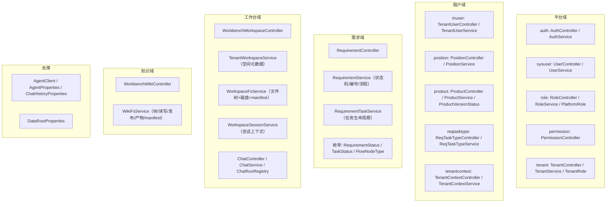

### 3.3 关键校验顺序

| 场景 | 校验顺序 |
|---|---|
| 任意租户级写操作 | 1) 登录态 → 2) 权限码 → 3) 租户存在（`requireTenantId`）→ 4) 资源归属/存在性 → 5) 业务规则 |
| 个人空间操作 | 1) 工作在当前租户 → 2) `space_type == PERSONAL` → 3) `owner_user_id == 当前用户` → 4) 节点属于该空间 |
| 会话操作 | 1) 空间合法（同上）→ 2) 会话属于该空间且 `user_id == 当前用户` → 3) 输出目录为空间内 DIR → 4) 上下文节点为本租户 Wiki 节点 |
| 需求动作 | 1) 权限码 → 2) 需求在本租户 → 3) 身份（创建人/当前处理人）→ 4) 状态机允许 → 5) 关联实体（产品/版本/审批人）合法 |
| 任务动作 | 1) 权限码 → 2) 需求/任务在本租户且互相匹配 → 3) 操作权（处理人/创建人/需求处理人/需求创建人）→ 4) 状态机允许 |
| Wiki 写操作 | 1) 权限码 `work:access` → 2) 父节点为本租户 DIR → 3) 名称合法且同级唯一 → 4) 磁盘写入 |

---

## 4. 接口详细设计

### 4.1 全量接口清单

#### 认证（`/api/auth`）

| 方法 | 路径 | 权限 | 请求 | 响应 `data` |
|---|---|---|---|---|
| POST | `/login` | 公开 | `{username, password}` | `{token, user:{id,username,roleId,roleName,builtin}, permissions[], currentTenantId, currentTenantName}` |
| POST | `/logout` | 登录 | — | `null`（前端负责清态） |
| GET | `/me` | 登录 | — | 同 login（无 token），含当前租户解析 |
| GET | `/my-tenants` | 登录 | — | 已加入且启用的租户列表 |

#### 用户 / 角色 / 权限 / 租户

| 方法 | 路径 | 权限 | 说明 |
|---|---|---|---|
| GET | `/api/users?page&size&username` | `user:view` | 分页 + 模糊搜索，返回 `{total, records[]}` |
| GET | `/api/users/all` | `tenant:view` | 全量用户（租户管理员候选） |
| POST/PUT/DELETE | `/api/users`、`/api/users/{id}` | `user:operate` | `{username,password,description,roleId}`；内置用户仅可改密码 |
| GET | `/api/roles` | `role:view` | 角色列表 |
| POST/PUT/DELETE | `/api/roles`、`/api/roles/{id}` | `role:operate` | 名称唯一 |
| GET/PUT | `/api/roles/{id}/permissions` | `role:view` / `role:operate` | 权限码集合读写 |
| GET | `/api/permissions` | `permission:view` | 只读 |
| GET | `/api/tenants`、`/api/tenants/{id}` | `tenant:view` | 含管理员列表 |
| POST/PUT/DELETE | `/api/tenants`、`/api/tenants/{id}` | `tenant:operate` | `{code,name,description,status,adminUserIds[]}`；编码不可改；至少一名管理员 |

#### 租户配置

| 方法 | 路径 | 权限 | 说明 |
|---|---|---|---|
| GET | `/api/tenant-users` | `tenant-user:view` | 当前租户成员（含平台/租户角色） |
| GET | `/api/tenant-users/candidates` | `tenant-user:view` | 可添加的系统用户 |
| GET | `/api/tenant-users/roles` | `tenant-user:view` | 租户角色字典 |
| POST/PUT/DELETE | `/api/tenant-users`、`/{id}` | `tenant-user:operate` | 成员与租户角色维护 |
| GET | `/api/positions?withSkills` | `position:view` 或 `work:access` | 岗位（可带技能） |
| GET | `/api/positions/{id}` | 同上 | 岗位详情 |
| POST/PUT/DELETE | `/api/positions`、`/{id}` | `position:operate` | 名称租户内唯一 |
| GET | `/api/positions/{id}/skills` | 同上 | 技能列表（按 `sort_order`） |
| POST/PUT/DELETE | `/api/positions/{id}/skills[/{skillId}]` | `position:operate` | 技能维护 |
| GET | `/api/products`、`/{id}` | `product:view` 或 `requirement:view` | 产品 |
| GET | `/api/products/managers` | `product:view` | 产品经理候选 |
| POST/PUT/DELETE | `/api/products`、`/{id}` | `product:operate` | 已关联需求拒绝删除 |
| GET | `/api/products/{id}/versions` | `product:view` 或 `requirement:view` | 版本列表 |
| POST/PUT/DELETE | `/api/products/{id}/versions[/{versionId}]` | `product:operate` | 版本号产品内唯一；`PLANNING` 必填 `planReleaseAt` |
| GET | `/api/req-task-types`、`/{id}` | `req-task-type:view` | 任务类型 |
| GET | `/api/req-task-types/enabled` | `work:access` | 启用类型（建任务用） |
| POST/PUT/DELETE | `/api/req-task-types`、`/{id}` | `req-task-type:operate` | 编码租户内唯一 |
| GET/PUT | `/api/tenant/context` | `work:access` | 我的岗位/技能上下文（PUT：`{positionId, skillIds[], customSkillText}`） |

#### 需求与任务（`/api/requirements`）

| 方法 | 路径 | 权限 | 说明 |
|---|---|---|---|
| GET | `/` | `requirement:view` | 我创建的需求 |
| GET | `/inbox` | `work:access` | 兼容接口，等价 `scope=todo` |
| GET | `/workbench?scope=todo\|all` | `work:access` | 当前处理人为我的需求 |
| GET | `/approver-candidates?productId` | `requirement:view` | 审批人候选 + 产品经理默认值 |
| GET | `/{id}` | 登录 + 可见性校验 | 详情（含 `flows` 流程列表） |
| POST | `/` | `requirement:operate` | `{name, description, productId, productVersionId}` |
| PUT | `/{id}` | `requirement:operate` | 仅 `DRAFT`/`REJECTED` 且为创建人 |
| POST | `/{id}/submit` | `requirement:operate` | `{approverId?}` |
| POST | `/{id}/approve` | `work:access` | 当前处理人 |
| POST | `/{id}/reject` | `work:access` | `{reason}` 必填 |
| POST | `/{id}/plan` | `work:access` | `{releaseVersionId, comment?}` |
| POST | `/{id}/develop` | `work:access` | 生成 Wiki 产物 |
| DELETE | `/{id}` | `requirement:operate` | 仅创建人 |
| GET | `/{id}/tasks` | `work:access` | 任务列表（含处理人/输入交付件） |
| POST | `/{id}/tasks` | `work:access` | `{taskTypeId, handlerUserIds[], inputDeliverables:[{wikiNodeId}], remark?}` |
| POST | `/{id}/tasks/{taskId}/start` | `work:access` | 开始 |
| POST | `/{id}/tasks/{taskId}/complete` | `work:access` | `{deliverableText?}` |
| POST | `/{id}/tasks/{taskId}/cancel` | `work:access` | 取消 |

#### 工作台工作空间（`/api/workbench/workspaces`）

| 方法 | 路径 | 说明 |
|---|---|---|
| GET | `/personal` | 我的个人空间列表 |
| POST | `/` | `{name, workDir?}` → `{id}`（服务端分配 workDir） |
| DELETE | `/{id}` | 删除空间（级联节点/会话/磁盘） |
| GET | `/{id}/tree` | 文件树（返回嵌套 `children`） |
| POST | `/{id}/dirs` | `{parentId?, displayName}` |
| POST | `/{id}/files` | `{parentId?, displayName, content?}`（自动补 `.md`） |
| GET | `/{id}/nodes/{nodeId}/content` | 读取文件 `{id,displayName,content,requirementId}` |
| PUT | `/{id}/nodes/{nodeId}/content` | `{content}` |
| DELETE | `/{id}/nodes/{nodeId}` | 删除节点（目录递归） |
| GET | `/{id}/sessions` | 会话列表（含上下文、输入交付件与输出目录标签） |
| POST | `/{id}/sessions` | `{sessionType,title,requirementId?,taskId?,outputDirNodeId?,contexts:[{wikiNodeId}]}` |
| GET/PUT/DELETE | `/{id}/sessions/{sessionId}` | 会话详情 / 更新 / 删除 |
| PUT | `/{id}/sessions/{sessionId}` | `{title, outputDirNodeId?, contexts[]}`（上下文整体替换） |
| GET | `/{id}/nodes/{nodeId}/revisions` | 文件修订列表（覆盖保存产生的快照） |
| GET | `/{id}/nodes/{nodeId}/diff` | 与上一版或指定修订并排 diff |

#### 聊天（`/api/chat`）

| 方法 | 路径 | 说明 |
|---|---|---|
| POST | `/completions` | SSE；`{sessionId, clientTempId?, content}`；转发 Agent 的 `meta`/`step`/`content`/`error`/`done`/`title` |
| POST | `/sessions/{id}/stop` | `{runId}` |
| GET | `/sessions` | 我的会话列表（跨空间） |
| GET | `/sessions/{id}/messages` | 消息列表（按 id 升序；不含步骤日志） |
| DELETE | `/sessions/{id}` | 删除会话（消息级联） |

#### Agent 内部文件工具（`/api/internal/agent`，`X-Internal-Token`，不对浏览器开放）

| 方法 | 路径 | 说明 |
|---|---|---|
| GET | `/sessions/{sessionId}/file-index` | 构造会话可用材料索引（Wiki 上下文 / 任务输入 / 输出目录等） |
| POST | `/sessions/{sessionId}/search` | `{query}` → 命中列表（优先 ripgrep，失败回退行扫描） |
| POST | `/sessions/{sessionId}/read` | `{source, nodeId}` → 文件正文（`source`：`wiki` / `workspace`） |
| POST | `/sessions/{sessionId}/write` | `{displayName, content}` → 写入会话输出目录；同名覆盖并保留旧版快照 |

#### Wiki（`/api/workbench/wiki`，均需 `work:access`）

| 方法 | 路径 | 说明 |
|---|---|---|
| GET | `/tree` | 租户 Wiki 树 |
| POST | `/dirs` | `{parentId?, displayName}` |
| POST | `/files` | `{parentId?, displayName, content?}` |
| GET | `/nodes/{nodeId}/content` | 读取文件 |
| PUT | `/nodes/{nodeId}/content` | `{content}` |
| DELETE | `/nodes/{nodeId}` | 删除节点（递归） |
| POST | `/publish` | `{sourceWorkspaceId, sourceNodeId, targetParentId?}` → `{id}` |

### 4.2 SSE 事件协议

**Java → 浏览器**（`POST /api/chat/completions`，`Content-Type: text/event-stream`）

| 事件 | data | 说明 |
|---|---|---|
| `meta` | `{sessionId, messageId, runId, clientTempId}` | 流开始，前端据此绑定消息与停止按钮 |
| `step` | `{step, message}` | 工作步骤摘要（如 `llm` / `search_docs` / `read_docs` / `write_output`）；**只转发不落库** |
| `content` | `{delta}` | 增量正文（打字机） |
| `error` | `{message}` | 运行期错误 |
| `done` | `{run_id}` 或 `{run_id, cancelled}` | 上游结束 |
| `title` | `{sessionId, title}` | 首轮后自动标题 |

**Agent → Java**（`POST /v1/chat/stream`）

| 事件 | data |
|---|---|
| `step` | `{step, message}` |
| `content` | `{delta}` |
| `done` | `{run_id}` / `{run_id, cancelled:true}` |
| `error` | `{message}` |

响应头要求：`Cache-Control: no-cache, no-transform`、`X-Accel-Buffering: no`、`Connection: keep-alive`。

**流式防缓冲要点**

- Vite 开发代理：对 `text/event-stream` / `/chat/completions` 去压缩、清 `content-length`，避免攒包。
- `RequestLoggingFilter`：**不得**对 SSE 响应使用 `ContentCachingResponseWrapper`，否则整段缓冲导致前端无打字机/无步骤。

### 4.3 Agent 内部接口

| 方法 | 路径 | 请求 | 响应 |
|---|---|---|---|
| POST | `/v1/chat/stream` | `{run_id, tenant_id, user_id, session_id, workspace_id, position, skills, messages, session_type?, output_dir_node_id?, file_index?, tools_enabled?}` | SSE（见上） |
| POST | `/v1/chat/title` | `{question}` | `{title}` |
| POST | `/v1/chat/stop` | `{run_id}` | `{ok, cancelled}` |
| GET | `/health` | — | 存活探测 |

所有 `/v1/chat/*` 均需 `X-Internal-Token`，缺失或不匹配返回 401。

---

## 5. 关键流程详细设计

### 5.1 登录与租户上下文

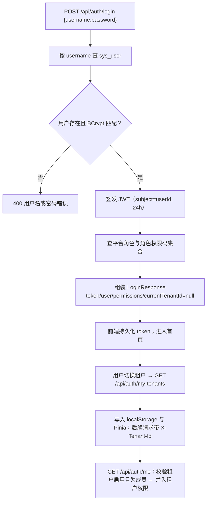

**要点**

- 登录不自动选租户（`currentTenantId` 恒为 null），与需求 FR-01-02 一致。
- `/me` 每次进入应用调用一次（前端 `meLoaded` 只取一次），用于恢复权限与租户。
- 若租户被停用或成员被移除，`/me` 返回的 `currentTenantId` 为空 → 前端提示重新选择。

### 5.2 需求创建与编号生成

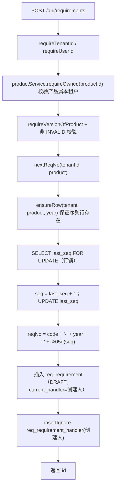

编号示例：产品 `DAP` 于 2026 年第 1 次创建 → `DAP-2026-00001`。

### 5.3 需求状态流转

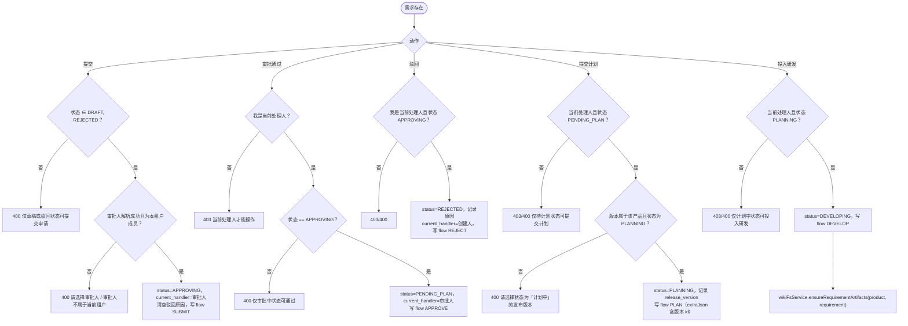

### 5.4 研发任务生命周期

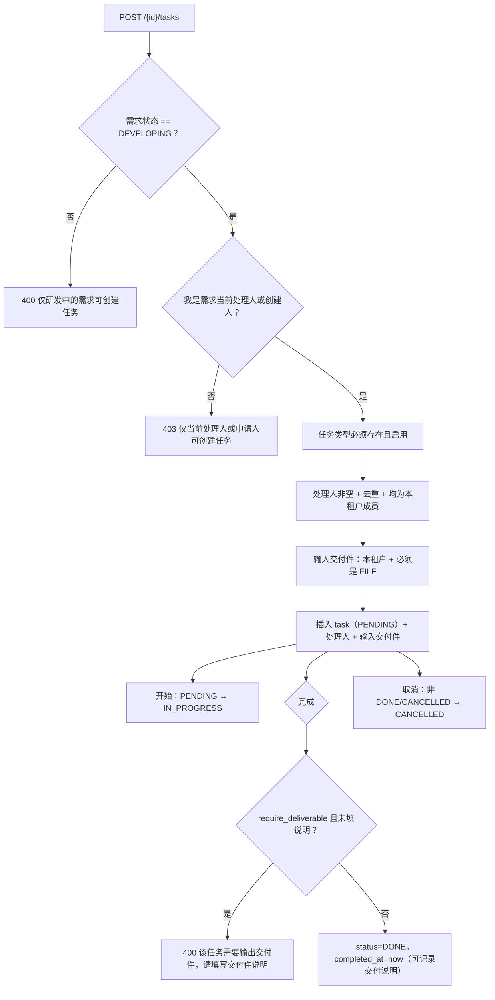

### 5.5 个人空间文件树

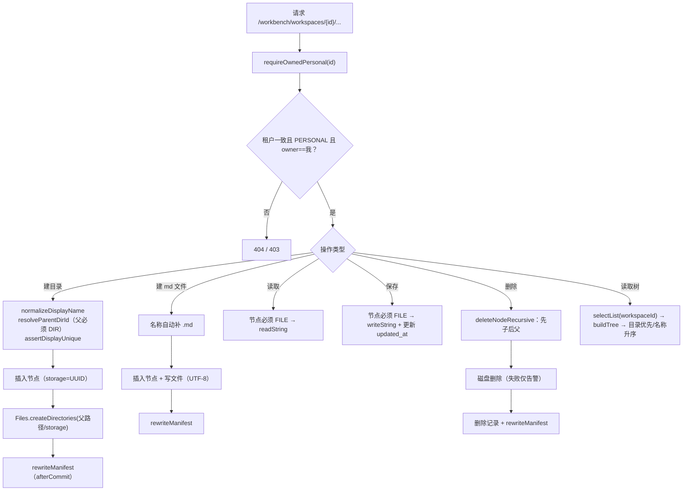

**路径解析**

```
resolveNodePath(ws, node):
  chain = 从 node 沿 parentId 上溯（上限 64 层）
  path  = resolveWorkspacePath(ws)
  for n in chain: path = path.resolve(n.storageName)
  assert path.normalize().startsWith(resolveWorkspacePath(ws))
```

### 5.6 会话创建与上下文落库

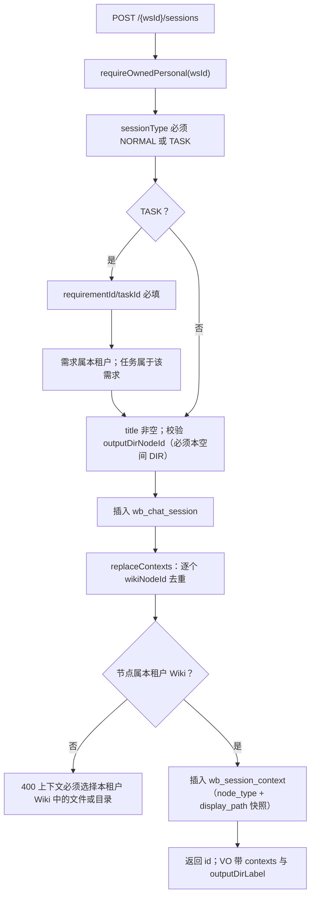

### 5.7 对话补全（代码级）

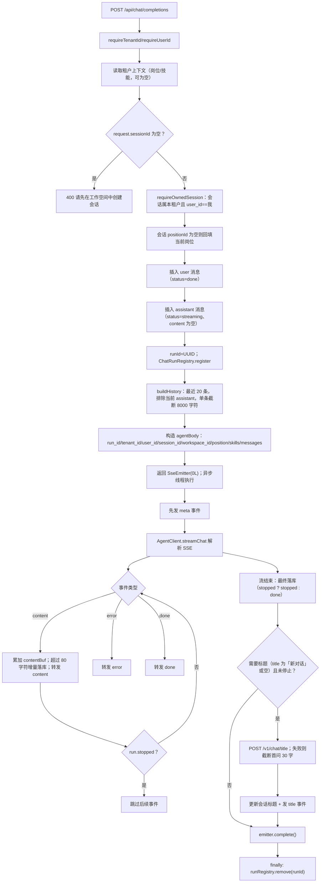

**异常路径**：`catch` 中把助手消息置 `error`，向浏览器发 `error` 事件并 `completeWithError`；`onTimeout` 触发 `markStopped + agentClient.stop`。

### 5.8 Wiki 发布

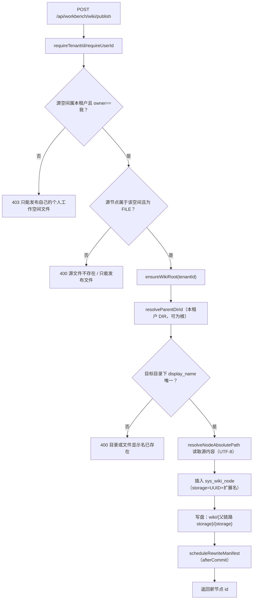

### 5.9 投入研发产物生成

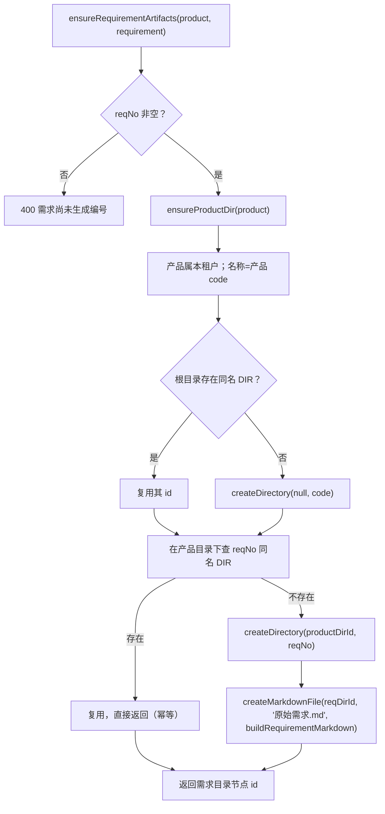

生成内容模板：

```markdown
# 原始需求

- 需求编号：{reqNo}
- 需求名称：{name}
- 产品版本：{productVersion}

---

{description}
```

### 5.10 manifest 原子重写

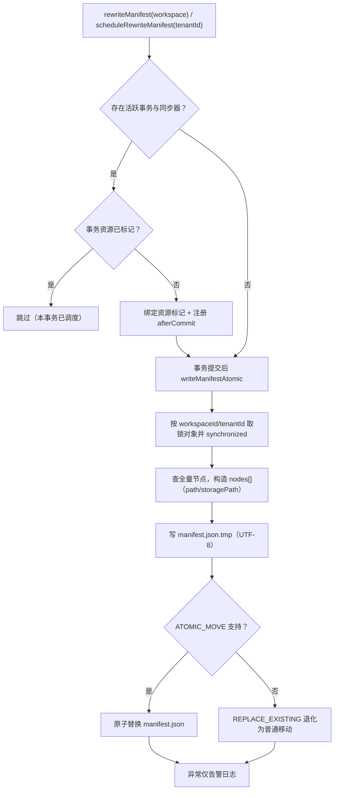

---

## 6. 磁盘与清单规范

### 6.1 目录契约

| 域 | 路径模板 | 说明 |
|---|---|---|
| 个人空间 | `{data.root}/{tenantCode}/{username}/{workDir}/` | `workDir` 由服务端分配，仅英数下划线，长度 ≤64 |
| 个人空间元数据 | `{空间根}/.dap/manifest.json` | 不参与文件树、不入库 |
| 个人空间目录 | `{空间根}/{uuid}/` | UUID 无扩展名 |
| 个人空间文件 | `{空间根}/.../{uuid}.md` | 保留原扩展名 |
| Wiki 根 | `{data.root}/{tenantCode}/wiki/` | 一租户一棵树 |
| Wiki 元数据 | `{wiki 根}/.dap/manifest.json` | 含 `tenantId` |
| Wiki 节点 | `{wiki 根}/.../{uuid}[.ext]` | |

### 6.2 manifest 结构

**个人空间**

| 字段 | 说明 |
|---|---|
| `version` | 结构版本，当前 `1` |
| `workspaceId` | 工作空间 id |
| `updatedAt` | ISO-8601 时间戳 |
| `nodes[].id` | 节点 id |
| `nodes[].parentId` | 父节点 id / null |
| `nodes[].type` | `DIR` / `FILE` |
| `nodes[].name` | 显示名 |
| `nodes[].path` | 展示逻辑路径（`a/b/c.md`） |
| `nodes[].storage` | 磁盘存储名 |
| `nodes[].storagePath` | 磁盘相对路径（`uuid/uuid.md`） |
| `nodes[].requirementId` | 可选，历史关联 |

**Wiki**：同上，`workspaceId` 替换为 `tenantId`。

### 6.3 命名与校验规则

| 对象 | 规则 | 违反提示 |
|---|---|---|
| 工作空间名称 | 必填；`^[a-zA-Z0-9_]+$`；长度 ≤128 | 「请输入名称」/「仅支持英文、数字、下划线」 |
| workDir | 单层；仅英数下划线；≤64 | 「工作目录只能是单层文件夹名」/「工作目录仅支持英文、数字、下划线」 |
| 节点显示名（空间/Wiki） | 非空；不含 `/`、`\`、`..`；同级唯一 | 「名称非法」/「目录或文件显示名已存在: xxx」 |
| Markdown 文件名 | 未以 `.md` 结尾自动补全（大小写不敏感） | — |
| 文件内容 | UTF-8，无大小上限（V1.0.0） | — |

---

## 7. 前端详细设计

### 7.1 目录结构

```
dap-front/src
├── main.ts              应用装配（Pinia / Router / Element Plus 中文包）
├── App.vue
├── router/index.ts      路由表 + 全局守卫
├── stores/
│   ├── auth.ts          token / user / permissions / currentTenant
│   └── workbenchUi.ts   工作台 UI 状态（当前未被引用）
├── api/                 auth user role permission tenant tenantUser tenantContext
│                        position product reqTaskType requirement wiki chat tenantWorkspace
├── utils/               request（Axios 实例与拦截器）· markdown · date
├── layouts/MainLayout.vue  顶栏 + 侧栏 + 内容区
├── components/          TenantSwitcher · MarkdownBody · FloatingAssistant（未挂载）
└── views/
    ├── login/LoginView.vue
    ├── home/HomeView.vue
    ├── user-center/     UsersView · RolesView · PermissionsView · TenantsView
    ├── sys-config/      TenantUsersView · PositionsView · ProductsView · ReqTaskTypesView
    ├── requirement/RequirementApplyView.vue
    └── workbench/       WorkbenchView · WorkbenchSpacesPane · WorkbenchWikiPane
```

### 7.2 路由与守卫

| 路由 | 组件 | `meta.permission` | `meta.requiresTenant` |
|---|---|---|---|
| `/login` | LoginView | —（`public: true`） | — |
| `/home` | HomeView | — | — |
| `/user-center/users` | UsersView | `user:view` | — |
| `/user-center/roles` | RolesView | `role:view` | — |
| `/user-center/permissions` | PermissionsView | `permission:view` | — |
| `/user-center/tenants` | TenantsView | `tenant:view` | — |
| `/tenant-config/users` | TenantUsersView | `tenant-user:view` | ✅ |
| `/tenant-config/positions` | PositionsView | `position:view` | ✅ |
| `/tenant-config/products` | ProductsView | `product:view` | ✅ |
| `/tenant-config/req-task-types` | ReqTaskTypesView | `req-task-type:view` | ✅ |
| `/requirement/apply` | RequirementApplyView | `requirement:view` | ✅ |
| `/workbench` | WorkbenchView | `work:access` | ✅ |
| `/sys-config/*` | 重定向到 `/tenant-config/*` | — | — |
| `/requirement/submit` | 重定向到 `/requirement/apply` | — | — |

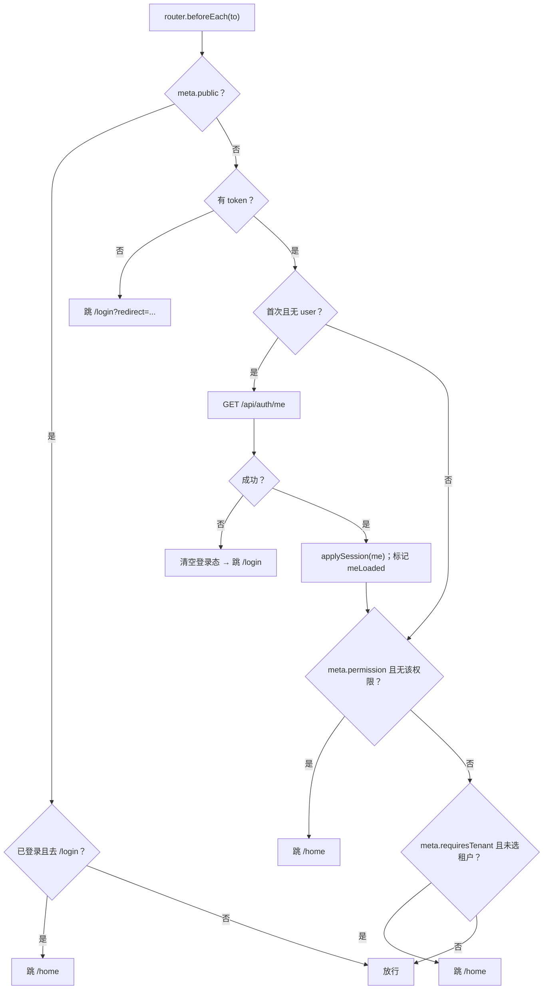

### 7.3 请求与 SSE 封装

**Axios 拦截器**

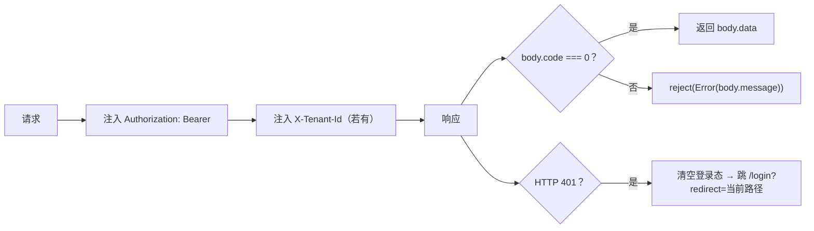

超时统一 30s；SSE 不走 Axios，使用原生 `fetch` 以支持 `ReadableStream`。

**SSE 客户端（`api/chat.ts#streamCompletion`）**

1. `fetch('/api/chat/completions', { method:'POST', headers, body, signal })`，头含 Bearer 与 `X-Tenant-Id`。
2. 逐行切分 `\r?\n`；空行触发 flush；`event:` 记录事件名，`data:` 累积数据行。
3. `flush` 中最多两次 `JSON.parse` 解包（兼容被二次转义的字符串）。
4. 非 2xx 时尝试读取 `{message}` 并抛错。

### 7.4 页面与组件要点

| 页面/组件 | 关键设计 |
|---|---|
| `MainLayout` | 顶栏 5 个主菜单（首页 / 需求管理 / 工作台 / 租户配置 / 用户中心），按权限与"是否已选租户"过滤；租户级菜单无权限时提示"暂无 xx 访问权限"；侧栏由路径前缀决定（用户中心 / 租户配置 / 需求） |
| `TenantSwitcher` | 读取 `my-tenants`，切换写入 Pinia + localStorage，触发页面重载数据 |
| `LoginView` | 表单校验；成功写 token 并跳 `redirect` 或 `/home` |
| `UsersView` / `RolesView` / `TenantsView` | 列表 + 抽屉/对话框表单；内置用户与当前用户删除按钮禁用；角色可勾选权限码 |
| `PermissionsView` | 纯只读表格 |
| `PositionsView` | 岗位列表 + 技能子表（行内增删改、排序号） |
| `ProductsView` | 产品列表 + 版本子表（状态、计划发布时间、关联需求保护） |
| `ReqTaskTypesView` | 类型列表 + 交付件要求/模板/启停 |
| `RequirementApplyView` | 本人需求列表 + 新建/编辑表单（产品→版本联动）+ 提交选审批人 |
| `WorkbenchView` | 三面板壳：需求列表 / 工作空间 / Wiki；左侧宽度可拖拽（默认 300）；需求面板为"产品→版本→需求"三级树 + 详情 + 流程时间线 + 任务对话框（Wiki 树勾选输入交付件） |
| `WorkbenchSpacesPane` | 左：空间+会话；中：会话/文档同级 Tab；聊天支持 Enter 发送、打字机增量、可折叠「工作步骤」、气泡 max-width；右：文件树；左右栏可拖宽；文件菜单「发布到 Wiki」/版本对比 |
| `DiffSideBySide` | md 修订并排 diff，行级高亮 |
| `WorkbenchWikiPane` | 左：Wiki 树；右：默认预览、点「编辑」切文本域、保存回预览；内容区 `flex:1` 撑满 |
| `MarkdownBody` | `marked` + `DOMPurify`；`user-select: text`；代码块「复制」按钮；与全局「非输入框清选区」策略兼容（`.md-body` / `.chat-body .bubble` 豁免） |
| `FloatingAssistant` / `HelloWorld` / `workbenchUi` | **未被任何路由或组件引用**，属历史残留，不影响运行 |

### 7.5 状态管理

| Store | 状态 | 说明 |
|---|---|---|
| `auth` | `token`、`user`、`permissions[]`、`currentTenantId`、`currentTenantName` | token 与租户持久化到 localStorage（`dap_token`、`dap_tenant_id`、`dap_tenant_name`）；`hasPermission/hasAnyPermission` 供菜单与守卫使用 |
| `workbenchUi` | `showAssistant` | 仅为残留组件准备，未使用 |

---

## 8. Agent 详细设计

### 8.1 服务结构

```
dap_agent/
├── main.py                 FastAPI 应用装配 + uvicorn 启动
├── config.py               Settings（.env）
├── api/
│   ├── deps.py             verify_internal_token
│   ├── logging_middleware.py
│   └── routes/
│       ├── health.py       GET /health
│       └── chat.py         /v1/chat/stream | title | stop（含 step/content SSE）
├── agents/
│   ├── workbench_agent.py  系统提示词 + 工具轮 astream + step/content 事件
│   └── title_agent.py      会话标题生成
├── tools/
│   ├── workspace_tools.py  search_docs / read_docs / write_output
│   └── dap_server_client.py  调用 Java /api/internal/agent/*（trust_env=False 防代理）
├── llm/factory.py          ChatOpenAI 工厂（base_url 归一化）
├── runtime/session_registry.py  runId → asyncio.Task
└── schemas/chat.py         Pydantic 请求/响应（含 file_index、tools_enabled）
```

### 8.2 流式接口实现

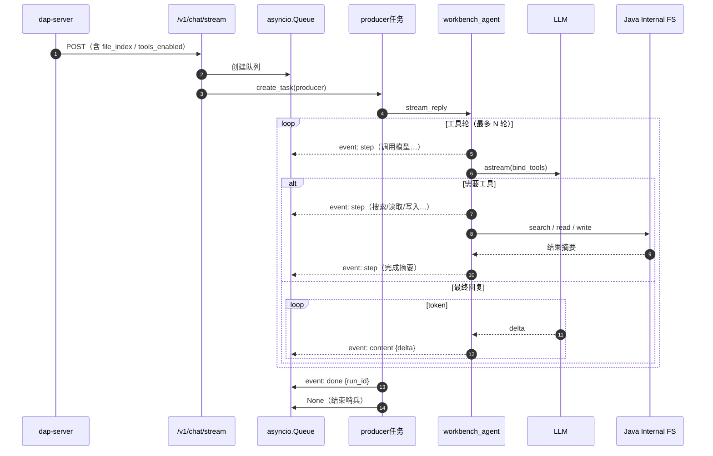

**取消语义**

- `/v1/chat/stop` → `session_registry.cancel(run_id)` → `Task.cancel()`；被取消分支会先投递 `done{cancelled:true}` 再抛出，确保客户端收到明确的结束事件。
- 未注册的 runId 返回 `{ok:true, cancelled:false}`，不报错（幂等）。

### 8.3 提示词与工具

```
你是 DAP 开发智能体工作台助手。
当前岗位：{position.name 或 "未指定"}
当前技能：{skills 名称、自定义文案，以「、」连接；无则 "未指定"}
（可附带会话材料索引摘要，指导工具选用）
请用简洁、专业的中文回答，聚焦软件研发生命周期相关问题。
直接输出对用户有用的正文，不要输出内部思考过程标签。
```

消息序列 = `System(上述)` + 历史消息。**不自动拼接 Wiki 全文**；需要时通过工具按需读取。

| 工具 | 作用 | 对应 Java |
|---|---|---|
| `search_docs` | 按关键词检索会话可访问材料 | `POST .../search` |
| `read_docs` | 读取 Wiki 或工作空间文件 | `POST .../read` |
| `write_output` | 写入本会话输出目录（同名覆盖+快照） | `POST .../write` |

`tools_enabled=false` 或缺少 `session_id` 时退化为纯 `astream` 文本流，仍发 `step`/`content`。

### 8.4 模型与流式细节

| 项 | 值 |
|---|---|
| 客户端 | `langchain_openai.ChatOpenAI` |
| 参数 | `temperature=0.3`（正文）/ `0`（标题）、`streaming=True` |
| `base_url` 归一化 | 去尾斜杠；以 `/v1` 结尾则原样；`/compatible-mode` 结尾自动补 `/v1` 并告警；其余仅告警 |
| 密钥缺失 | 正文：抛 `RuntimeError("未配置 LLM_API_KEY…")`；标题：退化为截断首问 |
| 内容解析 | `chunk.content` 为字符串直接输出；为列表时取 `type == "text"` 或字符串片段 |
| 工具轮 | `bind_tools` + `astream` 累积；有 `tool_calls` 则执行并继续；无则推送正文 delta |
| 步骤事件 | 每轮开始/工具前后 yield `step`，仅短摘要 |
| 标题 | 首问截断 500 字符送模型，返回再截断 30 字；异常回落为截断首问 |

---

## 9. 配置项清单

### 9.1 后端（`application.yml`）

| 配置 | 默认 | 说明 |
|---|---|---|
| `server.port` | 8200 | 服务端口 |
| `spring.datasource.url` | `jdbc:postgresql://localhost:5432/postgres?currentSchema=dap` | 数据库 |
| `spring.datasource.hikari.maximum-pool-size` | 20 | 连接池上限 |
| `spring.datasource.hikari.connection-init-sql` | `SET client_encoding TO 'UTF8'` | 编码 |
| `spring.flyway.schemas` / `default-schema` | `dap` | 迁移 schema |
| `dap.data.root` | `../data` | 数据根目录 |
| `dap.jwt.secret` | `dap-dev-secret-change-me-please-32bytes!!` | **生产必须替换** |
| `dap.jwt.expire-hours` | 24 | 令牌有效期 |
| `dap.agent.base-url` | `http://127.0.0.1:8202` | Agent 地址 |
| `dap.agent.internal-token` | `${DAP_AGENT_TOKEN:dev-internal-token}` | 内网令牌 |
| `dap.agent.connect-timeout-ms` | 3000 | 连接超时 |
| `dap.agent.read-timeout-ms` | 300000 | 读超时（5 分钟） |
| `dap.chat.history-max-messages` | 20 | 历史条数上限 |
| `dap.chat.history-max-chars` | 8000 | 单条历史截断 |

### 9.2 Agent（`.env`）

| 配置 | 默认 | 说明 |
|---|---|---|
| `DAP_INTERNAL_TOKEN` | `dev-internal-token` | 必须与后端一致 |
| `LLM_BASE_URL` | `https://api.openai.com/v1` | 需以 `/v1` 结尾 |
| `LLM_API_KEY` | 空 | 空则拒绝正文推理 |
| `LLM_MODEL` | `gpt-4o-mini` | 模型名 |
| `HOST` / `PORT` | `0.0.0.0` / 8202 | 监听 |

### 9.3 前端

| 配置 | 值 |
|---|---|
| 开发端口 | 8201（`strictPort`） |
| API 代理 | `/api → http://localhost:8200`，`timeout: 0`、`proxyTimeout: 0`；SSE 去压缩/`content-length`、设 `X-Accel-Buffering: no` |
| 请求超时 | 30s |

---

## 10. 错误码与提示文案

| HTTP | code | 触发 | 文案示例 |
|---|---|---|---|
| 401 | 401 | 无/非法 Bearer；JWT 过期；用户不存在；`UserContext` 为空 | 未登录 / 登录已失效 / 用户不存在 |
| 403 | 403 | 权限码缺失 | 无权限：`{code}` / 无权限查看产品 / 无权限查看岗位 |
| 200 | 403 | 资源归属校验 | 只能操作自己的个人工作空间 / 当前处理人才能操作 / 只能发布自己的个人工作空间文件 / 无权查看该需求 |
| 200 | 400 | 参数与业务规则 | 请先选择租户 / 请输入名称 / 名称非法 / 目录或文件显示名已存在 / 请选择岗位 / 请至少选择一个技能，或填写自定义技能 |
| 200 | 404 | 资源不存在或跨租户 | 工作空间不存在 / 会话不存在 / 节点不存在 / 需求不存在 / 任务不存在 / 产品不存在 |
| 200 | 200 | 需求状态机 | 仅草稿或驳回状态可提交申请 / 仅审批中状态可通过 / 仅待计划状态可提交计划 / 仅计划中状态可投入研发 |
| 200 | 200 | 任务规则 | 仅研发中的需求可创建任务 / 请至少选择一名处理人 / 处理人不属于当前租户 / 该任务需要输出交付件，请填写交付件说明 / 当前状态不可完成 / 当前状态不可取消 |
| 200 | 200 | 版本规则 | 请选择状态为「计划中」的发布版本 / 不能选择无效版本 / 该版本已关联需求，无法删除 / 产品已关联需求，无法删除 |
| 200 | 500 | 未捕获异常 | 服务器内部错误 |
| — | 502 | Agent 调用失败 | Agent 调用失败: `{body}` |

**前端提示**：所有业务错误经 Axios 拦截器转为 `Error(message)`，页面以 `ElMessage.error` 展示；401 统一跳登录。

---

## 11. 测试要点

### 11.1 认证与权限

| 用例 | 期望 |
|---|---|
| 无 token 访问 `/api/users` | 401 |
| 普通用户访问 `/api/users` | 403 |
| 携带非法 `X-Tenant-Id` 访问用户中心 | 正常返回（租户头被忽略） |
| 携带非成员租户访问 `/api/requirement` | 400 请先选择租户 |
| 租户 `OPERATOR` 访问 `/api/positions`（写） | 403；读（列表）放行 |

### 11.2 需求与任务

| 用例 | 期望 |
|---|---|
| 并发创建同产品需求 | 编号连续且唯一，无重复 |
| 换产品编辑需求 | 编号按新产品重新生成 |
| 非当前处理人审批 | 403 |
| 选非 `PLANNING` 版本提交计划 | 400 |
| 重复投入研发 | 幂等，Wiki 产物不重复 |
| 要求交付件的任务未填说明完成 | 400 |
| 处理人非租户成员 | 400 |
| 输入交付件选目录 | 400 |

### 11.3 工作台与文件

| 用例 | 期望 |
|---|---|
| 新建空间后磁盘出现 `.dap/manifest.json` | 存在且节点完整 |
| 同层重名建节点 | 400 显示名已存在 |
| 删除目录 | 子节点与磁盘递归删除 |
| 跨用户访问他人空间 | 403 |
| 显示名含 `../` | 400 名称非法 |
| 事务回滚 | manifest 不被重写（`afterCommit` 生效） |

### 11.4 会话与对话

| 用例 | 期望 |
|---|---|
| 无会话发消息 | 400 请先在工作空间中创建会话 |
| 生成中停止 | 消息状态 `stopped`，内容保留，Agent 任务被取消 |
| 停止已结束的 runId | 400 当前没有可停止的生成任务 |
| 首轮后标题 | 自动生成并持久化，SSE 收到 `title` |
| 历史超 20 条 | 仅取最近 20 条送入模型 |
| Agent 不可用 | 502 明确错误，消息状态 `error` |
| 刷新页面 | 历史消息完整（含 streaming 中间落库内容） |

### 11.5 Wiki

| 用例 | 期望 |
|---|---|
| 发布同名文件 | 400 冲突 |
| 发布后 Wiki 树与磁盘一致 | 是 |
| 删除被引用的 Wiki 节点 | 会话上下文/任务输入记录级联消失 |
| 投入研发产物路径 | `{产品编码}/{需求编号}/原始需求.md` |

---

## 12. 已知差异与待办

以下为**代码实现与早期文档/产品预期之间的差异**，供后续迭代决策（V1.0.0 以代码为准）。

| 编号 | 差异 | 现状 | 建议 |
|---|---|---|---|
| GAP-01 | 岗位/技能被引用时的删除保护 | PRD 要求"禁止删除并提示"；实现直接删除岗位与技能，被 `sys_user_tenant_context.position_id` 外键引用时数据库报错→返回"服务器内部错误" | 服务层前置查询引用并返回明确文案 |
| GAP-02 | 个人空间名称唯一范围 | PRD 表述为"租户+用户下唯一"；实现为**租户内**唯一（`assertNameUnique` 不带 owner 过滤），而 workDir 唯一性为"租户+所有者" | 统一为"租户+所有者"或在文档中明确租户内唯一 |
| GAP-03 | 文件上传 | PRD 提到"上传 md"，实现未提供上传接口（仅新建 md 并写入内容） | 增加上传接口或修正需求描述 |
| GAP-04 | 引入需求到个人空间 | 前端 `api/tenantWorkspace.ts` 保留 `importWorkbenchRequirement`，服务端无对应接口 | 删除前端残留方法 |
| GAP-05 | 前端残留组件 | `FloatingAssistant.vue`、`HelloWorld.vue`、`stores/workbenchUi.ts` 未被引用 | 清理或正式接入 |
| GAP-06 | `sys_workspace.space_type` 默认值 | DDL 默认 `SHARED`，业务仅写 `PERSONAL`；`WorkspaceSpaceType.SHARED` 分支与 `share/` 目录仍存在 | 后续迁移将默认值改为 `PERSONAL` 并移除 SHARED 分支 |
| GAP-07 | `sys_workspace.description` | 前端类型与表单仍含 `description`，V9 已删列 | 前端移除该字段 |
| GAP-08 | `requirement.plan_date` | 表存在字段，提交计划时固定写入 `null` | 明确是否需要计划日期或删除字段 |
| GAP-09 | 租户状态校验位置 | `AuthInterceptor` 仅校验成员关系，未校验租户 `status`；`/api/auth/me` 才校验启用状态 | 在拦截器统一校验，避免停用租户仍可调用接口 |
| GAP-10 | 需求/任务缺少乐观锁 | 无 `version` 字段，并发同单据操作可能覆盖 | 增加乐观锁与重试 |
| GAP-11 | 运行态注册表进程内存储 | `ChatRunRegistry` 与 `SessionRegistry` 均为进程内，多实例下停止失效 | 外置到 Redis |
| GAP-12 | Wiki 正文未注入 Prompt | 符合 V1.0.0 范围，但与"上下文"命名存在预期落差 | V1.2 增强并在 UI 上标注"当前仅记录引用" |
| GAP-13 | `workspace:view/operate` 权限码 | 已种入但无对应接口与页面 | 保留或移除 |
| GAP-14 | `permission:operate` | 保留不授予（符合需求）；无前端入口 | 保持 |

---

## 附录 A：符号与文件对照

| 符号 | 文件 |
|---|---|
| `AuthInterceptor` | `dap-server/.../security/AuthInterceptor.java` |
| `PermissionAspect` | `dap-server/.../security/PermissionAspect.java` |
| `TenantSupport` | `dap-server/.../security/TenantSupport.java` |
| `RequirementService` | `dap-server/.../modules/requirement/RequirementService.java` |
| `RequirementTaskService` | `dap-server/.../modules/requirement/RequirementTaskService.java` |
| `WorkspaceFsService` | `dap-server/.../modules/tnworkspace/WorkspaceFsService.java` |
| `WorkspaceSessionService` | `dap-server/.../modules/chat/WorkspaceSessionService.java` |
| `ChatService` | `dap-server/.../modules/chat/ChatService.java` |
| `ChatRunRegistry` | `dap-server/.../modules/chat/ChatRunRegistry.java` |
| `WikiFsService` | `dap-server/.../modules/wiki/WikiFsService.java` |
| `AgentClient` | `dap-server/.../integration/agent/AgentClient.java` |
| `TenantRole` | `dap-server/.../modules/tenant/TenantRole.java` |
| 前端守卫 | `dap-front/src/router/index.ts` |
| SSE 客户端 | `dap-front/src/api/chat.ts` |
| 工作台壳 | `dap-front/src/views/workbench/WorkbenchView.vue` |
| Agent 路由 | `dap-agent/src/dap_agent/api/routes/chat.py` |
| 提示词与流式 | `dap-agent/src/dap_agent/agents/workbench_agent.py` |
| 迁移脚本 | `dap-server/src/main/resources/db/migration/V1__init.sql` … `V10__work_wiki.sql` |

## 附录 B：与需求/架构的对应

| 详细设计章节 | 对应架构 | 对应需求 |
|---|---|---|
| §2 数据库 | 架构 §8 数据架构 | 需求 §8 状态与枚举 |
| §3.1 安全层 | 架构 §7 安全架构 | 需求 §3 角色与权限 |
| §4 接口 | 架构 §3 总体架构 | 需求 §5 功能需求 |
| §5.1 登录 | 架构 §7.2 鉴权时序 | FR-01-01～FR-01-08 |
| §5.3 需求流转 | — | FR-03-01～FR-03-08 |
| §5.4 任务 | — | FR-03-13～FR-03-18 |
| §5.5～5.7 工作台 | 架构 §10 AI 流式会话 | FR-04-01～FR-04-18（含步骤/工具/复制/版本对比） |
| §5.8～5.9 Wiki | 架构 §11 Wiki 产物与发布 | FR-03-05、FR-05-06～FR-05-08 |
| §6 磁盘与清单 | 架构 §9 文件存储架构 | FR-04-07、FR-05-05 |
| §7 前端 | 架构 §5.3 前端分层 | 需求 §9 界面与交互 |
| §8 Agent | 架构 §10.1 端到端时序 | FR-04-13～FR-04-16（含工具与 step） |

## 13. 自动化流水线详细设计

### 13.1 范围与边界

本节承接需求 §13 与架构 §16，保留领域、状态、存储与执行设计；节点配置和完整材料路径集中于 §14。固定主链由平台维护，通用转移引擎为历史草案。运行中的确认先留个人空间，人工发布正式稿后再交付下游。

### 13.2 领域模型

#### 13.2.1 分层

```text
PipeDefinition（平台固定主链定义 + 参数快照）
  ├─ PipeNodeDef / PipeUnitDef / PipeTransition
PipelineInstance（某需求上的一次运行，绑定 definition 版本）
  ├─ NodeInstance
  │     └─ UnitInstance → Session + ConfirmRound[] + Artifacts
  ├─ TrackMerge（按轨；含 LLM 归并结果 + 人勾选）
  ├─ IntTestCycle[]（集成测试轮次：报告 → 修复 → 再测）
  └─ Job
```

#### 13.2.2 默认节点目录（平台种子；固定主链）

与详设 §14 的节点与 Agent 配置对齐，平台种子写入 `pipe_*_def`，主链推进由平台维护：

`pm_first` → `ai_pre` → `pm_second`（含 arch/ui 选项）→ `gen_prd` →（可选）`gen_arch` / `gen_ui` → 并行评审轨 → 按轨 `doc_revise` → 并行 `gen_detail`+`gen_cases` → 并行评审 → `doc_revise_dt` → `gen_coding` → `code_review` → `gen_int_test`（含修复循环）→ `done`。

单元 I/O、模板、仓类型以 §14 为权威；`PipeUnitDef` 存可配置镜像。

#### 13.2.3 状态机

**实例**：`RUNNING` / `WAITING_HUMAN` / `SUSPENDED`（二审仅「通过」）/ `CANCELLED` / `FAILED` / `DONE`

**节点**：`PENDING` / `WAITING_TRIGGER` / `RUNNING` / `WAITING_HUMAN` / `SUCCEEDED` / `SKIPPED` / `FAILED`

**单元**：`PENDING` / `WAITING_TRIGGER` / `RUNNING` / `WAITING_CONFIRM` / `WRITING` / `SUCCEEDED` / `SKIPPED` / `FAILED`

**轨合并**：`IDLE` / `LLM_MERGING` / `WAITING_HUMAN` / `SUCCEEDED` / `SKIPPED`

**集成测试轮**：`TESTING` / `REPORT_READY` / `FIXING` / `PASSED` / `FAILED_CAP`

#### 13.2.4 推进规则（摘要）

1. `pm_first`：启动即成功（可追溯）。  
2. `ai_pre` 两单元完成输出并发布 → `pm_second`。  
3. `pm_second`：必填版本/时间；勾选是否启用架构/UI；  
   - 「通过」→ 实例 `SUSPENDED`；  
   - 「通过并投入研发」→ 写入选项 → 启 `gen_prd`（及后续按选项跳过/启用设计节点）。  
4. 设计节点（已启用）完成并发布后 → 并行对应评审轨；未启用轨 `SKIPPED`。  
5. **按轨**：评审齐 → **LLM 归并相同问题** → 人勾选有价值 → 《合并评审》→ 该轨修订单元。  
6. 已启用设计轨修订齐 → 并行详设+用例 → 评审 → 修订 → 编码。  
7. `gen_coding` 成功 → `code_review` → `gen_int_test`：  
   - 跑测 → **本轮《集成测试报告》**；  
   - 通过 → `done`；  
   - 失败 → 自动修复（编码/测试仓按职责）→ 再测 → 再出报告；循环直至通过或达 **96** 轮上限失败停下。  
8. 取消自动化 → `CANCELLED`。

#### 13.2.5 轮次档位（24 / 48 / 96）

| 档位 | 适用单元/循环 | 含义 |
|---|---|---|
| **24** | 人工确认偏多、产出轻的评审类：`REVIEW_*`（含初审）确认轮 | `confirm.round` 上限 |
| **48** | 文档生成与修订、合并 LLM：`GEN_PRD` / `GEN_ARCH` / `GEN_UI` / `GEN_DETAIL` / `GEN_CASES` / `REVISE_*`；轨合并 LLM 重试 | 确认轮或合并调用上限 |
| **96** | **写代码类**：`GEN_CODING`；`GEN_INT_TEST`（含自动化用例编码）；**集成测试「测→报告→修→再测」整轮计数** | 确认轮或测试修复轮上限 |

- 单元定义上配置 `round_tier`（`T24`/`T48`/`T96`），种子按上表写入，租户可改。  
- **超限**：当前单元（或 int-test 循环）→ `FAILED`；节点失败；实例进入可恢复的失败等待（不自动跳过）；需人工介入重试/取消。  
- 「写代码用最大档」：**编码与集成测试修复闭环固定建议 96**（种子如此；配置可调但不建议低于 48）。

### 13.3 流程定义与版本快照

#### 13.3.1 表：`pipe_definition`

- `code`（如 `RD_AUTO`）、`version`、`name`、`tenant_id`（NULL=平台种子）、`enabled`、时间戳  
- 保留平台定义与单元参数快照；通用 transition 编辑、租户自建流程引擎为历史草案，不属于本版能力。

#### 13.3.2 表：`pipe_node_def`

- `definition_id`、`code`、`name`、`kind`（HUMAN/AI/AI_MULTI/SYSTEM）、`optional`、`sort_order`、`join_group`、`parallel_group`、扩展 JSON（二审选项等）

#### 13.3.3 表：`pipe_unit_def`

- `node_def_id`、`code`、`name`、`position_code`、`task_type_code`  
- `round_tier`（T24/T48/T96）  
- `input_doc_kinds` / `context_paths_tpl` / `output_kind` / `output_template_ref`  
- `repo_kind`：`NONE` / `BIZ` / `TEST`  
- `prompt` 仍走岗位+任务类型，不在此存正文

#### 13.3.4 表：`pipe_transition`

- `from_node_code`、`to_node_code`、`event`（SUCCESS/APPROVE/SKIP/…）、`priority`、条件表达式（可选 JSON：如 `options.arch==true`）

#### 13.3.5 配置边界

主链在平台实现中推进。岗位任务、提示词、轮次、可选设计轨与运行时 Profile 可维护；流程定义版本在实例启动时冻结。通用定义 CRUD、任意条件转移和拖拽编排不作为已实现 API。


### 13.4 运行时表

#### 13.4.1 `pipe_instance`

| 字段 | 说明 |
|---|---|
| requirement_id | 需求 |
| definition_id | 冻结的定义 |
| status / waiting_reason | |
| options_json | 二审勾选：`{ "arch": true, "ui": false }` |
| release_version_id / release_time | 二审 |
| 统计字段 | tokens、duration 可选 |

**活跃唯一（已定）**：

- **同一需求**：同时仅一条活跃实例（`RUNNING` / `WAITING_HUMAN` / `SUSPENDED` / `FAILED`）；`DONE` / `CANCELLED` 后允许再启新实例（历史保留）。
- **不同需求**：可各自拥有并并行跑各自的流水线实例，互不抢锁。

#### 13.4.2 `pipe_node_instance` / `pipe_unit_instance`

节点记录所属实例、节点定义、状态与执行时间；单元记录所属节点、任务类型、会话及产物关联。单元额外保存 `round_tier`、`max_round`（启动时从 def 解析）、`confirm_round` 当前值和 `repo_kind` 快照。

#### 13.4.3 `pipe_confirm_round`

每轮一条，保存问题/答案与轮次；逐轮草稿保留个人空间。正式产物与最终汇总确认文件经人工发布后记录 Wiki 关联。进行中的轮次不自动发布 Wiki。

#### 13.4.4 `pipe_track_merge`

- `llm_merge_json`：大模型归并后的问题列表（含 source 引用）  
- `items_json`：人勾选有价值  
- `merged_wiki_node_id`

#### 13.4.5 `pipe_int_test_cycle`

| 字段 | 说明 |
|---|---|
| instance_id / unit_instance_id | |
| cycle_no | 从 1 起 |
| status | TESTING / REPORT_READY / FIXING / PASSED / FAILED_CAP |
| report_wiki_node_id | **本轮**集成测试报告 |
| fix_session_id | 修复所用会话（可复用编码单元策略或新单元） |
| started_at / finished_at | |

#### 13.4.6 `pipe_job` / `pipe_artifact` / 会话扩展

- Job：`RUN_UNIT` / `CONTINUE_UNIT` / `LLM_MERGE` / `INT_TEST_RUN` / `INT_TEST_FIX` / `ADVANCE`  
- Artifact：保留；报告按轮升版或 path 带 `r{n}`  
- `wb_chat_session.pipe_unit_instance_id`

### 13.5 后端组件

| 组件 | 职责 |
|---|---|
| `PipeDefinitionService` | 定义种子与版本快照；通用 CRUD 为规划 |
| `PipelineService` | 启动（冻结定义）、取消、查询、二审（含 arch/ui 选项） |
| `PipeAdvanceService` | 转移条件、并行 join、跳过可选节点 |
| `PipeUnitRunner` | 自动建 TASK 会话、灌提示词/材料、投递执行 |
| `PipeConfirmService` | 解析 phase；暂停；确认记录与个人草稿；自动续跑；人工发布；档位超限失败 |
| `PipeMergeService` | 调 LLM 归并 → 待人确认 → 写合并评审 → 启修订 |
| `PipeReviseService` | 勾选需改 → 自动修订或跳过 |
| `PipeIntTestService` | 测→报告→失败则修→再测；每轮报告；96 封顶 |
| `PipeJobWorker` | 轮询执行 |
| `PipeToolAcl` | 产出路径只写不读；输入/上下文只读；仓按 BIZ/TEST |
| `PipePermission` | 本岗触发/确认 |

### 13.6 当前接口与实现入口

以下来自 `PipelineController`；定义 CRUD、retry-failed 等历史草案路径不列作现行契约。

| 方法 | 路径（统一前缀 `/api/pipeline`） | 用途 |
|---|---|---|
| POST | `/instances` | 启动 |
| GET | `/instances/by-requirement/{requirementId}`、`/instances/by-issue/{issueId}`、`/instances/{id}` | 查询 |
| POST | `/instances/{id}/cancel`、`/instances/{id}/pm-second` | 取消、二审 |
| POST | `/instances/{id}/ensure-worktrees` | 编码阶段补建 worktree |
| GET | `/instances/{id}/docs` | 文档列表 |
| POST | `/units/{unitId}/trigger`、`/units/{unitId}/stop` | 执行、停止 |
| GET | `/units/{unitId}/coding`、`/units/{unitId}/confirm` | 编码进度、待确认 |
| POST | `/units/{unitId}/confirm`、`/units/{unitId}/publish` | 确认自动续跑、人工发布 |
| GET/POST | `/instances/{id}/track-merge/{trackCode}`（POST 加 `/confirm`） | 归并查询/确认 |

共用 `work:access` 入口鉴权，具体岗位操作规则由服务端裁决。实现入口包括 `PipelineService`、`PipeRuntimeService`、`PipeJobWorker`、`PipeMergeService`、`PipeUnitMaterialCatalog`、`GitWorktreeService`；上文组件职责表中按职责分解的类名不代表均有独立实现类。

### 13.7 Agent 与 ACL

#### 13.7.1 启动

自动建 TASK → `resolve` 提示词 → 平台组装首消息 → completions；结果由平台解析。

#### 13.7.2 确认循环

```text
Agent 输出
  → phase=need_human_confirm → 记录本轮问题/个人草稿 → WAITING_CONFIRM（暂停）
  → 人提交 → 回灌 → 自动续跑
  → 仍有问题 → 再暂停；phase=ok → 写正式产出/最终确认文件到个人空间
  → 完成输出 → 人工发布 Wiki → 下游读取
  → round > max_round(档位) → FAILED 停下
```

#### 13.7.3 工具 ACL

| 路径 | 读 | 写 |
|---|---|---|
| 输入文档 | 是 | 否 |
| 上下文路径 | 是 | 否 |
| **本单元正式产出路径** | **否** | **是** |
| 业务仓（`repo_kind=BIZ`） | 是 | 编码/详设等按任务 |
| 测试仓（`repo_kind=TEST`） | 是 | 用例自动化/集成测试 |
| 其它 Wiki | 否 | 否 |

产出「只写不读」：Agent 不能通过工具 read 目标产出文件；改稿靠会话内模型上下文 + 确认回灌，不靠回读 Wiki 产出。

#### 13.7.4 仓分离（口径 10）

- 产品配置：**业务代码仓**、**测试代码仓** 分开。  
- `GEN_CODING` → 业务仓（可同步写可自动化用例到测试仓的约定路径，或编码阶段只标用例、集成阶段落测试仓——**默认：可自动化脚本落测试仓，业务实现落业务仓**）。  
- `GEN_INT_TEST` / 修复轮 → 主绑测试仓；修复若属产品缺陷可开业务仓写权限（Job 类型区分 FIX_BIZ / FIX_TEST）。

#### 13.7.5 产品仓配置与编码分支（口径 13，已定）

**产品配置**：代码仓库填 **本机物理绝对路径**，且该目录必须是 **已建立的 Git 仓库**（存在 `.git`，一般为 clone/init 后的工作副本）。

**编码默认行为**：

1. 读取产品配置的物理路径作为主仓。  
2. 按**当前需求编号**创建新分支：业务仓 `feat/{需求编号}`，测试仓 `feat/{需求编号}-test`。  
3. 新分支从主仓默认分支（`main` / `master` / `origin/HEAD`）检出。  
4. 用 **Git worktree** 挂到旁路目录 `{仓名}-worktrees/{需求编号}/`，Agent **只在该目录编码**，不直接改主工作区，以便多需求并行。  
5. **本期不做**合入主干、合并冲突处理。

```text
产品配置：D:/repos/web-login          ← 物理路径，已是 Git 仓
  ├─（主工作区，流水线不在此编码）
  └─ D:/repos/web-login-worktrees/REQ-2026-001/
        → 分支 feat/REQ-2026-001          ← 本需求默认编码分支
```

| 项 | 约定 |
|---|---|
| 配置项 | `sys_product_code_repo.local_path` = 本地 Git 绝对路径 |
| 何时建分支 | **仅** `gen_coding` / `gen_int_test` 触发或推进到该节点时幂等 `ensure-worktrees`；启动与设计环节**不建** worktree |
| Agent 工作目录 | 编码/集成测试：**仅** worktree；详设/用例等可绑产品主仓路径（只读参考，不建分支） |
| 持久化 | `pipe_repo_worktree`：`branch_name` + `worktree_path` + `base_local_path` |

会话 `WbSessionCodeRepo` 绑定 = 该需求 worktree 路径（不是产品配置的主路径）。

### 13.8 集成测试修复闭环

```text
cycle=1..max(96)
  执行自动化（测试仓 + 可自动化用例）
  → 保存本轮《集成测试报告-r{cycle}.md》及运行记录
  → 通过？ → 节点成功 → done
  → 失败？ → 自动修复（分析报告 + 改业务仓和/或测试仓）
       → cycle++ → 再测
超限 → 单元/节点 FAILED，实例停下，保留最后一轮报告
```

每轮报告先持久化到个人输出与运行记录，供时间线追溯；对 Wiki 的交付沿用人工发布门禁。轮次文件可带 r{cycle}，正式对外交付名为 §14 约定的《集成测试报告.md》。

### 13.9 轨合并（LLM）

1. 收集本轨各岗评审书 / findings。  
2. Job `LLM_MERGE`：归并相同/相似问题，保留来源岗位与原编号。  
3. 人勾选「有价值」→ 《合并评审》→ 修订单元。  
4. 合并调用失败可重试，计入 48 档相关上限或独立 `merge_attempts`（默认≤3，耗尽则失败停下）。

### 13.10 前端功能与过程呈现

需求详情进入自动化流水线；展示时间线、二审版本/时间/可选轨、单元确认表单、文档输入输出、上下文路径、提示词、会话执行过程、轨合并勾选与测试轮次。编码阶段展示 PLAN/ANALYZE/TASK/INTEGRATE 及任务条。文档链接以实际落盘和发布状态为准。

### 13.11 验证要点

验证同需求活跃唯一、不同需求并行、岗位触发与确认限制、确认自动续跑、人工发布门禁、按轨独立合并和汇合、BIZ/TEST 仓隔离、worktree 幂等创建、轮次超限失败、取消与报告追溯。定义冻结后修改提示词或参数，不应悄然改写已固定的业务状态。

### 13.12 实例并发口径（已定）

- **一个需求 → 一条流水线（活跃唯一）**：避免同一需求双开抢 Wiki / 业务仓 / 测试仓。  
- **不同需求 → 多条流水线可并行**：租户内按需求隔离实例与 Job。  
- 约束实现：对「活跃状态」实例建部分唯一索引或启动前校验 `requirement_id`；Job Worker 按实例并发调度，不按租户全局串行。

## 14. 流水线节点、材料与 Agent 配置

### 14.1 全流程一览

```text
产品经理初审（默认自动通过，纯人工闸，无 Agent）
  → AI 初审（业务 PM + 技术 ARCH）          【Wiki：原始需求/{需求}】
  → 产品经理二审（纯人工；通过并投入研发才继续）
  → 生成需求分析 GEN_PRD                   【起：Wiki：{计划版本号}/{需求}】
       ├─（可选）生成架构设计 GEN_ARCH
       └─（可选）生成 UI 设计 GEN_UI
  → 设计齐后并行三类评审 → 合并确认 → 文档修订
  → 并行：详细设计 + 测试用例 → 评审 → 修订
  → 开发编码 → 代码评审 → 集成测试 → 结束
  （问题单：分析 → 修复 → 代码评审 → 存量集成测试）
```

**非 Agent**：产品经理初审/二审、各轨评审合并确认。  
**共性**：两段式——有不确定先确认 JSON，再出正式文档；确认后自动续跑。

---

### 14.2 路径约定（可直接照抄；缩写仅便于对照）

占位符：`{租户编码}` `{用户账号}` `{产品编码}` `{需求编号}` `{计划版本号}`。

| 用途 | 完整路径 | 缩写 |
|---|---|---|
| **输出目录**（个人空间） | `data/{租户编码}/{用户账号}/{产品编码}/{需求编号}` | OUT |
| **发布/输入·初审** | `data/{租户编码}/wiki/{产品编码}/原始需求/{需求编号}` | WIKI_RAW |
| **发布/输入·自 gen_prd 起** | `data/{租户编码}/wiki/{产品编码}/{计划版本号}/{需求编号}` | WIKI_VER |
| **模板** | `data/{租户编码}/wiki/模板` | WIKI_TPL |
| **规范** | `data/{租户编码}/wiki/规范` | WIKI_STD |
| **上下文·归档** | `data/{租户编码}/wiki/{产品编码}/归档/…` | — |

规则：

1. **只有产出写输出目录**；模板 / 规范 / 输入 / 上下文均在 Wiki。  
2. 正式文档与确认文件：先写**个人空间**输出目录；**进行中的确认轮次不自动进 Wiki**。确认档在「完成输出」前 **hidden（可建不展示）**；单元到「完成输出」后人工点**发布文档**，再按**发布目录**发到 Wiki。  
3. 确认 JSON 多轮汇总为一个确认文件（见各单元「输出文件名」第二项）；`…-r{n}.md` 轮次草稿仅个人空间追溯，**不发布 Wiki**；手动发布只发正式文档 + 最终确认文件。  
4. Agent 单元流程条：**执行中 → 完成输出 → 发布文档**（发布为手动）；未落个人空间/Wiki 前，工作台不展示可点击文档链接。  
5. 可选输入（未跑架构/UI）缺失则跳过，不绑空节点。  
6. **节点 × Agent 配置明细节写完整路径，建会话时按路径解析 Wiki 节点并绑定**——缩写不能代替配置。

---

### 14.3 任务会话创建：必配项 ↔ 系统映射

每个 Agent 单元启动时创建（或复用）一条 **TASK** 会话。**节点 × Agent 配置明细节字段必须映射到会话/运行时**，缺项则拒绝启动。

#### 14.3.1 字段 → 会话 / 运行时

| 配置项（节点 × Agent 配置明细节） | 任务会话 / 平台行为 | 说明 |
|---|---|---|
| 岗位 | `positionId` | 按 `positionCode` 解析 |
| 任务类型 | `taskTypeCode` + `sessionType=TASK` | 如 `REVIEW_PRE` |
| 输出目录 | `outputDirNodeId` | 个人空间目录节点 |
| 输出参考模板 | `outputTemplateWikiNodeId` | Wiki「模板」下文件；无则不绑 |
| 规范 | `standardsWikiNodeId` | Wiki「规范」；无则不绑 |
| 输入文件 | `wb_session_input[]` | 路径 → Wiki **FILE**；`file_index` role=`input` |
| 上下文 | `wb_session_context[]` | 路径 → Wiki **DIR/FILE**；目录展开只读 |
| 仓库 | `codeRepos` | 业务仓或测试仓本地路径；无则空 |
| 输出文件名 | 运行时约定 | `正式名；确认名` |
| 发布目录 | 手动「发布文档」目标 | 正式名+确认名一并发布 |
| 提示词 | kickoff 正文 | `PromptService(岗位×任务类型)` |

#### 14.3.2 创建校验（必须）

| 检查 | 失败处理 |
|---|---|
| 岗位、任务类型可解析 | 单元失败 |
| 输出目录可创建/可写 | 单元失败 |
| 每一条**必填**输入文件存在且为 FILE | 单元失败（可选输入缺失则跳过该项） |
| 输出参考模板 / 规范路径若配置则必须存在 | 单元失败 |
| 仓库=必填时本地路径可用（编码/测仓等） | 单元失败 |
| 计划版本：自 gen_prd 起 `{计划版本号}` 非空 | 单元失败 |

#### 14.3.3 读写边界

| 材料 | Agent 读 | Agent 写 |
|---|---|---|
| 输入文件 / 上下文 / 规范 / 模板 | 是（白名单内） | 否 |
| OUT 下产出 | 否（只写不读目标产出） | 是（`write_output`，文件名受「输出文件名」约束） |
| 代码仓 | 是（已绑定） | 是（按任务允许） |
| 发布目录 Wiki | 下一单元作输入时再读 | 由**平台发布**，不由 Agent 直写 Wiki |

#### 14.3.4 提示词与路径

提示词可写 Wiki/相对路径作引导；**鉴权仍以会话白名单为准**。  
因此创建会话时必须把任务会话创建节「输入文件 / 上下文 / 模板 / 规范」解析并绑定，否则 LLM 无法 `read_docs`。

---

### 14.4 模板与规范清单

仓库 `doc/模板/` 为种子 → `data/{租户编码}/wiki/模板/`。

| 类型 | 路径 | 用于 |
|---|---|---|
| 原始需求评估-业务 | `data/{租户编码}/wiki/模板/原始需求评估模板-业务.md` | REVIEW_PRE |
| 原始需求评估-技术 | `data/{租户编码}/wiki/模板/原始需求评估模板-技术.md` | REVIEW_PRE_TECH |
| 需求设计 PRD 模板 | `data/{租户编码}/wiki/模板/需求设计PRD模板.md` | GEN_PRD |
| 架构设计文档模板 | `data/{租户编码}/wiki/模板/架构设计文档模板.md` | GEN_ARCH |
| UI 设计规范 | `data/{租户编码}/wiki/规范/UI设计规范.md` | GEN_UI / REVISE_UI / REVIEW_UI |
| 评审模板 | `data/{租户编码}/wiki/模板/评审模板.md` | 各评审 |
| 详细设计文档模板 | `data/{租户编码}/wiki/模板/详细设计文档模板.md` | GEN_DETAIL |
| 需求测试用例模板 | `data/{租户编码}/wiki/模板/需求测试用例.md` | GEN_CASES |
| 编码完成报告模板 | `data/{租户编码}/wiki/模板/编码完成报告模板.md` | GEN_CODING |
| 集成测试报告模板 | `data/{租户编码}/wiki/模板/集成测试报告模板.md` | GEN_INT_TEST / GEN_ISSUE_INT_TEST |
| 编码规范目录 | `data/{租户编码}/wiki/规范/` | 凡改源码的节点：只绑目录；Agent 按改动文件类型自选文件 |

**编码类节点绑定「规范」目录**（`PipeUnitMaterialCatalog` → `@规范`；提示词只写路径，不枚举文件）：

| 任务类型 | 规范绑定 |
|---|---|
| `GEN_CODING` / `GEN_CODE_REVIEW` / `GEN_INT_TEST` / `GEN_ISSUE_FIX` / `GEN_ISSUE_CODE_REVIEW` / `GEN_ISSUE_INT_TEST` | `wiki/规范` 目录；按 `.vue/.ts`→前端、`.java`→Java、`.py`→Python、SQL→SQL（若有）自行 `read` |
| `GEN_ISSUE_ANALYSIS` 等不改源码 | 不绑 |

---

### 14.5 节点 × Agent 配置明细（建会话权威 · 完整路径）

每条用于 **创建 TASK 会话**：按路径解析节点并写入 `inputs` / `contexts` / 模板 / 规范 / 输出目录 / 仓库。写法对齐业务初审。

#### 14.5.1 AI 初审（`ai_pre`）

**Agent：业务初审**（范例）

- 岗位：PM
- 任务类型：`REVIEW_PRE`
- 输出目录：`data/{租户编码}/{用户账号}/{产品编码}/{需求编号}`
- 输出参考模板：`data/{租户编码}/wiki/模板/原始需求评估模板-业务.md`
- 输出文件名：`原始需求-业务评估.md；原始需求-业务确认.md`
- 发布目录：`data/{租户编码}/wiki/{产品编码}/原始需求/{需求编号}`
- 规范：无
- 输入文件：`data/{租户编码}/wiki/{产品编码}/原始需求/{需求编号}/原始需求.md`
- 上下文：`data/{租户编码}/wiki/{产品编码}/归档/需求`
- 仓库：无
- 提示词：`REVIEW_PRE_PM.md`

**Agent：技术初审**

- 岗位：ARCH
- 任务类型：`REVIEW_PRE_TECH`
- 输出目录：`data/{租户编码}/{用户账号}/{产品编码}/{需求编号}`
- 输出参考模板：`data/{租户编码}/wiki/模板/原始需求评估模板-技术.md`
- 输出文件名：`原始需求-技术评估.md；原始需求-技术确认.md`
- 发布目录：`data/{租户编码}/wiki/{产品编码}/原始需求/{需求编号}`
- 规范：无
- 输入文件：`data/{租户编码}/wiki/{产品编码}/原始需求/{需求编号}/原始需求.md`
- 上下文：`data/{租户编码}/wiki/{产品编码}/归档/需求`
- 仓库：无
- 提示词：`REVIEW_PRE_TECH.md`

---

#### 14.5.2 生成需求分析（`gen_prd`）起：Wiki 带 `{计划版本号}`

**Agent：写 PRD**

- 岗位：PM
- 任务类型：`GEN_PRD`
- 输出目录：`data/{租户编码}/{用户账号}/{产品编码}/{需求编号}`
- 输出参考模板：`data/{租户编码}/wiki/模板/需求设计PRD模板.md`
- 输出文件名：`产品需求说明书.md；产品需求说明书-确认.md`
- 发布目录：`data/{租户编码}/wiki/{产品编码}/{计划版本号}/{需求编号}`
- 规范：无
- 输入文件：`data/{租户编码}/wiki/{产品编码}/{计划版本号}/{需求编号}/原始需求.md`
- 上下文：`data/{租户编码}/wiki/{产品编码}/{计划版本号}/{需求编号}`；`data/{租户编码}/wiki/{产品编码}/归档/需求`
- 仓库：无
- 提示词：`GEN_PRD_PM.md`

说明书完成后：PM 勾选是否启动架构 / UI。

#### 14.5.3 生成架构设计（`gen_arch`，可选）

**Agent：写架构**

- 岗位：ARCH
- 任务类型：`GEN_ARCH`
- 输出目录：`data/{租户编码}/{用户账号}/{产品编码}/{需求编号}`
- 输出参考模板：`data/{租户编码}/wiki/模板/架构设计文档模板.md`
- 输出文件名：`架构设计文档.md；架构设计文档-确认.md`
- 发布目录：`data/{租户编码}/wiki/{产品编码}/{计划版本号}/{需求编号}`
- 规范：无
- 输入文件：`data/{租户编码}/wiki/{产品编码}/{计划版本号}/{需求编号}/产品需求说明书.md`
- 上下文：`data/{租户编码}/wiki/{产品编码}/{计划版本号}/{需求编号}`；`data/{租户编码}/wiki/{产品编码}/归档/架构设计`
- 仓库：无
- 提示词：`GEN_ARCH_ARCH.md`

#### 14.5.4 生成 UI 设计（`gen_ui`，可选）

**Agent：写 UI**

- 岗位：UI
- 任务类型：`GEN_UI`
- 输出目录：`data/{租户编码}/{用户账号}/{产品编码}/{需求编号}`
- 输出参考模板：无
- 输出文件名：`UI设计.html；UI设计-确认.md`
- 发布目录：`data/{租户编码}/wiki/{产品编码}/{计划版本号}/{需求编号}`
- 规范：`data/{租户编码}/wiki/规范/UI设计规范.md`
- 输入文件：`data/{租户编码}/wiki/{产品编码}/{计划版本号}/{需求编号}/产品需求说明书.md`
- 上下文：`data/{租户编码}/wiki/{产品编码}/{计划版本号}/{需求编号}`；`data/{租户编码}/wiki/{产品编码}/归档/UI设计`
- 仓库：无
- 提示词：`GEN_UI_UI.md`

#### 14.5.5 需求设计 PRD 评审（`prd_review`）

**Agent：PRD 评·研发**

- 岗位：DEV
- 任务类型：`REVIEW_PRD_DEV`
- 输出目录：`data/{租户编码}/{用户账号}/{产品编码}/{需求编号}`
- 输出参考模板：`data/{租户编码}/wiki/模板/评审模板.md`
- 输出文件名：`PRD评审-研发.md；PRD评审-研发-确认.md`
- 发布目录：`data/{租户编码}/wiki/{产品编码}/{计划版本号}/{需求编号}`
- 规范：无
- 输入文件：`data/{租户编码}/wiki/{产品编码}/{计划版本号}/{需求编号}/产品需求说明书.md`
- 上下文：`data/{租户编码}/wiki/{产品编码}/归档/需求`
- 仓库：有（业务仓）
- 提示词：`REVIEW_PRD_DEV.md`

**Agent：PRD 评·测试**

- 岗位：QA
- 任务类型：`REVIEW_PRD_QA`
- 输出目录：`data/{租户编码}/{用户账号}/{产品编码}/{需求编号}`
- 输出参考模板：`data/{租户编码}/wiki/模板/评审模板.md`
- 输出文件名：`PRD评审-测试.md；PRD评审-测试-确认.md`
- 发布目录：`data/{租户编码}/wiki/{产品编码}/{计划版本号}/{需求编号}`
- 规范：无
- 输入文件：`data/{租户编码}/wiki/{产品编码}/{计划版本号}/{需求编号}/产品需求说明书.md`
- 上下文：`data/{租户编码}/wiki/{产品编码}/归档/需求`
- 仓库：无
- 提示词：`REVIEW_PRD_QA.md`

#### 14.5.6 架构设计评审（`arch_review`，可选）

**Agent：架构评·研发**

- 岗位：DEV
- 任务类型：`REVIEW_ARCH_DEV`
- 输出目录：`data/{租户编码}/{用户账号}/{产品编码}/{需求编号}`
- 输出参考模板：`data/{租户编码}/wiki/模板/评审模板.md`
- 输出文件名：`架构设计评审-研发.md；架构设计评审-研发-确认.md`
- 发布目录：`data/{租户编码}/wiki/{产品编码}/{计划版本号}/{需求编号}`
- 规范：无
- 输入文件：`data/{租户编码}/wiki/{产品编码}/{计划版本号}/{需求编号}/产品需求说明书.md`；`data/{租户编码}/wiki/{产品编码}/{计划版本号}/{需求编号}/架构设计文档.md`
- 上下文：`data/{租户编码}/wiki/{产品编码}/归档/架构设计`
- 仓库：有（业务仓）
- 提示词：`REVIEW_ARCH_DEV.md`

**Agent：架构评·测试**

- 岗位：QA
- 任务类型：`REVIEW_ARCH_QA`
- 输出目录：`data/{租户编码}/{用户账号}/{产品编码}/{需求编号}`
- 输出参考模板：`data/{租户编码}/wiki/模板/评审模板.md`
- 输出文件名：`架构设计评审-测试.md；架构设计评审-测试-确认.md`
- 发布目录：`data/{租户编码}/wiki/{产品编码}/{计划版本号}/{需求编号}`
- 规范：无
- 输入文件：`data/{租户编码}/wiki/{产品编码}/{计划版本号}/{需求编号}/产品需求说明书.md`；`data/{租户编码}/wiki/{产品编码}/{计划版本号}/{需求编号}/架构设计文档.md`
- 上下文：`data/{租户编码}/wiki/{产品编码}/归档/架构设计`
- 仓库：无
- 提示词：`REVIEW_ARCH_QA.md`

#### 14.5.7 UI 设计评审（`ui_review`，可选）

**Agent：UI 评·产品**

- 岗位：PM
- 任务类型：`REVIEW_UI`
- 输出目录：`data/{租户编码}/{用户账号}/{产品编码}/{需求编号}`
- 输出参考模板：`data/{租户编码}/wiki/模板/评审模板.md`
- 输出文件名：`UI设计评审-产品.md；UI设计评审-产品-确认.md`
- 发布目录：`data/{租户编码}/wiki/{产品编码}/{计划版本号}/{需求编号}`
- 规范：`data/{租户编码}/wiki/模板/UI设计规范.md`
- 输入文件：`data/{租户编码}/wiki/{产品编码}/{计划版本号}/{需求编号}/产品需求说明书.md`；`data/{租户编码}/wiki/{产品编码}/{计划版本号}/{需求编号}/UI设计.html`
- 上下文：`data/{租户编码}/wiki/{产品编码}/归档/UI设计`
- 仓库：无
- 提示词：`REVIEW_UI_PM.md`

**Agent：UI 评·研发**

- 岗位：DEV
- 任务类型：`REVIEW_UI_DEV`
- 输出目录：`data/{租户编码}/{用户账号}/{产品编码}/{需求编号}`
- 输出参考模板：`data/{租户编码}/wiki/模板/评审模板.md`
- 输出文件名：`UI设计评审-研发.md；UI设计评审-研发-确认.md`
- 发布目录：`data/{租户编码}/wiki/{产品编码}/{计划版本号}/{需求编号}`
- 规范：无
- 输入文件：`data/{租户编码}/wiki/{产品编码}/{计划版本号}/{需求编号}/产品需求说明书.md`；`data/{租户编码}/wiki/{产品编码}/{计划版本号}/{需求编号}/UI设计.html`
- 上下文：`data/{租户编码}/wiki/{产品编码}/归档/UI设计`
- 仓库：有（业务仓）
- 提示词：`REVIEW_UI_DEV.md`

**Agent：UI 评·测试**

- 岗位：QA
- 任务类型：`REVIEW_UI_QA`
- 输出目录：`data/{租户编码}/{用户账号}/{产品编码}/{需求编号}`
- 输出参考模板：`data/{租户编码}/wiki/模板/评审模板.md`
- 输出文件名：`UI设计评审-测试.md；UI设计评审-测试-确认.md`
- 发布目录：`data/{租户编码}/wiki/{产品编码}/{计划版本号}/{需求编号}`
- 规范：无
- 输入文件：`data/{租户编码}/wiki/{产品编码}/{计划版本号}/{需求编号}/产品需求说明书.md`；`data/{租户编码}/wiki/{产品编码}/{计划版本号}/{需求编号}/UI设计.html`
- 上下文：`data/{租户编码}/wiki/{产品编码}/归档/UI设计`
- 仓库：无
- 提示词：`REVIEW_UI_QA.md`

#### 14.5.8 文档修订（`doc_revise`）

交互：确认问题项 → 勾选 → 自动修订。

**Agent：修订 PRD**

- 岗位：PM
- 任务类型：`REVISE_PRD`
- 输出目录：`data/{租户编码}/{用户账号}/{产品编码}/{需求编号}`
- 输出参考模板：无
- 输出文件名：`产品需求说明书.md；修订PRD-确认.md`
- 发布目录：`data/{租户编码}/wiki/{产品编码}/{计划版本号}/{需求编号}`
- 规范：无
- 输入文件：`data/{租户编码}/wiki/{产品编码}/{计划版本号}/{需求编号}/产品需求说明书.md`；`data/{租户编码}/wiki/{产品编码}/{计划版本号}/{需求编号}/PRD合并评审.md`
- 上下文：`data/{租户编码}/wiki/{产品编码}/归档/需求`
- 仓库：无
- 提示词：`REVISE_PRD_PM.md`

**Agent：修订架构**

- 岗位：ARCH
- 任务类型：`REVISE_ARCH`
- 输出目录：`data/{租户编码}/{用户账号}/{产品编码}/{需求编号}`
- 输出参考模板：无
- 输出文件名：`架构设计文档.md；修订架构-确认.md`
- 发布目录：`data/{租户编码}/wiki/{产品编码}/{计划版本号}/{需求编号}`
- 规范：无
- 输入文件：`data/{租户编码}/wiki/{产品编码}/{计划版本号}/{需求编号}/架构设计文档.md`；`data/{租户编码}/wiki/{产品编码}/{计划版本号}/{需求编号}/架构合并评审.md`
- 上下文：`data/{租户编码}/wiki/{产品编码}/归档/架构设计`
- 仓库：无
- 提示词：`REVISE_ARCH_ARCH.md`

**Agent：修订 UI**

- 岗位：UI
- 任务类型：`REVISE_UI`
- 输出目录：`data/{租户编码}/{用户账号}/{产品编码}/{需求编号}`
- 输出参考模板：无
- 输出文件名：`UI设计.html；修订UI-确认.md`
- 发布目录：`data/{租户编码}/wiki/{产品编码}/{计划版本号}/{需求编号}`
- 规范：`data/{租户编码}/wiki/模板/UI设计规范.md`
- 输入文件：`data/{租户编码}/wiki/{产品编码}/{计划版本号}/{需求编号}/UI设计.html`；`data/{租户编码}/wiki/{产品编码}/{计划版本号}/{需求编号}/UI合并评审.md`
- 上下文：`data/{租户编码}/wiki/{产品编码}/归档/UI设计`
- 仓库：无
- 提示词：`REVISE_UI_UI.md`

#### 14.5.9 详细设计（`gen_detail`）

**Agent：写详设**

- 岗位：DEV
- 任务类型：`GEN_DETAIL`
- 输出目录：`data/{租户编码}/{用户账号}/{产品编码}/{需求编号}`
- 输出参考模板：`data/{租户编码}/wiki/模板/详细设计文档模板.md`
- 输出文件名：`详细设计文档.md；详细设计-确认.md`
- 发布目录：`data/{租户编码}/wiki/{产品编码}/{计划版本号}/{需求编号}`
- 规范：无
- 输入文件：`data/{租户编码}/wiki/{产品编码}/{计划版本号}/{需求编号}/产品需求说明书.md`；`data/{租户编码}/wiki/{产品编码}/{计划版本号}/{需求编号}/架构设计文档.md`（若有）；`data/{租户编码}/wiki/{产品编码}/{计划版本号}/{需求编号}/UI设计.html`（若有）
- 上下文：`data/{租户编码}/wiki/{产品编码}/归档`
- 仓库：有（业务仓，必填）
- 提示词：`GEN_DETAIL_DEV.md`

#### 14.5.10 测试用例（`gen_cases`）

**Agent：写用例**

- 岗位：QA
- 任务类型：`GEN_CASES`
- 输出目录：`data/{租户编码}/{用户账号}/{产品编码}/{需求编号}`
- 输出参考模板：`data/{租户编码}/wiki/模板/需求测试用例.md`
- 输出文件名：`需求测试用例.md；测试用例-确认.md`
- 发布目录：`data/{租户编码}/wiki/{产品编码}/{计划版本号}/{需求编号}`
- 规范：无
- 输入文件：`data/{租户编码}/wiki/{产品编码}/{计划版本号}/{需求编号}/产品需求说明书.md`
- 上下文：`data/{租户编码}/wiki/{产品编码}/归档`
- 仓库：有（业务仓，必填）
- 提示词：`GEN_CASES_QA.md`

#### 14.5.11 详细设计评审（`detail_review`）

**Agent：详设评·架构**

- 岗位：ARCH
- 任务类型：`REVIEW_DETAIL_ARCH`
- 输出目录：`data/{租户编码}/{用户账号}/{产品编码}/{需求编号}`
- 输出参考模板：`data/{租户编码}/wiki/模板/评审模板.md`
- 输出文件名：`详细设计评审-架构.md；详细设计评审-架构-确认.md`
- 发布目录：`data/{租户编码}/wiki/{产品编码}/{计划版本号}/{需求编号}`
- 规范：无
- 输入文件：`data/{租户编码}/wiki/{产品编码}/{计划版本号}/{需求编号}/详细设计文档.md`；`data/{租户编码}/wiki/{产品编码}/{计划版本号}/{需求编号}/架构设计文档.md`（若有）
- 上下文：`data/{租户编码}/wiki/{产品编码}/归档`
- 仓库：无
- 提示词：`REVIEW_DETAIL_ARCH.md`

**Agent：详设评·产品**

- 岗位：PM
- 任务类型：`REVIEW_DETAIL_PM`
- 输出目录：`data/{租户编码}/{用户账号}/{产品编码}/{需求编号}`
- 输出参考模板：`data/{租户编码}/wiki/模板/评审模板.md`
- 输出文件名：`详细设计评审-产品.md；详细设计评审-产品-确认.md`
- 发布目录：`data/{租户编码}/wiki/{产品编码}/{计划版本号}/{需求编号}`
- 规范：无
- 输入文件：`data/{租户编码}/wiki/{产品编码}/{计划版本号}/{需求编号}/详细设计文档.md`；`data/{租户编码}/wiki/{产品编码}/{计划版本号}/{需求编号}/产品需求说明书.md`
- 上下文：`data/{租户编码}/wiki/{产品编码}/归档`
- 仓库：无
- 提示词：`REVIEW_DETAIL_PM.md`

**Agent：详设评·测试**

- 岗位：QA
- 任务类型：`REVIEW_DETAIL_QA`
- 输出目录：`data/{租户编码}/{用户账号}/{产品编码}/{需求编号}`
- 输出参考模板：`data/{租户编码}/wiki/模板/评审模板.md`
- 输出文件名：`详细设计评审-测试.md；详细设计评审-测试-确认.md`
- 发布目录：`data/{租户编码}/wiki/{产品编码}/{计划版本号}/{需求编号}`
- 规范：无
- 输入文件：`data/{租户编码}/wiki/{产品编码}/{计划版本号}/{需求编号}/详细设计文档.md`；`data/{租户编码}/wiki/{产品编码}/{计划版本号}/{需求编号}/产品需求说明书.md`；`data/{租户编码}/wiki/{产品编码}/{计划版本号}/{需求编号}/架构设计文档.md`（若有）
- 上下文：`data/{租户编码}/wiki/{产品编码}/归档`
- 仓库：无
- 提示词：`REVIEW_DETAIL_QA.md`

#### 14.5.12 测试用例评审（`cases_review`）

**Agent：用例评·架构**

- 岗位：ARCH
- 任务类型：`REVIEW_CASE_ARCH`
- 输出目录：`data/{租户编码}/{用户账号}/{产品编码}/{需求编号}`
- 输出参考模板：`data/{租户编码}/wiki/模板/评审模板.md`
- 输出文件名：`测试用例评审-架构.md；测试用例评审-架构-确认.md`
- 发布目录：`data/{租户编码}/wiki/{产品编码}/{计划版本号}/{需求编号}`
- 规范：无
- 输入文件：`data/{租户编码}/wiki/{产品编码}/{计划版本号}/{需求编号}/需求测试用例.md`；`data/{租户编码}/wiki/{产品编码}/{计划版本号}/{需求编号}/产品需求说明书.md`；`data/{租户编码}/wiki/{产品编码}/{计划版本号}/{需求编号}/架构设计文档.md`（若有）
- 上下文：`data/{租户编码}/wiki/{产品编码}/归档`
- 仓库：无
- 提示词：`REVIEW_CASE_ARCH.md`

**Agent：用例评·产品**

- 岗位：PM
- 任务类型：`REVIEW_CASE_PM`
- 输出目录：`data/{租户编码}/{用户账号}/{产品编码}/{需求编号}`
- 输出参考模板：`data/{租户编码}/wiki/模板/评审模板.md`
- 输出文件名：`测试用例评审-产品.md；测试用例评审-产品-确认.md`
- 发布目录：`data/{租户编码}/wiki/{产品编码}/{计划版本号}/{需求编号}`
- 规范：无
- 输入文件：`data/{租户编码}/wiki/{产品编码}/{计划版本号}/{需求编号}/需求测试用例.md`；`data/{租户编码}/wiki/{产品编码}/{计划版本号}/{需求编号}/产品需求说明书.md`
- 上下文：`data/{租户编码}/wiki/{产品编码}/归档`
- 仓库：无
- 提示词：`REVIEW_CASE_PM.md`

**Agent：用例评·研发**

- 岗位：DEV
- 任务类型：`REVIEW_CASE_DEV`
- 输出目录：`data/{租户编码}/{用户账号}/{产品编码}/{需求编号}`
- 输出参考模板：`data/{租户编码}/wiki/模板/评审模板.md`
- 输出文件名：`测试用例评审-研发.md；测试用例评审-研发-确认.md`
- 发布目录：`data/{租户编码}/wiki/{产品编码}/{计划版本号}/{需求编号}`
- 规范：无
- 输入文件：`data/{租户编码}/wiki/{产品编码}/{计划版本号}/{需求编号}/需求测试用例.md`；`data/{租户编码}/wiki/{产品编码}/{计划版本号}/{需求编号}/产品需求说明书.md`；`data/{租户编码}/wiki/{产品编码}/{计划版本号}/{需求编号}/架构设计文档.md`（若有）；`data/{租户编码}/wiki/{产品编码}/{计划版本号}/{需求编号}/详细设计文档.md`
- 上下文：`data/{租户编码}/wiki/{产品编码}/归档`
- 仓库：无
- 提示词：`REVIEW_CASE_DEV.md`

#### 14.5.13 文档修订详设/用例（`doc_revise_dt`）

**Agent：修订详设**

- 岗位：DEV
- 任务类型：`REVISE_DETAIL`
- 输出目录：`data/{租户编码}/{用户账号}/{产品编码}/{需求编号}`
- 输出参考模板：无
- 输出文件名：`详细设计文档.md；修订详设-确认.md`
- 发布目录：`data/{租户编码}/wiki/{产品编码}/{计划版本号}/{需求编号}`
- 规范：无
- 输入文件：`data/{租户编码}/wiki/{产品编码}/{计划版本号}/{需求编号}/详细设计文档.md`；`data/{租户编码}/wiki/{产品编码}/{计划版本号}/{需求编号}/详设合并评审.md`；`data/{租户编码}/wiki/{产品编码}/{计划版本号}/{需求编号}/产品需求说明书.md`；`data/{租户编码}/wiki/{产品编码}/{计划版本号}/{需求编号}/架构设计文档.md`（若有）
- 上下文：`data/{租户编码}/wiki/{产品编码}/归档`
- 仓库：有（业务仓）
- 提示词：`REVISE_DETAIL_DEV.md`

**Agent：修订用例**

- 岗位：QA
- 任务类型：`REVISE_CASES`
- 输出目录：`data/{租户编码}/{用户账号}/{产品编码}/{需求编号}`
- 输出参考模板：无
- 输出文件名：`需求测试用例.md；修订用例-确认.md`
- 发布目录：`data/{租户编码}/wiki/{产品编码}/{计划版本号}/{需求编号}`
- 规范：无
- 输入文件：`data/{租户编码}/wiki/{产品编码}/{计划版本号}/{需求编号}/需求测试用例.md`；`data/{租户编码}/wiki/{产品编码}/{计划版本号}/{需求编号}/用例合并评审.md`；`data/{租户编码}/wiki/{产品编码}/{计划版本号}/{需求编号}/产品需求说明书.md`；`data/{租户编码}/wiki/{产品编码}/{计划版本号}/{需求编号}/架构设计文档.md`（若有）
- 上下文：`data/{租户编码}/wiki/{产品编码}/归档`
- 仓库：有（业务仓，可选）
- 提示词：`REVISE_CASES_QA.md`

#### 14.5.14 开发编码（`gen_coding`）

**Agent：按详设编码**

- 岗位：DEV
- 任务类型：`GEN_CODING`
- 输出目录：`data/{租户编码}/{用户账号}/{产品编码}/{需求编号}`
- 输出参考模板：`data/{租户编码}/wiki/模板/编码完成报告模板.md`
- 输出文件名：`编码完成报告.md；编码-确认.md`
- 发布目录：`data/{租户编码}/wiki/{产品编码}/{计划版本号}/{需求编号}`
- 规范：`data/{租户编码}/wiki/规范`（只绑目录；按改动文件类型自选规范文件）
- 输入文件：`data/{租户编码}/wiki/{产品编码}/{计划版本号}/{需求编号}/详细设计文档.md`；`data/{租户编码}/wiki/{产品编码}/{计划版本号}/{需求编号}/产品需求说明书.md`；`data/{租户编码}/wiki/{产品编码}/{计划版本号}/{需求编号}/架构设计文档.md`（若有）
- 上下文：`data/{租户编码}/wiki/{产品编码}/归档`
- 仓库：有（业务/实现仓，必填）
- 提示词：`GEN_CODING_DEV.md`

#### 14.5.15 代码评审（`code_review`）

**Agent：按评审结论改码**（评审报告可由平台/其他单元给出；本岗执行标记为「修改」的项）

- 岗位：DEV
- 任务类型：`GEN_CODE_REVIEW`
- 输出目录：`data/{租户编码}/{用户账号}/{产品编码}/{需求编号}`
- 输出参考模板：无
- 输出文件名：`代码评审报告.md；代码评审报告-确认.md`
- 发布目录：`data/{租户编码}/wiki/{产品编码}/{计划版本号}/{需求编号}`
- 规范：`data/{租户编码}/wiki/规范`（同 §14.5.14）
- 输入文件：无强制 Wiki 输入（以会话/平台下发的评审结论与 worktree diff 为准）
- 上下文：`data/{租户编码}/wiki/{产品编码}/归档`
- 仓库：有（业务/实现仓，必填）
- 提示词：`GEN_CODE_REVIEW_DEV.md`

#### 14.5.16 集成测试（`gen_int_test`）

**Agent：自动化集成覆盖**

- 岗位：QA
- 任务类型：`GEN_INT_TEST`
- 输出目录：`data/{租户编码}/{用户账号}/{产品编码}/{需求编号}`
- 输出参考模板：`data/{租户编码}/wiki/模板/集成测试报告模板.md`
- 输出文件名：`集成测试报告.md；集成测试-确认.md`
- 发布目录：`data/{租户编码}/wiki/{产品编码}/{计划版本号}/{需求编号}`
- 规范：`data/{租户编码}/wiki/规范`（同 §14.5.14）
- 输入文件：`data/{租户编码}/wiki/{产品编码}/{计划版本号}/{需求编号}/需求测试用例.md`；`data/{租户编码}/wiki/{产品编码}/{计划版本号}/{需求编号}/产品需求说明书.md`；`data/{租户编码}/wiki/{产品编码}/{计划版本号}/{需求编号}/架构设计文档.md`（若有）；`data/{租户编码}/wiki/{产品编码}/{计划版本号}/{需求编号}/编码完成报告.md`
- 上下文：`data/{租户编码}/wiki/{产品编码}/归档`
- 仓库：有（测试仓库，必填）
- 提示词：`GEN_INT_TEST_QA.md`

#### 14.5.17 问题修复（`issue_fix`，问题单流水）

**Agent：按根因改码**

- 岗位：DEV
- 任务类型：`GEN_ISSUE_FIX`
- 规范：`data/{租户编码}/wiki/规范`（同 §14.5.14）
- 输入文件：发布目录下 `问题原因分析.md`
- 仓库：有（业务仓，必填）
- 提示词：`GEN_ISSUE_FIX_DEV.md`

#### 14.5.18 问题代码评审（`issue_code_review`）

- 岗位：DEV
- 任务类型：`GEN_ISSUE_CODE_REVIEW`
- 规范：`data/{租户编码}/wiki/规范`（同 §14.5.14）
- 仓库：有（业务仓，必填）
- 提示词：`GEN_ISSUE_CODE_REVIEW_DEV.md`

#### 14.5.19 存量集成测试（`issue_int_test`）

- 岗位：QA
- 任务类型：`GEN_ISSUE_INT_TEST`
- 规范：`data/{租户编码}/wiki/规范`（同 §14.5.14）
- 仓库：有（测试仓，必填）
- 提示词：`GEN_ISSUE_INT_TEST_QA.md`

> `GEN_ISSUE_ANALYSIS`（问题分析）只出分析文档、不改源码，**不**绑编码规范。

---

### 14.6 输入 → 产出 链路速查（路径把控）

便于实现「上游发布名 = 下游输入名」。

| 产出文件（发布到 Wiki） | 首发单元 | 主要下游输入方 |
|---|---|---|
| `原始需求.md` | 准入写入 `…/原始需求/{需求}/`；投入研发后到 `…/{计划版本号}/{需求}/` | GEN_PRD |
| `原始需求-业务评估.md` / `原始需求-技术评估.md` | REVIEW_PRE / REVIEW_PRE_TECH | 二审（人） |
| `产品需求说明书.md` | GEN_PRD（修订 REVISE_PRD 升版） | GEN_ARCH/UI、各类评审、详设/用例/编码 |
| `架构设计文档.md` | GEN_ARCH | 架构评审、详设、用例评、编码、集成测试 |
| `UI设计.html` | GEN_UI | UI 评审、详设 |
| `PRD评审-*.md` / `PRD合并评审.md` | 评审 / 合并 | REVISE_PRD |
| `架构设计评审-*.md` / `架构合并评审.md` | 评审 / 合并 | REVISE_ARCH |
| `UI设计评审-*.md` / `UI合并评审.md` | 评审 / 合并 | REVISE_UI |
| `详细设计文档.md` | GEN_DETAIL | 详设评审、修订、编码 |
| `需求测试用例.md` | GEN_CASES | 用例评审、修订、集成测试 |
| `详细设计评审-*.md` / `详设合并评审.md` | 评审 / 合并 | REVISE_DETAIL |
| `测试用例评审-*.md` / `用例合并评审.md` | 评审 / 合并 | REVISE_CASES |
| `编码完成报告.md` | GEN_CODING | GEN_INT_TEST |
| `集成测试报告.md` | GEN_INT_TEST | 流水线结束 |

**映射硬约束**：单元 A 的「输出文件名·正式文档」发布到「发布目录」后，单元 B 的「输入文件」必须能解析到同一 Wiki 节点（同目录同文件名）。

---

### 14.7 提示词槽位速查

| 工作节点 | 岗位任务槽位 |
|---|---|
| AI 初审（`ai_pre`） | PM·`REVIEW_PRE`；ARCH·`REVIEW_PRE_TECH` |
| 生成需求分析（`gen_prd`） | PM·`GEN_PRD` |
| 生成架构设计（`gen_arch`） | ARCH·`GEN_ARCH` |
| 生成 UI 设计（`gen_ui`） | UI·`GEN_UI` |
| 需求设计PRD评审（`prd_review`） | DEV·`REVIEW_PRD_DEV`；QA·`REVIEW_PRD_QA` |
| 架构设计评审（`arch_review`） | DEV·`REVIEW_ARCH_DEV`；QA·`REVIEW_ARCH_QA` |
| UI设计评审（`ui_review`） | PM·`REVIEW_UI`；DEV·`REVIEW_UI_DEV`；QA·`REVIEW_UI_QA` |
| 文档修订（`doc_revise`） | PM·`REVISE_PRD`；ARCH·`REVISE_ARCH`；UI·`REVISE_UI` |
| 详细设计（`gen_detail`） | DEV·`GEN_DETAIL` |
| 测试用例（`gen_cases`） | QA·`GEN_CASES` |
| 详细设计评审（`detail_review`） | ARCH·`REVIEW_DETAIL_ARCH`；PM·`REVIEW_DETAIL_PM`；QA·`REVIEW_DETAIL_QA` |
| 测试用例评审（`cases_review`） | ARCH·`REVIEW_CASE_ARCH`；PM·`REVIEW_CASE_PM`；DEV·`REVIEW_CASE_DEV` |
| 文档修订详设/用例（`doc_revise_dt`） | DEV·`REVISE_DETAIL`；QA·`REVISE_CASES` |
| 开发编码（`gen_coding`） | DEV·`GEN_CODING` |
| 代码评审（`code_review`） | DEV·`GEN_CODE_REVIEW` |
| 集成测试（`gen_int_test`） | QA·`GEN_INT_TEST` |
| 问题分析（`issue_analyze`） | DEV·`GEN_ISSUE_ANALYSIS` |
| 问题修复（`issue_fix`） | DEV·`GEN_ISSUE_FIX` |
| 问题代码评审（`issue_code_review`） | DEV·`GEN_ISSUE_CODE_REVIEW` |
| 存量集成测试（`issue_int_test`） | QA·`GEN_ISSUE_INT_TEST` |

默认正文：`dap-server/src/main/resources/prompt-defaults/`。

---

### 14.8 本地代码仓库

与 `SessionTaskType.needsLocalCodeRepo()` 及节点 × Agent 配置明细节「仓库」对齐：

| 级别 | 任务类型 |
|---|---|
| **必填·业务仓** | `GEN_DETAIL`、`GEN_CASES`、`GEN_CODING`、`GEN_CODE_REVIEW`、`GEN_ISSUE_FIX`、`GEN_ISSUE_CODE_REVIEW` |
| **必填·测试仓** | `GEN_INT_TEST`、`GEN_ISSUE_INT_TEST` |
| **无仓** | 详细设计评审、测试用例评审（各岗）；`GEN_ISSUE_ANALYSIS` |

编码：`feat/{需求}` worktree；集成测试：`feat/{需求}-test` worktree；问题修复：`fix/{问题单号}`。

---

### 14.9 对照入口

| 材料 | 路径 |
|---|---|
| 前端节点槽位 | `dap-front/src/views/sys-config/pipelinePromptNodes.ts` |
| 材料绑定权威 | `PipeUnitMaterialCatalog`（与模板规范清单/节点配置明细一致） |
| 会话创建 API | `WorkspaceSessionCreateRequest` / `WorkspaceSessionService.create` |
| 流水线建会话 | `PipeRuntimeService.ensureSession`（须按节点 × Agent 配置明细节路径补齐绑定） |
| 模板种子 | `doc/模板/` → `data/{租户}/wiki/模板/` |
| 规范种子（仓库） | `doc/规范/` → 上传到 `data/{租户}/wiki/规范/` |

## 15. Docker 沙箱详细设计

### 15.1 目标与本期范围

本机 Docker Desktop 验证独立 Manager/client/code-tools 与 DAP 租约闭环；白名单写/删/action/commit 在 webdev 容器，list/read/search 留本机。Wiki/个人空间不迁入沙箱，通用多机共享盘与正式节点认证不纳入本期。

### 15.2 架构约束

遵守架构 §17 的控制面/执行面分工。业务名额和 Profile 实例化归 DAP，Manager 仅路由，client 管本机 Docker，code-tools 不持远端凭证；远程写失败禁止静默回退。

本节覆盖本机可落地的资源池/Profile/租约与独立执行服务。职责边界见架构 §17。表/协议中的建议字段保留为设计契约，不能仅据此认定迁移和接口均已交付；现行 API 对照见本节末尾。只读始终本机，写/删/action/commit 才要求租约。


### 15.3 工程与模块

```text
dap-server/
  modules/sandbox/          # 新增：资源、名额、Manager 客户端、开关
  modules/agenttool/repo/   # CodeRepoToolService 改为门面分支

sandbox/sandbox-manager/    # 独立工程 Spring Boot
  api/NodeController
  api/LeaseController
  domain/NodeRegistry
  client/SandboxClientHttp

sandbox/sandbox-client/     # 独立工程 Spring Boot
  api/HealthController
  api/SandboxController
  docker/DockerSandboxService   # docker-java 或 Docker Engine HTTP
  proxy/CodeToolsProxy

sandbox/code-tools/         # 独立工程 Spring Boot（瘦）
  api/FsController, ActionController, GitCommitController
  security/WorkspacePathGuard
  action/WhitelistActionExecutor   # 从 CodeRepoToolService 迁徙

images/
  dap-sandbox-base/Dockerfile
  dap-sandbox-java/Dockerfile
```

Java 版本随仓库构建配置，当前与 dap-server 的 Java 21 对齐；镜像使用 JDK 21。

### 15.4 数据模型（DAP 库）

#### 15.4.1 `sb_node`（运行节点）

| 列 | 类型 | 说明 |
|---|---|---|
| id | BIGINT PK | |
| node_code | VARCHAR | 如 `local-dev`，唯一 |
| display_name | VARCHAR | |
| client_base_url | VARCHAR | `http://127.0.0.1:9300` |
| status | VARCHAR | `PENDING` / `ONLINE` / `OFFLINE` / `MAINT` |
| last_health_at | DATETIME | |
| docker_ok | TINYINT | 最近探活 |
| labels_json | TEXT | 能力：`{"langs":["java"]}` |
| created_at / updated_at | | |

本机：可启动时 upsert 一条 `local-dev`。

#### 15.4.2 `sb_product_resource`（产品 Docker 资源桶）

| 列 | 类型 | 说明 |
|---|---|---|
| id | BIGINT PK | resourceId |
| tenant_id / product_id | | |
| resource_code | VARCHAR | 产品内唯一 |
| node_id | BIGINT | 绑节点 |
| image | VARCHAR | 如 `dap-sandbox-java:dev` |
| max_slots | INT | 默认 3 |
| status | VARCHAR | `ACTIVE` / `DISABLED` |
| created_at / updated_at | | |

语义：配额桶 + 镜像 + 节点；**不是**必须预创建空容器。  
**与 Profile 分工：** 资源桶回答「在哪跑、用哪镜像、几席」；Profile（§15.5）回答「跑起来用什么 schema/端口/对接环境」。资源上的 `image` 可被 Profile 的 `imageOverride` 覆盖。

#### 15.4.3 `sb_runtime_profile`（产品运行时配置包）

见 **§15.5**；表结构摘要：

| 列 | 类型 | 说明 |
|---|---|---|
| id | BIGINT PK | |
| tenant_id / product_id | | |
| profile_code | VARCHAR | 产品内唯一，如 `default` / `it-parallel` |
| display_name | VARCHAR | |
| is_default | TINYINT | 产品默认 Profile |
| config_json | JSON/TEXT | 模板全文（§15.5.3） |
| status | VARCHAR | `ACTIVE` / `DISABLED` |
| version | INT | 乐观变更；实例化时写入 lease 快照 |
| created_at / updated_at | | |

#### 15.4.4 `sb_lease`（占用）

| 列 | 类型 | 说明 |
|---|---|---|
| id | BIGINT PK | leaseId |
| tenant_id / product_id | | |
| resource_id | BIGINT | 池席位 |
| profile_id | BIGINT | 所用 Profile |
| profile_version | INT | 申请时版本快照 |
| runtime_instance_json | JSON/TEXT | **实例化结果**（真实 schema、端口等） |
| integration_env_code | VARCHAR | 选用的对接环境 code |
| req_no | VARCHAR | 需求号 |
| session_id | BIGINT | 可空（流水线 Job 可另挂 job_id） |
| job_id | BIGINT | 可空 |
| worktree_host_path | VARCHAR | 宿主绝对路径 |
| purpose | VARCHAR | `DEV` / `PIPE_CODE` / `PIPE_IT` / … |
| status | VARCHAR | `REQUESTED` / `ATTACHED` / `RELEASING` / `CLOSED` |
| manager_attach_token | VARCHAR | 可选，防误用 |
| expires_at | DATETIME | 超时回收 |
| created_at / updated_at / closed_at | | |

唯一约束建议：同一 `resource_id` 下 `status=ATTACHED` 计数 ≤ max_slots（应用层事务校验）。

#### 15.4.5 会话 / Job 扩展

- `sandbox_lease_id`  
- `sandbox_resource_id`  
- `sandbox_profile_code`（冗余便于展示）  
- 流水线节点运行参数可冗余 `runtime_instance_json` 摘要供报告展示

#### 15.4.6 Manager 内存态（可不落库）

| 结构 | 内容 |
|---|---|
| NodeRuntime | nodeCode → clientBaseUrl, lastHealth, dockerOk |
| LeaseRoute | leaseId → nodeCode, clientBaseUrl（attach 成功后写入；detach 删除） |

名额以 DAP DB 为准；Manager 只缓存路由。重启后可按 DAP「仍 ATTACHED 的 lease」再向 client 询问或要求重新 attach。

#### 15.4.7 Client 内存态

| 结构 | 内容 |
|---|---|
| Instance | leaseId → containerId, hostPort, codeToolsBaseUrl=`http://127.0.0.1:{port}`, worktreeHostPath, injectedEnv |

持久化可选：本地文件/SQLite，便于 client 重启后 reconcile 孤儿容器。

### 15.5 产品运行时 Profile 与流水线资源配置

#### 15.5.1 问题与原则

自动化流水线或任务节点在 **编码 / 联调 / IT** 时，不能只选「有没有 Docker」，还要解决：库 schema、多服务端口、Redis 前缀、对接哪个依赖环境等。

**原则：**

1. **产品维护模板（Profile）**，需求/任务只生成 **实例（lease.runtime_instance_json）**。  
2. **池（resource）与配置包（Profile）分离**：池=席位与节点镜像；Profile=运行参数模板。  
3. **对接环境产品级共享**；schema/端口/前缀按需求隔离。  
4. **一任务一席位**：前端 + 多后端占用 **1 个 slot**，Profile 内分配 **多个端口**。  
5. 节点配置优先选 Profile（或产品默认），**一般不手工挑 R1/R2**（由申请算法选空席）。

```text
产品
  ├─ 沙箱资源池 sb_product_resource     ← 灶：节点 + 镜像 + 席位
  ├─ 运行时 Profile sb_runtime_profile  ← 配方：schema/端口/启动/env
  └─ 对接环境 Environment Profile       ← 调料架：网关/用户中心等（见本详设 §19）
```

#### 15.5.2 谁维护

| 角色 | 维护内容 |
|---|---|
| 运维 | 节点加入、镜像仓库与预拉 |
| 产品管理员 | 资源池条目；Profile；默认对接环境 |
| 流水线定义者 | 节点上选择 `profileCode` / `integrationEnvCode`（可默认） |
| 开发/Agent | 不改模板；使用实例化后的 env |

管理入口建议：产品设置 →「沙箱与运行时」三页签（资源池 / 运行时 Profile / 对接环境引用）。

#### 15.5.3 Profile.`config_json` 结构（模板）

```json
{
  "imageOverride": null,
  "sandbox": {
    "preferredResourceCodes": [],
    "leaseTtlHours": 8
  },
  "database": {
    "host": "10.0.0.12",
    "port": 5432,
    "name": "app_dev",
    "username": "app_dev",
    "password": "******"
  },
  "ports": {
    "pool": { "start": 18000, "end": 18999 },
    "services": [
      { "key": "web", "protocol": "http", "containerPort": 5173 },
      { "key": "api", "protocol": "http", "containerPort": 8080 },
      { "key": "admin", "protocol": "http", "containerPort": 8081 }
    ]
  },
  "testing": {
    "username": "it-admin",
    "password": "{{secret}}",
    "modelMode": "mock"
  },
  "middleware": {
    "redisKeyPrefixPattern": "{tenantId}:{productCode}:{reqNoSafe}:",
    "mqPrefixPattern": "{productCode}.{reqNoSafe}."
  },
  "integrationEnvDefault": "dev-integration",
  "envTemplates": [
    { "name": "SPRING_PROFILES_ACTIVE", "value": "sandbox" },
    { "name": "SERVER_PORT", "value": "{ports.api}" },
    { "name": "WEB_PORT", "value": "{ports.web}" },
    { "name": "API_BASE_URL", "value": "http://127.0.0.1:{ports.api}" },
    { "name": "SPRING_DATASOURCE_URL",
      "value": "jdbc:postgresql://{database.host}:{database.port}/{database.name}?currentSchema={schema}" },
    { "name": "SPRING_DATASOURCE_USERNAME", "value": "{database.username}" },
    { "name": "SPRING_DATASOURCE_PASSWORD", "value": "{database.password}" },
    { "name": "SPRING_FLYWAY_SCHEMAS", "value": "{schema}" },
    { "name": "REDIS_PREFIX", "value": "{redisKeyPrefix}" }
  ],
  "startTemplates": [
    { "key": "api", "actionHint": "start_maven", "workdir": "backend" },
    { "key": "web", "actionHint": "start_vite", "workdir": "frontend" }
  ],
  "cacheMounts": {
    "m2": true,
    "npm": true
  }
}
```

占位符在申请时解析：`productCode`、`reqNo`、`reqNoSafe`（仅 `[A-Za-z0-9_]`）、`tenantId`、`schema`、`redisKeyPrefix`、`mqPrefix`、`database.host/port/name/schema/username/password`、`ports.<key>`（容器端口）、`ports.<key>.host`（宿主端口）。未知占位符原样保留。

`{schema}` 取 `database.schema`；未填时按 `database.schemaPattern`（默认 `it_{productCode}_{reqNoSafe}`）生成。平台不建 schema、不校验连通性，隔离靠产品自己用该值连接与迁移。

`ports.services` 是端口清单的**唯一来源**：`key` 标识服务，`containerPort` 是容器内监听端口。平台为每个 `containerPort` 从 `ports.pool` 分配一个宿主机端口并 `docker -p` 映射，同一容器端口只映射一次；分配结果写进 `runtime_instance.ports`（`key → {host, container}`）。端口变量（`SERVER_PORT` 等）不单独配置，统一在 `envTemplates` / `envVars` 里用 `{ports.<key>}`、`{ports.<key>.host}` 声明。

集成测试在同一容器内运行，接口/页面地址默认取服务标识 `api` / `web` 的容器端口；`testing.apiUrl` / `uiUrl` 可直接覆盖，`apiService` / `uiService` 仅在标识非约定时使用。

平台不替产品命名变量：`database` 只提供占位符取值，产品实际读取的变量名（`SPRING_*`、`JDBC_URL`、`DAP_*` 等）一律由 Profile 的 `envTemplates` / `envVars` 声明。数据目录等路径同理：不设专门字段，直接写成变量值。旧版 `dapService` 字段已不再读取，保存时会被移除。

##### 15.5.3.1 DAP 自身的参考配置

平台自身（`dap-server` 8200 / `dap-front` 8201 / `dap-agent` 8202）在沙箱里的参考取值如下，按需照填（不随产品模板预置）：

```json
{
  "database": { "host": "host.docker.internal", "port": 5432, "name": "postgres", "username": "postgres" },
  "ports": {
    "services": [
      { "key": "api", "containerPort": 8200 },
      { "key": "web", "containerPort": 8201 },
      { "key": "agent", "containerPort": 8202 }
    ]
  },
  "envVars": [
    { "name": "SERVER_PORT", "value": "{ports.api}" },
    { "name": "DAP_UI_PORT", "value": "{ports.web}" },
    { "name": "PORT", "value": "{ports.agent}" },
    { "name": "DAP_SERVER_BASE_URL", "value": "http://127.0.0.1:{ports.api}" },
    { "name": "DAP_API_PROXY_TARGET", "value": "http://127.0.0.1:{ports.api}" },
    { "name": "DAP_AGENT_BASEURL", "value": "http://127.0.0.1:{ports.agent}" },
    { "name": "SPRING_DATASOURCE_URL",
      "value": "jdbc:postgresql://{database.host}:{database.port}/{database.name}?currentSchema={schema}" },
    { "name": "SPRING_DATASOURCE_USERNAME", "value": "{database.username}" },
    { "name": "SPRING_DATASOURCE_PASSWORD", "value": "{database.password}" },
    { "name": "SPRING_FLYWAY_SCHEMAS", "value": "{schema}" },
    { "name": "SPRING_FLYWAY_DEFAULTSCHEMA", "value": "{schema}" },
    { "name": "DAP_DATA_ROOT", "value": "/data/dap-dev" },
    { "name": "DAP_REVIEW_DATA_DIR", "value": "/data/dap-dev/review" }
  ]
}
```

- `host.docker.internal` 指容器外的宿主机（Docker Desktop）；数据库在别的机器就换成实际 IP。
- 库名、账号、密码按实际环境填；`{schema}` 默认按 `it_{productCode}_{reqNoSafe}` 生成，每个需求独立 schema。
- `DAP_*_BASEURL` 是容器内互调地址；测试也在同一容器内运行，所以用 `127.0.0.1`。
- `/data/dap-dev` 在容器内，随容器销毁；只有 `/workspace`（代码 worktree）是持久挂载。

#### 15.5.4 对接环境（产品级，引用）

不按需求一人一套。产品维护 Environment（见本详设 §19）：

| 字段 | 说明 |
|---|---|
| code | `dev-integration` / `qa-integration` |
| baseUrls | 网关、用户中心、下游 |
| dbHost/dbPort/dbName | 供 schema 建在共享实例上的逻辑库/schema |
| authSecretRef | 密钥库引用 |
| networkNotes | Runner 可达性说明 |

Profile 只存 `integrationEnvDefault`；节点可覆盖 `integrationEnvCode`。  
实例化时把对接环境中的地址 **合并进** `runtime_instance_json.env`。

#### 15.5.5 实例化算法（申请名额时）

输入：`productId, reqNo, profileCode?, integrationEnvCode?, purpose, worktreeHostPath, sessionId/jobId`  

```text
1. 解析 Profile：指定 code → 否则产品 is_default=1 → 否则失败
2. 解析对接环境：节点覆盖 → Profile 默认 → 失败可仅告警（视是否强制）
3. 选资源桶：
     - 若 preferredResourceCodes 非空则按序找空席
     - 否则产品下 ACTIVE 资源，节点健康，attached < maxSlots
4. 分配端口：按 ports.services 从端口池/租约服务领取宿主端口（可先简化为顺序递增+占用表）
5. 渲染 schema / redisPrefix / mqPrefix / envTemplates / envVars（占位符）
6. 写入 sb_lease（profile 快照 + runtime_instance_json）占席
7. Attach：image = profile.imageOverride ?? resource.image
     将 runtime_instance_json.env 注入容器环境变量
8. 会话/Job 绑定 leaseId；返回实例摘要给流水线节点
```

**`runtime_instance_json` 示例（实例）：**

```json
{
  "profileCode": "default",
  "schema": "it_tsglxt_TSGLXT_2026_00012",
  "ports": {
    "web": { "host": 18037, "container": 5173 },
    "api": { "host": 18038, "container": 8080 },
    "admin": { "host": 18039, "container": 8081 }
  },
  "redisKeyPrefix": "1:tsglxt:TSGLXT_2026_00012:",
  "integrationEnvCode": "dev-integration",
  "env": {
    "SPRING_PROFILES_ACTIVE": "sandbox",
    "SERVER_PORT": "8080",
    "DB_SCHEMA": "it_tsglxt_TSGLXT_2026_00012",
    "WEB_PORT": "5173",
    "REDIS_PREFIX": "1:tsglxt:TSGLXT_2026_00012:"
  },
  "image": "dap-sandbox-webdev:1.0"
}
```

多服务：同一 lease、同一（或同 compose）环境内起多个进程；**slot 只扣 1**。

#### 15.5.6 流水线 / 任务节点如何选配置

节点类型：`PIPE_CODE` / `PIPE_IT` / 人工编码会话等。

**节点可配项（存流水线定义）：**

| 配置键 | 必填 | 说明 |
|---|---|---|
| `runtimeProfileCode` | 否 | 空则产品默认 Profile |
| `integrationEnvCode` | 否 | 空则 Profile 默认 |
| `purpose` | 是 | `PIPE_CODE` / `PIPE_IT` / … |
| `acquireSandbox` | 是 | 是否申请沙箱（编码类默认 true） |

**节点不配（系统自动）：** 具体 resourceId、具体端口、具体 schema——申请时生成。

执行前钩子：

```text
ensure worktree
  → acquireLease(profile, integration, purpose, worktreePath)
  → attach + 注入 env
  → 跑 Agent / 测试
  → finally releaseLease
```

工作台展示：只读「当前需求运行时」卡片（schema、端口、对接环境、占用资源）。

#### 15.5.7 产品侧维护 API（DAP）

| 方法 | 路径 | 说明 |
|---|---|---|
| CRUD | `/api/work/products/{id}/sandbox/resources` | 资源池 |
| CRUD | `/api/work/products/{id}/sandbox/profiles` | Profile；支持 `setDefault` |
| GET | `/api/work/products/{id}/sandbox/profiles/{code}/preview` | 用样例 reqNo 预览实例化结果（不占席） |
| GET/PUT | 对接环境 | 可挂在现有产品环境配置下，Profile 仅引用 code |

申请 API 扩展（相对本节名额 API）：

```json
{
  "productId": 1,
  "reqNo": "TSGLXT-2026-00012",
  "sessionId": 10001,
  "purpose": "PIPE_CODE",
  "worktreeHostPath": "E:/.../worktrees/...",
  "profileCode": "default",
  "integrationEnvCode": "dev-integration"
}
```

响应增加 `runtimeInstance`（即实例 JSON 摘要）。

#### 15.5.8 端口占用表（建议）

`sb_port_allocation`：`lease_id, service_key, host_port, node_id, status`  
释放 lease 时归还端口，避免多任务撞车。本机单节点也可先用内存分配器，库表二期补。

#### 15.5.9 与镜像策略的关系

- 产品默认 Profile 建议镜像：`dap-sandbox-webdev`（JDK + Node），支撑前端 + 多后端编译启动。  
- 资源池可只登记该镜像；Profile.`imageOverride` 按需指向更瘦的 `java`/`node` 镜像。  

#### 15.5.10 本机最小配置

每个联调产品预置：

1. 节点 `local-dev`  
2. 资源 1 条：`webdev` 镜像，maxSlots=3  
3. Profile `default`：一份 schemaPattern + 2～3 个 ports.services + `dev-integration` 占位  
4. 流水线编码节点：`runtimeProfileCode` 留空（走默认）

### 15.6 配置项（各进程）

#### 15.6.1 dap-server

```yaml
dap:
  sandbox:
    enabled: false                 # true 后写/删/action/commit 走远程；只读仍本机
    manager-base-url: http://127.0.0.1:9210
    shared-token: dev-sandbox-token
    attach-on-lease: true          # 申请名额成功后自动 attach
    fallback-local: false          # 禁止静默回本机
```

#### 15.6.2 sandbox-manager

```yaml
server.port: 9210
sandbox:
  shared-token: dev-sandbox-token
  nodes:
    - code: local-dev
      client-base-url: http://127.0.0.1:9300
  health-interval-ms: 10000
```

#### 15.6.3 sandbox-client

```yaml
server.port: 9300
sandbox:
  shared-token: dev-sandbox-token
  node-code: local-dev
  manager-base-url: http://127.0.0.1:9210   # 可选自注册
  docker:
    host: ""                                 # 空=默认本机 Docker Desktop
  port-range: [9400, 9499]                   # code-tools 管理端口映射（业务端口见 Profile 实例）
  default-workspace-container-path: /workspace
```

#### 15.6.4 code-tools（容器环境变量）

```text
WORKSPACE_ROOT=/workspace
DEV_TOKEN=...                    # 可选，仅接受来自 client 的调用
ACTION_TIMEOUT_SEC=300
# 其余业务变量来自 Profile：services 的 env / urlEnv，以及 envTemplates / envVars（支持占位符）
```

### 15.7 接口详细设计

公共约定：

- Header：`X-Sandbox-Token: {shared-token}`（本期）  
- Header：`X-Lease-Id`（工具透传）  
- 错误体：`{ "code": "SB_xxx", "message": "..." }`  
- 成功：与现网 `ApiResponse` 或简单 `{ ok, data }` 对齐；**code-tools 与 CodeRepoDtos 字段对齐**，减少 server 映射  

#### 15.7.1 dap-server — 名额 / Profile API（供工作台/流水线）

| 方法 | 路径 | 说明 |
|---|---|---|
| CRUD | `/api/work/products/{id}/sandbox/resources` | 资源池 |
| CRUD | `/api/work/products/{id}/sandbox/profiles` | 运行时 Profile（§15.5.7） |
| GET | `/api/work/sandbox/resources?productId=` | 列表含占用数 |
| POST | `/api/work/sandbox/leases` | 申请（含实例化） |
| GET | `/api/work/sandbox/leases/{id}` | 查询（含 runtimeInstance） |
| DELETE | `/api/work/sandbox/leases/{id}` | 释放（先 detach 再关单） |

**申请请求**

```json
{
  "productId": 1,
  "reqNo": "TSGLXT-2026-00012",
  "sessionId": 10001,
  "purpose": "PIPE_CODE",
  "worktreeHostPath": "E:/.../foo-worktrees/TSGLXT-2026-00012",
  "profileCode": "default",
  "integrationEnvCode": "dev-integration"
}
```

**申请响应**

```json
{
  "leaseId": 501,
  "resourceId": 12,
  "nodeCode": "local-dev",
  "status": "ATTACHED",
  "runtimeInstance": {
    "schema": "it_tsglxt_TSGLXT_2026_00012",
    "ports": { "api": { "host": 18038, "container": 8080 } },
    "integrationEnvCode": "dev-integration"
  }
}
```

申请事务步骤：按 **§15.5.5 实例化算法**（解析 Profile → 选池 → 分配端口 → 写 lease → attach 并注入 env）。  
失败 → lease=`CLOSED` + 抛错。  
释放：Manager `detach` → 归还端口 → lease=`CLOSED` → 清会话字段。

#### 15.7.2 dap-server — 现有 Agent Code API（门面行为变更）

路径保持：

- `POST .../code/list|read|write|delete|search|action`  
- `GET .../code-repos`  
- `POST .../code/check-port`（见本节 check-port）  

只读 list/read/search 始终在本机绑定仓根内执行，不因开启远程而要求 lease。对写/删/action/commit，当 `dap.sandbox.enabled=true`：

1. 解析 session → 必须有 `sandbox_lease_id` 且 status=ATTACHED  
2. 将 body（RepoRef 中路径语义见下）转发 Manager  
3. 返回 DTO 与现网一致  

**RepoRef 在沙箱模式下的语义：**

- `repoIndex` / `localPath`：仍用于 DAP 侧解析「逻辑仓」与审计；  
- 实际读写根目录 = attach 时的 `/workspace`（单 worktree 场景一轮一个根）。  
- 多仓会话（BIZ+TEST）：**一会话可申请两笔 lease** 或一 lease 多 mount（一期建议 **一仓一 lease**，会话工具带 `repoIndex` 映射到对应 leaseId）。

一期简化：**编码会话单 BIZ worktree → 单 lease**；TEST 另开会话或二期再做。

#### 15.7.3 SandboxManager API

| 方法 | 路径 | 说明 |
|---|---|---|
| GET | `/api/v1/health` | 自身健康 |
| GET | `/api/v1/nodes` | 节点列表 + 缓存健康 |
| POST | `/api/v1/nodes/register` | 可选；body: nodeCode, clientBaseUrl |
| POST | `/api/v1/leases/{leaseId}/attach` | 见下 |
| POST | `/api/v1/leases/{leaseId}/detach` | |
| POST | `/api/v1/leases/{leaseId}/code/list` | 透传 |
| POST | `/api/v1/leases/{leaseId}/code/read` | 透传 |
| POST | `/api/v1/leases/{leaseId}/code/write` | 透传 |
| POST | `/api/v1/leases/{leaseId}/code/delete` | 透传 |
| POST | `/api/v1/leases/{leaseId}/code/search` | 透传 |
| POST | `/api/v1/leases/{leaseId}/code/action` | 透传 |
| POST | `/api/v1/leases/{leaseId}/code/commit` | 透传 |

**AttachRequest**

```json
{
  "nodeCode": "local-dev",
  "image": "dap-sandbox-webdev:dev",
  "worktreeHostPath": "E:/ws/.../REQ",
  "env": {
    "SERVER_PORT": "8080",
    "WEB_PORT": "5173",
    "DB_SCHEMA": "it_tsglxt_TSGLXT_2026_00012",
    "REDIS_PREFIX": "1:tsglxt:TSGLXT_2026_00012:"
  },
  "portPublishes": [
    { "host": 18038, "container": 8080 },
    { "host": 18037, "container": 5173 }
  ],
  "labels": { "reqNo": "..." }
}
```

`env` / `portPublishes` 来自 DAP 已实例化的 `runtime_instance_json`（Manager/client 不解析 Profile 模板）。

**AttachResponse**

```json
{
  "leaseId": 501,
  "nodeCode": "local-dev",
  "codeToolsReady": true
}
```

Manager 逻辑：校验 token → 查节点 ONLINE 且 dockerOk → POST client `/sandboxes/attach` → 写入 LeaseRoute。  
透传 code：无路由则 `SB_LEASE_NOT_ATTACHED`。

#### 15.7.4 sandbox-client API

| 方法 | 路径 | 说明 |
|---|---|---|
| GET | `/api/v1/health` | `{ status, dockerOk, dockerVersion, activeSandboxes }` |
| POST | `/api/v1/sandboxes/attach` | 创建容器 |
| POST | `/api/v1/sandboxes/{leaseId}/detach` | 停止删除 |
| POST | `/api/v1/sandboxes/{leaseId}/code/*` | 反代到 code-tools 对应路径 |

**Attach（client）实现要点**

1. 校验路径存在且为目录  
2. 分配宿主端口 `port-range`  
3. `docker run -d --name dap-sb-{leaseId}`  
   - `-v {worktreeHostPath}:/workspace`  
   - `-p 127.0.0.1:{codeToolsHostPort}:9100`（固定 code-tools 管理口，与 Profile 业务端口分离）  
   - 业务 `-p {host}:{container}` 来自 `portPublishes`  
   - `-e` 注入 attach.env  
   - image、非 root user（镜像约定）  
4. 等待 code-tools `/health` 就绪（超时失败则 rm 容器）  
5. 登记 Instance（含 injectedEnv）  

说明：一期可将 **code-tools 与业务共镜像共容器**，code-tools 固定听容器内管理端口（9100），业务用 Profile 的 8080/5173；映射时管理口与业务口一并 publish。  

**反代：** 将 `/sandboxes/{leaseId}/code/read` 转到 code-tools 管理口（路径可扁平为 `/read`）。

#### 15.7.5 code-tools API（与 CodeRepoDtos 对齐）

建议前缀 `/code` 或根路径，与 client 映射一致：

| 方法 | 路径 | 请求/响应 |
|---|---|---|
| GET | `/health` | ok |
| POST | `/list` | ListRequest 字段（无 session）→ ListResult |
| POST | `/read` | PathRequest → ReadResult |
| POST | `/write` | WriteRequest → GenericResult |
| POST | `/delete` | DeleteRequest → GenericResult |
| POST | `/search` | SearchRequest → map |
| POST | `/action` | ActionRequest → ActionResult |
| POST | `/commit` | `{ message, authorName, authorEmail }` → GenericResult |

工作区根：`WORKSPACE_ROOT`。`relativePath` 必须经 `WorkspacePathGuard`（禁止 `..`、symlink 逃逸，逻辑对齐现有 `RepoPathSandbox`）。

**run_action 白名单：** 与现网一致（`git_*` / `build_*` / `test_*` / `start_*` / …）。  
`stop_port`：沙箱内改为杀容器内进程或拒绝「宿主机 taskkill」；本期可对 `stop_port` 返回不支持或仅容器内端口。

**commit：**

```text
git -C /workspace status
git add -A
git -c user.name=... -c user.email=... commit -m "..."
```

无 remote credential；push 不在 code-tools。

#### 15.7.6 check-port

沙箱模式下：

- 优先在 **code-tools / 容器网络命名空间** 探测；或  
- 仍由 dap-server 本机探测并标注 `scope=host`（需在文档标明语义变化）  

一期建议：`check_port` 转发 code-tools 实现「容器内可否绑定」。

### 15.8 核心时序

#### 15.8.1 申请并 Attach（含 Profile 实例化）

```text
Workbench/流水线节点
  → DAP LeaseService.acquire(profileCode, integrationEnvCode, …)
       → 解析 Profile + 对接环境
       → 选资源池空席 + 分配端口
       → 渲染 runtime_instance_json
       → DB 占席
       → Manager.attach(image, env, portPublishes)
            → Client.attach → docker run + wait health
       → 会话/Job 写 leaseId
  ← ATTACHED + runtimeInstance
```

#### 15.8.2 工具 write 与只读分流

```text
Agent → DAP code/write
  → 校验材料范围及 lease ATTACHED
  → Manager /leases/{id}/code/write
  → Client 反代
  → code-tools /write
  ← 写入结果
只读 read/list/search → DAP 本机已绑定仓根，不进入上述远程链
```

#### 15.8.3 释放

```text
DAP release
  → Manager.detach → Client stop&rm container
  → 归还端口分配
  → lease CLOSED，会话字段清空
```

#### 15.8.4 超时回收（DAP 定时任务）

扫描 `ATTACHED && expires_at < now` → 走释放流程。  
client 侧可额外扫「无登记的 dap-sb-* 容器」作孤儿清理（安全网）。

### 15.9 错误码

| code | 含义 | HTTP |
|---|---|---|
| SB_TOKEN_INVALID | 共享 token 错误 | 401 |
| SB_NODE_OFFLINE | 节点不在线/Docker 不可用 | 503 |
| SB_NO_CAPACITY | 名额满 | 409 |
| SB_PROFILE_NOT_FOUND | Profile 不存在或停用 | 404 |
| SB_PORT_EXHAUSTED | 端口池耗尽 | 409 |
| SB_LEASE_NOT_FOUND | lease 不存在 | 404 |
| SB_LEASE_NOT_ATTACHED | 未 attach 或路由丢失 | 409 |
| SB_ATTACH_FAILED | 容器启动/健康检查失败 | 502 |
| SB_PATH_FORBIDDEN | 路径越界 | 400 |
| SB_ACTION_DENIED | 动作不在白名单 | 400 |
| SB_TIMEOUT | 执行超时 | 504 |
| SB_REMOTE_DISABLED | server 未开远程且调用了远程 | 400 |

### 15.10 安全设计（本期降级）

| 项 | 本期 | 后续 |
|---|---|---|
| 服务间认证 | 共享 `X-Sandbox-Token` | mTLS / 一节点一证 |
| 网络 | client、code-tools 端口绑 `127.0.0.1` | 节点仅内网 + 防火墙 |
| 容器 | 非 root；只 mount 任务 worktree | seccomp/网络 allowlist |
| 命令 | 白名单同现网 | 工具画像按任务类型 |
| 凭证 | 容器无 git remote 凭据 | 不变 |

### 15.11 镜像与容器约定

```dockerfile
# 仅保留 webdev（本期默认）
FROM eclipse-temurin:21-jdk
RUN apt-get install -y git ripgrep maven nodejs ...
COPY code-tools.jar /opt/code-tools.jar
# CODE_TOOLS_PORT=9100；业务 SERVER_PORT 等由 Profile 注入
```

只读搜代码：**本机 rg**，不进容器。容器内 rg 供 action/排障。  


容器名：`dap-sb-{leaseId}`  
Label：`dap.leaseId`、`dap.reqNo` 便于清理。

Windows Docker Desktop：`worktreeHostPath` 转换为共享盘路径（实现 `HostPathMapper`）。

### 15.12 dap-server 改造点（清单）

1. 数据迁移设计：`sb_node` / `sb_product_resource` / `sb_runtime_profile` / `sb_lease`（含 runtime_instance_json）/ 可选 `sb_port_allocation`  
2. `SandboxLeaseService`（实例化算法 §15.5.5）+ 资源池/Profile 管理 API  
3. 流水线节点参数：`runtimeProfileCode` / `integrationEnvCode`；执行前 acquire、finally release  
4. `SandboxManagerClient`（WebClient/RestClient）；attach 携带 env + portPublishes  
5. `CodeRepoToolService`：  
   - `if (sandboxEnabled) remote... else legacy...`  
   - `fallback-local=false` 时 remote 失败直接抛错  
6. 会话创建/编码单元开始：可选自动 acquire+attach（产品默认 Profile）  
7. 会话结束/Job finally：release  
8. 审计日志增加 leaseId、nodeCode、profileCode、schema  

**不迁：** Wiki FS、非仓工具。

### 15.13 本机部署与联调

#### 15.13.1 进程

```text
Docker Desktop
java -jar sandbox-manager.jar
java -jar sandbox-client.jar
java -jar dap-server.jar   # dap.sandbox.enabled=true
dap-agent
```

#### 15.13.2 冒烟用例

1. health：manager、client（dockerOk=true）  
2. 产品预置 resource + Profile `default`  
3. acquire（带 profile）→ 返回 schema/ports；docker ps 见 `dap-sb-*`  
4. 容器 env 含 DB_SCHEMA / SERVER_PORT  
5. write 文件 → 宿主 worktree 出现  
6. action=`git_status`  
7. commit → 宿主 git log  
8. release → 容器消失、端口归还、可再 acquire  
9. 占满后再 acquire → `SB_NO_CAPACITY`  

#### 15.13.3 开发脚本（建议）

仓库 `scripts/` 目录：`start-dev.ps1`（含 manager/client）、`build-code-tools-image.ps1`，用途与运行方式见 `scripts/readme.md`。

### 15.14 测试设计

| 层级 | 内容 |
|---|---|
| code-tools 单测 | PathGuard、白名单解析、commit 干跑 |
| client 单测 | 端口映射、attach 失败回滚（mock Docker） |
| Manager 单测 | 节点下线拒绝 attach、透传 |
| DAP 单元 | Profile 占位符渲染、选池、端口分配 |
| DAP 集成 | 名额并发、节点选型、开关切换、释放 |
| 手工 E2E | §15.13.2 |

### 15.15 本机启动、最小配置与现行接口对照

按 `scripts/readme.md` 和 `sandbox/README.md` 操作：先构建 webdev 镜像，启动 Manager（9210）、client（9300）、dap-server（8200）、dap-agent（8202）及前端（8201）。code-tools 随 lease attach 创建，容器内管理口 9100，宿主回环映射 9400～9499。

产品最小配置为 local-dev 节点、一条 webdev 资源（默认三席）及 default Profile。`POST /api/work/products/{productId}/sandbox/ensure` 可预置默认资源配置。推荐使用 `scripts/start-dev.ps1`，镜像构建使用 `scripts/build-code-tools-image.ps1`。

| 方法 | 现行路径 | 用途 |
|---|---|---|
| GET/PUT | `/api/work/products/{productId}/sandbox/resources` | 查询/保存资源 |
| GET/PUT | `/api/work/products/{productId}/sandbox/profiles` | 查询/保存 Profile |
| POST | `/api/work/products/{productId}/sandbox/profiles/{code}/default` | 设置默认 |
| DELETE | `/api/work/products/{productId}/sandbox/profiles/{code}` | 删除 Profile |
| GET | `/api/work/products/{productId}/sandbox/profiles/{code}/preview` | 不占席预览 |
| POST/GET | `/api/work/sandbox/leases` | 申请/列表 |
| DELETE | `/api/work/sandbox/leases/{leaseId}` | 释放 |

上文 CRUD 与单笔查询接口属于原设计描述，现行能力以此表及控制器为准。数据库/对接环境自动治理、多机、正式认证、Compose 与强隔离继续作为演进，不将本机共享 token 扩展为生产安全承诺。

## 16. 上下文压缩与工具交付纪律

### 16.1 上下文治理算法

#### 16.1.1 拍板：只分两桶

实现与心智模型保持简单，**不做多类细规则并行**：

| 桶 | 包含 | 超阈值策略 |
|----|------|------------|
| **A. System** | 岗位/任务说明、材料索引、**交付模板**、规范等 system 侧文本 | 模板（及过长规范样例）压缩为 **大纲 + 描述**，去掉长样例 |
| **B. 对话** | `user` + `assistant`（LLM 回复）+ **ToolMessage**（工具回调归此桶，不进 System） | ① **摘要压缩** → ② 仍超则 **丢掉最旧**，保留最近 **K** 轮滑动窗口 |

异步 action 完成事实、HITL 确认原文：并入对话桶，但 **结论行优先保留**（摘要时可压日志、不删 SUCCESS/FAILED 一句）。

#### 16.1.2 触发时机与处理顺序（超过单轮最大 token → 降级）

每轮调 LLM 前（含 tool 循环内、CONTINUE 续跑）估算 **整包** token（System+对话，字符近似）。

**主限额**：`max_round_tokens`（默认 32000）= 单轮允许发给模型的上限。

```text
pack < 50% max          → 不降级
pack ≥ 50% (soft)       → L1 对话摘要
仍 ≥ 75% (hard)         → L2 滑动保留最近 K 轮
仍 ≥ 85%                → L3 System 模板 → 大纲+描述
仍 ≥ 100% max           → L4 拒发（CONTEXT_EXCEEDED）
```

**不做「极限瘦身」**（骨架模板 / tool 指针化再压一轮）：大概率伤输出稳定性，顶满后直接拒发并要求拆任务更稳妥。

| 配置 | 默认 | 含义 |
|------|------|------|
| `context_max_round_tokens` | 32000 | 单轮最大限额 |
| soft / hard / template 比例 | 0.50 / 0.75 / 0.85 | 相对主限额的降级台阶 |
| K 编码 / 设计 | 8 / 10 | 滑动窗口轮数 |

字符近似：`token ≈ chars/2`。

#### 16.1.3 桶 A：System（模板降级）

| 状态 | 形态 |
|------|------|
| 默认 | 完整模板（**含样例**）+ 材料索引 + 岗位说明 |
| 超阈后（L3） | **大纲（章节标题）+ 描述（必填字段/约束说明）**；去掉占位长样例 |

规则：

1. **禁止默认开跑就降级**（保设计/编码报告结构稳定）  
2. 降级后发布前做 **结构校验**（缺章 → 补 `read_docs` 模板或打回）  
3. System 里岗位、任务类型、材料索引等短文本一般不动；动的是 **模板/过长规范正文**  
4. **不下探到「仅标题骨架」**；L3 后仍超限额则拒发

#### 16.1.4 桶 B：User + LLM + Tool（摘要 → 滑动 K）

**一轮（turn）定义**：与产品/审计里的 **`llmRound`（与 LLM 的一次调用）** 对齐，**不是**用户在会话窗口的发送次数。

```text
一轮 = 一次 AIMessage（模型调用）+ 其后紧跟的 ToolMessage*
开场 / CONTINUE 的 Human 挂到随后那一轮
```

工具环「第 13/256 轮」即压缩语义上的第 13 轮；禁止再按 HumanMessage 切轮（否则整段编码/评审工具环会被当成 1 轮，L1/L2 失效）。

**步骤 0：同读键去重 + 证据卡生命周期（始终，先于 Soft）**

- 读键 = 资源标识 + **行范围**（`start_line`/`end_line`；缺省=`all`）
  - 代码：`code|{relativePath}|{range}`
  - 文档：`doc|{source}|{nodeId}|{displayPath}|{range}`
- **path 相同但行范围不同 → 不同键，允许 PRD 分段读并存**
- 仅「完全相同读键」重复时：保留**最后一次**全文，更早的改为指针 stub

**证据卡（P0）**

| 类型 | 时机 | 内容 |
|------|------|------|
| 搜索索引卡 `[搜索证据]` | 不在最近 `fresh_search_turns`（默认 **2**）个 LLM 轮内的 search | query、聚合文件列表、行号、可选 1 句 snippet；去掉原始 hits JSON |
| 同文件工作区 | 该文件最后访问仍在最近 `read_keep_turns`（默认 **5**）轮 | 各分段正文**合并**到最新一条 Tool；旧分段 stub（避免续读丢 1-10；兼顾多文件联合判断） |
| 阅读证据卡 `[阅读证据]` | 文件最后访问已滑出 keep 窗口 | path、合并行范围、确定性要点摘要；原文折叠 |

配置：`context_evidence_fresh_search_turns` / `context_evidence_read_keep_turns`（默认 keep=**5**，与评审滚动窗对齐）。

**交付滚动窗（与 keep 同一限额）**

- **评审 `REVIEW_*`**：可连读约 5 次；未结算达 keep 前必须 `write_output` 或 `need_human_confirm`；无意见也算结算。
- **文档 `GEN_*`（不含 CODING/联调修 bug）**：先大纲后扩写；未结算达 keep 前必须 `write_output`（大纲/章节草稿即可）；禁止只探不写；编码任务和问题修复也按本节当前交付纪律执行。
- **同范围再读**：工具层直接回 `[阅读指针]`，不打后端；指针不计入证据卡 keep 续期（避免反复 read 把 keep 续死）。
- **`list_dir` 冷却**：同一 path 在近期工具结果中已出现则回 `[list_dir 冷却]`，引导改 search/read。
- **工具轮次触顶：硬失败中止，禁止再调模型汇总**（避免假完成）。

**步骤 1：摘要压缩（Soft）**

- 对滑动窗口之外的 **LLM 轮**：收成摘要块，例如：  
  `[摘要] LLM第3轮：搜索了 Foo；读取了 a.java:10-80；build 失败缺依赖`  
- 工具大段 stdout：摘要时只留结论 + 路径/行号指针，不强制再调 LLM（确定性截取优先；可选 LLM 摘要）

**步骤 2：滑动丢弃（Hard）**

- 保留最近 **K 个 LLM 轮**完整对话（含其 Tool）  
- 更旧轮：若已有摘要块则只留摘要；无摘要则直接丢弃  
- 当前未完成的 tool_call 配对、本轮正在进行的 Tool **不丢**

**不进入 System**：`search_*` / `read_*` / `run_action` 全部算对话桶，避免 System 被工具结果撑爆。

#### 16.1.5 硬兜底（L3 后仍超单轮限额 → 拒发）

压缩不是无限压。在已执行「对话摘要 → 滑动 K → 模板大纲+描述」之后，若估 token **仍 ≥ `max_round_tokens`**：

1. **拒发**本轮业务 LLM（返回 `CONTEXT_EXCEEDED` 说明）——**禁止**再做极限瘦身后静默续写  
2. 产品出口：拆任务 / 新会话 / HITL 裁切材料范围后再跑  

**状态建议**：`CONTEXT_EXCEEDED`；恢复靠拆分或人工缩小范围。  

**观测**：`downgrade_level = L1|L2|L3|L4_reject`。

#### 16.1.6 配置项（建议）

```yaml
# dap-agent settings / 环境变量
context_max_round_tokens: 32000   # 单轮最大 token（超限降级）
context_soft_ratio: 0.50
context_hard_ratio: 0.75
context_template_ratio: 0.85
context_sliding_k_coding: 8
context_sliding_k_design: 10
```


#### 16.1.7 交付滚动窗与当前任务预算

search 同样计入未结算探读窗口；达到 keep 时在工具层硬拦探索。评审通过 write_output/need_human_confirm 结算；文档生成先写大纲或章节；CODING_TASK 与问题修复可通过成功 write_file 结算。PLAN 禁止 write_file 修改业务代码，须尽早输出 coding_plan.json。

| 配置 | 默认值 | 作用 |
|---|---|---|
| max_tool_rounds_coding_plan | 32 | 任务规划短预算 |
| max_tool_rounds_coding_task | 96 | 单卡实现 |
| max_tool_rounds_coding_integrate | 48 | 独立汇总 |
| max_tool_rounds_issue_analysis | 24 | 问题原因分析 |
| max_tool_rounds_issue_fix_explore / wrap / issue_fix | 40 / 16 / 56 | 问题修复探索、收口及总预算 |
| coding_plan_max_list_dir / coding_task_max_list_dir | 8 / 16 | 限制目录探测 |
| issue_fix_max_list_dir / issue_analysis_max_list_dir | 12 / 6 | 问题单目录探测 |
| issue_fix_patched_read_keep | 3 | 改码后校验读窗口 |

问题修复使用 EXPLORE → PATCHED：首次成功 write_file 后禁止 search/list，只允许有限校验 read，然后提交问题修复报告。以上以仓库 `dap-agent/src/dap_agent/config.py` 为当前默认，替换早期讨论中的 64 轮；不与流水线 T24/T48/T96 确认档位混用。

#### 16.1.8 实现与验证入口

实现：`dap-agent/src/dap_agent/context/governor.py`、`agents/workbench_agent.py`、`config.py`；历史装配由 `ChatService` 负责。后端历史消息截断与每轮工具环 Context Governor 是两层控制，前者不替代后者。

验证：`dap-agent/tests/test_evidence_lifecycle.py` 与 `test_review_window.py` 覆盖证据生命周期和交付窗；同时验证精确行范围键、未完成工具调用配对、阈值降级与 CONTEXT_EXCEEDED。压缩结果落库、模板结构校验与更细观测仍需按具体实现评估。

### 16.2 观测目标与风险

记录整包/对话桶 token 估算、L1/L2/L3/L4 拒发次数、模板结构通过率、后台 action 终态和编码阶段耗时。原方案提出的「单卡输入相较旧单体下降至少 40%」「降级后结构校验通过率至少 95%」为建议目标，尚非测量结论。

滑窗前保留关键摘要/路径指针，异步动作终态与人工确认结论优先保留。模板默认完整，超阈值才降为大纲+描述；降级后应验证章节结构。工具触顶或 CONTEXT_EXCEEDED 必须明确失败，不能以伪完成报告代替交付。CONTINUE 按 actionId 去重，防止重复唤醒。

## 17. 编码任务拆分与汇总详细设计

### 17.1 编码四阶段设计

#### 17.1.1 子阶段总览

将现有 `gen_coding` **增强为编码阶段**（对外仍可显示「开发编码」），内部分四步：

```text
① CODING_PLAN     任务拆分节点
② CODING_ANALYZE  执行分析节点（串 / 并行）
③ CODING_TASK×N   按任务启动 Coding Agent
④ CODING_INTEGRATE 汇总验收（独立 Agent / 会话）
```

与流水线关系：

- **定义态**：可在 `pipe_node_def` 增加子节点，或单节点内用 Job 类型模拟子阶段（P0 推荐 **Job 类型模拟**，少改推进硬编码面）  
- **运行态**：全部走现有 `pipe_job` 乐观抢占  

#### 17.1.2 ① 任务拆分（CODING_PLAN）

**目标**：按 **可独立编译验证的模块** 拆任务卡。

**输入**：

- 详细设计文档、（可选）PRD/架构  
- 仓模块索引（目录 / Gradle module 列表，**非**全仓源码）

**输出**（个人输出目录 + DB 运行态；正式 Wiki 交付沿用人工发布）：`coding_plan.json`（示例）

```json
{
  "version": 1,
  "requirementId": 123,
  "tasks": [
    {
      "id": "T1",
      "title": "user-service 新增字段与 API",
      "module": "user-service",
      "goal": "…",
      "touch": ["user-service/src/main/java/**"],
      "deps": [],
      "acceptance": ["module build pass", "接口可编译"],
      "budget": { "maxRounds": 32, "maxFiles": 8 }
    },
    {
      "id": "T2",
      "title": "api-gateway 路由",
      "module": "api-gateway",
      "touch": ["api-gateway/**"],
      "deps": ["T1"],
      "acceptance": ["module build pass"],
      "budget": { "maxRounds": 24, "maxFiles": 5 }
    }
  ]
}
```

**Agent**：短会话 Planner；**禁止**大范围改业务代码。  
**HITL（建议开）**：人确认任务卡后再进分析/执行。

#### 17.1.3 ② 执行分析（CODING_ANALYZE）

**目标**：判定任务图 **串行 / 可并行**，产出调度计划。

**优先规则引擎（不靠大模型自由发挥）**：

1. `deps` 非空 → 必须等前置 SUCCEEDED  
2. `touch` 路径 glob 有交集 → **强制串行**（同 worktree 写冲突）  
3. 无依赖且 touch 无交集 → 可并行（P2 再开；P0 可全部串行只输出「建议并行」标记）  

**LLM 仅补**：规则说不清的隐式依赖（可选），结果仍写回计划的 `schedule` 字段：

```json
{
  "schedule": {
    "mode": "SERIAL",
    "waves": [ ["T1"], ["T2"] ],
    "notes": "T1/T2 touch 无交集但 deps 约束串行"
  }
}
```

**Agent**：可轻量或纯 Java；**不是** Coding Agent。

#### 17.1.4 ③ 启动 Coding Agent（CODING_TASK）

每个任务卡：

| 项 | 设计 |
|----|------|
| 会话 | **一任务一 TASK 会话**（窄上下文） |
| Job | `CODING_TASK`，payload：`{ "taskId": "T1" }` |
| 上下文 | 任务卡 + touchAllow + 前置任务「摘要」；**不传**他卡 Tool 历史 |
| 结束 | acceptance 达成 / 超 budget / 失败达上限 |
| 产物 | `task_result.json`：改动文件列表、diff 摘要、命令结果、遗留项 |

任务间传递 **只允许摘要**，禁止整段对话接力。

编码 Agent **不写**最终总报告。

#### 17.1.5 ④ 汇总（CODING_INTEGRATE）

| 项 | 设计 |
|----|------|
| 与编码 Agent | **不同会话**；可同岗位提示词模板（DEV） |
| 输入 | 各 `task_result` + 改动清单；需要时再按需 read |
| 动作 | 全量或约定范围 build；写「编码完成报告」；失败则点名打回任务卡重跑 |
| 原则 | 汇总 Agent **不做**大范围业务实现；冲突/失败以打回为主 |

#### 17.1.6 状态机（编码阶段）

```text
PLANNING → (HITL?) → ANALYZING → SCHEDULING
  → TASK_RUNNING (wave 内)
  → (wave 完成) → 下一 wave / 全完成
  → INTEGRATING → CODING_STAGE_DONE
```

任务卡状态：`PENDING | WAITING_DEP | RUNNING | WAITING_TOOL | SUCCEEDED | FAILED | BLOCKED_HITL`

节点 `gen_coding` 成功条件：INTEGRATE SUCCEEDED（或跳过策略显式配置）。

#### 17.1.7 Job 类型扩展

| job_type | 含义 |
|----------|------|
| `CODING_PLAN` | 跑拆分单元 |
| `CODING_ANALYZE` | 跑分析 / 写 schedule |
| `CODING_TASK` | 跑单个任务卡 |
| `CODING_INTEGRATE` | 汇总 |
| 复用 `CONTINUE_UNIT` | 异步工具完成后续跑 **同一 task 会话** |

#### 17.1.8 表结构（建议增量）

**方案 A（P0 轻量）**：`pipe_unit_instance.payload_json` / Wiki 文件承载 plan；少建表。  

**方案 B（P1）** 新增：

```text
pipe_coding_plan (
  id, instance_id, version, status, plan_json, schedule_json,
  confirmed_by, confirmed_at, created_at
)

pipe_coding_task (
  id, plan_id, task_code, title, module, touch_json, deps_json,
  budget_json, status, session_id, unit_instance_id,
  result_json, started_at, finished_at
)
```


#### 17.1.9 会话、提交与失败收口

PLAN、各 TASK、INTEGRATE 分别建立会话；编码任务不继承其它卡的工具全文。PLAN 使用规划专用约束，收窗与预算见 §16。ANALYZE 优先按 deps/touch 规则调度，默认串行；无冲突 wave 并行是后续扩展。

开发编码/问题修复成功后自动 commit，代码评审前再次兜底提交；基线优先 master（本地或 origin），否则回退默认分支。提交留在需求 worktree，自动 push/合主干仍不在本期承诺中。

编码阶段以 INTEGRATE 成功为完成依据，失败点名打回任务卡或人工处理；前端展示阶段/任务进度，步骤列表读取最近 500 条。独立的 pipe_coding_plan/task 表为增量建模建议，不能与现有 payload/Wiki 存储方案同时认定为必须已建表。

## 18. 异步工具运行时（设计预留）

本节是后续实现方案，未发现 action 持久化与 RUNNING_BACKGROUND 现行入口，不计入已实现基线。慢工具软超时不代表成功。


### 18.1 异步执行协议

#### 18.1.1 适用

安装依赖、长编译、长测试、启动服务等待等 **可预期慢** 命令。  
`git diff` 等短命令保持同步即可。

#### 18.1.2 调用时序

```text
Agent tool_call
  → Tool Gateway 创建 action(actionId, RUNNING)
  → 执行器启动进程
  → 同步等待 ≤ softTimeoutSec（如 120）
       ├─ 结束 → 返回终态 ToolMessage
       └─ 未结束 → 返回 RUNNING_BACKGROUND + actionId
            → 进程继续
            → Agent 可干无依赖的其它事，或本轮收束

后台完成
  → 更新 action 终态
  → INSERT 会话消息（完成事实）
  → CONTINUE_UNIT（同 session / 同 coding task）
  → buildHistory 含该事实 → 再调 LLM
```

#### 18.1.3 完成通知放哪

| 存储 | 用途 |
|------|------|
| `pipe_tool_action`（或等价表） | 调度、去重、超时杀进程 |
| `wb_chat_message` | **给 LLM 看的事实**（必做） |
| ES step | 可观测（可选） |
| 仅内存 | **禁止**作为唯一来源 |

消息示例（assistant/system/tool 择一，建议 tool/system）：

```text
[action:A1] SUCCESS install_deps
摘要：依赖解析完成，耗时 380s
日志尾：…
```

#### 18.1.4 与 HITL 分流

| 情况 | 处理 |
|------|------|
| 慢但正常 | 后台，不 HITL |
| 后台失败 | 回同一 Agent 有限次修复 |
| 超总时限 / 多次失败 / 需密钥或版本决策 | HITL |
| 进程无心跳 | 杀死 → FAILED → Agent 或 HITL |

#### 18.1.5 落地任务拆解（异步工具）

| ID | 任务 | 优先级 |
|----|------|--------|
| A1 | action 表 + softTimeout 回执协议 | P0 |
| A2 | 完成写消息 + CONTINUE_UNIT | P0 |
| A3 | 提示词：未完成勿当成功；区分可并行工作 | P0 |
| A4 | 前端任务「后台执行中」状态 | P1 |
| A5 | 依赖缓存卷命中率（减慢调用次数） | P0（基建，与异步正交） |

## 19. 并行测试隔离、资源租约与对接环境（规划）

以下保留企业级运行时隔离设计，独立于本机 Profile 的参数渲染。自动建库/schema、对接环境密钥托管与完整租约治理需后续实现。


### 19.1 集成测试并行：端口、Flyway 与运行时隔离

#### 19.1.1 问题本质

| 已隔离 | 未隔离（冲突点） |
|---|---|
| Git 分支 + worktree | 默认固定 `server.port` |
| 流水线实例 / Job | 同一库/schema 多进程抢 Flyway |
| | 共享 Redis/MQ key、外部依赖 |
| | 测试写库互相污染 |

**worktree 只解决「改哪份代码」；集成测试还要解决「各自有一套可启动的运行时」。**

#### 19.1.2 策略选项

| 策略 | 做法 | 适用 |
|---|---|---|
| A. 随机端口 + 独立 schema | `port=0`；每需求/每 cycle 独立 schema；Flyway 只迁本 schema | 短线可落地 |
| B. Docker 一栈一任务 | compose 短命环境，测完销毁 | 中线企业态 |
| C. 共享环境串行 | 产品级互斥锁，同时只跑 1 个 IT | 仅应急，吞吐差 |

#### 19.1.3 Flyway 口径

- **禁止**多需求共用开发库做集成测试 migrate  
- 每个并行任务：**独立 database 或独立 schema**  
- 测试 profile 校验照常，但 history 表互不共享  

#### 19.1.4 与流水线衔接

在 `GEN_INT_TEST` / `INT_TEST_RUN` 前增加平台编排步骤：

```text
ensure worktree（已有）
  → allocate runtime（端口/库/容器 = f(租户, 需求, cycle)）
  → 注入会话环境 / 临时配置
  → Runner 或 Agent 执行测试
  → finally 回收 runtime
  → 写《集成测试报告-r{n}.md》
```

Agent **不得自行挑选固定 8080/5432**；由平台分配。

### 19.2 开发 / 测试资源租约（端口、库模式等）

#### 19.2.1 结论

每个需求任务可申请 **资源包（租约 lease）**，使本服务运行时独立；与 worktree 同一主维度（需求），而不是给每人永久钉死一套资源。

#### 19.2.2 粒度建议

| 粒度 | 说明 |
|---|---|
| **默认：一需求一资源包** | 与 worktree/流水线一致 |
| 同需求多人 | 共享资源包；「启动服务」另加 runtime 占用锁 |
| 每需求 × 每用户 | 最隔离，配额压力大，按需开启 |
| 流水线 IT cycle | 短租约，测完强制回收 |

个人长驻联调：显式申请 / 续租 / 释放，带过期时间。

#### 19.2.3 租约内容示例

```text
subject     = (tenant, product, reqNo, purpose)  # purpose: DEV | PIPE_IT | …
port.http   = 池化领取或哈希落入端口段
db.schema   = it_{product}_{reqNo} 或独立 database
redis.prefix= {tenant}:{product}:{reqNo}:
compose.project = dap-{reqNo}
workdir     = 已有 worktree 路径
expiresAt / status = ACTIVE | EXPIRED | RELEASING
```

配套：**租户/产品配额**、泄漏检测、失败/取消/超时 **finally 回收**。

#### 19.2.4 数据与 API（草案）

- 表：`dev_resource_lease` 或 `pipe_resource_lease`  
- API：申请、查询、续租、释放  
- 与会话绑定：创建/触发单元时写入环境变量或临时配置文件

### 19.3 对接环境（依赖服务）

#### 19.3.1 问题

真实项目服务很少能「独自跑通」，通常依赖用户中心、网关、MQ、下游 RPC 等。  
仅隔离本服务端口/schema 不够，还需要配置 **对接环境**。

#### 19.3.2 三层环境模型

```text
① 本需求运行时（租约）
   - 本服务端口、本库 schema、本 worktree
   - 人开发 / 流水线 IT 真正启动的「被测服务」

② 对接环境（产品级配置，共享）
   - 用户中心、网关、消息、对象存储、下游 HTTP/RPC
   - 按「开发对接 / 测试对接 / 预发」分套，一般不按需求一人一套

③ 可选替身（Mock / Contract Stub）
   - 下游不稳定或需大规模并行时，用桩替代部分②
```

常见组合：**① 隔离 + ② 共享对接 + 必要时 ③ 替身**。

#### 19.3.3 对接环境配置（挂在产品上）

每个产品维护若干 Environment Profile，例如：

| 字段 | 含义 |
|---|---|
| `code` | `dev-integration` / `qa-integration` |
| `baseUrls` | 网关与依赖服务地址 |
| `auth` | 测试账号、client 凭证（密钥库引用） |
| `middleware` | 共享 Redis/MQ 的逻辑前缀或专用 vhost |
| `network` | 内网/VPN、Runner 可达性 |
| `rules` | 可写范围、禁打生产、限流 |

启动时 **合并配置**：

```text
本服务 port / 本库 = 租约
依赖 URL / 测试账号 = 对接环境
→ 注入会话与 worktree，人与 Agent 共用
```

#### 19.3.4 共享对接环境的治理

- 测试数据带需求号前缀，降低踩踏  
- 对接环境只读 / 可写分级  
- 高危写走 Mock  
- 限制同时连接对接环境的租约数  

#### 19.3.5 集成测试两种模式（产品可配）

1. **联调模式（默认）**：起本服务（租约）→ 连对接环境 → 跑 IT  
2. **契约/沙箱模式**：本服务 + 本地/Compose stub，少依赖或零依赖对接环境  

`GEN_INT_TEST` 必须标明 profile，禁止写死「永远全链路」。

## 20. 文档整合追溯与修订记录

| 合并前材料 | 合并后位置与处理 |
|---|---|
| 需求文档 V1.0 | 需求 §1～§12；保留需求编号与基础业务，新增流水线/沙箱/上下文需求。 |
| 架构设计 V1.0 | 架构 §1～§14；扩展控制面/执行面与治理架构，原演进计划统一为 §15/§19。 |
| 详细设计 V1.0 | 详设 §1～§12、附录；保留数据/接口/流程/配置，补充专项详设。 |
| 流水线需求规格 | 需求 §13：将讨论整理为业务规则、发布门禁、范围与验收。 |
| 流水线详细设计 | 架构 §16、详设 §13；通用流程引擎与逐轮自动发布的旧设想已修正。 |
| 流水线节点与 Agent 配置 | 详设 §14：完整保留节点/材料/文件名/提示词槽位。 |
| Docker 沙箱本机落地设计 | 架构 §17；详设 §15 的部署、最小配置和验收；重复概要/API 以较新详设为准。 |
| Docker 沙箱详细设计 | 架构 §17 的责任边界；详设 §15 的模型/Profile/配置/API/时序/错误/测试。 |
| 上下文压缩与编码任务拆分设计 | 需求 §15、架构 §18、详设 §16～§18；整合截至原 V0.15 的决策，并核对当前预算默认值。 |
| 企业级设计规划 | 架构 §19：租户、配额、指标、扩容、优先级与待决策；详设 §19：并行 IT、资源与对接环境。 |
| 平台 UI 设计目录与交互 Mock | 移除；流程中的 UI 生成/评审业务能力、模板与规范保留。 |

旧专题与旧版本主文档在内容归入后三份主文档后移除，后续在各自职责层维护，不再另存同版本副本。模板与编码规范继续独立保留。

| 版本 | 日期 | 修订 |
|---|---|---|
| V1.0.0 | 2026-11-24 | 统一需求/架构/详设目录；合并流水线、Docker、上下文与企业规划；统一发布规则、只读执行边界和端口；移除 UI 设计稿与 Mock。 |
