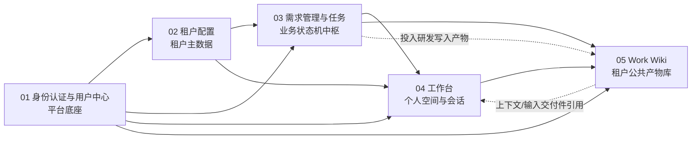
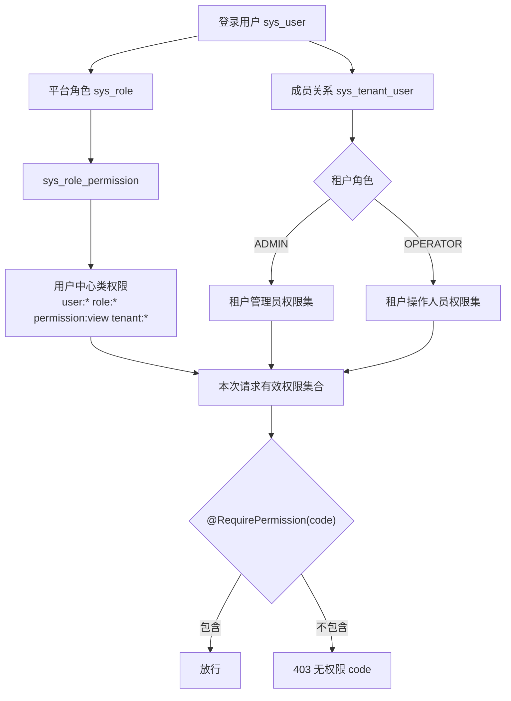
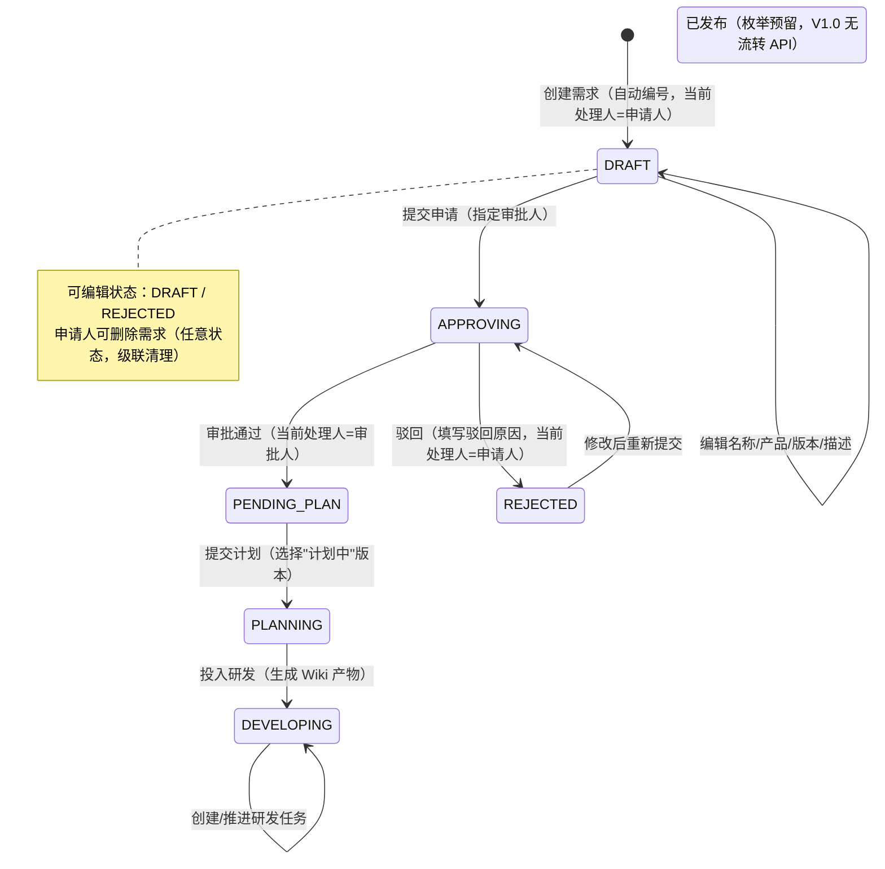
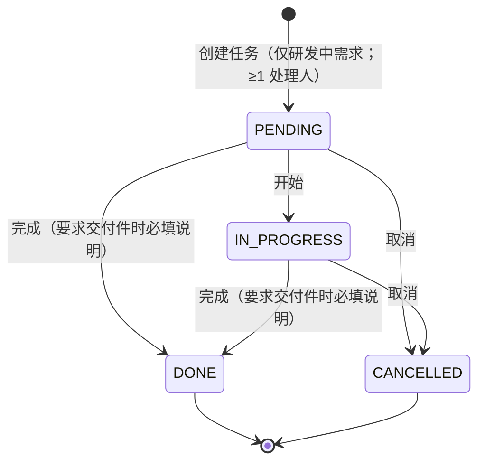
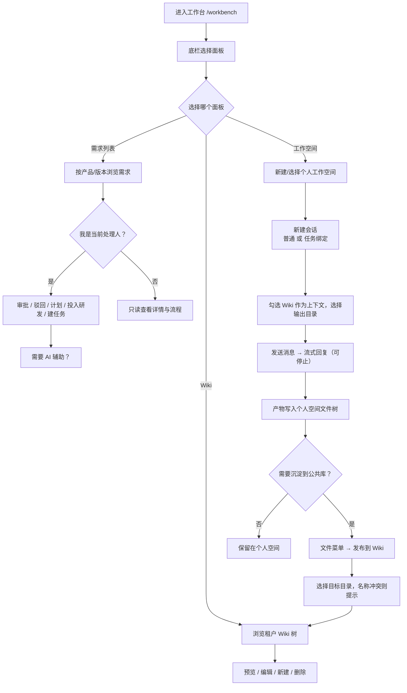
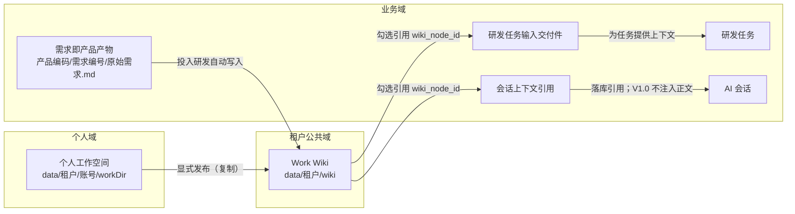
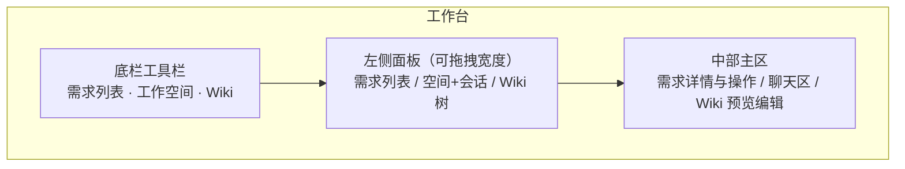

# DAP 研发流程平台 · 需求文档 V1.0

| 项 | 内容 |
|---|---|
| 文档名称 | DAP 研发流程平台 产品需求说明书（PRD） |
| 版本 | **V1.0** |
| 状态 | 已实现基线（与代码一致） |
| 适用范围 | 平台 V1.0 全部业务积木：01 身份认证与用户中心、02 租户配置、03 需求管理与任务、04 工作台个人空间与会话、05 Work Wiki |
| 编制依据 | `doc/需求/`、`doc/架构设计/`、`doc/详细设计/`、`doc/UI设计/` 与 `dap-server` / `dap-agent` / `dap-front` 源码 |
| 配套文档 | [架构设计 V1.0](./架构设计V1.0.md)、[详细设计 V1.0](./详细设计V1.0.md) |

---

## 目录

1. [概述](#1-概述)
2. [总体需求](#2-总体需求)
3. [角色、权限与多租户模型](#3-角色权限与多租户模型)
4. [端到端业务流程](#4-端到端业务流程)
5. [功能需求明细](#5-功能需求明细)
6. [业务规则汇总](#6-业务规则汇总)
7. [非功能需求](#7-非功能需求)
8. [状态与枚举字典](#8-状态与枚举字典)
9. [界面与交互需求](#9-界面与交互需求)
10. [验收标准](#10-验收标准)
11. [V1.0 不纳入范围与演进方向](#11-v10-不纳入范围与演进方向)
12. [附录：需求追溯矩阵](#12-附录需求追溯矩阵)

---

## 1. 概述

### 1.1 平台定位

DAP（Dev Agent Platform）是面向软件研发全流程的**多租户协作平台**：以「需求 → 审批 → 计划 → 投入研发 → 任务协同」为主干流程，把 AI 工作台（个人磁盘沙箱 + 大模型会话）与租户公共知识库（Work Wiki）嵌入到研发动作中，形成"需求驱动、AI 辅助、知识沉淀"的闭环。

平台由三个可独立部署的进程组成：`dap-front`（Web 前端）、`dap-server`（Java 业务后端）、`dap-agent`（Python 推理服务，仅内网可见）。

### 1.2 建设背景

| 痛点 | 平台解法 |
|---|---|
| 需求靠文档与口头流转，状态不可追溯 | 需求主数据 + 服务端状态机 + 流程留痕（`req_requirement_flow`） |
| 需求、计划、任务、产物分散在不同工具 | 需求下挂研发任务，任务输入直接引用 Wiki 文件 |
| AI 能力以个人工具形式存在，产物无法沉淀 | 个人工作空间落盘 + 一键发布到租户 Wiki |
| 多团队共用平台但数据需隔离 | 租户码隔离全部业务数据，租户角色独立于平台角色 |
| 公共知识（产品/需求产物）无统一落点 | 一租户一棵 Work Wiki，投入研发自动生成产物目录 |

### 1.3 建设目标

1. **统一身份与权限**：一套账号体系（JWT）+ 平台角色/租户角色双层授权，前端口令与后端校验同源。
2. **需求可管可追**：需求全状态流转由服务端裁决，任何状态变化留痕，编号全局可读（`{产品编码}-{年}-{5位序号}`）。
3. **任务可协同**：研发中需求支持多处理人任务，类型来自租户主数据，完成时可强制交付说明。
4. **AI 可落地**：每位用户在租户下拥有个人文件工作区，AI 会话把产出写入个人空间，可显式发布到租户 Wiki。
5. **知识可沉淀**：租户唯一公共 Wiki，既是会话上下文与任务输入的同源引用，也是投入研发的产物落点。

### 1.4 目标用户

| 角色 | 典型职责 | 主要使用模块 |
|---|---|---|
| 系统管理员（内置 `admin`） | 平台用户/角色/权限/租户维护 | 用户中心 |
| 租户管理员（`ADMIN`） | 租户成员、岗位技能、产品版本、任务类型、需求审批 | 租户配置 + 需求 + 工作台 |
| 租户操作人员（`OPERATOR`） | 提交需求、参与研发任务、使用 AI 工作台与 Wiki | 需求申请 + 工作台 |

### 1.5 术语表

| 术语 | 定义 |
|---|---|
| 平台角色 | `sys_role`，决定用户中心等**系统级**能力 |
| 租户角色 | `sys_tenant_user.tenant_role`，取值 `ADMIN` / `OPERATOR`，映射租户业务权限 |
| 当前租户 | 前端持久化、请求头 `X-Tenant-Id` 携带的租户，仅影响租户级业务 |
| 租户上下文 | 用户在租户下的岗位 + 技能选择（`sys_user_tenant_context`），注入 AI 提示词 |
| 个人工作空间 | `space_type=PERSONAL` 的用户私有磁盘区，路径 `data/{租户编码}/{账号}/{workDir}/` |
| Work Wiki | 租户级公共 Markdown 文件库，一租户一棵树，磁盘 `data/{租户编码}/wiki/` |
| 投入研发 | 需求 `PLANNING → DEVELOPING` 的动作，同时在 Wiki 生成产物目录 |
| 输入交付件 | 任务可选引用的 Wiki **文件**节点，用于向研发任务提供上下文 |
| 发布 | 个人空间文件复制到 Wiki 的显式操作（非自动同步） |
| 运行标识 runId | 一次 AI 流式生成的唯一标识，用于停止生成 |

---

## 2. 总体需求

### 2.1 业务积木划分与依赖

平台按 5 个业务积木交付，编号在需求/架构/详细设计中一一对应：

### 2.2 功能地图

```mermaid
graph TD
  ROOT["DAP 研发流程平台 V1.0"]

  ROOT --> A["身份认证与用户中心"]
  ROOT --> B["租户配置"]
  ROOT --> C["需求管理与任务"]
  ROOT --> D["工作台"]
  ROOT --> E["Work Wiki"]

  A --> A1["登录 / 登出 / 当前用户"]
  A --> A2["首页与顶栏导航"]
  A --> A3["用户管理"]
  A --> A4["角色管理"]
  A --> A5["权限管理（只读）"]
  A --> A6["租户管理（含成员）"]
  A --> A7["切换当前租户"]

  B --> B1["租户用户"]
  B --> B2["岗位与技能"]
  B --> B3["产品与版本"]
  B --> B4["需求任务类型"]
  B --> B5["我的岗位/技能上下文"]

  C --> C1["需求申请（本人）"]
  C --> C2["提交 / 审批 / 驳回"]
  C --> C3["提交计划"]
  C --> C4["投入研发 + 生成 Wiki 产物"]
  C --> C5["工作台需求待办/全部"]
  C --> C6["研发任务（多处理人）"]

  D --> D1["个人工作空间 CRUD"]
  D --> D2["文件树与 Markdown 编辑"]
  D --> D3["工作会话（普通/任务）"]
  D --> D4["SSE 流式对话与停止"]
  D --> D5["发布到 Wiki"]

  E --> E1["Wiki 树浏览与 CRUD"]
  E --> E2["Markdown 预览 / 编辑"]
  E --> E3["接收个人空间发布"]
  E --> E4["投入研发自动产物"]
```

### 2.3 版本范围

| 分类 | 内容 |
|---|---|
| **V1.0 包含** | 登录与用户中心全流程；租户主数据（成员/岗位/产品/任务类型/上下文）；需求申请至研发中全流转；工作台需求面板；个人工作空间与文件树（含版本快照/对比）；普通/任务会话与 **SSE 打字机流式对话**；会话内 **Agent 工具**（检索/读文档/写输出目录）；**工作步骤**进度展示；Markdown **划选复制**；Work Wiki 与发布；投入研发产物自动生成 |
| **V1.0 不包含** | SSO / 第三方登录；独立审计与日志中心；组织架构树；共享工作空间（已取消，由 Wiki 取代）；需求 `RELEASED` 的流转 API；将 Wiki 全文自动拼进 System Prompt（工具按需读取除外）；工作步骤落库；多 Wiki / 按岗位隔离 Wiki；Wiki 细粒度权限 |

---

## 3. 角色、权限与多租户模型

### 3.1 双层权限模型

权限校验的最终权限集合 = **平台角色权限** ∪ **租户角色权限**（仅当请求携带合法 `X-Tenant-Id` 且用户是该租户成员时并入）。

### 3.2 权限码清单

| 权限码 | 名称 | 归属模块 | 授予以谁 |
|---|---|---|---|
| `user:view` / `user:operate` | 用户查看 / 操作 | 用户管理 | 平台角色（系统管理员） |
| `role:view` / `role:operate` | 角色查看 / 操作 | 角色管理 | 平台角色 |
| `permission:view` | 权限查看 | 权限管理 | 平台角色 |
| `permission:operate` | 权限操作（**保留，不授予**） | 权限管理 | 无 |
| `tenant:view` / `tenant:operate` | 租户查看 / 操作 | 租户管理 | 平台角色 |
| `tenant-user:view` / `tenant-user:operate` | 租户用户排序查看 / 维护 | 租户配置 | 租户 ADMIN |
| `position:view` / `position:operate` | 岗位技能查看 / 维护 | 租户配置 | 租户 ADMIN |
| `product:view` / `product:operate` | 产品版本查看 / 维护 | 租户配置 | 租户 ADMIN |
| `workspace:view` / `workspace:operate` | 工作空间查看 / 维护（V1.0 保留） | 租户配置 | 租户 ADMIN |
| `req-task-type:view` / `req-task-type:operate` | 任务类型查看 / 维护 | 租户配置 | 租户 ADMIN |
| `requirement:view` / `requirement:operate` | 需求查看 / 维护 | 需求管理 | 租户 ADMIN、OPERATOR |
| `work:access` | 工作台访问（含 Wiki 读写） | 工作台 | 租户 ADMIN、OPERATOR |

**租户角色映射（实现口径）**

- `ADMIN`：`tenant-user:*`、`position:*`、`product:*`、`workspace:*`、`req-task-type:*`、`requirement:*`、`work:access`
- `OPERATOR`：`requirement:view/operate`、`work:access`

### 3.3 多租户隔离规则

| 规则 | 说明 |
|---|---|
| 数据隔离 | 所有租户业务表带 `tenant_id`，服务端以当前租户为过滤条件；跨租户访问一律返回"不存在" |
| 路径隔离 | 磁盘按 `data/{租户编码}/...` 分域；租户删除时整体清理该目录 |
| 上下文隔离 | 会话上下文、任务输入交付件必须引用**本租户** Wiki 节点 |
| 用户中心例外 | 用户中心 API **忽略** `X-Tenant-Id`，按系统级数据处理 |
| 未选租户 | 租户级接口返回"请先选择租户"；前端隐藏/拦截租户级菜单与路由 |

---

## 4. 端到端业务流程

### 4.1 需求全生命周期

**流程说明与权责**

| 步骤 | 操作者 | 前置状态 | 结果状态 | 副作用 |
|---|---|---|---|---|
| 创建 | 任意有 `requirement:operate` 且为本租户成员的用户 | — | `DRAFT` | 生成 `req_no`；当前处理人=创建人；写入相关人记录 |
| 编辑 | 创建人 | `DRAFT` / `REJECTED` | 不变 | 换产品时**重新生成**编号 |
| 提交 | 创建人 | `DRAFT` / `REJECTED` | `APPROVING` | 审批人默认为产品经理，可手选；必须为本租户成员；清空驳回原因；写流程节点 `SUBMIT` |
| 审批通过 | 当前处理人（审批人） | `APPROVING` | `PENDING_PLAN` | 写流程节点 `APPROVE` |
| 驳回 | 当前处理人（审批人） | `APPROVING` | `REJECTED` | 必填原因；当前处理人回到创建人；写流程节点 `REJECT` |
| 提交计划 | 当前处理人 | `PENDING_PLAN` | `PLANNING` | 所选版本必须属于该产品且状态为 `PLANNING`；记录发布版本号；写流程节点 `PLAN` |
| 投入研发 | 当前处理人 | `PLANNING` | `DEVELOPING` | 写流程节点 `DEVELOP`；在 Wiki 生成 `{产品编码}/{需求编号}/原始需求.md` |
| 删除 | 创建人 | 任意 | 已删除 | 任务、流程、相关人、输入交付件按外键级联清理 |

### 4.2 研发任务状态机

**任务操作权**：任务处理人、任务创建人、需求当前处理人、需求创建人四者之一即可开始/完成/取消；创建任务仅限需求当前处理人或需求创建人。任务类型取租户主数据中**启用**的类型；创建时快照类型编码/名称/是否要求交付件，后续主数据变更不影响历史任务。

### 4.3 AI 辅助研发协作主流程

### 4.4 知识流转视角

> 说明：V1.0 中会话上下文与任务输入仍**只落库引用**（`wiki_node_id` + 显示路径），System Prompt **不自动拼装** Wiki 全文。Agent 可通过工具（`search_docs` / `read_docs`）按需检索与读取 Wiki/工作空间材料，并通过 `write_output` 写入会话绑定的输出目录。

---

## 5. 功能需求明细

### 5.1 身份认证与用户中心（01）

#### 5.1.1 登录与登出

| ID | 需求 | 规则 | 优先级 |
|---|---|---|---|
| FR-01-01 | 用户名 + 密码登录，成功进入首页 | 密码 BCrypt 校验；签发 JWT（默认 24 小时） | P0 |
| FR-01-02 | 登录失败提示明确错误 | 统一提示"用户名或密码错误"；不自动选择租户 | P0 |
| FR-01-03 | 登出清除会话并回登录页 | 前端清 token/权限/当前租户 | P0 |
| FR-01-04 | 未登录访问业务路由重定向登录页 | 携带 `redirect` 参数；token 失效时自动跳登录 | P0 |

#### 5.1.2 首页与顶栏

| ID | 需求 | 规则 | 优先级 |
|---|---|---|---|
| FR-01-05 | 首页展示欢迎信息与当前用户 | 未选租户时用户中心仍可用 | P0 |
| FR-01-06 | 顶栏展示产品名、主导航、当前用户、租户切换器 | 导航项按权限与"是否已选租户"显隐 | P0 |
| FR-01-07 | 可切换当前租户 | 仅列出"已加入且已启用"的租户；切换后持久化 | P0 |
| FR-01-08 | 用户中心菜单按权限显隐 | 无任一子菜单权限时不显示侧栏 | P0 |

#### 5.1.3 用户管理

| ID | 需求 | 规则 | 优先级 |
|---|---|---|---|
| FR-01-09 | 用户列表 / 搜索 / 新建 / 编辑 / 删除 | 用户名全局唯一；3–32 位；仅字母数字下划线 | P0 |
| FR-01-10 | 密码哈希存储；创建与编辑可设密码 | 长度 6–64；只存 BCrypt 摘要 | P0 |
| FR-01-11 | 一人一平台角色；描述 ≤200 | 平台角色仅"系统管理员""系统操作人员"两个内置角色 | P0 |
| FR-01-12 | 内置用户 `admin` 不可删除；编辑仅可改密码 | 编辑时忽略用户名/角色/描述 | P0 |
| FR-01-13 | 不可删除当前登录用户 | 服务端拦截 | P0 |

#### 5.1.4 角色与权限

| ID | 需求 | 规则 | 优先级 |
|---|---|---|---|
| FR-01-14 | 角色 CRUD 并可配置权限码集合 | 名称唯一；内置角色标记 `builtin` | P0 |
| FR-01-15 | 权限列表只读 | `permission:operate` 保留不授予，前端无写入口 | P0 |

#### 5.1.5 租户管理

| ID | 需求 | 规则 | 优先级 |
|---|---|---|---|
| FR-01-16 | 租户 CRUD，编码唯一，可启停 | 编码创建后不可修改；状态仅 0/1 | P0 |
| FR-01-17 | 维护租户成员及租户角色（`ADMIN`/`OPERATOR`） | 成员必须是系统用户；创建/编辑租户时至少配置一名租户管理员；重置管理员时其余成员降级为 `OPERATOR` | P0 |
| FR-01-18 | 无预置租户 | 系统仅内置权限码、两个平台角色与 `admin` 账号 | P0 |

---

### 5.2 租户配置（02）

| ID | 需求 | 规则 | 优先级 |
|---|---|---|---|
| FR-02-01 | 列表当前租户成员 | 需 `tenant-user:view` | P1 |
| FR-02-02 | 添加/移除成员、设置租户角色 | 需 `tenant-user:operate`；候选用户来自系统用户 | P1 |
| FR-02-03 | 岗位 CRUD | 租户内名称唯一；名称 ≤64；描述 ≤200 | P1 |
| FR-02-04 | 岗位下技能增删改 | 岗位内名称唯一；支持排序号 | P1 |
| FR-02-05 | 岗位/技能被引用时删除需受约束 | 现有实现依赖数据库外键约束（被租户上下文引用时删除失败并报错），产品侧要求"禁止删除并给出明确提示" | P2 |
| FR-02-06 | 产品 CRUD | 产品名称与编码在租户内唯一；编码必填；可选产品经理 | P0 |
| FR-02-07 | 产品下版本维护 | 版本号在产品内唯一；状态 `PLANNING`/`RELEASED`/`INVALID`；`PLANNING` 版本需填计划发布时间；已关联需求的版本禁止删除 | P0 |
| FR-02-08 | 任务类型 CRUD | 编码租户内唯一；含是否要求交付件、交付件模板、启停 | P0 |
| FR-02-09 | 用户设置当前租户下岗位与多选技能（或自定义技能文案） | 岗位必填；至少一个技能或一段自定义技能文案；技能必须属于所选岗位 | P0 |
| FR-02-10 | 岗位/技能上下文注入 AI 会话提示词 | 见 FR-04-13 | P0 |

**权限放宽约定（实现口径）**

- 岗位列表/详情：具备 `position:view` **或** `work:access` 即可读（供工作台与上下文选择）。
- 产品列表/详情：具备 `product:view` **或** `requirement:view` 即可读（供需求申请选产品）。

---

### 5.3 需求管理与任务（03）

#### 5.3.1 需求主数据与流转

| ID | 需求 | 规则 | 优先级 |
|---|---|---|---|
| FR-03-01 | 创建/编辑需求：名称、描述、产品、产品版本 | 仅 `DRAFT`/`REJECTED` 可编辑；版本不能选 `INVALID`；名称 ≤128、描述必填 | P0 |
| FR-03-02 | 提交审批 | `DRAFT`/`REJECTED → APPROVING`；审批人必须为本租户成员 | P0 |
| FR-03-03 | 审批通过 / 驳回 | `APPROVING → PENDING_PLAN` / `REJECTED`；驳回必填原因；仅当前处理人可操作 | P0 |
| FR-03-04 | 提交计划 | `PENDING_PLAN → PLANNING`；必须选择该产品下状态为"计划中"的版本 | P0 |
| FR-03-05 | 投入研发 | `PLANNING → DEVELOPING`；在 Wiki 生成 `{产品编码}/{需求编号}/原始需求.md` | P0 |
| FR-03-06 | 删除需求 | 仅创建人；任意状态可删；任务/流程/相关人级联清理 | P1 |
| FR-03-07 | 自动编号 | `{产品编码}-{年}-{5位序号}`，按 产品+年 从 1 递增（序号表行锁保证并发安全）；换产品时重新生成 | P0 |
| FR-03-08 | 流程留痕 | 节点类型 `SUBMIT`/`APPROVE`/`REJECT`/`PLAN`/`DEVELOP`；记录前后状态、操作人、备注、扩展 JSON | P0 |

#### 5.3.2 列表与工作台

| ID | 需求 | 规则 | 优先级 |
|---|---|---|---|
| FR-03-09 | 需求申请页列表仅本人创建 | 需 `requirement:view` | P0 |
| FR-03-10 | 工作台需求面板：按产品/版本浏览，`scope=todo\|all` | 仅返回"当前处理人=我"的需求；按产品、版本、更新时间排序 | P0 |
| FR-03-11 | `todo` 不含草稿/驳回/已发布；`all` 额外包含已发布 | `todo` = APPROVING/PENDING_PLAN/PLANNING/DEVELOPING；`all` 再加 RELEASED | P1 |
| FR-03-12 | 需求详情可见性 | 创建人、当前处理人、审批人、或该需求下任务的处理人可查看 | P0 |

#### 5.3.3 研发任务

| ID | 需求 | 规则 | 优先级 |
|---|---|---|---|
| FR-03-13 | 仅 `DEVELOPING` 需求可创建任务 | 创建人须为需求当前处理人或需求创建人 | P0 |
| FR-03-14 | 多处理人 | 至少一名；每名必须为本租户成员；去重 | P0 |
| FR-03-15 | 可选输入交付件 | 只能勾选 **Wiki 文件**节点（不可选目录）；必须属于本租户 | P1 |
| FR-03-16 | 开始 / 完成 / 取消 | `PENDING→IN_PROGRESS→DONE`，或 →`CANCELLED`；`DONE`/`CANCELLED` 不可再变更 | P0 |
| FR-03-17 | 要求交付件时完成必须填写交付说明 | 依据任务类型快照的 `require_deliverable` | P0 |
| FR-03-18 | 任务类型来自任务类型主数据 | 仅可选择**启用**的类型；创建时快照编码/名称/交付件要求 | P1 |

---

### 5.4 工作台 · 个人空间与会话（04）

#### 5.4.1 工作台壳

| ID | 需求 | 规则 | 优先级 |
|---|---|---|---|
| FR-04-01 | 路由 `/workbench`，底栏含「需求列表 / 工作空间 / Wiki」 | 进入条件：`work:access` + 已选租户 | P0 |
| FR-04-02 | 切换底栏保留各自面板（实现允许重载） | 工作空间面板支持左/右栏拖拽调宽；中部以同级 Tab 承载「会话」与「打开的 md 文档」 | P1 |

#### 5.4.2 个人工作空间

| ID | 需求 | 规则 | 优先级 |
|---|---|---|---|
| FR-04-03 | 列表仅当前用户 `PERSONAL` 空间 | 按创建时间倒序 | P0 |
| FR-04-04 | 新建空间：名称英数下划线，服务端分配 workDir | 名称在租户内唯一；workDir 在同一「租户+所有者」下唯一，冲突自动加 `_1.._31`，仍冲突则 `ws_{12位随机}` | P0 |
| FR-04-05 | 删除空间：级联节点、会话、磁盘目录 | 前端二次确认 | P0 |
| FR-04-06 | 文件树：建目录/建 md、删除节点、打开编辑 | 显示名同级唯一；md 自动补 `.md` 后缀；删除目录递归删除子树；打开文件以中部 Tab 展示，默认预览、可切编辑 | P0 |
| FR-04-06a | md 文件版本与对比 | 保存覆盖时保留旧版快照；可查看修订列表；支持与上一版（或指定版本）并排 diff 高亮 | P1 |
| FR-04-07 | 磁盘路径与清单 | `data/{租户编码}/{账号}/{workDir}/`；文件用 UUID 存储名；根目录维护 `.dap/manifest.json` | P0 |
| FR-04-08 | 仅所有者可读写个人空间 | 跨用户访问返回 403；跨租户返回 404 | P0 |

> V1.0 **不含**上传文件接口（仅支持新建 Markdown 文件与目录）。前端 API 层保留的"引入需求到个人空间"接口在服务端**不存在**，属于历史残留，不作为需求。

#### 5.4.3 工作会话

| ID | 需求 | 规则 | 优先级 |
|---|---|---|---|
| FR-04-09 | 类型 `NORMAL` / `TASK` | `TASK` 必须选择需求与任务，且任务必须属于该需求；会话必须属于当前用户的个人空间 | P0 |
| FR-04-10 | 标题、输出目录 | 输出目录必须是本空间内的 `DIR`（可为根，存 `null`） | P0 |
| FR-04-11 | 上下文：勾选 Wiki 节点（`DIR`/`FILE`） | 只存引用：`wiki_node_id`、节点类型、显示路径；同会话内去重；必须属于本租户 Wiki | P1 |
| FR-04-12 | 会话列表按空间归属，仅本人可见 | 编辑会话会**整体替换**上下文集合 | P0 |

#### 5.4.4 聊天

| ID | 需求 | 规则 | 优先级 |
|---|---|---|---|
| FR-04-13 | SSE 流式回复（打字机），可停止生成 | 浏览器 → Java（SSE）→ Agent（SSE）；事件含 `meta`/`step`/`content`/`error`/`done`/`title`；生成中正文增量渲染，**无需刷新页面** | P0 |
| FR-04-13a | 输入交互 | `Enter` 发送；`Shift+Enter` 换行；生成中可点「停止」 | P0 |
| FR-04-13b | 工作步骤展示 | 流式过程展示可折叠「工作步骤」；进行中文案「处理中」，结束后「已处理 N秒」；明细含调模型/检索/读文件/写输出等摘要（不含大段正文）；**本轮仅会话内存展示，不落库** | P1 |
| FR-04-13c | 气泡布局 | 助手/用户气泡 `max-width` 固定上限，短文按内容收窄（`fit-content`） | P2 |
| FR-04-14 | 注入租户岗位/技能 + 历史消息 | 历史默认取最近 20 条、单条截断 8000 字符；System Prompt **不自动注入** Wiki 全文；需要时由 Agent 工具按需读取 | P0 |
| FR-04-14a | Agent 工作区工具 | 启用工具时下发材料索引；工具含 `search_docs`（检索）、`read_docs`（读 Wiki/工作空间文件）、`write_output`（写入本会话输出目录，同名覆盖并保留快照） | P0 |
| FR-04-15 | 消息持久化；助手内容 Markdown 渲染 | 助手消息先落库为 `streaming`，生成中每累计 >80 字符落一次库，最终 `done`/`stopped`/`error`；`step` 事件不写入消息正文 | P0 |
| FR-04-15a | Markdown 文本复制 | 会话与文档预览中可划选任意渲染文本（含代码块）；支持 Ctrl/Cmd+C 与右键复制；代码块提供一键复制纯文本 | P0 |
| FR-04-16 | 首次对话自动生成会话标题 | 标题为"新对话"或空时触发；Agent 生成失败则截断首问 30 字 | P1 |
| FR-04-17 | 无会话不能发消息 | 返回"请先在工作空间中创建会话"。停止接口需校验 runId 与 sessionId 归属 | P0 |

#### 5.4.5 发布入口

| ID | 需求 | 规则 | 优先级 |
|---|---|---|---|
| FR-04-18 | 个人空间 **FILE** 节点菜单「发布到 Wiki」 | 见 FR-05-06/07 | P1 |

---

### 5.5 Work Wiki（05）

| ID | 需求 | 规则 | 优先级 |
|---|---|---|---|
| FR-05-01 | 展示租户 Wiki 树 | 节点类型 `DIR`/`FILE`；目录在前、名称升序 | P0 |
| FR-05-02 | 根或目录下新建目录 / 新建 md | 显示名同级唯一；md 自动补后缀；名称禁含路径分隔符与 `..` | P0 |
| FR-05-03 | 删除节点（含子树） | 磁盘与记录同步清理；前端确认 | P0 |
| FR-05-04 | 打开文件默认预览，可切编辑，保存回预览 | Markdown 渲染并做 XSS 过滤 | P0 |
| FR-05-05 | 磁盘布局 | `data/{租户编码}/wiki/`；UUID 存储名；根 `.dap/manifest.json`（含 `tenantId`） | P0 |
| FR-05-06 | 仅个人空间 FILE 可发布到 Wiki | 复制内容，不在两处建立同步关系；只有本人、本租户的个人空间文件可发布 | P0 |
| FR-05-07 | 目标目录显示名冲突则失败并提示 | 不做覆盖/自动改名 | P0 |
| FR-05-08 | 投入研发写入 `{产品编码}/{需求编号}/原始需求.md` | 目录已存在则复用；文件内容含编号/名称/产品版本与描述 | P0 |
| FR-05-09 | 会话上下文与任务输入引用 `wiki_node_id` | 被引用节点删除时，引用随外键级联删除 | P1 |
| FR-05-10 | 权限 | 读写统一 `work:access` + 当前租户成员；不区分文件级权限 | P0 |

---

## 6. 业务规则汇总

| 编号 | 规则 |
|---|---|
| R-01 | 用户中心为系统级，接口忽略 `X-Tenant-Id`；切换租户不改变平台权限 |
| R-02 | 租户级接口必须携带合法 `X-Tenant-Id`，且用户为该租户成员，否则拒绝/忽略 |
| R-03 | 有效权限 = 平台角色权限 ∪ 租户角色权限；`permission:operate` 永不授予 |
| R-04 | 需求状态只能由服务端按状态机迁移，客户端不得直接改状态字段 |
| R-05 | 需求编号 `{产品编码}-{年}-{5位}`，并发下由序号表行锁保证唯一递增 |
| R-06 | 审批人、任务处理人、产品经理候选都必须属于当前租户 |
| R-07 | 计划所选发布版本必须属于该产品且状态为 `PLANNING` |
| R-08 | 投入研发必须生成 Wiki 产物；重复执行为幂等（目录已存在则复用） |
| R-09 | 个人空间节点的显示名与磁盘存储名分离；显示名同级唯一，存储名全局唯一（UUID） |
| R-10 | 节点变更后通过事务 `afterCommit` 重写 manifest；按对象加锁 + 临时文件原子替换 |
| R-11 | 删除个人空间/租户时同步清理磁盘；磁盘清理失败不阻塞数据库清理（尽力而为） |
| R-12 | 一租户一棵 Wiki；不做共享工作空间兼容 |
| R-13 | 发布是显式复制，不做双向同步；同名冲突即失败 |
| R-14 | 会话上下文与任务输入只能引用本租户 Wiki 节点；任务输入只能引用文件 |
| R-15 | Agent 服务不对浏览器暴露，仅 `dap-server` 通过内网 + `X-Internal-Token` 调用 |

---

## 7. 非功能需求

| 类别 | 要求 |
|---|---|
| 安全 | JWT 鉴权；密码 BCrypt 存储；权限码服务端注解校验 + 前端路由守卫双层；Agent 接口内网 token 校验；路径拼接必须校验落在数据根目录内（防目录穿越） |
| 多租户 | 所有租户数据按 `tenant_id` 过滤；磁盘按租户编码隔离 |
| 性能 | 常规 REST 列表接口 P95 < 500 ms（本地开发库基线）；对话首字节依赖上游模型；历史消息限制 20 条 / 单条 8000 字符以控制上下文开销 |
| 可用性 | 对话为长连接 SSE，需禁用代理缓冲；前端生成中可随时停止；Agent 不可用时返回明确错误 |
| 数据一致性 | 数据库为准，磁盘为从；manifest 供 Agent 消费；磁盘失败记录告警日志但不阻断主流程 |
| 可维护性 | 后端按业务模块分包；迁移脚本 Flyway 版本化；前后端权限码同源 |
| 兼容性 | Chrome/Edge 最新版；后端 Java 21 / Spring Boot 4.1；前端 Vue 3 + Element Plus |
| 可观测性 | 请求日志过滤器 + 业务关键日志（chat 起止、Agent 调用状态、manifest 写失败） |

---

## 8. 状态与枚举字典

| 枚举 | 取值 | 中文 | 备注 |
|---|---|---|---|
| 需求状态 | `DRAFT` | 草稿 | 可编辑，不进工作台待办 |
| | `APPROVING` | 审批中 | 当前处理人=审批人 |
| | `REJECTED` | 驳回 | 可编辑后重提，不进待办 |
| | `PENDING_PLAN` | 待计划 | 当前处理人=审批人 |
| | `PLANNING` | 计划中 | 已绑定发布版本 |
| | `DEVELOPING` | 研发中 | 可创建任务 |
| | `RELEASED` | 已发布 | **枚举预留，V1.0 无进入该状态的 API** |
| 任务状态 | `PENDING` | 待处理 | 可开始/直接完成/取消 |
| | `IN_PROGRESS` | 进行中 | 可完成/取消 |
| | `DONE` | 已完成 | 终态 |
| | `CANCELLED` | 已取消 | 终态 |
| 流程节点 | `SUBMIT` / `APPROVE` / `REJECT` / `PLAN` / `DEVELOP` | 提交申请 / 审批通过 / 驳回 / 提交计划 / 投入研发 | 写入 `req_requirement_flow` |
| 产品版本状态 | `PLANNING` / `RELEASED` / `INVALID` | 计划中 / 已发布 / 无效 | 计划动作只接受 `PLANNING`；创建需求不能选 `INVALID` |
| 会话类型 | `NORMAL` / `TASK` | 普通 / 任务 | `TASK` 需绑定需求与任务 |
| 节点类型 | `DIR` / `FILE` | 目录 / 文件 | 个人空间与 Wiki 共用 |
| 工作空间类型 | `SHARED` / `PERSONAL` | 共享 / 个人 | V1.0 仅使用 `PERSONAL`，`SHARED` 为兼容保留 |
| 租户状态 | `1` / `0` | 启用 / 停用 | 停用租户不出现在切换列表 |
| 租户角色 | `ADMIN` / `OPERATOR` | 租户管理员 / 租户操作人员 | 与平台角色独立 |

---

## 9. 界面与交互需求

### 9.1 页面清单

| 路由 | 页面 | 权限 | 需租户 | 说明 |
|---|---|---|---|---|
| `/login` | 登录 | 公开 | 否 | 已登录时自动跳首页 |
| `/home` | 首页 | 登录 | 否 | 欢迎信息、当前用户/租户 |
| `/user-center/users` | 用户管理 | `user:view` | 否 | 列表/搜索/CRUD |
| `/user-center/roles` | 角色管理 | `role:view` | 否 | CRUD + 权限勾选 |
| `/user-center/permissions` | 权限管理 | `permission:view` | 否 | 只读 |
| `/user-center/tenants` | 租户管理 | `tenant:view` | 否 | CRUD + 成员/管理员 |
| `/tenant-config/users` | 租户用户 | `tenant-user:view` | 是 | 成员与租户角色 |
| `/tenant-config/positions` | 岗位管理 | `position:view` | 是 | 岗位 + 技能 |
| `/tenant-config/products` | 产品管理 | `product:view` | 是 | 产品 + 版本 + 产品经理 |
| `/tenant-config/req-task-types` | 需求任务 | `req-task-type:view` | 是 | 任务类型主数据 |
| `/requirement/apply` | 需求申请 | `requirement:view` | 是 | 本人需求列表 + 表单 |
| `/workbench` | 工作台 | `work:access` | 是 | 底栏三面板 |

### 9.2 工作台布局

- 需求面板：产品 → 版本 → 需求三级树 + 详情（含流程时间线）+ 任务对话框（Wiki 树勾选输入交付件）。
- 工作空间面板：左「空间 + 会话」、中「会话/文档同级 Tab（聊天或 md 预览编辑）」、右「文件树」；左中右可拖宽；文件菜单提供发布与版本对比入口。
- Wiki 面板：左树、右侧默认 Markdown 预览，「编辑」切换文本域，保存回预览，内容区纵向撑满。

### 9.3 交互约束

| 场景 | 要求 |
|---|---|
| 无权限访问路由 | 重定向首页（不白屏、不报错页） |
| 未选租户访问租户级路由 | 重定向首页；顶栏隐藏租户级菜单 |
| 会话生成中 | 发送按钮进入停止态；可中途停止，已产出内容保留并标记 `stopped`；正文打字机增量展示；步骤条默认折叠为「处理中」 |
| 会话输入 | Enter 发送，Shift+Enter 换行 |
| 名称冲突 | 后端返回明确文案，前端 Toast 提示 |
| 破坏性操作 | 删除空间/节点/需求前二次确认 |
| 助手消息 | Markdown 渲染（过滤危险 HTML）；可划选复制；代码块可一键复制 |

---

## 10. 验收标准

### 10.1 身份认证与用户中心（01）

- [ ] `admin / admin` 可登录进入首页；错误密码提示明确。
- [ ] 用户/角色/权限/租户 CRUD 符合字段与内置约束（`admin` 不可删、不可删自己、密码 6–64）。
- [ ] 权限页无写操作入口。
- [ ] 切换租户后顶栏展示更新，用户中心列表**不受影响**。
- [ ] 未选租户时租户级菜单隐藏，用户中心仍可用。

### 10.2 租户配置（02）

- [ ] 未选租户无法进入 `/tenant-config/*`（路由与接口双重拦截）。
- [ ] 岗位、技能、产品、版本、任务类型 CRUD 可用且唯一性校验生效。
- [ ] 版本创建时"计划中"必须填发布时间；已关联需求的版本不可删。
- [ ] 上下文保存后，工作台对话可带出岗位与技能（提示词生效）。

### 10.3 需求管理与任务（03）

- [ ] 可走通 `创建 → 提交 → 通过 → 计划 → 投入研发`，每步状态与当前处理人正确。
- [ ] 需求编号形如 `{产品编码}-2026-00001`，同产品同年递增。
- [ ] 投入研发后 Wiki 出现 `{产品编码}/{需求编号}/原始需求.md`，重复投入不报错。
- [ ] 可建多处理人任务、勾选 Wiki 文件作为输入；要求交付件时未填说明无法完成。
- [ ] 工作台待办只显示"当前处理人=我"的需求；`todo` 不含草稿/驳回。
- [ ] 删除需求后任务与流程记录一并清理。
- [ ] 无「发布完成」等 V1.0 不可用入口。

### 10.4 工作台（04）

- [ ] 可建个人空间并在其中维护 md 树（新建目录/文件、删除、编辑保存）；打开文件以中部 Tab 预览/编辑。
- [ ] 可建普通会话与任务会话（任务会话必须绑定需求与任务）。
- [ ] 可发送消息获得**无需刷新**的打字机流式回复，可中途停止；刷新后历史消息完整。
- [ ] Enter 发送、Shift+Enter 换行可用。
- [ ] 生成中可见可折叠「工作步骤」（处理中 → 已处理 N秒）；展开可见读文件/检索/写输出等摘要。
- [ ] 任务会话中 Agent 可读取输入材料并写入输出目录；同名文件可对比上一版。
- [ ] 会话与文档预览中 Markdown 可划选复制；代码块可一键复制。
- [ ] 勾选 Wiki 上下文后，会话详情可见引用路径。
- [ ] 首次对话后会话标题自动生成并被持久化。
- [ ] 个人空间文件可发起「发布到 Wiki」。

### 10.5 Work Wiki（05）

- [ ] Wiki 树可完成新建目录/文件、删除子树、预览与编辑保存。
- [ ] 个人文件发布后出现在目标目录，同名冲突提示失败。
- [ ] 投入研发后可见产品编码目录与需求编号目录产物。
- [ ] 会话上下文与任务输入均可选择 Wiki 节点。

---

## 11. V1.0 不纳入范围与演进方向

| 项 | 现状 | 演进建议 |
|---|---|---|
| 需求 `RELEASED` 流转 | 枚举预留，无 API | 增加"发布完成"动作与版本闭环 |
| Wiki 全文自动注入 System Prompt | 已改为工具按需 `read_docs`；引用仍只落库 | 可选：会话构造时预读摘要并做 token 预算 |
| 工作步骤持久化 | 仅前端本轮内存展示 | 挂到助手消息扩展字段或独立步骤表，刷新可回看 |
| 共享工作空间 | 已取消，Wiki 取代 | 如确需协作空间，用 Wiki 目录 + 权限扩展实现 |
| 上传非 Markdown 文件 | 未实现（仅新建 md） | 增加上传、二进制存储、预览矩阵 |
| 岗位被引用时的删除提示 | 依赖数据库外键报错 | 服务层前置校验并给出明确文案 |
| 独立审计与操作日志查询 | 仅运行日志 | 增加审计表与查询页面 |

---

## 12. 附录：需求追溯矩阵

| 需求块 | 主要接口前缀 | 数据表 | 详细设计章节 |
|---|---|---|---|
| 01 认证与用户中心 | `/api/auth`、`/api/users`、`/api/roles`、`/api/permissions`、`/api/tenants` | `sys_user`、`sys_role`、`sys_permission`、`sys_role_permission`、`sys_tenant`、`sys_tenant_user` | 详设 §4.1、§5.1 |
| 02 租户配置 | `/api/tenant-users`、`/api/positions`、`/api/products`、`/api/req-task-types`、`/api/tenant/context` | `sys_position`、`sys_position_skill`、`sys_product`、`sys_product_version`、`sys_req_task_type`、`sys_user_tenant_context(_skill)` | 详设 §4.2、§5.2 |
| 03 需求与任务 | `/api/requirements` | `req_requirement`、`req_requirement_flow`、`req_requirement_handler`、`req_requirement_no_seq`、`req_requirement_task*` | 详设 §4.3、§5.3 |
| 04 工作台 | `/api/workbench/workspaces`、`/api/chat`、`/api/internal/agent` | `sys_workspace`、`sys_workspace_node`、`wb_chat_session`、`wb_session_context`、`wb_chat_message`（及文件修订快照） | 详设 §4.2～4.4、§8 |
| 05 Work Wiki | `/api/workbench/wiki` | `sys_wiki_node`、引用方 `wb_session_context`、`req_requirement_task_input` | 详设 §4.5、§5.5 |
